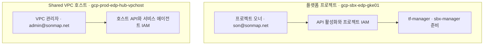
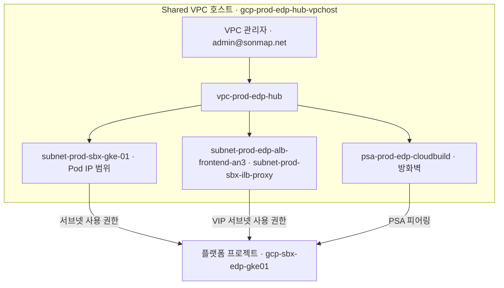
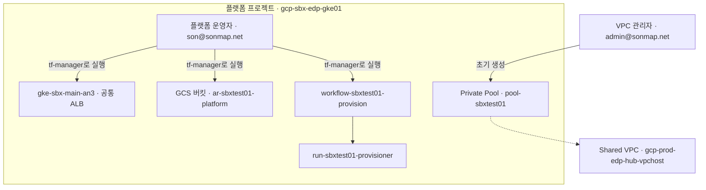
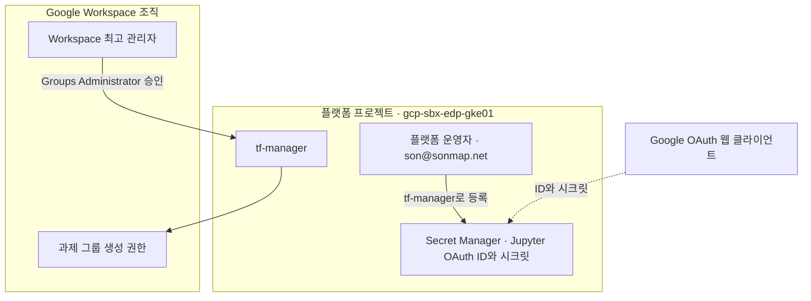
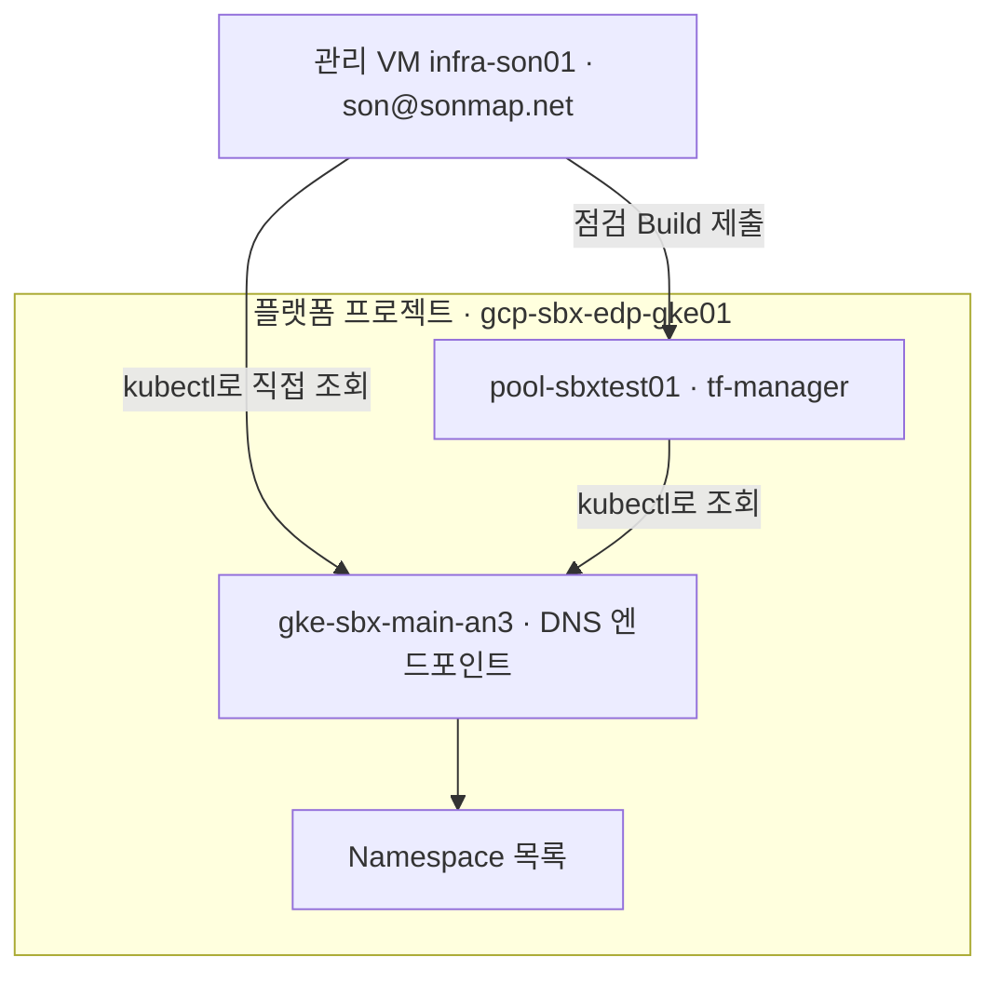
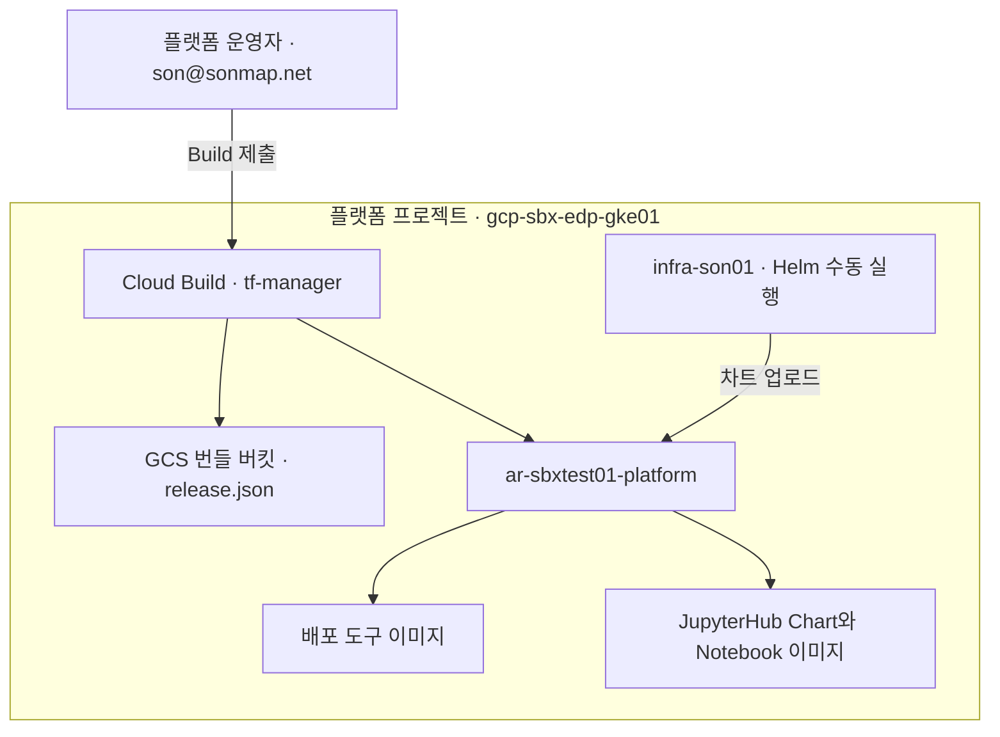
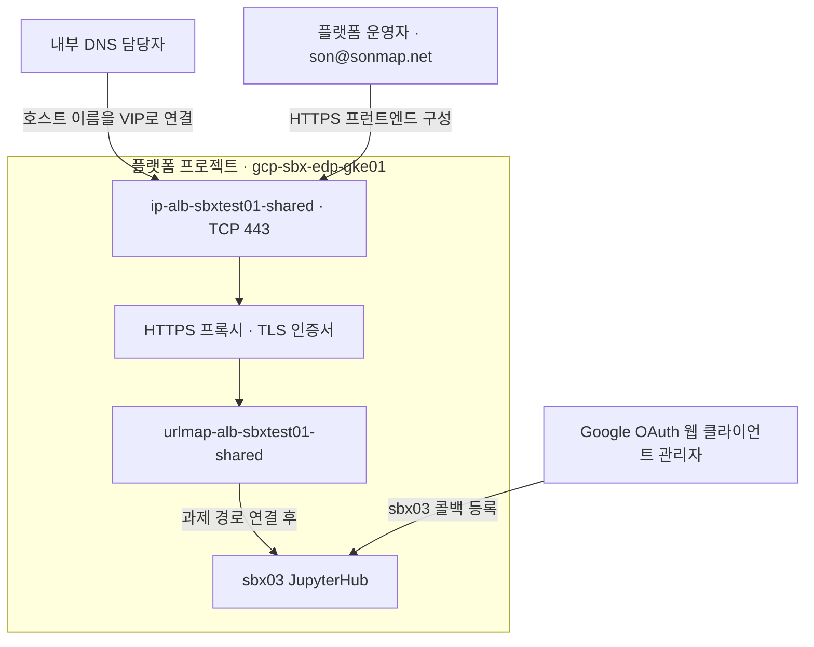

# 1차 인프라 만들기

1번부터 차례대로 진행하고, 명령 위에 적힌 창에서 한 줄씩 실행하세요.

| 담당 계정 | 실제 실행 위치 | 로그인 계정 | 작업 |
|---|---|---|---|
| 인프라관팀 Admin 계정 | 소유자 PC의 Bash | `admin@sonmap.net` | Shared VPC 호스트 설정, Private Pool 최초 생성 |
| 프로젝트소유 관리계정 | 관리 VM `infra-son01`의 별도 Bash | `son@sonmap.net` | 플랫폼 프로젝트 `gcp-sbx-edp-gke01`의 API·IAM·GKE·배포 작업 |

**실행 순서**는 1번 프로젝트소유 관리계정 → 인프라관팀 Admin 계정, 2번 인프라관팀 Admin 계정, 3번 프로젝트소유 관리계정 → 인프라관팀 Admin 계정 → 프로젝트소유 관리계정, 4~7번 프로젝트소유 관리계정입니다. Workspace 승인과 내부 DNS 작업은 해당 담당자가 별도로 수행합니다.

각 창에서 `gcloud auth list --filter=status:ACTIVE --format='value(account)'`로 계정을 먼저 확인하세요. 창을 바꿀 때는 해당 창의 기존 세션을 사용합니다. 이미 있는 자원은 조회 결과를 확인하고 생성 명령을 건너뜁니다. `403`이나 연결 오류가 나면 그 단계에서 멈춥니다.

**[프로젝트소유 관리계정] · `son@sonmap.net`**

```bash
cd ~/GCP_SBX_Test01
git status --short
git pull --ff-only
```

공통 인프라가 이미 있으면 **[2차 배포](02-sandbox-deploy.md)**로 이동합니다. GKE만 삭제했다면 [GKE 복구 순서](reference/sbx03-new-project-runbook.md#6-실제-작업-기록과-다음-테스트-순서)를 따릅니다.

## 1. 작업에 쓸 계정과 권한 만들기



**실행:** 플랫폼 프로젝트의 API·계정·IAM은 `GKE_PRJ_ACCOUNT` (`son@sonmap.net`)로 실행합니다. Shared VPC 호스트는 `VPC_ADMIN_ACCOUNT`를 사용하며, 기본값은 `ADMIN_ACCOUNT` (`admin@sonmap.net`)입니다.  
**다음으로:** `tf-manager`와 `sbx-manager`가 조회되고 API·권한 설정이 완료되면 2번으로 이동합니다.

<details>
<summary>1번 명령 보기 · 프로젝트소유 관리계정에서 플랫폼 설정 → 인프라관팀 Admin 계정에서 호스트 설정</summary>

**[프로젝트소유 관리계정] · `son@sonmap.net`** · 먼저 플랫폼 API·서비스 계정·IAM을 설정합니다.

```bash
unset CLOUDSDK_AUTH_IMPERSONATE_SERVICE_ACCOUNT
export ADMIN_ACCOUNT="admin@sonmap.net"
export GKE_PRJ_ACCOUNT="son@sonmap.net"
# 실행 프로젝트 작업자는 son, Shared VPC·초기 권한 관리자는 admin으로 구분합니다.
export VPC_ADMIN_ACCOUNT="${VPC_ADMIN_ACCOUNT:-${ADMIN_ACCOUNT}}"
export OPERATOR_MEMBER=user:son@sonmap.net
export SBX_GKE_PROJECT="gcp-sbx-edp-gke01"
export VPC_HOST_PROJECT="gcp-prod-edp-hub-vpchost"
export TF_MANAGER="tf-manager@${SBX_GKE_PROJECT}.iam.gserviceaccount.com"
export SBX_MANAGER="sbx-manager@${SBX_GKE_PROJECT}.iam.gserviceaccount.com"
export SBX_GKE_PROJECT_NUMBER="$(gcloud projects describe "${SBX_GKE_PROJECT}" --account="${GKE_PRJ_ACCOUNT}" --format='value(projectNumber)')"
# 프로젝트 번호는 자동 조회합니다. 조회 실패 또는 숫자가 아닌 결과이면 이후 명령을 중단합니다.

# ── 1. 필요한 API 활성화 — CI/CD · Shared VPC Host · GKE 프로젝트 ──
gcloud services enable servicenetworking.googleapis.com serviceusage.googleapis.com iam.googleapis.com iamcredentials.googleapis.com compute.googleapis.com container.googleapis.com cloudbuild.googleapis.com config.googleapis.com run.googleapis.com workflows.googleapis.com artifactregistry.googleapis.com secretmanager.googleapis.com storage.googleapis.com logging.googleapis.com cloudresourcemanager.googleapis.com cloudbilling.googleapis.com cloudidentity.googleapis.com --project="${SBX_GKE_PROJECT}" --account="${GKE_PRJ_ACCOUNT}"
gcloud services enable container.googleapis.com compute.googleapis.com iam.googleapis.com iamcredentials.googleapis.com cloudresourcemanager.googleapis.com orgpolicy.googleapis.com --project="${SBX_GKE_PROJECT}" --account="${GKE_PRJ_ACCOUNT}"

# ── 2. Google 서비스 에이전트 준비 — API별로 필요한 시스템 계정 ──
gcloud beta services identity create --service=cloudbuild.googleapis.com --project="${SBX_GKE_PROJECT}" --account="${GKE_PRJ_ACCOUNT}"
gcloud beta services identity create --service=servicenetworking.googleapis.com --project="${SBX_GKE_PROJECT}" --account="${GKE_PRJ_ACCOUNT}"
gcloud beta services identity create --service=config.googleapis.com --project="${SBX_GKE_PROJECT}" --account="${GKE_PRJ_ACCOUNT}"
gcloud beta services identity create --service=run.googleapis.com --project="${SBX_GKE_PROJECT}" --account="${GKE_PRJ_ACCOUNT}"
gcloud beta services identity create --service=workflows.googleapis.com --project="${SBX_GKE_PROJECT}" --account="${GKE_PRJ_ACCOUNT}"
gcloud beta services identity create --service=container.googleapis.com --project="${SBX_GKE_PROJECT}" --account="${GKE_PRJ_ACCOUNT}"

# Service Networking 시스템 계정의 역할은 사용자 계정에 부여하지 않습니다.
gcloud projects add-iam-policy-binding "${SBX_GKE_PROJECT}" --member="serviceAccount:service-${SBX_GKE_PROJECT_NUMBER}@service-networking.iam.gserviceaccount.com" --role=roles/servicenetworking.serviceAgent --condition=None --account="${GKE_PRJ_ACCOUNT}"

# ── 3. 사용자 관리 서비스 계정 — sbx-manager · tf-manager ──

# sbx-manager: 조회 성공(이미 존재)이면 바로 다음 create 한 줄은 건너뜁니다.
# 명시적 Not Found일 때만 create를 실행합니다. 403·인증·연결 오류면 중단합니다.
gcloud iam service-accounts describe "${SBX_MANAGER}" --project="${SBX_GKE_PROJECT}" --format=json --account="${GKE_PRJ_ACCOUNT}"
gcloud iam service-accounts create sbx-manager --project="${SBX_GKE_PROJECT}" --display-name=sbx_manager --account="${GKE_PRJ_ACCOUNT}"

# tf-manager: 조회 성공(이미 존재)이면 바로 다음 create 한 줄은 건너뜁니다.
# 명시적 Not Found일 때만 create를 실행합니다. 403·인증·연결 오류면 중단합니다.
gcloud iam service-accounts describe "${TF_MANAGER}" --project="${SBX_GKE_PROJECT}" --format=json --account="${GKE_PRJ_ACCOUNT}"
gcloud iam service-accounts create tf-manager --project="${SBX_GKE_PROJECT}" --display-name=tf_manager --account="${GKE_PRJ_ACCOUNT}"

# ── 4. tf-manager 권한 — CI/CD 기반 구축 · Build · Infrastructure Manager ──
gcloud projects add-iam-policy-binding "${SBX_GKE_PROJECT}" --member="serviceAccount:${TF_MANAGER}" --role=roles/serviceusage.serviceUsageAdmin --condition=None --account="${GKE_PRJ_ACCOUNT}"
gcloud projects add-iam-policy-binding "${SBX_GKE_PROJECT}" --member="serviceAccount:${TF_MANAGER}" --role=roles/iam.serviceAccountAdmin --condition=None --account="${GKE_PRJ_ACCOUNT}"
gcloud projects add-iam-policy-binding "${SBX_GKE_PROJECT}" --member="serviceAccount:${TF_MANAGER}" --role=roles/resourcemanager.projectIamAdmin --condition=None --account="${GKE_PRJ_ACCOUNT}"
gcloud projects add-iam-policy-binding "${SBX_GKE_PROJECT}" --member="serviceAccount:${TF_MANAGER}" --role=roles/storage.admin --condition=None --account="${GKE_PRJ_ACCOUNT}"
gcloud projects add-iam-policy-binding "${SBX_GKE_PROJECT}" --member="serviceAccount:${TF_MANAGER}" --role=roles/secretmanager.admin --condition=None --account="${GKE_PRJ_ACCOUNT}"
gcloud projects add-iam-policy-binding "${SBX_GKE_PROJECT}" --member="serviceAccount:${TF_MANAGER}" --role=roles/artifactregistry.admin --condition=None --account="${GKE_PRJ_ACCOUNT}"
gcloud projects add-iam-policy-binding "${SBX_GKE_PROJECT}" --member="serviceAccount:${TF_MANAGER}" --role=roles/cloudbuild.builds.editor --condition=None --account="${GKE_PRJ_ACCOUNT}"
gcloud projects add-iam-policy-binding "${SBX_GKE_PROJECT}" --member="serviceAccount:${TF_MANAGER}" --role=roles/cloudbuild.workerPoolUser --condition=None --account="${GKE_PRJ_ACCOUNT}"
gcloud projects add-iam-policy-binding "${SBX_GKE_PROJECT}" --member="serviceAccount:${TF_MANAGER}" --role=roles/config.admin --condition=None --account="${GKE_PRJ_ACCOUNT}"
gcloud projects add-iam-policy-binding "${SBX_GKE_PROJECT}" --member="serviceAccount:${TF_MANAGER}" --role=roles/config.agent --condition=None --account="${GKE_PRJ_ACCOUNT}"
gcloud projects add-iam-policy-binding "${SBX_GKE_PROJECT}" --member="serviceAccount:${TF_MANAGER}" --role=roles/run.admin --condition=None --account="${GKE_PRJ_ACCOUNT}"
gcloud projects add-iam-policy-binding "${SBX_GKE_PROJECT}" --member="serviceAccount:${TF_MANAGER}" --role=roles/workflows.admin --condition=None --account="${GKE_PRJ_ACCOUNT}"
gcloud projects add-iam-policy-binding "${SBX_GKE_PROJECT}" --member="serviceAccount:${TF_MANAGER}" --role=roles/container.admin --condition=None --account="${GKE_PRJ_ACCOUNT}"
gcloud projects add-iam-policy-binding "${SBX_GKE_PROJECT}" --member="serviceAccount:${TF_MANAGER}" --role=roles/compute.viewer --condition=None --account="${GKE_PRJ_ACCOUNT}"
gcloud projects add-iam-policy-binding "${SBX_GKE_PROJECT}" --member="serviceAccount:${TF_MANAGER}" --role=roles/logging.logWriter --condition=None --account="${GKE_PRJ_ACCOUNT}"
gcloud projects add-iam-policy-binding "${SBX_GKE_PROJECT}" --member="serviceAccount:${TF_MANAGER}" --role=roles/serviceusage.serviceUsageConsumer --condition=None --account="${GKE_PRJ_ACCOUNT}"

# ── 5. sbx-manager 권한 — 요청 처리 · Workflow · Build 제출 ──
gcloud projects add-iam-policy-binding "${SBX_GKE_PROJECT}" --member="serviceAccount:${SBX_MANAGER}" --role=roles/cloudbuild.builds.editor --condition=None --account="${GKE_PRJ_ACCOUNT}"
gcloud projects add-iam-policy-binding "${SBX_GKE_PROJECT}" --member="serviceAccount:${SBX_MANAGER}" --role=roles/cloudbuild.workerPoolUser --condition=None --account="${GKE_PRJ_ACCOUNT}"
gcloud projects add-iam-policy-binding "${SBX_GKE_PROJECT}" --member="serviceAccount:${SBX_MANAGER}" --role=roles/workflows.invoker --condition=None --account="${GKE_PRJ_ACCOUNT}"
gcloud projects add-iam-policy-binding "${SBX_GKE_PROJECT}" --member="serviceAccount:${SBX_MANAGER}" --role=roles/logging.logWriter --condition=None --account="${GKE_PRJ_ACCOUNT}"
gcloud projects add-iam-policy-binding "${SBX_GKE_PROJECT}" --member="serviceAccount:${SBX_MANAGER}" --role=roles/serviceusage.serviceUsageConsumer --condition=None --account="${GKE_PRJ_ACCOUNT}"

# VPC Admin은 Host 네트워크 관리 권한을 이미 보유한 계정입니다.
# Pool 자원은 gcp-sbx-edp-gke01에 생성하므로 해당 프로젝트의 초기 Pool 관리 권한을 부여합니다.
gcloud projects add-iam-policy-binding "${SBX_GKE_PROJECT}" --member="user:${VPC_ADMIN_ACCOUNT}" --role=roles/cloudbuild.workerPoolOwner --condition=None --account="${GKE_PRJ_ACCOUNT}"
gcloud projects add-iam-policy-binding "${SBX_GKE_PROJECT}" --member="user:${VPC_ADMIN_ACCOUNT}" --role=roles/serviceusage.serviceUsageConsumer --condition=None --account="${GKE_PRJ_ACCOUNT}"

# ── 7. tf-manager 권한 — GKE · 공통 로드밸런서 ──
gcloud projects add-iam-policy-binding "${SBX_GKE_PROJECT}" --member="serviceAccount:${TF_MANAGER}" --role=roles/compute.loadBalancerAdmin --condition=None --account="${GKE_PRJ_ACCOUNT}"

# ── 8. 서비스 계정 사용·위임 권한 — 운영자 · 두 계정 · 서비스 에이전트 ──
gcloud iam service-accounts add-iam-policy-binding "${TF_MANAGER}" --project="${SBX_GKE_PROJECT}" --member="${OPERATOR_MEMBER}" --role=roles/iam.serviceAccountTokenCreator --condition=None --account="${GKE_PRJ_ACCOUNT}"
gcloud iam service-accounts add-iam-policy-binding "${SBX_MANAGER}" --project="${SBX_GKE_PROJECT}" --member="${OPERATOR_MEMBER}" --role=roles/iam.serviceAccountTokenCreator --condition=None --account="${GKE_PRJ_ACCOUNT}"
gcloud iam service-accounts add-iam-policy-binding "${TF_MANAGER}" --project="${SBX_GKE_PROJECT}" --member="${OPERATOR_MEMBER}" --role=roles/iam.serviceAccountUser --condition=None --account="${GKE_PRJ_ACCOUNT}"
gcloud iam service-accounts add-iam-policy-binding "${SBX_MANAGER}" --project="${SBX_GKE_PROJECT}" --member="serviceAccount:${TF_MANAGER}" --role=roles/iam.serviceAccountUser --condition=None --account="${GKE_PRJ_ACCOUNT}"
gcloud iam service-accounts add-iam-policy-binding "${TF_MANAGER}" --project="${SBX_GKE_PROJECT}" --member="serviceAccount:${SBX_MANAGER}" --role=roles/iam.serviceAccountUser --condition=None --account="${GKE_PRJ_ACCOUNT}"
gcloud iam service-accounts add-iam-policy-binding "${TF_MANAGER}" --project="${SBX_GKE_PROJECT}" --member="serviceAccount:${TF_MANAGER}" --role=roles/iam.serviceAccountUser --condition=None --account="${GKE_PRJ_ACCOUNT}"
gcloud iam service-accounts add-iam-policy-binding "${TF_MANAGER}" --project="${SBX_GKE_PROJECT}" --member="serviceAccount:${TF_MANAGER}" --role=roles/iam.serviceAccountTokenCreator --condition=None --account="${GKE_PRJ_ACCOUNT}"
gcloud iam service-accounts add-iam-policy-binding "${TF_MANAGER}" --project="${SBX_GKE_PROJECT}" --member="serviceAccount:service-${SBX_GKE_PROJECT_NUMBER}@gcp-sa-config.iam.gserviceaccount.com" --role=roles/iam.serviceAccountUser --condition=None --account="${GKE_PRJ_ACCOUNT}"
gcloud iam service-accounts add-iam-policy-binding "${TF_MANAGER}" --project="${SBX_GKE_PROJECT}" --member="serviceAccount:service-${SBX_GKE_PROJECT_NUMBER}@gcp-sa-cloudbuild.iam.gserviceaccount.com" --role=roles/iam.serviceAccountTokenCreator --condition=None --account="${GKE_PRJ_ACCOUNT}"

# ── 11. GCP 서비스 에이전트 권한 — Shared VPC 사용 ──

# ── 12. GKE 노드 기본 계정 권한 — 노드 실행 · tf-manager의 계정 사용 ──
gcloud projects add-iam-policy-binding "${SBX_GKE_PROJECT}" --member="serviceAccount:${SBX_GKE_PROJECT_NUMBER}-compute@developer.gserviceaccount.com" --role=roles/container.defaultNodeServiceAccount --condition=None --account="${GKE_PRJ_ACCOUNT}"
gcloud iam service-accounts add-iam-policy-binding "${SBX_GKE_PROJECT_NUMBER}-compute@developer.gserviceaccount.com" --project="${SBX_GKE_PROJECT}" --member="serviceAccount:${TF_MANAGER}" --role=roles/iam.serviceAccountUser --condition=None --account="${GKE_PRJ_ACCOUNT}"

# ── Cloud Identity 그룹 관리자 역할 직접 부여에 사용할 서비스 계정 Unique ID ──
# Workspace 최고 관리자는 tf-manager에 Groups Administrator 역할을 직접 부여합니다.
# GCP IAM 역할과 별개이며 사용자 대신 실행하는 Domain-wide Delegation은 사용하지 않습니다.
gcloud iam service-accounts describe "${TF_MANAGER}" --project="${SBX_GKE_PROJECT}" --account="${GKE_PRJ_ACCOUNT}" --format='value(uniqueId)'


printf '플랫폼 프로젝트 번호: %s\n' "${SBX_GKE_PROJECT_NUMBER}"
```

**[인프라관팀 Admin 계정] · `admin@sonmap.net`** · 프로젝트소유 관리계정에 나온 플랫폼 프로젝트 번호만 옮겨 입력합니다. 숫자가 비어 있거나 다르면 중단하세요.

```bash
unset CLOUDSDK_AUTH_IMPERSONATE_SERVICE_ACCOUNT
export ADMIN_ACCOUNT="admin@sonmap.net"
export VPC_ADMIN_ACCOUNT="${VPC_ADMIN_ACCOUNT:-${ADMIN_ACCOUNT}}"
export SBX_GKE_PROJECT="gcp-sbx-edp-gke01"
export VPC_HOST_PROJECT="gcp-prod-edp-hub-vpchost"
export TF_MANAGER="tf-manager@${SBX_GKE_PROJECT}.iam.gserviceaccount.com"
read -r -p '프로젝트소유 관리계정에 출력된 플랫폼 프로젝트 번호: ' SBX_GKE_PROJECT_NUMBER
[[ "${SBX_GKE_PROJECT_NUMBER}" =~ ^[0-9]+$ ]]
gcloud services enable compute.googleapis.com container.googleapis.com servicenetworking.googleapis.com --project="${VPC_HOST_PROJECT}" --account="${VPC_ADMIN_ACCOUNT}"
gcloud beta services identity create --service=container.googleapis.com --project="${VPC_HOST_PROJECT}" --account="${VPC_ADMIN_ACCOUNT}"
# 호스트 PSA 조회 오류 시 Service Networking 에이전트 역할도 확인합니다.
gcloud beta services identity create --service=servicenetworking.googleapis.com --project="${VPC_HOST_PROJECT}" --account="${VPC_ADMIN_ACCOUNT}"
export VPC_HOST_PROJECT_NUMBER="$(gcloud projects describe "${VPC_HOST_PROJECT}" --account="${VPC_ADMIN_ACCOUNT}" --format='value(projectNumber)')"
gcloud projects add-iam-policy-binding "${VPC_HOST_PROJECT}" --member="serviceAccount:service-${VPC_HOST_PROJECT_NUMBER}@service-networking.iam.gserviceaccount.com" --role=roles/servicenetworking.serviceAgent --condition=None --account="${VPC_ADMIN_ACCOUNT}"
# tf-manager에는 Host 전체 Network User/Network Admin/Security Admin을 부여하지 않습니다.
# 서브넷 사용 권한은 서브넷 생성 후 02-subnet-iam.md에서 부여합니다.
gcloud projects add-iam-policy-binding "${VPC_HOST_PROJECT}" --member="serviceAccount:${TF_MANAGER}" --role=roles/compute.networkViewer --condition=None --account="${VPC_ADMIN_ACCOUNT}"
gcloud projects add-iam-policy-binding "${VPC_HOST_PROJECT}" --member="serviceAccount:${TF_MANAGER}" --role=roles/serviceusage.serviceUsageConsumer --condition=None --account="${VPC_ADMIN_ACCOUNT}"
gcloud projects add-iam-policy-binding "${VPC_HOST_PROJECT}" --member="serviceAccount:service-${SBX_GKE_PROJECT_NUMBER}@container-engine-robot.iam.gserviceaccount.com" --role=roles/container.hostServiceAgentUser --condition=None --account="${VPC_ADMIN_ACCOUNT}"
```

</details>

## 2. GKE와 ALB가 사용할 네트워크 준비



**실행:** 인프라관팀 Admin 계정의 VPC 관리자 `admin@sonmap.net`.  
**다음으로:** Shared VPC 연결, 서브넷, PSA 피어링, 방화벽, 서브넷 사용 권한을 확인합니다.

<details>
<summary>2번 명령 보기 · 네트워크와 서브넷 권한</summary>

**[인프라관팀 Admin 계정] · `admin@sonmap.net`**

```bash
# ── 이 문서에서 사용하는 변수 선언 ──
# 인프라관팀 Admin 계정에서 실행합니다.
unset CLOUDSDK_AUTH_IMPERSONATE_SERVICE_ACCOUNT
export ADMIN_ACCOUNT="admin@sonmap.net"
# 실행 프로젝트 작업자는 son, Shared VPC·초기 권한 관리자는 admin으로 구분합니다.
export VPC_ADMIN_ACCOUNT="${VPC_ADMIN_ACCOUNT:-${ADMIN_ACCOUNT}}"
export SBX_GKE_PROJECT="gcp-sbx-edp-gke01"
export VPC_HOST_PROJECT="gcp-prod-edp-hub-vpchost"
export REGION=asia-northeast3
export NETWORK=vpc-prod-edp-hub
# 내부 ALB 대역 후보: VPC Admin의 실제 중복 확인·승인 후 실행합니다.
export ILB_VIP_SUBNET=subnet-prod-edp-alb-frontend-an3
export ILB_VIP_CIDR=172.31.96.0/27
export ILB_VIP_ADDRESS="" # 예약 후 실제 할당 주소 조회
export ILB_PROXY_SUBNET=subnet-prod-sbx-ilb-proxy
export ILB_PROXY_CIDR=172.31.111.64/26
export MAIN_SUBNET=subnet-prod-sbx-gke-01
export MAIN_NODE_CIDR=10.252.0.0/24
export MAIN_POD_RANGE=subnet-prod-sbx-pod-01
export MAIN_POD_CIDR=100.64.128.0/19
export PSA_NAME=psa-prod-edp-cloudbuild
export PSA_ADDRESS="10.250.0.0"
export PSA_PREFIX_LENGTH="24"
# 이 문서는 VPC Admin 계정으로 수행합니다. 초기 Shared VPC 연결·Subnet·방화벽·PSA를 관리할 권한이 필요합니다.
# 완료 후 02-subnet-iam.md를 수행한 뒤 03-foundation.md로 진행합니다.

# 먼저 기존 Primary/Secondary 대역을 확인합니다.
# Node · Pod · Control Plane · PSA 대역이 겹치거나 기존 설정과 다르면 중단합니다.

# ── 기존 대역 먼저 확인 ──
gcloud compute networks subnets list --project="${VPC_HOST_PROJECT}" --format=json --account="${VPC_ADMIN_ACCOUNT}"

# ── 1. compute networks create vpc-prod-edp-hub ──
# 기존 자원 확인
gcloud compute networks describe "${NETWORK}" --project="${VPC_HOST_PROJECT}" --format=json --account="${VPC_ADMIN_ACCOUNT}"
# 조회 결과가 명시적 Not Found일 때만 아래 생성 명령을 실행합니다.
# 기존 자원 확인값: {"autoCreateSubnetworks": false} — 다르면 중단합니다.
gcloud compute networks create "${NETWORK}" --project="${VPC_HOST_PROJECT}" --subnet-mode=custom --account="${VPC_ADMIN_ACCOUNT}"

# ── 2. compute shared-vpc get-host-project gcp-prod-edp-hub-vpchost ──
# 기존 자원 확인
gcloud compute shared-vpc get-host-project "${VPC_HOST_PROJECT}" --format=json --account="${VPC_ADMIN_ACCOUNT}"

# ── 3. compute shared-vpc enable gcp-prod-edp-hub-vpchost ──
# 앞의 조회에서 이미 같은 Host에 연결되어 있으면 아래 명령은 건너뜁니다. 다른 Host면 중단합니다.
gcloud compute shared-vpc enable "${VPC_HOST_PROJECT}" --account="${VPC_ADMIN_ACCOUNT}"

# ── 4. compute shared-vpc get-host-project gcp-sbx-edp-gke01 ──
# 기존 자원 확인
gcloud compute shared-vpc get-host-project "${SBX_GKE_PROJECT}" --format=json --account="${VPC_ADMIN_ACCOUNT}"

# ── 5. compute shared-vpc associated-projects add gcp-sbx-edp-gke01 ──
# 앞의 조회에서 이미 같은 Host에 연결되어 있으면 아래 명령은 건너뜁니다. 다른 Host면 중단합니다.
gcloud compute shared-vpc associated-projects add "${SBX_GKE_PROJECT}" --host-project="${VPC_HOST_PROJECT}" --account="${VPC_ADMIN_ACCOUNT}"

# ── 6. compute networks subnets create subnet-prod-sbx-gke-01 ──
# 기존 자원 확인
gcloud compute networks subnets describe "${MAIN_SUBNET}" --project="${VPC_HOST_PROJECT}" --region="${REGION}" --format=json --account="${VPC_ADMIN_ACCOUNT}"
# 조회 결과가 명시적 Not Found일 때만 아래 생성 명령을 실행합니다.
# 기존 자원 확인값: {"ipCidrRange": "10.252.0.0/24", "network": "https://www.googleapis.com/compute/v1/projects/gcp-prod-edp-hub-vpchost/global/networks/vpc-prod-edp-hub"} — 다르면 중단합니다.
gcloud compute networks subnets create "${MAIN_SUBNET}" --project="${VPC_HOST_PROJECT}" --region="${REGION}" --network="${NETWORK}" --range="${MAIN_NODE_CIDR}" --enable-private-ip-google-access --secondary-range="${MAIN_POD_RANGE}=${MAIN_POD_CIDR}" --account="${VPC_ADMIN_ACCOUNT}"

# ── 7. compute networks subnets update subnet-prod-sbx-gke-01 ──
gcloud compute networks subnets update "${MAIN_SUBNET}" --project="${VPC_HOST_PROJECT}" --region="${REGION}" --enable-private-ip-google-access --account="${VPC_ADMIN_ACCOUNT}"

# IP 최소화: Cloud Run·과제 전용 Subnet을 생성하지 않습니다.
# 과제 Namespace는 기존 Main GKE Pod 대역을 공유합니다.

# ── 8. compute addresses create psa-prod-edp-cloudbuild ──
# 기존 자원 확인
gcloud compute addresses describe "${PSA_NAME}" --project="${VPC_HOST_PROJECT}" --global --format=json --account="${VPC_ADMIN_ACCOUNT}"
# 조회 결과가 명시적 Not Found일 때만 아래 생성 명령을 실행합니다.
# 기존 자원 확인값: {"address": "10.250.0.0", "prefixLength": 24, "purpose": "VPC_PEERING"} — 다르면 중단합니다.
gcloud compute addresses create "${PSA_NAME}" --project="${VPC_HOST_PROJECT}" --global --purpose=VPC_PEERING --addresses="${PSA_ADDRESS}" --prefix-length="${PSA_PREFIX_LENGTH}" --network="projects/${VPC_HOST_PROJECT}/global/networks/${NETWORK}" --account="${VPC_ADMIN_ACCOUNT}"

# ── 9. services vpc-peerings list ──
# 기존 자원 확인
gcloud services vpc-peerings list --project="${VPC_HOST_PROJECT}" --network="${NETWORK}" --service=servicenetworking.googleapis.com --format=json --account="${VPC_ADMIN_ACCOUNT}"

# ── 10. services vpc-peerings connect ──
# 앞의 조회에 PSA Range 연결이 이미 있으면 건너뜁니다. 기존 Range를 덮어쓰지 않습니다.
gcloud services vpc-peerings connect --project="${VPC_HOST_PROJECT}" --network="${NETWORK}" --service=servicenetworking.googleapis.com --ranges="${PSA_NAME}" --account="${VPC_ADMIN_ACCOUNT}"

# ── 11. compute firewall-rules create fw-sbxtest01-alb-hc ──
# 기존 자원 확인
gcloud compute firewall-rules describe fw-sbxtest01-alb-hc --project="${VPC_HOST_PROJECT}" --format=json --account="${VPC_ADMIN_ACCOUNT}"
# 조회 결과가 명시적 Not Found일 때만 아래 생성 명령을 실행합니다.
# 기존 자원 확인값: {"sourceRanges": ["35.191.0.0/16", "130.211.0.0/22"], "destinationRanges": ["100.64.128.0/19"]} — 다르면 중단합니다.
gcloud compute firewall-rules create fw-sbxtest01-alb-hc --project="${VPC_HOST_PROJECT}" --network="${NETWORK}" --direction=INGRESS --allow=tcp:8000 --source-ranges=35.191.0.0/16,130.211.0.0/22 --destination-ranges="${MAIN_POD_CIDR}" --account="${VPC_ADMIN_ACCOUNT}"

# ── 내부 ALB VIP용 일반 Subnet /27 — Shared VPC Host 소유 ──
# 후보 CIDR은 반드시 VPC Admin이 전체 사내망과 중복 여부를 확인합니다.
gcloud compute networks subnets describe "${ILB_VIP_SUBNET}" --project="${VPC_HOST_PROJECT}" --region="${REGION}" --format=json --account="${VPC_ADMIN_ACCOUNT}"
# 명시적 Not Found일 때만 생성합니다. 403이면 중단합니다.
gcloud compute networks subnets create "${ILB_VIP_SUBNET}" --project="${VPC_HOST_PROJECT}" --region="${REGION}" --network="${NETWORK}" --range="${ILB_VIP_CIDR}" --enable-private-ip-google-access --account="${VPC_ADMIN_ACCOUNT}"

# ── 프록시 전용 Subnet — 같은 VPC·리전에 ACTIVE가 있으면 재사용 ──
# 목록의 network·region·purpose·role을 확인합니다. 기존 ACTIVE가 있으면
# ILB_PROXY_SUBNET·ILB_PROXY_CIDR을 그 값으로 맞추고 아래 create를 건너뜁니다.
gcloud compute networks subnets list --project="${VPC_HOST_PROJECT}" --filter="purpose=REGIONAL_MANAGED_PROXY AND region:${REGION}" --format=json --account="${VPC_ADMIN_ACCOUNT}"
# 호환 ACTIVE가 없고 CIDR 승인이 완료된 경우에만 생성합니다. /28은 사용할 수 없습니다.
gcloud compute networks subnets create "${ILB_PROXY_SUBNET}" --project="${VPC_HOST_PROJECT}" --region="${REGION}" --network="${NETWORK}" --range="${ILB_PROXY_CIDR}" --purpose=REGIONAL_MANAGED_PROXY --role=ACTIVE --account="${VPC_ADMIN_ACCOUNT}"

# ── ALB 프록시에서 GKE NEG의 Proxy Pod로 HTTP 전달 ──
gcloud compute firewall-rules describe fw-sbxtest01-ilb-proxy --project="${VPC_HOST_PROJECT}" --format=json --account="${VPC_ADMIN_ACCOUNT}"
# 명시적 Not Found일 때만 생성합니다. 기존 규칙이면 실제 CIDR·포트를 비교합니다.
gcloud compute firewall-rules create fw-sbxtest01-ilb-proxy --project="${VPC_HOST_PROJECT}" --network="${NETWORK}" --direction=INGRESS --allow=tcp:8000 --source-ranges="${ILB_PROXY_CIDR}" --destination-ranges="${MAIN_POD_CIDR}" --account="${VPC_ADMIN_ACCOUNT}"
```

서브넷을 확인한 다음 사용 권한을 적용합니다.

**[인프라관팀 Admin 계정] · `admin@sonmap.net`**

```bash
export ADMIN_ACCOUNT="admin@sonmap.net"
# 실제 VPC Admin 계정으로 변경합니다.
export VPC_ADMIN_ACCOUNT="${VPC_ADMIN_ACCOUNT:-${ADMIN_ACCOUNT}}"
export VPC_HOST_PROJECT="gcp-prod-edp-hub-vpchost"
export SBX_GKE_PROJECT="gcp-sbx-edp-gke01"
export REGION="asia-northeast3"
export MAIN_SUBNET="subnet-prod-sbx-gke-01"
export ILB_VIP_SUBNET="subnet-prod-edp-alb-frontend-an3"
export TF_MANAGER="tf-manager@${SBX_GKE_PROJECT}.iam.gserviceaccount.com"
# 1번 인프라관팀 Admin 계정에서 입력한 플랫폼 프로젝트 번호를 사용합니다.
[[ "${SBX_GKE_PROJECT_NUMBER:-}" =~ ^[0-9]+$ ]]

# 존재 여부와 현재 IAM을 확인합니다.
gcloud compute networks subnets describe "${MAIN_SUBNET}" --project="${VPC_HOST_PROJECT}" --region="${REGION}" --account="${VPC_ADMIN_ACCOUNT}"
gcloud compute networks subnets describe "${ILB_VIP_SUBNET}" --project="${VPC_HOST_PROJECT}" --region="${REGION}" --account="${VPC_ADMIN_ACCOUNT}"
gcloud compute networks subnets get-iam-policy "${MAIN_SUBNET}" --project="${VPC_HOST_PROJECT}" --region="${REGION}" --account="${VPC_ADMIN_ACCOUNT}"
gcloud compute networks subnets get-iam-policy "${ILB_VIP_SUBNET}" --project="${VPC_HOST_PROJECT}" --region="${REGION}" --account="${VPC_ADMIN_ACCOUNT}"

# 1. GKE를 구축·사용할 배포 계정
gcloud compute networks subnets add-iam-policy-binding "${MAIN_SUBNET}" --project="${VPC_HOST_PROJECT}" --region="${REGION}" --member="serviceAccount:${TF_MANAGER}" --role=roles/compute.networkUser --account="${VPC_ADMIN_ACCOUNT}"

# 2. GKE 서비스 에이전트
gcloud compute networks subnets add-iam-policy-binding "${MAIN_SUBNET}" --project="${VPC_HOST_PROJECT}" --region="${REGION}" --member="serviceAccount:service-${SBX_GKE_PROJECT_NUMBER}@container-engine-robot.iam.gserviceaccount.com" --role=roles/compute.networkUser --account="${VPC_ADMIN_ACCOUNT}"

# 3. Google APIs 서비스 에이전트
gcloud compute networks subnets add-iam-policy-binding "${MAIN_SUBNET}" --project="${VPC_HOST_PROJECT}" --region="${REGION}" --member="serviceAccount:${SBX_GKE_PROJECT_NUMBER}@cloudservices.gserviceaccount.com" --role=roles/compute.networkUser --account="${VPC_ADMIN_ACCOUNT}"

# 4. 내부 ALB VIP 서브넷 사용자
gcloud compute networks subnets add-iam-policy-binding "${ILB_VIP_SUBNET}" --project="${VPC_HOST_PROJECT}" --region="${REGION}" --member="serviceAccount:${TF_MANAGER}" --role=roles/compute.networkUser --account="${VPC_ADMIN_ACCOUNT}"

# 적용 후 다시 조회합니다.
gcloud compute networks subnets get-iam-policy "${MAIN_SUBNET}" --project="${VPC_HOST_PROJECT}" --region="${REGION}" --account="${VPC_ADMIN_ACCOUNT}"
gcloud compute networks subnets get-iam-policy "${ILB_VIP_SUBNET}" --project="${VPC_HOST_PROJECT}" --region="${REGION}" --account="${VPC_ADMIN_ACCOUNT}"
```

</details>

## 3. 공통 서비스와 GKE 만들기



**실행:** 플랫폼 운영자 `son@sonmap.net`이 `tf-manager` 권한으로 공통 자원을 만듭니다. Private Pool 초기 생성은 VPC 관리자 `admin@sonmap.net`이 플랫폼 프로젝트에서 수행합니다.  
**다음으로:** 버킷·Artifact Registry·GKE·Private Pool·Cloud Run·Workflow·공통 URL Map이 조회되면 4번으로 이동합니다.

<details>
<summary>3번 명령 보기 · 프로젝트소유 관리계정에서 저장소 → 인프라관팀 Admin 계정에서 Pool → 프로젝트소유 관리계정에서 GKE와 공통 서비스</summary>

**[프로젝트소유 관리계정] · `son@sonmap.net`** · 공통 저장소와 Secret을 준비합니다.

```bash
# ── 이 문서에서 사용하는 변수 선언 ──
# 프로젝트소유 관리계정에서 아래 값을 확인하고 실행합니다.
unset CLOUDSDK_AUTH_IMPERSONATE_SERVICE_ACCOUNT
export ADMIN_ACCOUNT="admin@sonmap.net"
export GKE_PRJ_ACCOUNT="son@sonmap.net"
# 실행 프로젝트 작업자는 son, Shared VPC·초기 권한 관리자는 admin으로 구분합니다.
export VPC_ADMIN_ACCOUNT="${VPC_ADMIN_ACCOUNT:-${ADMIN_ACCOUNT}}"
export OPERATOR_MEMBER=user:son@sonmap.net
export SBX_GKE_PROJECT="gcp-sbx-edp-gke01"
export VPC_HOST_PROJECT="gcp-prod-edp-hub-vpchost"
export REGION=asia-northeast3
export NETWORK=vpc-prod-edp-hub
# 내부 ALB 대역 후보: VPC Admin의 실제 중복 확인·승인 후 실행합니다.
export ILB_VIP_SUBNET=subnet-prod-edp-alb-frontend-an3
export ILB_VIP_CIDR=172.31.96.0/27
export ILB_VIP_ADDRESS="" # 예약 후 실제 할당 주소 조회
export ILB_PROXY_SUBNET=subnet-prod-sbx-ilb-proxy
export ILB_PROXY_CIDR=172.31.111.64/26
export MAIN_CLUSTER=gke-sbx-main-an3
export MAIN_SUBNET=subnet-prod-sbx-gke-01
export MAIN_POD_RANGE=subnet-prod-sbx-pod-01
export MAIN_CP_CIDR=10.253.3.0/28
export PSA_CIDR=10.250.0.0/24
export ADMIN_CIDR=172.31.10.0/24
export TF_MANAGER="tf-manager@${SBX_GKE_PROJECT}.iam.gserviceaccount.com"
export SBX_MANAGER="sbx-manager@${SBX_GKE_PROJECT}.iam.gserviceaccount.com"
export SBX_GKE_PROJECT_NUMBER="$(gcloud projects describe "${SBX_GKE_PROJECT}" --account="${GKE_PRJ_ACCOUNT}" --format='value(projectNumber)')"
# 프로젝트 번호는 자동 조회합니다. 조회 실패 또는 숫자가 아닌 결과이면 이후 명령을 중단합니다.

# 02-network.md와 02-subnet-iam.md 완료 후 저장소 루트에서 실행합니다.
# 기존 GKE는 Autopilot · Private Nodes/Endpoint · Subnet · Pod Range를 확인합니다.
# Private Pool → GKE 사설 경로는 별도로 준비합니다.

# ── 1. storage buckets create gs://gcp-sbx-edp-gke01-sbxtest01-requests ──
# 기존 자원 확인
gcloud storage buckets describe "gs://${SBX_GKE_PROJECT}-sbxtest01-requests" --format=json --account="${GKE_PRJ_ACCOUNT}" --impersonate-service-account="${TF_MANAGER}"
# 조회 결과가 명시적 Not Found일 때만 아래 생성 명령을 실행합니다.
gcloud storage buckets create "gs://${SBX_GKE_PROJECT}-sbxtest01-requests" --project="${SBX_GKE_PROJECT}" --location="${REGION}" --uniform-bucket-level-access --public-access-prevention --account="${GKE_PRJ_ACCOUNT}" --impersonate-service-account="${TF_MANAGER}"

# ── 2. storage buckets update gs://gcp-sbx-edp-gke01-sbxtest01-requests ──
gcloud storage buckets update "gs://${SBX_GKE_PROJECT}-sbxtest01-requests" --versioning --public-access-prevention --account="${GKE_PRJ_ACCOUNT}" --impersonate-service-account="${TF_MANAGER}"

# ── 3. storage buckets create gs://gcp-sbx-edp-gke01-sbxtest01-bundles ──
# 기존 자원 확인
gcloud storage buckets describe "gs://${SBX_GKE_PROJECT}-sbxtest01-bundles" --format=json --account="${GKE_PRJ_ACCOUNT}" --impersonate-service-account="${TF_MANAGER}"
# 조회 결과가 명시적 Not Found일 때만 아래 생성 명령을 실행합니다.
gcloud storage buckets create "gs://${SBX_GKE_PROJECT}-sbxtest01-bundles" --project="${SBX_GKE_PROJECT}" --location="${REGION}" --uniform-bucket-level-access --public-access-prevention --account="${GKE_PRJ_ACCOUNT}" --impersonate-service-account="${TF_MANAGER}"

# ── 4. storage buckets update gs://gcp-sbx-edp-gke01-sbxtest01-bundles ──
gcloud storage buckets update "gs://${SBX_GKE_PROJECT}-sbxtest01-bundles" --versioning --public-access-prevention --account="${GKE_PRJ_ACCOUNT}" --impersonate-service-account="${TF_MANAGER}"

# ── 5. storage buckets create gs://gcp-sbx-edp-gke01-sbxtest01-build-source ──
# 기존 자원 확인
gcloud storage buckets describe "gs://${SBX_GKE_PROJECT}-sbxtest01-build-source" --format=json --account="${GKE_PRJ_ACCOUNT}" --impersonate-service-account="${TF_MANAGER}"
# 조회 결과가 명시적 Not Found일 때만 아래 생성 명령을 실행합니다.
gcloud storage buckets create "gs://${SBX_GKE_PROJECT}-sbxtest01-build-source" --project="${SBX_GKE_PROJECT}" --location="${REGION}" --uniform-bucket-level-access --public-access-prevention --account="${GKE_PRJ_ACCOUNT}" --impersonate-service-account="${TF_MANAGER}"

# ── 6. storage buckets update gs://gcp-sbx-edp-gke01-sbxtest01-build-source ──
gcloud storage buckets update "gs://${SBX_GKE_PROJECT}-sbxtest01-build-source" --versioning --public-access-prevention --account="${GKE_PRJ_ACCOUNT}" --impersonate-service-account="${TF_MANAGER}"

# ── 7. storage buckets add-iam-policy-binding gs://gcp-sbx-edp-gke01-sbxtest01-requests · roles/storage.objectAdmin ──
gcloud storage buckets add-iam-policy-binding "gs://${SBX_GKE_PROJECT}-sbxtest01-requests" --member="serviceAccount:${SBX_MANAGER}" --role=roles/storage.objectAdmin --account="${GKE_PRJ_ACCOUNT}" --impersonate-service-account="${TF_MANAGER}"

# ── 8. storage buckets add-iam-policy-binding gs://gcp-sbx-edp-gke01-sbxtest01-bundles · roles/storage.objectAdmin ──
gcloud storage buckets add-iam-policy-binding "gs://${SBX_GKE_PROJECT}-sbxtest01-bundles" --member="serviceAccount:${SBX_MANAGER}" --role=roles/storage.objectAdmin --account="${GKE_PRJ_ACCOUNT}" --impersonate-service-account="${TF_MANAGER}"

# ── 9. storage buckets add-iam-policy-binding gs://gcp-sbx-edp-gke01-sbxtest01-bundles · roles/storage.objectViewer ──
gcloud storage buckets add-iam-policy-binding "gs://${SBX_GKE_PROJECT}-sbxtest01-bundles" --member="serviceAccount:service-${SBX_GKE_PROJECT_NUMBER}@gcp-sa-config.iam.gserviceaccount.com" --role=roles/storage.objectViewer --account="${GKE_PRJ_ACCOUNT}" --impersonate-service-account="${TF_MANAGER}"

# ── 10. artifacts repositories create ar-sbxtest01-platform ──
# 기존 자원 확인
gcloud artifacts repositories describe ar-sbxtest01-platform --project="${SBX_GKE_PROJECT}" --location="${REGION}" --format=json --account="${GKE_PRJ_ACCOUNT}" --impersonate-service-account="${TF_MANAGER}"
# 조회 결과가 명시적 Not Found일 때만 아래 생성 명령을 실행합니다.
gcloud artifacts repositories create ar-sbxtest01-platform --project="${SBX_GKE_PROJECT}" --location="${REGION}" --repository-format=docker --account="${GKE_PRJ_ACCOUNT}" --impersonate-service-account="${TF_MANAGER}"

# ── 11. artifacts repositories add-iam-policy-binding ar-sbxtest01-platform · roles/artifactregistry.reader ──
gcloud artifacts repositories add-iam-policy-binding ar-sbxtest01-platform --project="${SBX_GKE_PROJECT}" --location="${REGION}" --member="serviceAccount:${SBX_GKE_PROJECT_NUMBER}-compute@developer.gserviceaccount.com" --role=roles/artifactregistry.reader --account="${GKE_PRJ_ACCOUNT}" --impersonate-service-account="${TF_MANAGER}"

# ── 12. artifacts repositories add-iam-policy-binding ar-sbxtest01-platform · roles/artifactregistry.reader ──

# ── 13. secrets create jupyter-oauth-client-id ──
# 기존 자원 확인
gcloud secrets describe jupyter-oauth-client-id --project="${SBX_GKE_PROJECT}" --format=json --account="${GKE_PRJ_ACCOUNT}" --impersonate-service-account="${TF_MANAGER}"
# 조회 결과가 명시적 Not Found일 때만 아래 생성 명령을 실행합니다.
gcloud secrets create jupyter-oauth-client-id --project="${SBX_GKE_PROJECT}" --replication-policy=user-managed --locations="${REGION}" --account="${GKE_PRJ_ACCOUNT}" --impersonate-service-account="${TF_MANAGER}"

# ── 14. secrets add-iam-policy-binding jupyter-oauth-client-id · roles/secretmanager.secretAccessor ──
gcloud secrets add-iam-policy-binding jupyter-oauth-client-id --project="${SBX_GKE_PROJECT}" --member="serviceAccount:${TF_MANAGER}" --role=roles/secretmanager.secretAccessor --account="${GKE_PRJ_ACCOUNT}" --impersonate-service-account="${TF_MANAGER}"

# ── 15. secrets create jupyter-oauth-client-secret ──
# 기존 자원 확인
gcloud secrets describe jupyter-oauth-client-secret --project="${SBX_GKE_PROJECT}" --format=json --account="${GKE_PRJ_ACCOUNT}" --impersonate-service-account="${TF_MANAGER}"
# 조회 결과가 명시적 Not Found일 때만 아래 생성 명령을 실행합니다.
gcloud secrets create jupyter-oauth-client-secret --project="${SBX_GKE_PROJECT}" --replication-policy=user-managed --locations="${REGION}" --account="${GKE_PRJ_ACCOUNT}" --impersonate-service-account="${TF_MANAGER}"

# ── 16. secrets add-iam-policy-binding jupyter-oauth-client-secret · roles/secretmanager.secretAccessor ──
gcloud secrets add-iam-policy-binding jupyter-oauth-client-secret --project="${SBX_GKE_PROJECT}" --member="serviceAccount:${TF_MANAGER}" --role=roles/secretmanager.secretAccessor --account="${GKE_PRJ_ACCOUNT}" --impersonate-service-account="${TF_MANAGER}"
```

**[인프라관팀 Admin 계정] · `admin@sonmap.net`** · 이 블록은 대상 프로젝트가 `gcp-sbx-edp-gke01`이어도 인프라관팀 Admin 계정에서 실행합니다.

```bash
unset CLOUDSDK_AUTH_IMPERSONATE_SERVICE_ACCOUNT
export ADMIN_ACCOUNT="admin@sonmap.net"
export VPC_ADMIN_ACCOUNT="${VPC_ADMIN_ACCOUNT:-${ADMIN_ACCOUNT}}"
export SBX_GKE_PROJECT="gcp-sbx-edp-gke01"
export VPC_HOST_PROJECT="gcp-prod-edp-hub-vpchost"
export REGION=asia-northeast3
export NETWORK=vpc-prod-edp-hub
export PSA_CIDR=10.250.0.0/24
# ── 17. VPC Admin: Private Pool 초기 구성 ──
# 이 절만 VPC_ADMIN_ACCOUNT로 실행합니다. 이후 GKE·ALB 등은 tf-manager 위임입니다.
# 기존 자원 확인
gcloud builds worker-pools describe pool-sbxtest01 --project="${SBX_GKE_PROJECT}" --region="${REGION}" --format=json --account="${VPC_ADMIN_ACCOUNT}"
# 조회 결과가 명시적 Not Found일 때만 아래 생성 명령을 실행합니다.
gcloud builds worker-pools create pool-sbxtest01 --project="${SBX_GKE_PROJECT}" --region="${REGION}" --worker-machine-type=e2-standard-2 --worker-disk-size=100GB --no-public-egress --peered-network="projects/${VPC_HOST_PROJECT}/global/networks/${NETWORK}" --peered-network-ip-range="${PSA_CIDR}" --account="${VPC_ADMIN_ACCOUNT}"
```

**[프로젝트소유 관리계정] · `son@sonmap.net`** · 인프라관팀 Admin 계정에서 Private Pool을 확인한 뒤, 이전 프로젝트소유 관리계정에서 이어서 실행합니다.

```bash
# ── 18. container clusters create-auto gke-sbx-main-an3 ──
# 기존 자원 확인
gcloud container clusters describe "${MAIN_CLUSTER}" --project="${SBX_GKE_PROJECT}" --region="${REGION}" --format=json --account="${GKE_PRJ_ACCOUNT}" --impersonate-service-account="${TF_MANAGER}"
# 조회 결과가 명시적 Not Found일 때만 아래 생성 명령을 실행합니다.
# 기존 자원 확인값: {"autopilot.enabled": true, "privateClusterConfig.enablePrivateNodes": true, "privateClusterConfig.enablePrivateEndpoint": true, "ipAllocationPolicy.clusterSecondaryRangeName": "subnet-prod-sbx-pod-01"} — 다르면 중단합니다.
gcloud container clusters create-auto "${MAIN_CLUSTER}" --project="${SBX_GKE_PROJECT}" --region="${REGION}" --network="projects/${VPC_HOST_PROJECT}/global/networks/${NETWORK}" --subnetwork="projects/${VPC_HOST_PROJECT}/regions/${REGION}/subnetworks/${MAIN_SUBNET}" --cluster-secondary-range-name="${MAIN_POD_RANGE}" --enable-private-nodes --enable-private-endpoint --master-ipv4-cidr="${MAIN_CP_CIDR}" --enable-master-authorized-networks --master-authorized-networks="${ADMIN_CIDR},${PSA_CIDR}" --enable-master-global-access --release-channel=regular --account="${GKE_PRJ_ACCOUNT}" --impersonate-service-account="${TF_MANAGER}"

# ── 19. builds submit . ──
gcloud builds submit . --project="${SBX_GKE_PROJECT}" --region="${REGION}" --service-account="projects/${SBX_GKE_PROJECT}/serviceAccounts/${TF_MANAGER}" --gcs-source-staging-dir="gs://${SBX_GKE_PROJECT}-sbxtest01-build-source/source" --config=02.sandbox_setup_01_gcloud/configs/bootstrap-build.yaml --account="${GKE_PRJ_ACCOUNT}" --impersonate-service-account="${TF_MANAGER}"

# ── 20. run deploy run-sbxtest01-provisioner ──
gcloud run deploy run-sbxtest01-provisioner --project="${SBX_GKE_PROJECT}" --region="${REGION}" --image="${REGION}-docker.pkg.dev/${SBX_GKE_PROJECT}/ar-sbxtest01-platform/run-sbxtest01-provisioner:bootstrap" --service-account="${SBX_MANAGER}" --no-allow-unauthenticated --ingress=all --timeout=300 --max-instances=2 --env-vars-file=02.sandbox_setup_01_gcloud/configs/provisioner-env.yaml --clear-network --account="${GKE_PRJ_ACCOUNT}" --impersonate-service-account="${TF_MANAGER}"

# ── 21. run services add-iam-policy-binding run-sbxtest01-provisioner · roles/run.invoker ──
gcloud run services add-iam-policy-binding run-sbxtest01-provisioner --project="${SBX_GKE_PROJECT}" --region="${REGION}" --member="serviceAccount:${SBX_MANAGER}" --role=roles/run.invoker --account="${GKE_PRJ_ACCOUNT}" --impersonate-service-account="${TF_MANAGER}"

# ── 22. run services describe run-sbxtest01-provisioner ──
gcloud run services describe run-sbxtest01-provisioner --project="${SBX_GKE_PROJECT}" --region="${REGION}" '--format=value(status.url)' --account="${GKE_PRJ_ACCOUNT}" --impersonate-service-account="${TF_MANAGER}"

# ── Workflow 입력 파일 준비 ──
# Cloud Run URL 조회가 성공했고 값이 비어 있지 않은지 확인합니다.
# URL만 치환합니다. Workflows의 ${args}, ${response.body}는 그대로 유지합니다.
export PROVISIONER_URL="$(gcloud run services describe run-sbxtest01-provisioner --project="${SBX_GKE_PROJECT}" --region="${REGION}" --account="${GKE_PRJ_ACCOUNT}" --impersonate-service-account="${TF_MANAGER}" --format='value(status.url)')"
mkdir -p .local
sed "s|__PROVISIONER_URL__|${PROVISIONER_URL}|g" 02.sandbox_setup_01_gcloud/configs/workflow.template.yaml > .local/workflow.yaml

# ── 23. workflows deploy workflow-sbxtest01-provision ──
gcloud workflows deploy workflow-sbxtest01-provision --project="${SBX_GKE_PROJECT}" --location="${REGION}" --service-account="${SBX_MANAGER}" --source=.local/workflow.yaml --account="${GKE_PRJ_ACCOUNT}" --impersonate-service-account="${TF_MANAGER}"

# ── 24. projects add-iam-policy-binding gcp-sbx-edp-gke01 · roles/workflows.invoker ──
gcloud projects add-iam-policy-binding "${SBX_GKE_PROJECT}" --member="${OPERATOR_MEMBER}" --role=roles/workflows.invoker --condition=None --account="${GKE_PRJ_ACCOUNT}" --impersonate-service-account="${TF_MANAGER}"

# ── 25. storage buckets add-iam-policy-binding gs://gcp-sbx-edp-gke01-sbxtest01-requests · roles/storage.objectAdmin ──
gcloud storage buckets add-iam-policy-binding "gs://${SBX_GKE_PROJECT}-sbxtest01-requests" --member="${OPERATOR_MEMBER}" --role=roles/storage.objectAdmin --account="${GKE_PRJ_ACCOUNT}" --impersonate-service-account="${TF_MANAGER}"

# ── 26. storage buckets add-iam-policy-binding gs://gcp-sbx-edp-gke01-sbxtest01-bundles · roles/storage.objectViewer ──
gcloud storage buckets add-iam-policy-binding "gs://${SBX_GKE_PROJECT}-sbxtest01-bundles" --member="${OPERATOR_MEMBER}" --role=roles/storage.objectViewer --account="${GKE_PRJ_ACCOUNT}" --impersonate-service-account="${TF_MANAGER}"

# ── ALB 사전 확인: tf-manager로 VIP Subnet 조회 ──
gcloud compute networks subnets describe "${ILB_VIP_SUBNET}" --project="${VPC_HOST_PROJECT}" --region="${REGION}" --format=json --account="${GKE_PRJ_ACCOUNT}" --impersonate-service-account="${TF_MANAGER}"
# 조회는 Network Viewer로도 성공할 수 있습니다. 실제 사용 권한은 02-subnet-iam.md의 바인딩을 확인합니다.
# 조회 실패 또는 바인딩 미확인 상태에서는 VPC Admin에게 요청하고 ALB 생성을 중단합니다.

# ── 27. Regional Internal ALB: 사설 VIP 예약 ──
# 서브넷·프록시 전용 Subnet·방화벽 준비가 완료된 뒤 실행합니다.
# 기존 Global 외부 ALB를 제자리 변환하지 않습니다. Regional 자원을 별도로 생성합니다.
gcloud compute addresses describe ip-alb-sbxtest01-shared --project="${SBX_GKE_PROJECT}" --region="${REGION}" --format=json --account="${GKE_PRJ_ACCOUNT}" --impersonate-service-account="${TF_MANAGER}"
# 명시적 Not Found일 때만 생성합니다.
gcloud compute addresses create ip-alb-sbxtest01-shared --project="${SBX_GKE_PROJECT}" --region="${REGION}" --subnet="projects/${VPC_HOST_PROJECT}/regions/${REGION}/subnetworks/${ILB_VIP_SUBNET}" --purpose=SHARED_LOADBALANCER_VIP --account="${GKE_PRJ_ACCOUNT}" --impersonate-service-account="${TF_MANAGER}"
# 자동 예약된 실제 VIP를 이후 프런트엔드 구성에 사용합니다.
export ILB_VIP_ADDRESS="$(gcloud compute addresses describe ip-alb-sbxtest01-shared --project="${SBX_GKE_PROJECT}" --region="${REGION}" --account="${GKE_PRJ_ACCOUNT}" --impersonate-service-account="${TF_MANAGER}" --format='value(address)')"

# ── 28. 기본 Regional Health Check·Backend ──
gcloud compute health-checks describe hc-alb-sbxtest01-shared-default --project="${SBX_GKE_PROJECT}" --region="${REGION}" --format=json --account="${GKE_PRJ_ACCOUNT}" --impersonate-service-account="${TF_MANAGER}"
# 명시적 Not Found일 때만 생성합니다.
gcloud compute health-checks create http hc-alb-sbxtest01-shared-default --project="${SBX_GKE_PROJECT}" --region="${REGION}" --port=8000 --request-path=/_chp_healthz --account="${GKE_PRJ_ACCOUNT}" --impersonate-service-account="${TF_MANAGER}"
gcloud compute backend-services describe bes-alb-sbxtest01-shared-default --project="${SBX_GKE_PROJECT}" --region="${REGION}" --format=json --account="${GKE_PRJ_ACCOUNT}" --impersonate-service-account="${TF_MANAGER}"
# 명시적 Not Found일 때만 생성합니다. 기존 scheme은 INTERNAL_MANAGED여야 합니다.
gcloud compute backend-services create bes-alb-sbxtest01-shared-default --project="${SBX_GKE_PROJECT}" --region="${REGION}" --protocol=HTTP --load-balancing-scheme=INTERNAL_MANAGED --health-checks=hc-alb-sbxtest01-shared-default --health-checks-region="${REGION}" --account="${GKE_PRJ_ACCOUNT}" --impersonate-service-account="${TF_MANAGER}"

# ── 29. Regional URL Map ──
gcloud compute url-maps describe urlmap-alb-sbxtest01-shared --project="${SBX_GKE_PROJECT}" --region="${REGION}" --format=json --account="${GKE_PRJ_ACCOUNT}" --impersonate-service-account="${TF_MANAGER}"
# 명시적 Not Found일 때만 생성합니다.
gcloud compute url-maps create urlmap-alb-sbxtest01-shared --project="${SBX_GKE_PROJECT}" --region="${REGION}" --default-service="projects/${SBX_GKE_PROJECT}/regions/${REGION}/backendServices/bes-alb-sbxtest01-shared-default" --account="${GKE_PRJ_ACCOUNT}" --impersonate-service-account="${TF_MANAGER}"
```

</details>

## 4. 그룹 생성 승인과 Google 로그인 준비



1. Workspace 최고 관리자는 [그룹 관리 역할 승인](reference/cloud-identity-group-terraform.md)에 따라 `tf-manager`에 Groups Administrator 역할을 부여합니다.
2. 배포 환경의 `02.sandbox_setup_01_gcloud/configs/provisioner-env.yaml`에서 `CLOUD_IDENTITY_CUSTOMER_ID`를 실제 값으로 설정합니다. `__SET_CUSTOMER_ID__`는 예시 값입니다.
3. 아래 명령으로 Google OAuth 값을 Secret Manager에 등록합니다. 기존 값을 계속 사용하는 경우 버전 상태만 확인합니다.

<details>
<summary>4번 명령 보기 · OAuth Secret 등록</summary>

**[프로젝트소유 관리계정] · `son@sonmap.net`**

```bash
export SBX_GKE_PROJECT="gcp-sbx-edp-gke01"
# 저장소 루트 GCP_SBX_Test01에서 실행합니다.
export GKE_PRJ_ACCOUNT="son@sonmap.net"
export REGION="asia-northeast3"
export TF_MANAGER="tf-manager@${SBX_GKE_PROJECT}.iam.gserviceaccount.com"
export TF_MANAGER_RESOURCE="projects/${SBX_GKE_PROJECT}/serviceAccounts/${TF_MANAGER}"
export BUILD_STAGING_BUCKET="${SBX_GKE_PROJECT}-sbxtest01-build-source"
unset CLOUDSDK_AUTH_IMPERSONATE_SERVICE_ACCOUNT

# 입력값은 화면에 표시하지 않습니다. set -x를 사용하지 않습니다.
read -r -s -p "OAuth Client ID: " OAUTH_CLIENT_ID
printf '\n'
read -r -s -p "OAuth Client Secret: " OAUTH_CLIENT_SECRET
printf '\n'
# 둘 다 입력했는지 확인한 뒤 아래 명령을 실행합니다.
test -n "${OAUTH_CLIENT_ID}" && test -n "${OAUTH_CLIENT_SECRET}"

# 입력이 비어 있으면 중단합니다. 값은 표준입력으로만 전달합니다.
if [ -n "${OAUTH_CLIENT_ID}" ] && [ -n "${OAUTH_CLIENT_SECRET}" ]; then
  printf '%s' "${OAUTH_CLIENT_ID}" | gcloud secrets versions add jupyter-oauth-client-id --project="${SBX_GKE_PROJECT}" --account="${GKE_PRJ_ACCOUNT}" --impersonate-service-account="${TF_MANAGER}" --data-file=-
  printf '%s' "${OAUTH_CLIENT_SECRET}" | gcloud secrets versions add jupyter-oauth-client-secret --project="${SBX_GKE_PROJECT}" --account="${GKE_PRJ_ACCOUNT}" --impersonate-service-account="${TF_MANAGER}" --data-file=-
fi
unset OAUTH_CLIENT_ID OAUTH_CLIENT_SECRET
```

</details>

## 5. GKE 접속이 되는지 확인



**실행:** 관리 VM `infra-son01`. 첫 명령은 새 클러스터에서 DNS 엔드포인트를 활성화할 때 사용합니다.  
**다음으로:** 관리 VM과 Private Pool 양쪽에서 Namespace 목록이 나오고, 점검 Build가 `SUCCESS`이면 통과입니다.

**[프로젝트소유 관리계정] · `son@sonmap.net`**

```bash
gcloud container clusters update gke-sbx-main-an3 --project=gcp-sbx-edp-gke01 --region=asia-northeast3 --enable-dns-access --account=son@sonmap.net

KUBECONFIG="$HOME/.kube/config-sbx-dns" gcloud container clusters get-credentials gke-sbx-main-an3 --project=gcp-sbx-edp-gke01 --region=asia-northeast3 --dns-endpoint --account=son@sonmap.net

CLOUDSDK_CORE_ACCOUNT=son@sonmap.net kubectl --kubeconfig="$HOME/.kube/config-sbx-dns" get namespaces

gcloud builds submit --no-source --config=03.cloudbuild/check-private-gke.yaml \
  --project=gcp-sbx-edp-gke01 --region=asia-northeast3 --account=son@sonmap.net \
  --service-account=projects/gcp-sbx-edp-gke01/serviceAccounts/tf-manager@gcp-sbx-edp-gke01.iam.gserviceaccount.com
```

## 6. 배포 도구와 Notebook 이미지 준비



**다음으로:** 플랫폼 릴리스의 `release.json`, JupyterHub Chart, Notebook 이미지가 게시됐는지 확인합니다. 같은 릴리스와 이미지가 이미 있으면 해당 빌드는 건너뜁니다.

<details>
<summary>6번 명령 보기 · 릴리스, Chart와 이미지</summary>

**먼저 플랫폼 릴리스를 게시합니다.** 환경 파일의 실제 Customer ID가 릴리스 소스에 포함되어 있어야 합니다.

**[프로젝트소유 관리계정] · `son@sonmap.net`**

```bash
export SBX_GKE_PROJECT="gcp-sbx-edp-gke01"
# 저장소 루트 GCP_SBX_Test01에서 실행합니다.
export GKE_PRJ_ACCOUNT="son@sonmap.net"
export REGION="asia-northeast3"
export TF_MANAGER="tf-manager@${SBX_GKE_PROJECT}.iam.gserviceaccount.com"
export TF_MANAGER_RESOURCE="projects/${SBX_GKE_PROJECT}/serviceAccounts/${TF_MANAGER}"
export BUILD_STAGING_BUCKET="${SBX_GKE_PROJECT}-sbxtest01-build-source"
unset CLOUDSDK_AUTH_IMPERSONATE_SERVICE_ACCOUNT

# 현재 Git 커밋과 로컬에 설정한 Customer ID를 사용합니다.
export COMMIT_SHA="$(git rev-parse HEAD)"
export RELEASE_ID="git-${COMMIT_SHA:0:12}-$(date -u +%Y%m%d%H%M%S)"
if grep -Eq '^CLOUD_IDENTITY_CUSTOMER_ID:[[:space:]]+C[[:alnum:]]+[[:space:]]*$' 02.sandbox_setup_01_gcloud/configs/provisioner-env.yaml; then
  gcloud builds submit . \
    --project="${SBX_GKE_PROJECT}" --region="${REGION}" --account="${GKE_PRJ_ACCOUNT}" \
    --service-account="${TF_MANAGER_RESOURCE}" \
    --gcs-source-staging-dir="gs://${BUILD_STAGING_BUCKET}/source" \
    --config=03.cloudbuild/platform-release.yaml \
    --substitutions="_RELEASE_ID=${RELEASE_ID},_COMMIT_SHA=${COMMIT_SHA}"
else
  echo "provisioner-env.yaml에 실제 Cloud Identity Customer ID를 입력하세요."
fi
```

**릴리스 Build가 성공하면 [infra-son01에서 Helm 차트를 수동 반입](../02.sandbox_setup_01_gcloud/04-manual-gcloud.md#infra-son01에서-helm-차트-수동-반입)합니다.** 차트가 AR에서 조회되면 아래 명령으로 기본 이미지를 복사합니다.

**[프로젝트소유 관리계정] · `son@sonmap.net`**

```bash
export SBX_GKE_PROJECT="gcp-sbx-edp-gke01"
# 저장소 루트 GCP_SBX_Test01에서 실행합니다.
export GKE_PRJ_ACCOUNT="son@sonmap.net"
export REGION="asia-northeast3"
export TF_MANAGER="tf-manager@${SBX_GKE_PROJECT}.iam.gserviceaccount.com"
export TF_MANAGER_RESOURCE="projects/${SBX_GKE_PROJECT}/serviceAccounts/${TF_MANAGER}"
export BUILD_STAGING_BUCKET="${SBX_GKE_PROJECT}-sbxtest01-build-source"
unset CLOUDSDK_AUTH_IMPERSONATE_SERVICE_ACCOUNT

export AUTOMATION_IMAGE="${REGION}-docker.pkg.dev/${SBX_GKE_PROJECT}/ar-sbxtest01-platform/sbxtest01-automation-runner:bootstrap"

# Hub / Proxy / Notebook 기본 이미지를 내부 저장소로 복사합니다.
gcloud builds submit --no-source --project="${SBX_GKE_PROJECT}" --region="${REGION}" --account="${GKE_PRJ_ACCOUNT}" --impersonate-service-account="${TF_MANAGER}" --service-account="${TF_MANAGER_RESOURCE}" --config=03.cloudbuild/mirror-jupyterhub-images.yaml --substitutions="_AUTOMATION_IMAGE=${AUTOMATION_IMAGE}"
```

**기본 이미지 복사 Build가 성공하면 표준 Notebook 이미지를 빌드합니다.**

**[프로젝트소유 관리계정] · `son@sonmap.net`**

```bash
export SBX_GKE_PROJECT="gcp-sbx-edp-gke01"
# 저장소 루트 GCP_SBX_Test01에서 실행합니다.
export GKE_PRJ_ACCOUNT="son@sonmap.net"
export REGION="asia-northeast3"
export TF_MANAGER="tf-manager@${SBX_GKE_PROJECT}.iam.gserviceaccount.com"
export TF_MANAGER_RESOURCE="projects/${SBX_GKE_PROJECT}/serviceAccounts/${TF_MANAGER}"
export BUILD_STAGING_BUCKET="${SBX_GKE_PROJECT}-sbxtest01-build-source"
unset CLOUDSDK_AUTH_IMPERSONATE_SERVICE_ACCOUNT

export IMAGE_REPO="${REGION}-docker.pkg.dev/${SBX_GKE_PROJECT}/ar-sbxtest01-platform/jupyterhub-k8s-singleuser-standard"
export IMAGE_TAG="4.2.0-r2-home"
export BASE_IMAGE="${REGION}-docker.pkg.dev/${SBX_GKE_PROJECT}/ar-sbxtest01-platform/jupyterhub-k8s-singleuser-sample:4.2.0"

# 버킷 location이 asia-northeast3인지 확인합니다. 다르면 중단합니다.
gcloud storage buckets describe "gs://${BUILD_STAGING_BUCKET}" --project="${SBX_GKE_PROJECT}" --account="${GKE_PRJ_ACCOUNT}" --impersonate-service-account="${TF_MANAGER}" --format='value(location)'

# Build 실행 계정의 소스 읽기 권한을 준비합니다.
gcloud storage buckets add-iam-policy-binding "gs://${BUILD_STAGING_BUCKET}" --member="serviceAccount:${TF_MANAGER}" --role=roles/storage.objectViewer --account="${GKE_PRJ_ACCOUNT}" --impersonate-service-account="${TF_MANAGER}"

# Notebook 이미지를 빌드합니다. 성공한 뒤 이미지 조회로 확인합니다.
gcloud builds submit 04.Jupiter-setup-image --project="${SBX_GKE_PROJECT}" --region="${REGION}" --account="${GKE_PRJ_ACCOUNT}" --impersonate-service-account="${TF_MANAGER}" --service-account="${TF_MANAGER_RESOURCE}" --gcs-source-staging-dir="gs://${BUILD_STAGING_BUCKET}/jupyter-source" --config=04.Jupiter-setup-image/cloudbuild.yaml --substitutions="_BASE_IMAGE=${BASE_IMAGE},_IMAGE_REPO=${IMAGE_REPO},_IMAGE_TAG=${IMAGE_TAG}"
```

**[프로젝트소유 관리계정] · `son@sonmap.net`**

```bash
gcloud artifacts docker images describe "${IMAGE_REPO}:${IMAGE_TAG}" --project="${SBX_GKE_PROJECT}" --account="${GKE_PRJ_ACCOUNT}" --impersonate-service-account="${TF_MANAGER}"
```

</details>

## 7. 내부 HTTPS와 Google 로그인 주소 연결



**실행:** 플랫폼 운영자와 인증서·DNS 담당자. 아래는 `sbx03` Windows 시험에서 사용한 프런트엔드 명령입니다. 이미 HTTPS가 연결된 공유 ALB라면 먼저 기존 인증서와 전달 규칙을 조회합니다.

<details>
<summary>7번 명령 보기 · 시험 인증서와 ALB 443 연결</summary>

테스트용 인증서가 없을 때만 아래 순서로 만듭니다. 운영에서는 해당 도메인의 신뢰 인증서를 사용합니다.

**[프로젝트소유 관리계정] · `son@sonmap.net`**

```bash
umask 077
openssl req -x509 -newkey rsa:2048 -sha256 -nodes -days 90 \
  -keyout /tmp/jupyter-sbx03.key -out /tmp/jupyter-sbx03.crt \
  -subj "/CN=jupyter-sbx03.sonmap.net" \
  -addext "subjectAltName=DNS:jupyter-sbx03.sonmap.net"
```

**[프로젝트소유 관리계정] · `son@sonmap.net`**

```bash
gcloud compute ssl-certificates create cert-jupyter-sbx03-self \
  --project=gcp-sbx-edp-gke01 --region=asia-northeast3 \
  --certificate=/tmp/jupyter-sbx03.crt --private-key=/tmp/jupyter-sbx03.key \
  --account=son@sonmap.net
```

**[프로젝트소유 관리계정] · `son@sonmap.net`**

```bash
gcloud compute target-https-proxies create https-proxy-alb-sbxtest01-shared \
  --project=gcp-sbx-edp-gke01 --region=asia-northeast3 \
  --url-map=urlmap-alb-sbxtest01-shared --url-map-region=asia-northeast3 \
  --ssl-certificates=cert-jupyter-sbx03-self --account=son@sonmap.net
```

**[프로젝트소유 관리계정] · `son@sonmap.net`**

```bash
gcloud compute forwarding-rules create fr-alb-sbxtest01-shared-https \
  --project=gcp-sbx-edp-gke01 --region=asia-northeast3 \
  --load-balancing-scheme=INTERNAL_MANAGED \
  --network=projects/gcp-prod-edp-hub-vpchost/global/networks/vpc-prod-edp-hub \
  --subnet=projects/gcp-prod-edp-hub-vpchost/regions/asia-northeast3/subnetworks/subnet-prod-edp-alb-frontend-an3 \
  --address=ip-alb-sbxtest01-shared --ports=443 \
  --target-https-proxy=https-proxy-alb-sbxtest01-shared \
  --target-https-proxy-region=asia-northeast3 --account=son@sonmap.net
```

</details>

내부 DNS에서 `jupyter-sbx03.sonmap.net`이 `172.31.96.2`로 해석되는지 확인합니다. Windows 시험 VM에만 설정할 때는 [hosts·인증서 확인 절차](reference/sbx03-https-certificate-runbook.md)를 사용합니다. Google Auth Platform의 웹 클라이언트에는 [sbx03 OAuth 콜백 URI](reference/sbx03-google-oauth-runbook.md)를 등록합니다.

**다음으로:** Windows의 TCP 443 연결이 성공하고, 승인 요청을 받을 준비가 되면 **[2차 Sandbox 배포](02-sandbox-deploy.md)**로 이동합니다.
