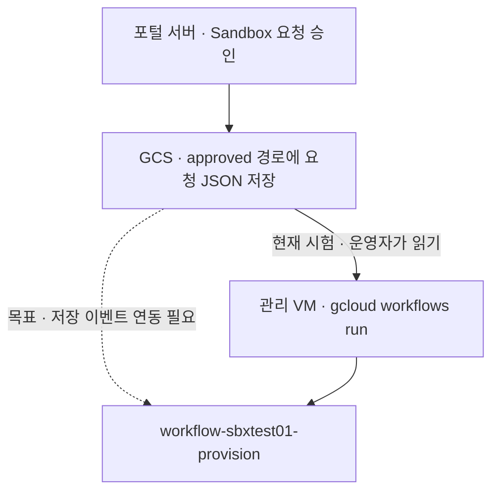
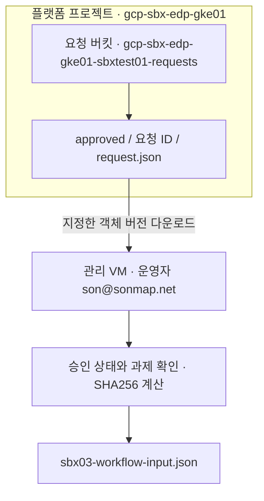
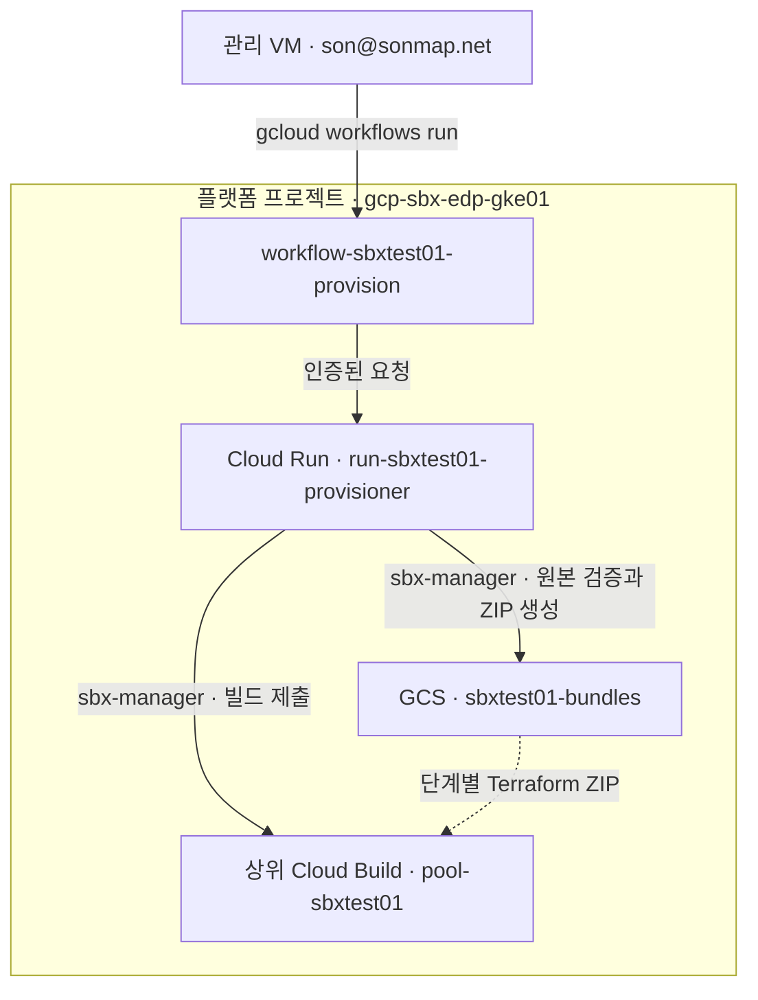
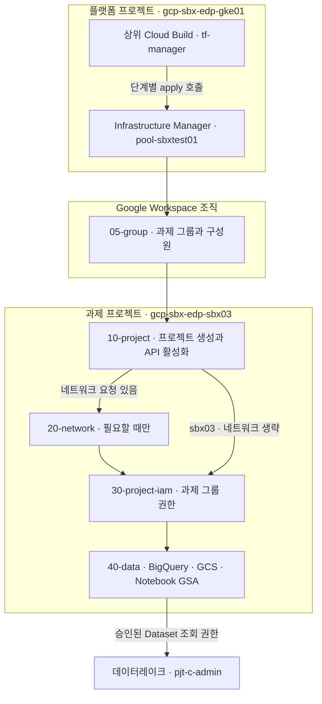
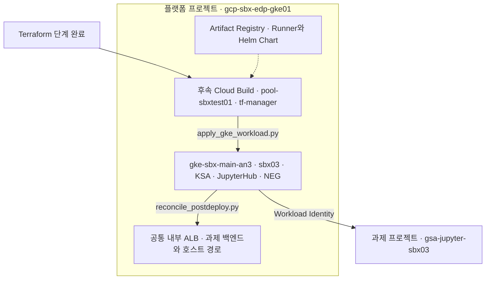
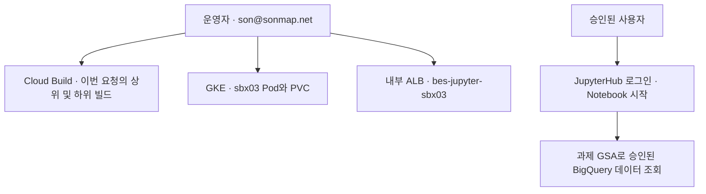

# 2차 Sandbox 배포 · sbx03

[1차 공통 인프라](01-infra-setup.md)가 준비되면, 포털에서 승인된 요청으로 과제별 자원을 추가합니다. 아래는 신규 과제 `sbx03` 기준입니다.

| 구분 | 배포를 시작하는 주체 | 그 뒤에 실행되는 작업 |
|---|---|---|
| 포털 연동 목표 | 포털에서 승인 → GCS에 JSON 저장 → 저장 이벤트로 Workflows 호출 | Cloud Run 검증 → Cloud Build → Terraform → GKE·ALB |
| 현재 반자동 시험 | 운영자 `son@sonmap.net`이 관리 VM에서 승인 JSON을 읽고 `gcloud workflows run` 실행 | 같은 Cloud Run·Cloud Build·Terraform·GKE 흐름 |



현재 저장소의 시험 절차에서는 **승인 JSON을 저장한 뒤 1~2절의 명령으로 시작**합니다. 목표 흐름에서 자동으로 시작하려면 GCS 객체 생성 이벤트를 Workflows 입력 형식으로 연결하고, `approved/` 경로와 객체 세대 번호·SHA256을 처리하는 연동이 필요합니다.

## 1. 승인 요청 읽기



포털이 GCS에 저장한 **승인된 요청 ID**를 입력합니다. 신규 프로젝트 사전 권한과 승인 JSON이 아직 준비되지 않았다면 [sbx03 신규 과제 절차 1~3절](reference/sbx03-new-project-runbook.md)을 먼저 따릅니다. 같은 `sbx03`을 재배포할 때는 포털에서 새 요청 ID를 발급받습니다.

아래 블록을 같은 Bash 셸에서 실행합니다. 성공하면 검증된 입력 파일을 만듭니다. 다운로드나 검증이 실패하면 파일을 새로 만들지 않습니다.

```bash
read -r -p '승인된 sbx03 요청 ID: ' REQUEST_ID
REQUEST_URI="gs://gcp-sbx-edp-gke01-sbxtest01-requests/approved/${REQUEST_ID}/request.json"
mkdir -p .local &&
  rm -f .local/sbx03-workflow-input.json &&
  REQUEST_GENERATION="$(gcloud storage objects describe "$REQUEST_URI" --account=son@sonmap.net --format='value(generation)')" &&
  gcloud storage cp "${REQUEST_URI}#${REQUEST_GENERATION}" .local/sbx03-request.json --account=son@sonmap.net &&
  jq -e --arg id "$REQUEST_ID" '
    .request_id == $id and .approval.status == "APPROVED"
    and .task.name == "sbx03"
    and .project.project_id == "gcp-sbx-edp-sbx03"
    and .gke.project_id == "gcp-sbx-edp-gke01"
  ' .local/sbx03-request.json &&
  REQUEST_SHA256="$(sha256sum .local/sbx03-request.json | cut -d ' ' -f1)" &&
  jq -n --arg id "$REQUEST_ID" --arg uri "$REQUEST_URI" --arg gen "$REQUEST_GENERATION" --arg sha "$REQUEST_SHA256" \
    '{request_id:$id,approved_json_uri:$uri,generation:($gen|tonumber),sha256:$sha}' \
    > .local/sbx03-workflow-input.json
```

## 2. 배포 시작



1절에서 `true`와 입력 파일 생성을 확인한 뒤 실행합니다.

```bash
test -s .local/sbx03-workflow-input.json &&
  gcloud workflows run workflow-sbxtest01-provision \
    --project=gcp-sbx-edp-gke01 --location=asia-northeast3 \
    --account=son@sonmap.net --data="$(cat .local/sbx03-workflow-input.json)"
```

Workflow의 `SUCCEEDED`와 응답의 `ACCEPTED`는 **배포 접수**입니다. 과제 배포 완료는 다음 단계의 빌드 결과에서 확인합니다.

### 2-1. Terraform이 과제 자원 추가



| 자동 작업 | sbx03에서 확인할 결과 |
|---|---|
| 그룹 | `pgrp-gcp-dev-sbx03@sonmap.net`과 승인된 구성원 |
| 프로젝트와 IAM | `gcp-sbx-edp-sbx03` 프로젝트, 필요한 API와 과제 그룹 권한 |
| 데이터와 실행 계정 | `sbx03_main`, `gcp-sbx-edp-sbx03-sbx03-data`, `gsa-jupyter-sbx03`과 Workload Identity 권한 |
| 데이터레이크 연결 | 승인된 경우 `pjt-c-admin:dlk_sample` 조회 권한 |

Infrastructure Manager가 ZIP별로 Terraform을 적용합니다. 시험 운영자가 직접 실행하는 시작 명령은 위의 `gcloud workflows run`입니다. [Terraform 파일과 실행 관계](reference/file-relationships.md#4-terraform-자동-적용--zip과-실제-원본-파일)

### 2-2. 후속 빌드가 GKE와 내부 ALB 연결



기존 GKE에 `sbx03` Namespace와 JupyterHub를 추가하고, 공통 내부 ALB에 `jupyter-sbx03.sonmap.net` 경로를 연결합니다. 사용자가 로그인하고 서버를 시작하면 Notebook Pod를 확인할 수 있습니다.

## 3. 배포 결과와 접속 확인



```bash
gcloud builds list --project=gcp-sbx-edp-gke01 --region=asia-northeast3 --account=son@sonmap.net --limit=10 --format='table(id,status,createTime)'

CLOUDSDK_CORE_ACCOUNT=son@sonmap.net kubectl --kubeconfig="$HOME/.kube/config-sbx-dns" -n sbx03 get pods,pvc

gcloud compute backend-services get-health bes-jupyter-sbx03 --project=gcp-sbx-edp-gke01 --region=asia-northeast3 --account=son@sonmap.net
```

이번 요청의 상위·하위 빌드가 `SUCCESS`이고 ALB 백엔드가 `HEALTHY`면 [JupyterHub](https://jupyter-sbx03.sonmap.net/hub/home)에서 Google 로그인과 Notebook 서버 시작을 시험합니다. Notebook에서 `echo "$HOME"`이 `/home/user01`을 표시하는지, 승인된 BigQuery 데이터셋을 조회할 수 있는지 확인합니다.

| 막힌 지점 | 열어야 할 문서 |
|---|---|
| Workflow 이후 빌드 실패 또는 대기 | [sbx03 실제 시험 기록](reference/sbx03-new-project-runbook.md#6-실제-작업-기록과-다음-테스트-순서) |
| 이름 해석·443·인증서 오류 | [내부 HTTPS와 인증서](reference/sbx03-https-certificate-runbook.md) |
| `redirect_uri_mismatch` 또는 로그인 거부 | [Google OAuth 로그인](reference/sbx03-google-oauth-runbook.md) |
| 이전 Notebook 이미지 또는 홈 경로 | [Notebook 이미지와 Helm 적용](../04.Jupiter-setup-image/README.md) |

## 공통 Workflows 배포 명령

> **담당 구분:** Private Pool → GKE 사설 경로와 기존 BigQuery 데이터 조회 권한은 **VPC Admin 요청사항**입니다. 인증서·DNS는 **별도 진행**합니다. tf-manager의 그룹 관리자 역할은 과제 Google Group 관리용, Jupyter OAuth는 사용자 로그인용입니다. [담당자 요청서·인증 설명](reference/admin-requests.md)을 확인하세요.

현재 운영 방식은 **인프라를 개별 gcloud 명령으로 구축한 뒤, 작업자가 과제 Deploy 명령을 실행**하는 것입니다. GCS 이벤트 자동 시작·포털 결과 전달 자동화는 이후에 적용합니다. 기존 배포 코드를 사용하므로 Deploy 시작 이후의 그룹·Terraform·GKE 설치 순서는 Cloud Build가 수행합니다.

### 최초 한 번 — 인프라 준비

관리 VM에서 저장소 루트 GCP_SBX_Test01을 기준으로 아래 문서의 gcloud 명령을 한 줄씩 실행합니다. 각 단계가 성공한 뒤 다음 단계로 진행합니다. 기존 자원은 조회 후 필요한 create/update 명령만 실행합니다. .sh 실행이나 전체 명령 일괄 붙여넣기는 필요하지 않습니다.

| 순서 | 직접 실행할 문서 | 수행 내용 |
|---|---|---|
| 0 | [공통 변수](01-infra-setup.md#0-공통-변수) | 프로젝트·계정·대역 확인 |
| 1 | [관리자 준비](01-infra-setup.md#1-api와-관리자-권한) | API·서비스 계정·IAM |
| 2 | [네트워크](01-infra-setup.md#2-shared-vpc와-네트워크) | Shared VPC·Subnet·PSA·방화벽 |
| 2-1 | [서브넷별 IAM](01-infra-setup.md#2-1-서브넷별-iam) | GKE·ALB VIP 사용 계정 부여 |
| 3 | [공통 실행 기반](01-infra-setup.md#3-공통-기반) | GCS·AR·Private Pool·GKE·Cloud Run·Workflow·ALB |
| 4 | [관리자 개별 명령](01-infra-setup.md#4-oauth-값-등록) 및 [인증 안내](reference/jupyterhub-internal-alb-oauth-runbook.md) | OAuth 등록·그룹 관리자 역할 직접 부여·인증서·DNS 준비 |
| 5 | [Private Pool 접속 점검](reference/runbook-two-stage.md#5-private-pool에서-gke-사설-api-연결-확인) | GKE 사설 API 조회 Build 성공 확인 |
| 6 | [관리자 개별 명령 5~7절](01-infra-setup.md#4-oauth-값-등록) | 플랫폼 릴리스·기본 이미지 미러링·Notebook 이미지 빌드 |

tf-manager 그룹 관리자 역할 준비·DNS·인증서와 기존 BQ 데이터 조회 권한은 각 담당자가 준비합니다. 인증서는 공통 ALB의 HTTPS 연결 명령 전에 필요합니다. 이 준비 작업을 과제 Deploy마다 반복하지 않습니다.

### 과제마다 — 배포할 요청 지정

포털이 GCS에 저장한 **승인된** request.json을 사용합니다. 포털 파일은 [요청 작성 규칙](../05.sandbox_json/README.md)과 [실행용 스키마](../07.sandbox_request_api/sandbox-request.schema.json)를 만족하고 source의 릴리스·generation·SHA256이 실제 게시값이어야 합니다. 파일 저장만으로 배포가 시작되지 않습니다.

아래 REQUEST_ID와 REQUEST_URI를 실제 포털 파일로 바꿉니다. 실행 계정에는 요청 객체 읽기와 Workflow 호출 권한이 필요합니다. 폴더 이름의 번호는 실행 순서가 아니며 07/08/09에서 프로그램을 직접 실행하지 않습니다.

```bash
# 저장소 루트에서 한 줄씩 실행합니다.
export ADMIN_ACCOUNT="son@sonmap.net"
export SBX_GKE_PROJECT="gcp-sbx-edp-gke01"
export SBX_NAME="sbx01"
export VPC_HOST_PROJECT="gcp-prod-edp-hub-vpchost"
export SBX_PROJECT="pjt-net-hub-base"
export REGION="asia-northeast3"
export WORKFLOW_NAME="workflow-sbxtest01-provision"
export REQUEST_ID="REQ-20261105-001"
export REQUEST_URI="gs://${SBX_GKE_PROJECT}-sbxtest01-requests/approved/${REQUEST_ID}/request.json"
unset CLOUDSDK_AUTH_IMPERSONATE_SERVICE_ACCOUNT
mkdir -p .local

# 1. 포털이 저장한 객체의 특정 버전을 고정합니다.
gcloud storage objects describe "${REQUEST_URI}" --account="${ADMIN_ACCOUNT}" --format='yaml(name,generation,size)'
export REQUEST_GENERATION="$(gcloud storage objects describe "${REQUEST_URI}" --account="${ADMIN_ACCOUNT}" --format='value(generation)')"

# 2. 해당 버전을 읽어 무결성 확인값을 계산합니다. 오류 시 중단합니다.
gcloud storage cp "${REQUEST_URI}#${REQUEST_GENERATION}" .local/deploy-request.json --account="${ADMIN_ACCOUNT}"
export REQUEST_SHA256="$(sha256sum .local/deploy-request.json | cut -d ' ' -f1)"

# 3. Request ID와 대상 과제를 확인합니다. false 또는 오류이면 배포하지 않습니다.
jq -e --arg id "${REQUEST_ID}" --arg name "${SBX_NAME}" --arg gke "${SBX_GKE_PROJECT}" --arg project "${SBX_PROJECT}" '.request_id == $id and .task.name == $name and .gke.project_id == $gke and .project.project_id == $project' .local/deploy-request.json

# 4. 배포 입력 파일을 만듭니다. jq는 JSON 작성 도구이며 GCP 자원을 생성하지 않습니다.
jq -n --arg id "${REQUEST_ID}" --arg uri "${REQUEST_URI}" --arg gen "${REQUEST_GENERATION}" --arg sha "${REQUEST_SHA256}" '{request_id:$id,approved_json_uri:$uri,generation:($gen|tonumber),sha256:$sha}' > .local/deploy-input.json
```

위 준비 명령들이 모두 성공하고 요청 대상이 맞는지 확인한 뒤 아래 Deploy 명령만 실행합니다. 같은 요청을 반복 제출하기 전에 기존 Build 결과를 확인합니다.

### Deploy 시작 — gcloud 명령 하나

```bash
gcloud workflows run "${WORKFLOW_NAME}" --project="${SBX_GKE_PROJECT}" --location="${REGION}" --account="${ADMIN_ACCOUNT}" --data="$(cat .local/deploy-input.json)"
```

이 명령은 기존 Workflow → Cloud Run → Cloud Build 배포 경로를 시작합니다. **ACCEPTED 또는 Workflow 성공은 배포 접수 결과**입니다. GKE 생성·공통 네트워크 재구축·이미지 빌드는 이 명령에서 반복하지 않습니다. 과제 요청에 따른 그룹·Project/IAM/Data·선택 Network 구성과 GKE 워크로드 배포는 수행됩니다.

### 배포 결과 확인

```bash
export SBX_GKE_PROJECT="gcp-sbx-edp-gke01"
export TF_MANAGER="tf-manager@${SBX_GKE_PROJECT}.iam.gserviceaccount.com"

# 이번 요청의 실행 시각과 결과를 확인합니다.
gcloud workflows executions list "${WORKFLOW_NAME}" --project="${SBX_GKE_PROJECT}" --location="${REGION}" --account="${ADMIN_ACCOUNT}" --limit=5
gcloud builds list --project="${SBX_GKE_PROJECT}" --region="${REGION}" --account="${ADMIN_ACCOUNT}" --impersonate-service-account="${TF_MANAGER}" --limit=10 --sort-by='~createTime' --format='table(id,status,createTime)'

# 위 목록과 요청 로그로 이번 부모·자식 Build를 식별한 후 실제 ID를 입력합니다.
# export BUILD_ID="실제_BUILD_ID"
# gcloud builds describe "${BUILD_ID}" --project="${SBX_GKE_PROJECT}" --region="${REGION}" --account="${ADMIN_ACCOUNT}" --impersonate-service-account="${TF_MANAGER}" --format='yaml(id,status,steps)'
# gcloud builds log "${BUILD_ID}" --project="${SBX_GKE_PROJECT}" --region="${REGION}" --account="${ADMIN_ACCOUNT}" --impersonate-service-account="${TF_MANAGER}"
```

완료 기준은 부모·자식 Build SUCCESS와 [GKE·ALB·로그인·BQ 확인](reference/runbook-two-stage.md#11-최종-배포와-사용자-동작-확인)입니다. 최신 Build 하나만 보고 다른 과제의 성공을 이번 요청의 성공으로 판단하지 않습니다.

### 나중에 적용할 자동화

현재 작업 순서에 Eventarc 설치·GCS 이벤트 연동 구현을 필수 단계로 넣지 않습니다. 추후 GCS 파일 저장 이벤트가 요청 버전 고정·입력 생성·Deploy 시작을 대신하고, Build 완료 추적과 포털 결과 전달을 연결합니다. 지금은 작업자가 Deploy 시작과 결과 확인을 수행합니다.
