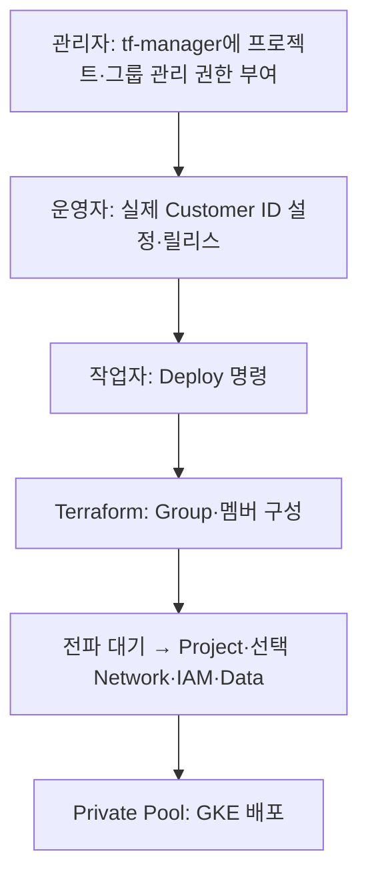

# Cloud Identity 그룹 — Terraform 배포

## 실행 계정과 순서

실행 계정은 tf-manager@gcp-sbx-edp-gke01.iam.gserviceaccount.com입니다. 그룹과 구성원 생성은 08.sandbox_setup_02_terraform/deployments/05-group에서 Cloud Identity Groups API로 수행합니다. 사용자 위임과 Python 그룹 생성 실행기는 제거했습니다.



## 최초 준비

1. GCP 관리자는 tf-manager에 기존 01-admin.md의 조직·Folder·프로젝트 생성·IAM·필요 Billing 권한을 부여합니다.
2. Workspace 최고 관리자는 tf-manager 서비스 계정에 **Groups Administrator 역할을 직접 부여**합니다. [공식 방법](https://docs.cloud.google.com/identity/docs/how-to/setup#assigning_an_admin_role_to_the_service_account)에 따라 서비스 계정 Unique ID로 역할을 부여합니다. GCP 프로젝트 Owner만 부여해서는 그룹 관리 권한이 생기지 않습니다.
3. cloudidentity.googleapis.com을 자동화 실행 프로젝트에서 활성화합니다. 01-admin.md에 포함되어 있습니다.
4. 실제 Cloud Identity Customer ID를 확인해 `02.sandbox_setup_01_gcloud/configs/provisioner-env.yaml`의 CLOUD_IDENTITY_CUSTOMER_ID에 입력하고 커밋합니다. __SET_CUSTOMER_ID__는 배포 가능한 값이 아닙니다. GCP 프로젝트 ID·프로젝트 번호와 Customer ID는 다릅니다.
5. 새 플랫폼 릴리스로 API·Runner·소스 ZIP과 Cloud Run 환경설정을 함께 갱신합니다. 포털 요청 source도 새 release.json을 사용합니다. 이전 ZIP에는 05-group이 없으므로 새 API와 혼용하지 않습니다.

Domain-wide Delegation, 사용자 관리자 이메일, Directory API Scope 승인, SA 키파일은 사용하지 않습니다. Jupyter 사용자 로그인용 OAuth Client ID/Secret은 별도로 유지합니다. Private Pool 경로·BQ 권한은 VPC Admin 요청사항이며 인증서·DNS는 별도 진행합니다.

## 새 그룹

identity.group_email과 identity.members의 기존 요청 규격을 유지합니다. 그룹·멤버는 Terraform이 생성하며 최초 호출 계정 tf-manager가 초기 Owner가 됩니다. 그룹에는 prevent_destroy를 설정해 이름 변경이나 잘못된 교체로 삭제되지 않게 했습니다.

## 기존 그룹 — 재생성 대신 import

기존 Python 실행기가 생성했거나 다른 관리자가 만든 그룹은 첫 Terraform 배포 전에 편입해야 합니다. 실제 그룹·멤버 리소스 ID를 권한 있는 관리자가 Cloud Identity API에서 확인하고 다음 선택 필드를 승인 JSON의 identity에 포함합니다. 그룹 ID와 이메일은 다른 값입니다.

```json
{
  "identity": {
    "group_email": "pgrp-gcp-dev-sbx01@sonmap.net",
    "members": ["user01@sonmap.net", "user02@sonmap.net"],
    "group_resource_name": "groups/ACTUAL_GROUP_ID",
    "membership_resource_names": {
      "user01@sonmap.net": "groups/ACTUAL_GROUP_ID/memberships/ACTUAL_MEMBERSHIP_ID"
    }
  }
}
```

이 예시는 identity 부분만 보여줍니다. 전체 요청의 다른 필수 항목도 필요합니다. 예시 ID는 실제 값으로 바꿉니다. 기존 승인 멤버는 membership_resource_names에 모두 기재하고, 신규 멤버는 기재하지 않습니다. API는 Terraform 1.5에 맞는 literal import 블록을 요청별 group.zip에 생성합니다. 이미 state가 관리하는 리소스는 기존 state를 계속 사용합니다. 기존 그룹·멤버인데 import 정보가 없으면 409로 실패할 수 있으므로 삭제 후 재시도하지 않습니다.

Terraform은 승인 요청에 포함되어 state가 관리하는 멤버십만 관리합니다. 과거 Python처럼 요청에 없는 모든 기존 멤버를 일괄 삭제하지 않습니다. 기존 미관리 구성원은 관리자가 승인 명단과 대조해 정리해야 합니다. 이미 다른 Terraform state가 관리한다면 중복 소유하지 않도록 기존 담당자와 이전해야 합니다.

## 검증과 제한

Cloud Identity 그룹 배포가 성공한 뒤 60초 전파 대기 후 Project/IAM 단계로 진행합니다. 전파 지연이 더 길면 Build 실패 원인을 확인한 뒤 재실행하며, 성공으로 무시하지 않습니다. 완료 기준은 tf-manager 주체로 그룹·승인 멤버 구성, 후속 IAM·GKE Build 성공입니다.

실제 조직 역할·Customer ID·기존 리소스 ID를 제공하거나 클라우드에 적용한 것은 아닙니다. 오프라인 검사와 실제 Google API 권한·사설 경로 검증은 구분합니다.
