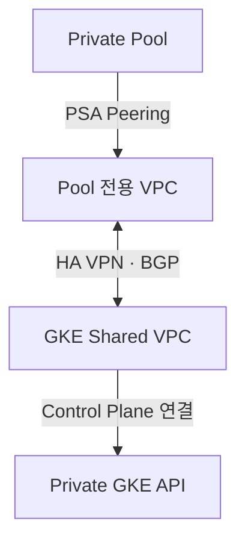

# Private Pool에서 GKE API 접속 점검

[실제 수행 절차](runbook-two-stage.md)의 5단계에서 [check-private-gke.yaml](../../03.cloudbuild/check-private-gke.yaml)을 사용합니다. Cloud Build에 넘기는 실행 설정으로, Cloud Build 설정을 함께 찾을 수 있도록 `03.cloudbuild`에 둡니다. 운영자는 1차 문서의 접속 점검 명령에서 이 YAML을 지정합니다.

## 1. 무엇을 확인하는가

| YAML 항목 | 동작 |
|---|---|
| `steps[0].name` | Artifact Registry에 게시된 `sbxtest01-automation-runner:bootstrap` 이미지 사용 |
| `options.pool` | 서울 리전의 `pool-sbxtest01`에서 실행 |
| `KUBECONFIG` | 빌드 작업 공간의 `/workspace/kubeconfig`에 접속 정보 저장 |
| `get-credentials --dns-endpoint` | `gke-sbx-main-an3`의 DNS 엔드포인트 설정 가져오기 |
| `kubectl --request-timeout=20s get namespaces` | GKE API 접속과 Namespace 목록 조회 권한 확인 |
| `CLOUD_LOGGING_ONLY`, `timeout: 300s` | Cloud Logging에 결과를 기록하고 빌드 실행 시간을 제한 |

Namespace 목록만 조회하는 점검입니다. 운영 VM의 kubeconfig와 Kubernetes 리소스에는 변경을 가하지 않습니다. 현재 YAML과 배포 환경 파일의 기본값은 DNS 모드입니다.

## 2. 언제, 어떻게 실행하는가

공통 기반의 **GKE와 DNS 엔드포인트, Private Pool, bootstrap 이미지**가 준비된 뒤 실행합니다. GKE를 다시 만들거나 Pool·접속 권한을 바꾼 뒤 과제 배포 전에 이 점검을 다시 실행합니다.

관리 VM의 저장소 루트에서 `son@sonmap.net`으로 빌드를 제출합니다. 실제 빌드 실행 계정은 `--service-account`로 지정한 `tf-manager`입니다. `--no-source`를 사용하므로 저장소 소스를 업로드할 필요가 없습니다.

```bash
gcloud builds submit --no-source \
  --config=03.cloudbuild/check-private-gke.yaml \
  --project=gcp-sbx-edp-gke01 --region=asia-northeast3 \
  --account=son@sonmap.net \
  --service-account=projects/gcp-sbx-edp-gke01/serviceAccounts/tf-manager@gcp-sbx-edp-gke01.iam.gserviceaccount.com
```

**통과 기준은 빌드 상태 `SUCCESS`와 로그의 Namespace 목록입니다.** 제출 결과에서 Build ID를 확인하고, 빌드 상세 화면에서 Cloud Logging 로그를 확인합니다. 관리 VM에서의 `kubectl` 성공과 별개로 이 빌드의 결과를 확인합니다.

| 실패 지점 | 확인할 항목 |
|---|---|
| 빌드 제출 또는 실행 계정 지정 실패 | 제출 계정의 Cloud Build 권한, Pool 사용 권한, 실행 계정의 `actAs` 권한 |
| `bootstrap` 이미지 Pull 실패 | 이미지 태그 존재 여부와 Artifact Registry 읽기 권한 |
| `get-credentials`에서 403 | 실행 계정의 GKE 조회·접속 권한 |
| `kubectl` 시간 초과 또는 DNS 오류 | Pool에서 DNS 엔드포인트까지의 이름 해석과 네트워크 경로 |
| `kubectl Unauthorized/Forbidden` | Build 실행 계정 인증과 Namespace 조회 권한 |

## 3. DNS 점검과 사설 IP 점검의 범위

이 YAML의 성공은 **Private Pool에서 DNS 엔드포인트를 통해 GKE API 조회가 성공했다는 의미**입니다. GKE Control Plane의 사설 IP 경로 또는 VPN/BGP 경로를 검증해야 한다면, 그 경로에 맞춰 별도의 `--internal-ip` 점검을 수행합니다.

## 4. 라우팅이 준비되지 않았다면 네트워크 담당 작업

Cloud Build Pool와 GKE Control Plane은 Google 관리 네트워크에서 VPC에 연결됩니다. PSA/VPC Peering은 전이 라우팅을 제공하지 않으므로 같은 Shared VPC에 연결하는 기본 명령만으로 상호 Private IP 경로가 완성되지는 않습니다.

네트워크 담당자는 승인된 토폴로지에서 Pool CIDR과 GKE Control Plane CIDR의 양방향 경로·BGP 광고·커스텀 경로 전파, Authorized Networks, 방화벽을 준비합니다. Pool 전용 VPC+HA VPN을 선택하면 다음 관계를 실제 구성한 뒤 사설 IP 전용 점검을 실행합니다. 아래 기본 DNS 점검은 별도로 유지합니다.



현재 03-foundation의 Pool은 기존 Shared VPC를 대상으로 생성합니다. 다른 Pool VPC 설계를 적용할 때는 Pool peered-network/PSA 대상도 함께 맞춰야 합니다. 기존 Pool의 연결 대상을 문서 읽기만으로 자동 전환하지 않습니다. 전용 VPC/VPN/BGP 생성 명령은 이 저장소의 기본 구축 범위에 포함되어 있지 않습니다.
