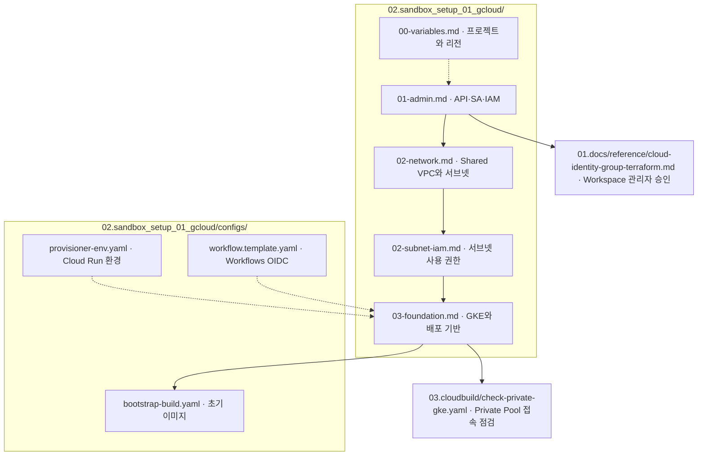
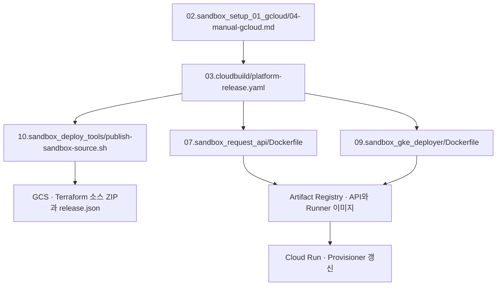
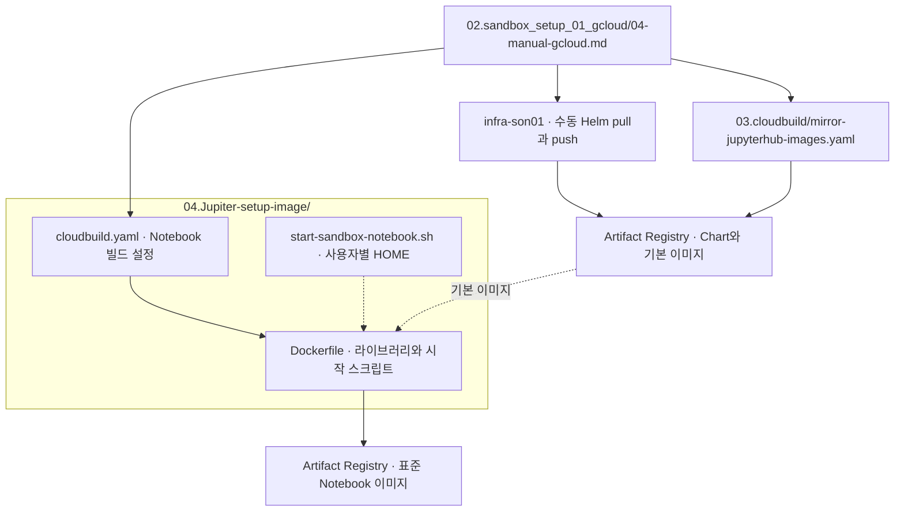
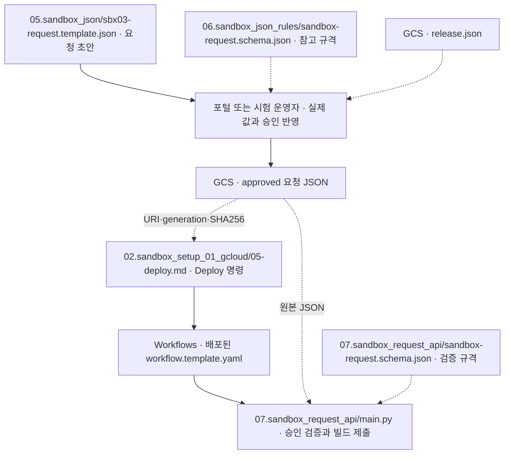
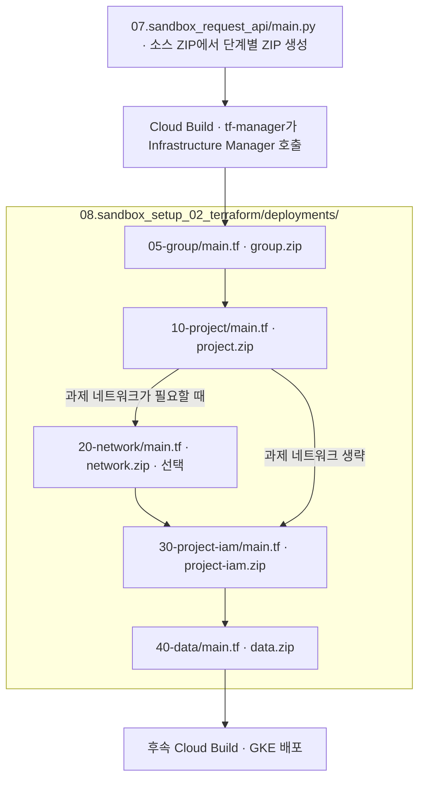
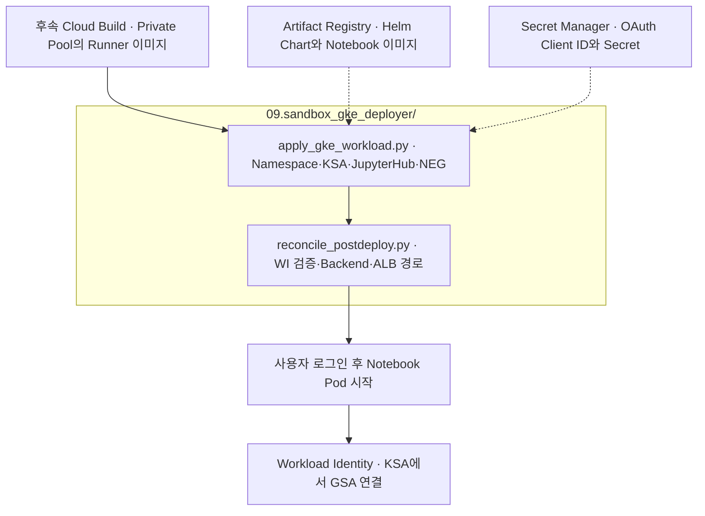

# 폴더·파일과 실행 관계

[파일 목록](file-catalog.md)은 파일별 역할을 찾는 표입니다. 이 문서는 **각 단계에서 누가 어떤 파일을 읽고 실행하는지** 보여 줍니다. 그림의 폴더 박스는 저장소 경로이고, GCS·Artifact Registry·Workflows 박스는 배포 후 만들어지거나 참조되는 GCP 자원입니다. 실선은 실행·생성·호출, 점선은 설정·소스 참조입니다.

실제 명령은 [2단계 실행 절차](runbook-two-stage.md)와 [작업 순서](work-order.md)를 따릅니다.

## 1. 공통 기반 준비 · 운영자가 실행

| 파일 | 사용 시점과 결과 |
|---|---|
| [00-variables.md](../../02.sandbox_setup_01_gcloud/00-variables.md), [01-admin.md](../../02.sandbox_setup_01_gcloud/01-admin.md) | 관리자가 변수와 계정을 확인하고 API, `tf-manager`·`sbx-manager`, IAM을 준비합니다. |
| [02-network.md](../../02.sandbox_setup_01_gcloud/02-network.md), [02-subnet-iam.md](../../02.sandbox_setup_01_gcloud/02-subnet-iam.md) | VPC 관리자가 호스트 프로젝트의 네트워크와 서브넷별 권한을 준비합니다. |
| [03-foundation.md](../../02.sandbox_setup_01_gcloud/03-foundation.md) | 운영자가 개별 `gcloud` 명령으로 공통 버킷·AR·Private Pool·GKE·Cloud Run·Workflow·ALB 기반을 준비합니다. |
| [bootstrap-build.yaml](../../02.sandbox_setup_01_gcloud/configs/bootstrap-build.yaml), [provisioner-env.yaml](../../02.sandbox_setup_01_gcloud/configs/provisioner-env.yaml), [workflow.template.yaml](../../02.sandbox_setup_01_gcloud/configs/workflow.template.yaml) | 기반 명령이 초기 빌드 설정, Cloud Run 환경, Workflow 템플릿을 각각 읽습니다. |
| [cloud-identity-group-terraform.md](cloud-identity-group-terraform.md) | Workspace 관리자가 `tf-manager`의 그룹 관리 역할을 승인합니다. |
| [check-private-gke.yaml](../../03.cloudbuild/check-private-gke.yaml) | 운영자가 `gcloud builds submit --config`에 지정합니다. Private Pool에서 DNS 엔드포인트로 Namespace 목록을 조회합니다. [사용법](cloudbuild-private-gke-vpn-design.md) |

## 2. 플랫폼 릴리스와 Notebook 이미지 · 운영자가 빌드 제출

| 파일 | 사용 시점과 결과 |
|---|---|
| [04-manual-gcloud.md](../../02.sandbox_setup_01_gcloud/04-manual-gcloud.md) | OAuth Secret 등록, 차트 수동 반입, 릴리스와 이미지 빌드 명령입니다. |
| [platform-release.yaml](../../03.cloudbuild/platform-release.yaml), [publish-sandbox-source.sh](../../10.sandbox_deploy_tools/publish-sandbox-source.sh) | 릴리스 빌드가 API·Runner 이미지를 게시하고 Terraform 소스를 ZIP으로 올린 뒤 Cloud Run을 갱신합니다. |
| [mirror-jupyterhub-images.yaml](../../03.cloudbuild/mirror-jupyterhub-images.yaml) | 기본 이미지를 내부 Artifact Registry에 복사합니다. |
| [Notebook cloudbuild.yaml](../../04.Jupiter-setup-image/cloudbuild.yaml), [Dockerfile](../../04.Jupiter-setup-image/Dockerfile), [시작 스크립트](../../04.Jupiter-setup-image/start-sandbox-notebook.sh) | 사용자 Pod용 표준 이미지를 빌드합니다. 사용자별 홈을 지원하는 이미지의 시작 스크립트는 마운트 경로를 `HOME`으로 사용합니다. |

`release.sh`, `mirror-jupyter.sh`, `build-gcloud.sh`는 보조 실행 파일입니다. 위 문서의 개별 명령을 사용했다면 같은 빌드를 중복 제출할 필요가 없습니다.

## 3. 승인 요청 제출 · 운영자에서 자동화로 전환

| 파일 | 사용 시점과 결과 |
|---|---|
| [sbx03 요청 템플릿](../../05.sandbox_json/sbx03-request.template.json), [sbx01 요청 예시](../../05.sandbox_json/sbx01-approved-request.json) | 신규 과제와 기존 프로젝트 사용 예시입니다. 제출 전 실제 승인 정보와 릴리스 값을 사용합니다. |
| [참고 스키마](../../06.sandbox_json_rules/sandbox-request.schema.json), [런타임 스키마](../../07.sandbox_request_api/sandbox-request.schema.json) | 전자는 요청을 작성할 때 참고하는 사본이고, 후자는 API 이미지가 실제 검증에 사용합니다. |
| [05-deploy.md](../../02.sandbox_setup_01_gcloud/05-deploy.md) | 운영자가 승인 객체를 고정하고 `gcloud workflows run`을 실행합니다. `sbx03` 값은 [신규 과제 절차](sbx03-new-project-runbook.md)를 따릅니다. |
| [main.py](../../07.sandbox_request_api/main.py) | Cloud Run의 `sbx-manager`가 승인 JSON·릴리스 ZIP을 읽고 단계별 ZIP을 만든 후 Cloud Build를 제출합니다. |

[run-approved-workflow.sh](../../10.sandbox_deploy_tools/run-approved-workflow.sh)는 수동 시험용 보조 도구입니다. 운영 흐름에서는 포털이 승인 JSON을 저장하고 운영자가 위 Deploy 명령을 실행합니다.

## 4. Terraform 자동 적용 · ZIP과 실제 원본 파일

| 폴더의 실제 파일 | 하는 일 |
|---|---|
| [05-group/main.tf](../../08.sandbox_setup_02_terraform/deployments/05-group/main.tf) | 과제 Google Group과 구성원을 관리합니다. |
| [10-project/main.tf](../../08.sandbox_setup_02_terraform/deployments/10-project/main.tf) | 요청에 따라 신규 프로젝트를 만들거나 기존 프로젝트를 사용하고 API와 IAM을 구성합니다. |
| [20-network/main.tf](../../08.sandbox_setup_02_terraform/deployments/20-network/main.tf) | 요청에서 필요한 경우에만 과제 네트워크 단계를 실행합니다. |
| [30-project-iam/main.tf](../../08.sandbox_setup_02_terraform/deployments/30-project-iam/main.tf) | 과제 프로젝트의 그룹 IAM을 구성합니다. |
| [40-data/main.tf](../../08.sandbox_setup_02_terraform/deployments/40-data/main.tf) | Dataset·버킷·Notebook GSA와 Workload Identity를 구성하고 승인된 데이터레이크 권한을 연결합니다. |

각 폴더의 `variables.tf`와 `versions.tf`는 같은 ZIP에 들어가며, Infrastructure Manager가 `main.tf`와 함께 읽습니다. 운영자가 폴더마다 따로 `terraform apply`를 실행하는 흐름은 아닙니다.

## 5. GKE 배포와 사용자 접속 · Runner가 실행

[apply_gke_workload.py](../../09.sandbox_gke_deployer/apply_gke_workload.py)는 승인 요청을 읽어 Helm과 Kubernetes 자원을 적용합니다. [reconcile_postdeploy.py](../../09.sandbox_gke_deployer/reconcile_postdeploy.py)는 이후 백엔드·헬스 체크·NEG와 ALB 호스트 경로를 연결합니다. 두 파일은 [Runner Dockerfile](../../09.sandbox_gke_deployer/Dockerfile)에 포함됩니다.

신규 `sbx03`은 전용 `gsa-jupyter-sbx03`으로 연결합니다. 공통 서비스 계정을 쓰는 기존 요청은 `sbx-manager` 경로를 사용합니다. 브라우저 검증은 [HTTPS·인증서](sbx03-https-certificate-runbook.md)와 [Google OAuth](sbx03-google-oauth-runbook.md)를 따릅니다. [11.tests](../../11.tests)는 명령·빌드 경로·요청 생성과 ALB 로직을 검증하는 폴더입니다.
