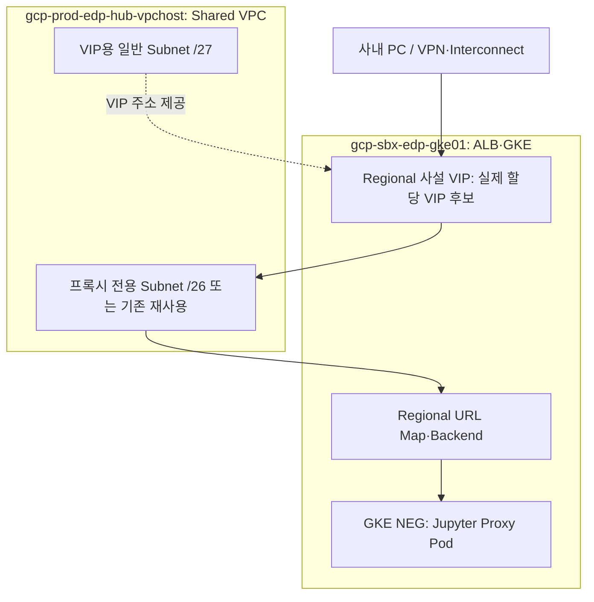

# Regional Internal ALB 설계·전환

사용자 Jupyter 접속을 외부 Global ALB에서 **사설 Regional Internal Application Load Balancer**로 전환합니다. 리전은 asia-northeast3, scheme은 INTERNAL_MANAGED입니다. 실제 클라우드에 적용한 상태가 아니라 수정한 소스의 설계입니다.

## 자원·대역·소유 프로젝트

| 항목 | 이름 / 후보 값 | 소유 프로젝트 | 담당 |
|---|---|---|---|
| VPC | vpc-prod-edp-hub | gcp-prod-edp-hub-vpchost | VPC Admin |
| VIP용 일반 Subnet | subnet-prod-edp-alb-frontend-an3 / 172.31.96.0/27 | gcp-prod-edp-hub-vpchost | VPC Admin |
| 사설 VIP 자원 | ip-alb-sbxtest01-shared / 실제 할당 VIP | **gcp-sbx-edp-gke01** | 인프라 작업자 |
| 프록시 전용 Subnet | subnet-prod-sbx-ilb-proxy / 172.31.111.64/26 | gcp-prod-edp-hub-vpchost | 기존 ACTIVE 재사용 우선, 없으면 VPC Admin 구성 |
| URL Map·Target HTTP/HTTPS Proxy·Forwarding Rule | 기존 ALB 이름의 Regional 자원 | **gcp-sbx-edp-gke01** | 인프라 작업자 |
| SSL 인증서 | cert-jupyter-sbx01-self — Regional | gcp-sbx-edp-gke01 | 인증서 담당자 별도 준비 |
| 과제 Backend·Health Check·GKE NEG | bes-jupyter-sbx01 / hc-jupyter-sbx01 / proxy-public NEG | gcp-sbx-edp-gke01 | 과제 자동 Deploy |
| Proxy Pod 대역 | 기존 100.64.128.0/19 | Shared VPC Secondary / GKE 사용 | 기존 재사용 |

172 대역은 실제 인벤토리 조회 없이 정한 **후보값**입니다. VPC Admin은 온프레미스·전체 VPC·VPN·Peering·PSA 중복을 확인한 뒤 승인하고, 변경한다면 00-variables·02-network·03-foundation의 ILB 변수들을 동일하게 수정합니다.

## /28 하나로 끝낼 수 없는 이유

VIP는 기존 일반 서브넷 172.31.96.0/27의 가용 IP를 자동 예약하여 사용합니다. 프록시 전용 Subnet은 Envoy 작업자 IP용이며 최소 /26입니다. VIP를 프록시 전용 대역에서 할당할 수 없습니다. 같은 VPC·리전의 호환 ACTIVE 프록시 전용 Subnet이 있으면 재사용하므로 새 /26을 추가하지 않습니다.

VIP는 기존 /27 서브넷을 재사용하므로 VIP용 신규 대역을 예약하지 않습니다. 프록시 전용 /26이 새로 필요하면 전체 주소 64개가 추가됩니다. 이는 전체 주소 수이며 사용 가능 주소·접속 수가 아닙니다. Google은 더 큰 프록시 범위를 권장하지만 현재는 IP 절약을 위해 최소 /26 후보로 두었습니다. 트래픽 증가 시 프록시 IP 사용량을 확인해야 합니다.

Shared VPC 사용 시 Subnet은 Host 프로젝트 소유입니다. gcp-sbx-edp-gke01에 별도 VPC를 만들어 그곳에 /28을 생성하는 방식은 기존 GKE 네트워크 설계와 다르므로 적용하지 않았습니다. ALB·사설 VIP 자원은 요청대로 gcp-sbx-edp-gke01에 둡니다.

## 실제 통신 흐름

## 작업자가 수행할 순서

1. VPC Admin이 후보 CIDR·기존 ACTIVE 프록시 전용 Subnet을 확인합니다. 기존 프록시를 재사용하면 ILB_PROXY_SUBNET·ILB_PROXY_CIDR을 실제 값으로 맞춥니다. 원래 서브넷이 일반 Subnet이라면 프록시 전용으로 대신 쓸 수 없습니다.
2. [02-network](../../02.sandbox_setup_01_gcloud/02-network.md)의 개별 gcloud 명령으로 VIP Subnet·필요한 프록시 Subnet·방화벽을 준비합니다. 사내 클라이언트에서 VIP 대역으로의 라우팅도 확인합니다.
3. 서브넷 생성 후 VPC Admin이 [서브넷별 IAM](../../02.sandbox_setup_01_gcloud/02-subnet-iam.md)을 적용합니다. tf-manager는 VIP·GKE 서브넷을 사용하고 프록시 전용 Subnet은 VPC Admin이 관리합니다. 이후 [03-foundation](../../02.sandbox_setup_01_gcloud/03-foundation.md) 27~34단계에서 Regional VIP·기본 Health Check/Backend·URL Map·Proxy·Forwarding Rule을 준비합니다. 인증서가 없으면 HTTPS 단계를 중단하고 Regional 인증서를 별도 등록합니다. 기본 Backend는 과제 라우트가 붙기 전까지 사용자 서비스를 제공하지 않습니다.
4. 새 API·Runner 릴리스를 게시하고 새 source로 과제를 Deploy합니다. Reconciler는 Regional Health Check·INTERNAL_MANAGED Backend·NEG·Regional URL Map을 연결합니다. 기존 Global Backend와 혼용하지 않습니다.
5. 내부 DNS를 사설 VIP로 연결합니다. 인증서 SAN·신뢰·OAuth Callback은 실제 도메인과 일치해야 합니다. 브라우저는 Google OAuth 로그인에도 접근할 수 있어야 합니다.
6. 사내망에서 HTTPS 로그인·Notebook·WebSocket/터미널·BQ를 확인하고, GKE Backend HEALTHY를 확인합니다.
7. 기존 외부 테스트 ALB의 의존성·접속자를 확인한 뒤 별도로 폐기합니다. **외부 ALB는 소스 변경만으로 닫히지 않습니다.** 기존 Global 객체를 내부 객체로 제자리 변환하지 않으며 자동 삭제 명령은 넣지 않았습니다.

Forwarding Rule의 allow-global-access는 연결된 사설망의 다른 리전에서도 접근하도록 하는 설정으로 인터넷 공개 설정이 아닙니다. 사내 접근은 실제 라우팅·방화벽·VPN/Interconnect 설정이 필요합니다.

## 방화벽·접속 책임

| 출발 | 목적지 | 허용 | 담당 |
|---|---|---|---|
| 재사용/신규 프록시 전용 CIDR | GKE Proxy Pod 대역 | TCP 8000 | VPC Admin |
| Google Health Check 35.191.0.0/16·130.211.0.0/22 | GKE Proxy Pod 대역 | TCP 8000 | VPC Admin |
| 승인된 사내망·VPN/Interconnect | 사설 VIP | TCP 443, 필요 시 80 | VPC Admin / 연결 담당 |
| tf-manager | Regional ALB 및 승인 GKE·VIP Subnet 사용 | IAM | 프로젝트 관리자·VPC Admin, 서브넷별 Network User |

Google Health Check의 주소는 관리형 점검 트래픽의 출발 범위이며 공인 사용자 VIP를 생성하는 의미가 아닙니다. HTTP 80도 내부 Forwarding Rule이며, 사용자 접속 URL은 HTTPS를 사용합니다. 이 변경은 사용자 Jupyter ALB의 내부화이며 Cloud Run 요청 API는 기존 IAM 인증·ingress=all 상태입니다.

## 검증 범위

Host 전체 권한이 이미 있었다면 서브넷별 추가만으로 사용 범위가 제한되지 않습니다. [이전 광역 권한 정리](../../02.sandbox_setup_01_gcloud/06-iam-migration.md)는 실제 동작을 확인한 뒤 별도로 수행합니다.

단위 테스트는 Regional 범위·내부 scheme·Shared VPC 경로·Health Check 참조·Global Backend 혼용 거부를 확인합니다. 실제 CIDR 가용성, GCP 생성 성공, Regional 인증서, 사내 라우팅·NEG health·DNS·사용자 로그인은 적용 환경에서 검증해야 합니다.

[Proxy-only Subnet 최소 크기](https://docs.cloud.google.com/load-balancing/docs/proxy-only-subnets) / [Shared VPC 내부 ALB](https://docs.cloud.google.com/load-balancing/docs/l7-internal/l7-internal-shared-vpc)
