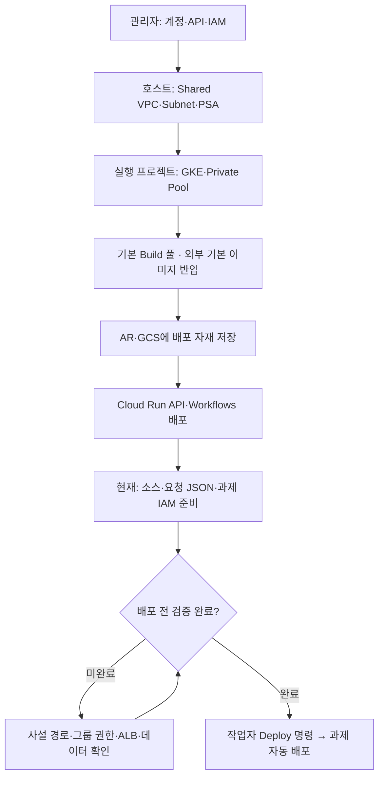
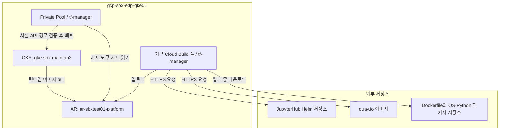

# 실제 작업 순서 — GKE Sandbox 개별 명령 가이드

> 신규 프로젝트·과제 전용 GSA 생성은 [sbx03 신규 과제 절차](sbx03-new-project-runbook.md)를 우선 적용합니다. 기존 프로젝트 재사용 절차와 구분하세요.

기준일: 2026-11-07. 대화에서 실행·확인한 환경을 기준으로 정리했습니다. 이 문서는 작업자가 명령을 한 개씩 실행하는 가이드이며, 전체 자동 실행 스크립트가 아닙니다. GCP 자원은 이 문서를 저장하는 것으로 생성되지 않습니다.

**현재 환경 기본값을 저장소에 동기화했습니다.** 점검 YAML·Build·API 환경·요청 Schema는 `gcp-sbx-edp-gke01` 기준입니다. 프로젝트명 치환용 sed는 더 이상 필요하지 않습니다. 실제 Customer ID·Secret·승인 정보는 별도로 준비합니다.

각 명령의 결과를 확인한 뒤 다음 명령을 실행합니다. 신규 구축은 00부터, 이어서 작업할 때는 상태표에서 미확인 항목부터 시작합니다. 이미 존재하는 자원은 조회 후 재사용하며 삭제·재생성하지 않습니다. GCP 계정과 VM의 Linux 로그인 이름 `admin_sonmap_net`은 다릅니다.

| 대상 | 프로젝트 / 계정 |
|---|---|
| GKE·AR·Build·Run·WF·IM·공통 GCS | `gcp-sbx-edp-gke01` / `869916265282` |
| Shared VPC 호스트 | `gcp-prod-edp-hub-vpchost` / `620081195575` |
| 기존 과제 프로젝트 | `pjt-net-hub-base` / `1016054259755` |
| 실행 프로젝트 작업자 | `son@sonmap.net` |
| 호스트·권한 초기 설정 관리자 | `admin@sonmap.net` |
| Terraform·Build·GKE 배포 SA | `tf-manager@gcp-sbx-edp-gke01.iam.gserviceaccount.com` |
| API·Workflow·Notebook 실행 SA | `sbx-manager@gcp-sbx-edp-gke01.iam.gserviceaccount.com` |

`--account`는 명령 제출자, `--impersonate-service-account`는 실제 API 호출 권한, Build의 `--service-account`는 빌드 컨테이너 실행 계정입니다. 이 문서에서는 프로젝트 설정에 의존하지 않고 `--project`·`--account`를 명시합니다.

| 순서 | 작업 | 현재 증빙 상태 |
|---|---|---|
| [00](#step00) | 도구·계정·프로젝트 | 프로젝트 ACTIVE·번호 확인 |
| [01](#step01) | 작업자 IAM | son 계정 권한 추가 명령 안내, 항목별 재조회 필요 |
| [02](#step02) | API·두 SA·서비스 에이전트 | 설정 진행, 오류 수정 포함 |
| [03](#step03) | GCS·AR·OAuth Secret | 생성·권한 진행, OAuth Secret 버전 1 ENABLED 확인 |
| [04](#step04) | Build·IM·배포 IAM | tf-manager SA 정책 출력 확인 |
| [05](#step05) | Shared VPC·GKE 서브넷·IAM | 노드·Pod 대역·PGA·tf-manager 조회 확인 |
| [06](#step06) | PSA·Private Pool | PSA 연결·10.250.0.0/24 accepted 확인 / Pool RUNNING 출력 미수신 |
| [07](#step07) | 내부 ALB 네트워크 | 명령 안내 / VIP·규칙 실제 결과 재확인 필요 |
| [08](#step08) | GKE 생성 | RUNNING·사설 API 10.253.3.2 확인 |
| [09](#step09) | 별도 kubeconfig·접속 오류 해결 | kubectl 조회 성공, 사용자 GKE 정상 확인 |
| [10](#step10) | 이미지·Helm 차트 준비 | infra-son01 수동 반입 후 AR 차트 조회 확인 |
| [11](#step11) | Cloud Run API | 배포 성공·Service URL 확인 |
| [12](#step12) | Workflows | 서비스 에이전트 오류 해결 명령·배포 명령 안내 / ACTIVE 출력 재확인 |
| [13](#step13) | Terraform 번들 게시 | URI·generation·SHA-256·ZIP 경로 확인 |
| [14](#step14) | 과제 요청 JSON | 새 프로젝트·소스값 반영 명령 안내 / 실제 사용자·승인·데이터 확인 필요 |
| [15](#step15) | 과제 프로젝트 권한 | ACTIVE 확인 / 역할 부여 명령 안내, 적용 재조회 필요 |
| [16](#step16) | 배포 전 남은 확인 | Private Pool 접속·그룹 역할·ALB·데이터·이미지 태그 등 미완료 |



<a id="step00"></a>

## 00. 소스·도구·계정·프로젝트 확인

실행 위치: 관리 VM `infra-son01`. `git`, `gcloud`, `kubectl`, `gke-gcloud-auth-plugin`, `jq`, `zip/unzip`, `sha256sum`을 준비합니다. 사용자 VM에 Python·Terraform을 통합 설치하여 실행하지 않습니다.

**명령 001 — 저장소가 없을 때만 받기**

```bash
git clone https://github.com/sonmap/GCP_SBX_Test01.git
```

**명령 002 — 이후 로컬 명령은 저장소 루트에서 실행**

```bash
cd "$HOME/GCP_SBX_Test01"
```

**명령 003 — 로그인 계정 확인**

```bash
gcloud auth list --format="table(account,status)"
```

**명령 004 — son 계정이 없을 때만 로그인**

```bash
gcloud auth login son@sonmap.net
```

**명령 005 — 기본 계정 선택**

```bash
gcloud config set account son@sonmap.net
```

**명령 006 — 기본 프로젝트 선택**

```bash
gcloud config set project gcp-sbx-edp-gke01
```

**명령 007 — 기존 전역 SA 위임 설정 확인**

```bash
gcloud config get-value auth/impersonate_service_account
```

전역 위임이 의도치 않게 설정되어 있으면 `gcloud config unset auth/impersonate_service_account`로 해제합니다. 토큰·Secret 값은 출력하거나 문서에 기록하지 않습니다.

**명령 008 — 프로젝트 확인 — son@sonmap.net**

```bash
gcloud projects describe gcp-sbx-edp-gke01 --account=son@sonmap.net --format="table(projectId,projectNumber,lifecycleState)"
```

**명령 009 — 프로젝트 확인 — admin@sonmap.net**

```bash
gcloud projects describe gcp-prod-edp-hub-vpchost --account=admin@sonmap.net --format="table(projectId,projectNumber,lifecycleState)"
```

**명령 010 — 프로젝트 확인 — admin@sonmap.net**

```bash
gcloud projects describe pjt-net-hub-base --account=admin@sonmap.net --format="table(projectId,projectNumber,lifecycleState)"
```

<a id="step01"></a>

## 01. son 작업자 권한 초기 설정

수행·실행 계정: **admin@sonmap.net**. 다음 역할은 실행 프로젝트에만 부여합니다. Owner를 새로 부여하지 않습니다. 프로젝트 전체 서비스 관리 권한이므로 운영 전 범위 재검토가 필요합니다. `config.agent`는 사용자에게 주지 않고 Terraform 실행 SA에 부여합니다.

**명령 011 — AR 관리**

```bash
gcloud projects add-iam-policy-binding gcp-sbx-edp-gke01 --account=admin@sonmap.net --member="user:son@sonmap.net" --role=roles/artifactregistry.admin --condition=None
```

**명령 012 — Cloud Build 제출·관리**

```bash
gcloud projects add-iam-policy-binding gcp-sbx-edp-gke01 --account=admin@sonmap.net --member="user:son@sonmap.net" --role=roles/cloudbuild.builds.editor --condition=None
```

**명령 013 — Infrastructure Manager 관리**

```bash
gcloud projects add-iam-policy-binding gcp-sbx-edp-gke01 --account=admin@sonmap.net --member="user:son@sonmap.net" --role=roles/config.admin --condition=None
```

**명령 014 — Cloud Run 관리**

```bash
gcloud projects add-iam-policy-binding gcp-sbx-edp-gke01 --account=admin@sonmap.net --member="user:son@sonmap.net" --role=roles/run.admin --condition=None
```

**명령 015 — Public IP 관리 — 기존 요청 목록에 포함, 사설 ALB만 쓰면 필요성 재검토**

```bash
gcloud projects add-iam-policy-binding gcp-sbx-edp-gke01 --account=admin@sonmap.net --member="user:son@sonmap.net" --role=roles/compute.publicIpAdmin --condition=None
```

**명령 016 — Compute 조회**

```bash
gcloud projects add-iam-policy-binding gcp-sbx-edp-gke01 --account=admin@sonmap.net --member="user:son@sonmap.net" --role=roles/compute.viewer --condition=None
```

**명령 017 — Eventarc 관리 — 향후 자동 시작용, 현재 미사용이면 생략 가능**

```bash
gcloud projects add-iam-policy-binding gcp-sbx-edp-gke01 --account=admin@sonmap.net --member="user:son@sonmap.net" --role=roles/eventarc.admin --condition=None
```

**명령 018 — GKE 관리**

```bash
gcloud projects add-iam-policy-binding gcp-sbx-edp-gke01 --account=admin@sonmap.net --member="user:son@sonmap.net" --role=roles/container.admin --condition=None
```

**명령 019 — 프로젝트 IAM 관리**

```bash
gcloud projects add-iam-policy-binding gcp-sbx-edp-gke01 --account=admin@sonmap.net --member="user:son@sonmap.net" --role=roles/resourcemanager.projectIamAdmin --condition=None
```

**명령 020 — Pub/Sub 관리 — 현재 미사용이면 생략 가능**

```bash
gcloud projects add-iam-policy-binding gcp-sbx-edp-gke01 --account=admin@sonmap.net --member="user:son@sonmap.net" --role=roles/pubsub.admin --condition=None
```

**명령 021 — Secret 관리**

```bash
gcloud projects add-iam-policy-binding gcp-sbx-edp-gke01 --account=admin@sonmap.net --member="user:son@sonmap.net" --role=roles/secretmanager.admin --condition=None
```

**명령 022 — SA 관리**

```bash
gcloud projects add-iam-policy-binding gcp-sbx-edp-gke01 --account=admin@sonmap.net --member="user:son@sonmap.net" --role=roles/iam.serviceAccountAdmin --condition=None
```

**명령 023 — API 관리**

```bash
gcloud projects add-iam-policy-binding gcp-sbx-edp-gke01 --account=admin@sonmap.net --member="user:son@sonmap.net" --role=roles/serviceusage.serviceUsageAdmin --condition=None
```

**명령 024 — GCS 관리**

```bash
gcloud projects add-iam-policy-binding gcp-sbx-edp-gke01 --account=admin@sonmap.net --member="user:son@sonmap.net" --role=roles/storage.admin --condition=None
```

**명령 025 — Workflows 관리**

```bash
gcloud projects add-iam-policy-binding gcp-sbx-edp-gke01 --account=admin@sonmap.net --member="user:son@sonmap.net" --role=roles/workflows.admin --condition=None
```

**명령 026 — Private Pool 조회 — Build Editor와 별개**

```bash
gcloud projects add-iam-policy-binding gcp-sbx-edp-gke01 --account=admin@sonmap.net --member="user:son@sonmap.net" --role=roles/cloudbuild.workerPoolViewer --condition=None
```

**명령 027 — Private Pool 사용**

```bash
gcloud projects add-iam-policy-binding gcp-sbx-edp-gke01 --account=admin@sonmap.net --member="user:son@sonmap.net" --role=roles/cloudbuild.workerPoolUser --condition=None
```

**명령 028 — son에 적용된 직접 역할 확인**

```bash
gcloud projects get-iam-policy gcp-sbx-edp-gke01 --account=son@sonmap.net --flatten="bindings[].members" --filter="bindings.members=user:son@sonmap.net" --format="table(bindings.role,bindings.condition)"
```

IAM Deny·조건·그룹·상위 정책은 별도로 적용될 수 있습니다. 권한이 반영될 때까지 잠시 기다린 뒤 재조회합니다. 로그 진단에 `logging.logEntries.list` 오류가 있으면 프로젝트 관리자에게 Logging Viewer 조회 역할을 별도 요청합니다.

<a id="step02"></a>

## 02. API·사용자 관리 SA·Google 서비스 에이전트

수행·실행 계정: **son@sonmap.net**. 사용자 관리 SA는 tf-manager·sbx-manager 두 개입니다. Google 서비스 에이전트·기본 노드 SA·KSA는 별도입니다.

**명령 029 — GKE·Compute**

```bash
gcloud services enable container.googleapis.com compute.googleapis.com --project=gcp-sbx-edp-gke01 --account=son@sonmap.net
```

**명령 030 — Build·AR**

```bash
gcloud services enable cloudbuild.googleapis.com artifactregistry.googleapis.com --project=gcp-sbx-edp-gke01 --account=son@sonmap.net
```

**명령 031 — Run·Workflow·IM·Secret**

```bash
gcloud services enable run.googleapis.com workflows.googleapis.com workflowexecutions.googleapis.com config.googleapis.com secretmanager.googleapis.com --project=gcp-sbx-edp-gke01 --account=son@sonmap.net
```

**명령 032 — Service Networking**

```bash
gcloud services enable servicenetworking.googleapis.com --project=gcp-sbx-edp-gke01 --account=son@sonmap.net
```

**명령 033 — 추가 배포 전 확인: SA 토큰·그룹·로그·스토리지 API**

```bash
gcloud services enable iam.googleapis.com iamcredentials.googleapis.com cloudidentity.googleapis.com logging.googleapis.com storage.googleapis.com --project=gcp-sbx-edp-gke01 --account=son@sonmap.net
```

**명령 034 — 없는 경우만 SA 생성**

```bash
gcloud iam service-accounts create tf-manager --project=gcp-sbx-edp-gke01 --account=son@sonmap.net --display-name="Sandbox Terraform 배포 계정"
```

**명령 035 — 없는 경우만 SA 생성**

```bash
gcloud iam service-accounts create sbx-manager --project=gcp-sbx-edp-gke01 --account=son@sonmap.net --display-name="Sandbox 요청 처리 및 Notebook 계정"
```

**명령 036 — 두 SA 조회**

```bash
gcloud iam service-accounts list --project=gcp-sbx-edp-gke01 --account=son@sonmap.net --filter="email ~ '^(tf-manager|sbx-manager)@'" --format="table(email,disabled)"
```

**명령 037 — Google 서비스 ID: cloudbuild.googleapis.com**

```bash
gcloud beta services identity create --service=cloudbuild.googleapis.com --project=gcp-sbx-edp-gke01 --account=son@sonmap.net
```

**명령 038 — 해당 Google 서비스 에이전트 전용 역할 확인·복원**

```bash
gcloud projects add-iam-policy-binding gcp-sbx-edp-gke01 --account=son@sonmap.net --member="serviceAccount:service-869916265282@gcp-sa-cloudbuild.iam.gserviceaccount.com" --role=roles/cloudbuild.serviceAgent --condition=None
```

**명령 039 — Google 서비스 ID: config.googleapis.com**

```bash
gcloud beta services identity create --service=config.googleapis.com --project=gcp-sbx-edp-gke01 --account=son@sonmap.net
```

**명령 040 — 해당 Google 서비스 에이전트 전용 역할 확인·복원**

```bash
gcloud projects add-iam-policy-binding gcp-sbx-edp-gke01 --account=son@sonmap.net --member="serviceAccount:service-869916265282@gcp-sa-config.iam.gserviceaccount.com" --role=roles/config.serviceAgent --condition=None
```

**명령 041 — Google 서비스 ID: container.googleapis.com**

```bash
gcloud beta services identity create --service=container.googleapis.com --project=gcp-sbx-edp-gke01 --account=son@sonmap.net
```

**명령 042 — 해당 Google 서비스 에이전트 전용 역할 확인·복원**

```bash
gcloud projects add-iam-policy-binding gcp-sbx-edp-gke01 --account=son@sonmap.net --member="serviceAccount:service-869916265282@container-engine-robot.iam.gserviceaccount.com" --role=roles/container.serviceAgent --condition=None
```

**명령 043 — Google 서비스 ID: servicenetworking.googleapis.com**

```bash
gcloud beta services identity create --service=servicenetworking.googleapis.com --project=gcp-sbx-edp-gke01 --account=son@sonmap.net
```

**명령 044 — 해당 Google 서비스 에이전트 전용 역할 확인·복원**

```bash
gcloud projects add-iam-policy-binding gcp-sbx-edp-gke01 --account=son@sonmap.net --member="serviceAccount:service-869916265282@service-networking.iam.gserviceaccount.com" --role=roles/servicenetworking.serviceAgent --condition=None
```

**명령 045 — Google 서비스 ID: workflows.googleapis.com**

```bash
gcloud beta services identity create --service=workflows.googleapis.com --project=gcp-sbx-edp-gke01 --account=son@sonmap.net
```

**명령 046 — 해당 Google 서비스 에이전트 전용 역할 확인·복원**

```bash
gcloud projects add-iam-policy-binding gcp-sbx-edp-gke01 --account=son@sonmap.net --member="serviceAccount:service-869916265282@gcp-sa-workflows.iam.gserviceaccount.com" --role=roles/workflows.serviceAgent --condition=None
```

서비스 ID 생성 성공만으로 역할 부여까지 완료되었다고 판단하지 않습니다. 에이전트 역할은 사용자에게 부여하지 않습니다.

<a id="step03"></a>

## 03. AR·공통 버킷·OAuth Secret

수행·실행 계정: **son@sonmap.net**. `ALREADY_EXISTS`이면 삭제하지 않고 describe/list로 확인합니다.

**명령 047 — AR 생성**

```bash
gcloud artifacts repositories create ar-sbxtest01-platform --project=gcp-sbx-edp-gke01 --location=asia-northeast3 --account=son@sonmap.net --repository-format=docker --description="Sandbox 컨테이너 이미지 및 Helm 차트 저장소"
```

**명령 048 — 버킷 생성: requests**

```bash
gcloud storage buckets create gs://gcp-sbx-edp-gke01-sbxtest01-requests --project=gcp-sbx-edp-gke01 --location=asia-northeast3 --account=son@sonmap.net --uniform-bucket-level-access --public-access-prevention
```

**명령 049 — 버킷 생성: bundles**

```bash
gcloud storage buckets create gs://gcp-sbx-edp-gke01-sbxtest01-bundles --project=gcp-sbx-edp-gke01 --location=asia-northeast3 --account=son@sonmap.net --uniform-bucket-level-access --public-access-prevention
```

**명령 050 — 버킷 생성: build-source**

```bash
gcloud storage buckets create gs://gcp-sbx-edp-gke01-sbxtest01-build-source --project=gcp-sbx-edp-gke01 --location=asia-northeast3 --account=son@sonmap.net --uniform-bucket-level-access --public-access-prevention
```

**명령 051 — 이전 객체 버전 보관: requests**

```bash
gcloud storage buckets update gs://gcp-sbx-edp-gke01-sbxtest01-requests --account=son@sonmap.net --versioning
```

**명령 052 — 이전 객체 버전 보관: bundles**

```bash
gcloud storage buckets update gs://gcp-sbx-edp-gke01-sbxtest01-bundles --account=son@sonmap.net --versioning
```

**명령 053 — 없는 경우만 Secret 생성**

```bash
gcloud secrets create jupyter-oauth-client-id --project=gcp-sbx-edp-gke01 --account=son@sonmap.net --replication-policy=automatic
```

**명령 054 — 값을 출력하지 않고 활성 버전 확인**

```bash
gcloud secrets versions list jupyter-oauth-client-id --project=gcp-sbx-edp-gke01 --account=son@sonmap.net --format="table(name,state)"
```

**명령 055 — 해당 Secret 읽기: sbx-manager@gcp-sbx-edp-gke01.iam.gserviceaccount.com**

```bash
gcloud secrets add-iam-policy-binding jupyter-oauth-client-id --project=gcp-sbx-edp-gke01 --account=son@sonmap.net --member="serviceAccount:sbx-manager@gcp-sbx-edp-gke01.iam.gserviceaccount.com" --role=roles/secretmanager.secretAccessor
```

**명령 056 — 해당 Secret 읽기: tf-manager@gcp-sbx-edp-gke01.iam.gserviceaccount.com**

```bash
gcloud secrets add-iam-policy-binding jupyter-oauth-client-id --project=gcp-sbx-edp-gke01 --account=son@sonmap.net --member="serviceAccount:tf-manager@gcp-sbx-edp-gke01.iam.gserviceaccount.com" --role=roles/secretmanager.secretAccessor
```

**명령 057 — 없는 경우만 Secret 생성**

```bash
gcloud secrets create jupyter-oauth-client-secret --project=gcp-sbx-edp-gke01 --account=son@sonmap.net --replication-policy=automatic
```

**명령 058 — 값을 출력하지 않고 활성 버전 확인**

```bash
gcloud secrets versions list jupyter-oauth-client-secret --project=gcp-sbx-edp-gke01 --account=son@sonmap.net --format="table(name,state)"
```

**명령 059 — 해당 Secret 읽기: sbx-manager@gcp-sbx-edp-gke01.iam.gserviceaccount.com**

```bash
gcloud secrets add-iam-policy-binding jupyter-oauth-client-secret --project=gcp-sbx-edp-gke01 --account=son@sonmap.net --member="serviceAccount:sbx-manager@gcp-sbx-edp-gke01.iam.gserviceaccount.com" --role=roles/secretmanager.secretAccessor
```

**명령 060 — 해당 Secret 읽기: tf-manager@gcp-sbx-edp-gke01.iam.gserviceaccount.com**

```bash
gcloud secrets add-iam-policy-binding jupyter-oauth-client-secret --project=gcp-sbx-edp-gke01 --account=son@sonmap.net --member="serviceAccount:tf-manager@gcp-sbx-edp-gke01.iam.gserviceaccount.com" --role=roles/secretmanager.secretAccessor
```

이번 환경은 두 Secret 모두 버전 1 ENABLED가 확인되었습니다. 신규 환경에서 값이 없으면 인증 담당자가 Secret 버전을 등록합니다. 기존 OAuth 값을 임의로 교체하지 않습니다.

**명령 061 — 버킷 한정 권한: storage.objectAdmin**

```bash
gcloud storage buckets add-iam-policy-binding gs://gcp-sbx-edp-gke01-sbxtest01-build-source --account=son@sonmap.net --member="serviceAccount:tf-manager@gcp-sbx-edp-gke01.iam.gserviceaccount.com" --role=roles/storage.objectAdmin
```

**명령 062 — 버킷 한정 권한: storage.legacyBucketReader**

```bash
gcloud storage buckets add-iam-policy-binding gs://gcp-sbx-edp-gke01-sbxtest01-build-source --account=son@sonmap.net --member="serviceAccount:tf-manager@gcp-sbx-edp-gke01.iam.gserviceaccount.com" --role=roles/storage.legacyBucketReader
```

**명령 063 — 버킷 한정 권한: storage.objectAdmin**

```bash
gcloud storage buckets add-iam-policy-binding gs://gcp-sbx-edp-gke01-sbxtest01-bundles --account=son@sonmap.net --member="serviceAccount:tf-manager@gcp-sbx-edp-gke01.iam.gserviceaccount.com" --role=roles/storage.objectAdmin
```

**명령 064 — 버킷 한정 권한: storage.objectViewer**

```bash
gcloud storage buckets add-iam-policy-binding gs://gcp-sbx-edp-gke01-sbxtest01-requests --account=son@sonmap.net --member="serviceAccount:tf-manager@gcp-sbx-edp-gke01.iam.gserviceaccount.com" --role=roles/storage.objectViewer
```

**명령 065 — 버킷 한정 권한: storage.objectViewer**

```bash
gcloud storage buckets add-iam-policy-binding gs://gcp-sbx-edp-gke01-sbxtest01-requests --account=son@sonmap.net --member="serviceAccount:sbx-manager@gcp-sbx-edp-gke01.iam.gserviceaccount.com" --role=roles/storage.objectViewer
```

**명령 066 — 버킷 한정 권한: storage.objectAdmin**

```bash
gcloud storage buckets add-iam-policy-binding gs://gcp-sbx-edp-gke01-sbxtest01-bundles --account=son@sonmap.net --member="serviceAccount:sbx-manager@gcp-sbx-edp-gke01.iam.gserviceaccount.com" --role=roles/storage.objectAdmin
```

`build-source`의 `objectAdmin`만으로는 버킷 자체의 `storage.buckets.get` 검사가 실패할 수 있습니다. `legacyBucketReader` 추가가 실제 빌드 제출 오류의 해결 절차입니다. sbx-manager의 bundles 객체 관리는 API의 단계별 Terraform ZIP·manifest 생성에 사용합니다.

**명령 067 — tf-manager AR 업로드 권한**

```bash
gcloud artifacts repositories add-iam-policy-binding ar-sbxtest01-platform --project=gcp-sbx-edp-gke01 --location=asia-northeast3 --account=son@sonmap.net --member="serviceAccount:tf-manager@gcp-sbx-edp-gke01.iam.gserviceaccount.com" --role=roles/artifactregistry.writer
```

<a id="step04"></a>

## 04. Build·IM·Run·Workflow 실행 IAM

수행·실행 계정: **son@sonmap.net**. son이 SA IAM을 조회할 수 없는 초기 상태에서는 이 절의 SA 바인딩을 admin@sonmap.net이 먼저 수행할 수 있습니다. 예시는 명시된 계정을 사용합니다.

**명령 068 — tf-manager / cloudbuild.builds.editor**

```bash
gcloud projects add-iam-policy-binding gcp-sbx-edp-gke01 --account=son@sonmap.net --member="serviceAccount:tf-manager@gcp-sbx-edp-gke01.iam.gserviceaccount.com" --role=roles/cloudbuild.builds.editor --condition=None
```

**명령 069 — tf-manager / logging.logWriter**

```bash
gcloud projects add-iam-policy-binding gcp-sbx-edp-gke01 --account=son@sonmap.net --member="serviceAccount:tf-manager@gcp-sbx-edp-gke01.iam.gserviceaccount.com" --role=roles/logging.logWriter --condition=None
```

**명령 070 — tf-manager / config.admin**

```bash
gcloud projects add-iam-policy-binding gcp-sbx-edp-gke01 --account=son@sonmap.net --member="serviceAccount:tf-manager@gcp-sbx-edp-gke01.iam.gserviceaccount.com" --role=roles/config.admin --condition=None
```

**명령 071 — tf-manager / config.agent**

```bash
gcloud projects add-iam-policy-binding gcp-sbx-edp-gke01 --account=son@sonmap.net --member="serviceAccount:tf-manager@gcp-sbx-edp-gke01.iam.gserviceaccount.com" --role=roles/config.agent --condition=None
```

**명령 072 — tf-manager / cloudbuild.workerPoolUser**

```bash
gcloud projects add-iam-policy-binding gcp-sbx-edp-gke01 --account=son@sonmap.net --member="serviceAccount:tf-manager@gcp-sbx-edp-gke01.iam.gserviceaccount.com" --role=roles/cloudbuild.workerPoolUser --condition=None
```

**명령 073 — tf-manager / run.admin**

```bash
gcloud projects add-iam-policy-binding gcp-sbx-edp-gke01 --account=son@sonmap.net --member="serviceAccount:tf-manager@gcp-sbx-edp-gke01.iam.gserviceaccount.com" --role=roles/run.admin --condition=None
```

**명령 074 — tf-manager / workflows.admin**

```bash
gcloud projects add-iam-policy-binding gcp-sbx-edp-gke01 --account=son@sonmap.net --member="serviceAccount:tf-manager@gcp-sbx-edp-gke01.iam.gserviceaccount.com" --role=roles/workflows.admin --condition=None
```

**명령 075 — tf-manager / container.admin**

```bash
gcloud projects add-iam-policy-binding gcp-sbx-edp-gke01 --account=son@sonmap.net --member="serviceAccount:tf-manager@gcp-sbx-edp-gke01.iam.gserviceaccount.com" --role=roles/container.admin --condition=None
```

**명령 076 — tf-manager / compute.loadBalancerAdmin**

```bash
gcloud projects add-iam-policy-binding gcp-sbx-edp-gke01 --account=son@sonmap.net --member="serviceAccount:tf-manager@gcp-sbx-edp-gke01.iam.gserviceaccount.com" --role=roles/compute.loadBalancerAdmin --condition=None
```

**명령 077 — sbx-manager / cloudbuild.builds.editor**

```bash
gcloud projects add-iam-policy-binding gcp-sbx-edp-gke01 --account=son@sonmap.net --member="serviceAccount:sbx-manager@gcp-sbx-edp-gke01.iam.gserviceaccount.com" --role=roles/cloudbuild.builds.editor --condition=None
```

**명령 078 — sbx-manager / logging.logWriter**

```bash
gcloud projects add-iam-policy-binding gcp-sbx-edp-gke01 --account=son@sonmap.net --member="serviceAccount:sbx-manager@gcp-sbx-edp-gke01.iam.gserviceaccount.com" --role=roles/logging.logWriter --condition=None
```

**명령 079 — SA 한정 역할 / 수행 계정 admin@sonmap.net**

```bash
gcloud iam service-accounts add-iam-policy-binding tf-manager@gcp-sbx-edp-gke01.iam.gserviceaccount.com --project=gcp-sbx-edp-gke01 --account=admin@sonmap.net --member="user:son@sonmap.net" --role=roles/iam.serviceAccountTokenCreator --condition=None
```

**명령 080 — SA 한정 역할 / 수행 계정 son@sonmap.net**

```bash
gcloud iam service-accounts add-iam-policy-binding tf-manager@gcp-sbx-edp-gke01.iam.gserviceaccount.com --project=gcp-sbx-edp-gke01 --account=son@sonmap.net --member="user:son@sonmap.net" --role=roles/iam.serviceAccountUser --condition=None
```

**명령 081 — SA 한정 역할 / 수행 계정 son@sonmap.net**

```bash
gcloud iam service-accounts add-iam-policy-binding sbx-manager@gcp-sbx-edp-gke01.iam.gserviceaccount.com --project=gcp-sbx-edp-gke01 --account=son@sonmap.net --member="user:son@sonmap.net" --role=roles/iam.serviceAccountUser --condition=None
```

**명령 082 — SA 한정 역할 / 수행 계정 son@sonmap.net**

```bash
gcloud iam service-accounts add-iam-policy-binding tf-manager@gcp-sbx-edp-gke01.iam.gserviceaccount.com --project=gcp-sbx-edp-gke01 --account=son@sonmap.net --member="serviceAccount:sbx-manager@gcp-sbx-edp-gke01.iam.gserviceaccount.com" --role=roles/iam.serviceAccountUser --condition=None
```

**명령 083 — SA 한정 역할 / 수행 계정 son@sonmap.net**

```bash
gcloud iam service-accounts add-iam-policy-binding sbx-manager@gcp-sbx-edp-gke01.iam.gserviceaccount.com --project=gcp-sbx-edp-gke01 --account=son@sonmap.net --member="serviceAccount:tf-manager@gcp-sbx-edp-gke01.iam.gserviceaccount.com" --role=roles/iam.serviceAccountUser --condition=None
```

**명령 084 — SA 한정 역할 / 수행 계정 son@sonmap.net**

```bash
gcloud iam service-accounts add-iam-policy-binding tf-manager@gcp-sbx-edp-gke01.iam.gserviceaccount.com --project=gcp-sbx-edp-gke01 --account=son@sonmap.net --member="serviceAccount:tf-manager@gcp-sbx-edp-gke01.iam.gserviceaccount.com" --role=roles/iam.serviceAccountUser --condition=None
```

**명령 085 — SA 한정 역할 / 수행 계정 son@sonmap.net**

```bash
gcloud iam service-accounts add-iam-policy-binding tf-manager@gcp-sbx-edp-gke01.iam.gserviceaccount.com --project=gcp-sbx-edp-gke01 --account=son@sonmap.net --member="serviceAccount:service-869916265282@gcp-sa-cloudbuild.iam.gserviceaccount.com" --role=roles/iam.serviceAccountTokenCreator --condition=None
```

**명령 086 — SA 한정 역할 / 수행 계정 son@sonmap.net**

```bash
gcloud iam service-accounts add-iam-policy-binding tf-manager@gcp-sbx-edp-gke01.iam.gserviceaccount.com --project=gcp-sbx-edp-gke01 --account=son@sonmap.net --member="serviceAccount:service-869916265282@gcp-sa-config.iam.gserviceaccount.com" --role=roles/iam.serviceAccountUser --condition=None
```

**명령 087 — 노드 기본 SA 존재 확인**

```bash
gcloud iam service-accounts describe 869916265282-compute@developer.gserviceaccount.com --project=gcp-sbx-edp-gke01 --account=son@sonmap.net --format="table(email,disabled)"
```

노드 SA가 없다면 다음 세 명령을 실행하지 않고 노드 SA를 먼저 준비합니다. 기존 노드 SA를 확인한 경우에만 이어갑니다.

**명령 088 — 노드 기본 역할**

```bash
gcloud projects add-iam-policy-binding gcp-sbx-edp-gke01 --account=son@sonmap.net --member="serviceAccount:869916265282-compute@developer.gserviceaccount.com" --role=roles/container.defaultNodeServiceAccount --condition=None
```

**명령 089 — 노드 AR 읽기**

```bash
gcloud artifacts repositories add-iam-policy-binding ar-sbxtest01-platform --project=gcp-sbx-edp-gke01 --location=asia-northeast3 --account=son@sonmap.net --member="serviceAccount:869916265282-compute@developer.gserviceaccount.com" --role=roles/artifactregistry.reader
```

**명령 090 — tf-manager가 노드 SA를 지정하도록 허용**

```bash
gcloud iam service-accounts add-iam-policy-binding 869916265282-compute@developer.gserviceaccount.com --project=gcp-sbx-edp-gke01 --account=son@sonmap.net --member="serviceAccount:tf-manager@gcp-sbx-edp-gke01.iam.gserviceaccount.com" --role=roles/iam.serviceAccountUser --condition=None
```

**명령 091 — son이 직접 GKE 생성 시 노드 SA를 지정하도록 허용**

```bash
gcloud iam service-accounts add-iam-policy-binding 869916265282-compute@developer.gserviceaccount.com --project=gcp-sbx-edp-gke01 --account=son@sonmap.net --member="user:son@sonmap.net" --role=roles/iam.serviceAccountUser --condition=None
```

**명령 092 — SA 위임 인증·AR 조회 확인**

```bash
gcloud artifacts repositories describe ar-sbxtest01-platform --project=gcp-sbx-edp-gke01 --location=asia-northeast3 --account=son@sonmap.net --impersonate-service-account=tf-manager@gcp-sbx-edp-gke01.iam.gserviceaccount.com --format="table(name,format)"
```

`Failed to impersonate`·`getAccessToken denied`이면 AR 역할을 바꾸기 전에 tf-manager SA 정책의 son Token Creator 바인딩을 확인합니다. `Service Account Admin`, `Service Account User`, `Token Creator`는 서로 다른 역할입니다.

<a id="step05"></a>

## 05. Shared VPC·GKE 서브넷·권한

수행·실행 계정: **admin@sonmap.net**. 실제 사용 VPC는 vpc-prod-edp-hub이며 vpc-prod-edp-hub1이 아닙니다.

**명령 093 — 실행 프로젝트의 Shared VPC 호스트 확인**

```bash
gcloud compute shared-vpc get-host-project gcp-sbx-edp-gke01 --account=admin@sonmap.net
```

기대 호스트는 gcp-prod-edp-hub-vpchost입니다. 연결이 없으면 VPC 관리자가 기존 조직 정책에 맞춰 서비스 프로젝트를 연결한 후 진행합니다.

**명령 094 — 실제 서브넷·보조 범위 확인**

```bash
gcloud compute networks subnets list --project=gcp-prod-edp-hub-vpchost --network=vpc-prod-edp-hub --account=admin@sonmap.net --format="yaml(name,region,ipCidrRange,secondaryIpRanges,purpose,role)"
```

**명령 095 — 승인된 신규 대역으로, 서브넷이 없을 때만 생성**

```bash
gcloud compute networks subnets create subnet-prod-sbx-gke-01 --project=gcp-prod-edp-hub-vpchost --region=asia-northeast3 --account=admin@sonmap.net --network=vpc-prod-edp-hub --range=10.252.0.0/24 --secondary-range=subnet-prod-sbx-pod-01=100.64.128.0/19 --enable-private-ip-google-access
```

**명령 096 — 노드 서브넷 한정 Network User**

```bash
gcloud compute networks subnets add-iam-policy-binding subnet-prod-sbx-gke-01 --project=gcp-prod-edp-hub-vpchost --region=asia-northeast3 --account=admin@sonmap.net --member="serviceAccount:tf-manager@gcp-sbx-edp-gke01.iam.gserviceaccount.com" --role=roles/compute.networkUser
```

**명령 097 — 노드 서브넷 한정 Network User**

```bash
gcloud compute networks subnets add-iam-policy-binding subnet-prod-sbx-gke-01 --project=gcp-prod-edp-hub-vpchost --region=asia-northeast3 --account=admin@sonmap.net --member="serviceAccount:service-869916265282@container-engine-robot.iam.gserviceaccount.com" --role=roles/compute.networkUser
```

**명령 098 — 노드 서브넷 한정 Network User**

```bash
gcloud compute networks subnets add-iam-policy-binding subnet-prod-sbx-gke-01 --project=gcp-prod-edp-hub-vpchost --region=asia-northeast3 --account=admin@sonmap.net --member="serviceAccount:869916265282@cloudservices.gserviceaccount.com" --role=roles/compute.networkUser
```

**명령 099 — GKE 에이전트의 호스트 연동 역할**

```bash
gcloud projects add-iam-policy-binding gcp-prod-edp-hub-vpchost --account=admin@sonmap.net --member="serviceAccount:service-869916265282@container-engine-robot.iam.gserviceaccount.com" --role=roles/container.hostServiceAgentUser --condition=None
```

**명령 100 — tf-manager 호스트 읽기·API 사용 역할**

```bash
gcloud projects add-iam-policy-binding gcp-prod-edp-hub-vpchost --account=admin@sonmap.net --member="serviceAccount:tf-manager@gcp-sbx-edp-gke01.iam.gserviceaccount.com" --role=roles/compute.networkViewer --condition=None
```

**명령 101 — tf-manager 호스트 읽기·API 사용 역할**

```bash
gcloud projects add-iam-policy-binding gcp-prod-edp-hub-vpchost --account=admin@sonmap.net --member="serviceAccount:tf-manager@gcp-sbx-edp-gke01.iam.gserviceaccount.com" --role=roles/serviceusage.serviceUsageConsumer --condition=None
```

**명령 102 — tf-manager로 서브넷 조회 확인 — 제출자 son**

```bash
gcloud compute networks subnets describe subnet-prod-sbx-gke-01 --project=gcp-prod-edp-hub-vpchost --region=asia-northeast3 --account=son@sonmap.net --impersonate-service-account=tf-manager@gcp-sbx-edp-gke01.iam.gserviceaccount.com --format="yaml(name,network,ipCidrRange,secondaryIpRanges,privateIpGoogleAccess)"
```

Network User는 지정 서브넷 사용 권한입니다. VPC 자체 조회에는 호스트 프로젝트의 networkViewer가 별도로 필요했습니다. tf-manager에 호스트 Network Admin·Security Admin을 일괄 부여하지 않습니다.

<a id="step06"></a>

## 06. 기존 PSA 연결 재사용·Private Pool

호스트 작업: **admin@sonmap.net**. Pool 초기 생성도 이 가이드에서는 관리자 계정으로 수행합니다. 기존 연결을 삭제하지 않습니다.

**명령 103 — PSA 예약 확인**

```bash
gcloud compute addresses describe psa-prod-edp-cloudbuild --global --project=gcp-prod-edp-hub-vpchost --account=admin@sonmap.net --format="yaml(name,address,prefixLength,network,purpose)"
```

**명령 104 — VPC 피어링 확인**

```bash
gcloud compute networks describe vpc-prod-edp-hub --project=gcp-prod-edp-hub-vpchost --account=admin@sonmap.net --format="yaml(peerings)"
```

확인값: 예약 10.250.0.0/24, 피어링 servicenetworking-googleapis-com ACTIVE. 다음은 예약이 실제 연결에 포함되는지 확인하는 별도 명령입니다.

**명령 105 — 연결의 예약 범위 확인**

```bash
gcloud services vpc-peerings list --project=gcp-prod-edp-hub-vpchost --network=vpc-prod-edp-hub --service=servicenetworking.googleapis.com --account=admin@sonmap.net --format="yaml(peering,reservedPeeringRanges)"
```

**실제 오류 해결:** Owner인데도 위 명령과 콘솔에서 compute.networks.get 오류가 났습니다. 호스트 Service Networking 에이전트는 존재했지만 전용 역할이 조회되지 않았고, 아래 역할 부여 후 조회가 성공했습니다. 사용자 권한 부족으로만 단정하지 않습니다.

**명령 106 — 오류가 있는 경우 호스트 서비스 ID 확인**

```bash
gcloud beta services identity create --service=servicenetworking.googleapis.com --project=gcp-prod-edp-hub-vpchost --account=admin@sonmap.net
```

**명령 107 — 호스트 서비스 에이전트 역할 복원**

```bash
gcloud projects add-iam-policy-binding gcp-prod-edp-hub-vpchost --account=admin@sonmap.net --member="serviceAccount:service-620081195575@service-networking.iam.gserviceaccount.com" --role=roles/servicenetworking.serviceAgent --condition=None
```

**명령 108 — 수신 경로 확인**

```bash
gcloud compute networks peerings list-routes servicenetworking-googleapis-com --network=vpc-prod-edp-hub --project=gcp-prod-edp-hub-vpchost --region=asia-northeast3 --direction=INCOMING --account=admin@sonmap.net
```

이번 환경은 reservedPeeringRanges에 psa-prod-edp-cloudbuild, 수신 경로에 10.250.0.0/24 accepted가 확인되었습니다. 이 조회만으로 가용량 전체를 보장하지 않으므로 기존 서비스의 범위 점유·재사용 가능 여부도 확인합니다. `PEERING_NAME`이라는 예시 문자열이나 VPC 이름을 피어링 이름 자리에 넣지 않습니다.

**명령 109 — Pool이 없고 기존 예약 재사용이 가능한 경우에만 생성**

```bash
gcloud builds worker-pools create pool-sbxtest01 --project=gcp-sbx-edp-gke01 --region=asia-northeast3 --account=admin@sonmap.net --worker-machine-type=e2-standard-4 --worker-disk-size=100GB --peered-network=projects/gcp-prod-edp-hub-vpchost/global/networks/vpc-prod-edp-hub --peered-network-ip-range=10.250.0.0/24 --no-public-egress
```

**명령 110 — Pool 상태 확인 — son**

```bash
gcloud builds worker-pools describe pool-sbxtest01 --project=gcp-sbx-edp-gke01 --region=asia-northeast3 --account=son@sonmap.net --format="yaml(name,state,privatePoolV1Config)"
```

RUNNING을 확인합니다. workerPoolViewer는 조회, workerPoolUser는 빌드 사용 권한이며 둘은 별도입니다. Pool 생성 성공은 GKE API 접속 성공과 별개입니다. no-public-egress Pool에서 외부 quay.io·Helm 다운로드를 실행하지 않습니다.

<a id="step07"></a>

## 07. 내부 ALB 네트워크 준비

수행·실행 계정: **admin@sonmap.net**. 아래는 안내한 준비 명령입니다. 생성 결과가 모두 확인된 것으로 간주하지 않습니다. 기존 프런트엔드 서브넷 재사용을 기준으로 합니다.

**명령 111 — 기존 ALB 프런트엔드 조회**

```bash
gcloud compute networks subnets describe subnet-prod-edp-alb-frontend-an3 --project=gcp-prod-edp-hub-vpchost --region=asia-northeast3 --account=admin@sonmap.net --format="yaml(name,network,ipCidrRange,purpose)"
```

실제 확인 대역은 172.31.96.0/27입니다. 이전 후보 subnet-prod-sbx-gcp / 172.31.111.0/28과 혼용하지 않습니다.

**명령 112 — tf-manager에 VIP 서브넷 사용 권한**

```bash
gcloud compute networks subnets add-iam-policy-binding subnet-prod-edp-alb-frontend-an3 --project=gcp-prod-edp-hub-vpchost --region=asia-northeast3 --account=admin@sonmap.net --member="serviceAccount:tf-manager@gcp-sbx-edp-gke01.iam.gserviceaccount.com" --role=roles/compute.networkUser
```

**명령 113 — 기존 proxy-only 서브넷 확인**

```bash
gcloud compute networks subnets list --project=gcp-prod-edp-hub-vpchost --network=vpc-prod-edp-hub --regions=asia-northeast3 --account=admin@sonmap.net --format="yaml(name,ipCidrRange,purpose,role)"
```

**명령 114 — 동일 VPC·리전의 ACTIVE proxy가 없고 IPAM 승인된 경우만 생성**

```bash
gcloud compute networks subnets create subnet-prod-sbx-ilb-proxy --project=gcp-prod-edp-hub-vpchost --region=asia-northeast3 --account=admin@sonmap.net --network=vpc-prod-edp-hub --range=172.31.111.64/26 --purpose=REGIONAL_MANAGED_PROXY --role=ACTIVE
```

**명령 115 — VIP 자동 예약 — son 제출 / tf-manager 실행**

```bash
gcloud compute addresses create ip-alb-sbxtest01-shared --project=gcp-sbx-edp-gke01 --region=asia-northeast3 --account=son@sonmap.net --subnet=projects/gcp-prod-edp-hub-vpchost/regions/asia-northeast3/subnetworks/subnet-prod-edp-alb-frontend-an3 --purpose=SHARED_LOADBALANCER_VIP --impersonate-service-account=tf-manager@gcp-sbx-edp-gke01.iam.gserviceaccount.com
```

**명령 116 — 실제 VIP 확인 — son**

```bash
gcloud compute addresses describe ip-alb-sbxtest01-shared --project=gcp-sbx-edp-gke01 --region=asia-northeast3 --account=son@sonmap.net --format="yaml(name,address,status,subnetwork)"
```

**명령 117 — 기존 규칙이 없을 때 생성 / admin**

```bash
gcloud compute firewall-rules create fw-sbxtest01-alb-hc --project=gcp-prod-edp-hub-vpchost --account=admin@sonmap.net --network=vpc-prod-edp-hub --direction=INGRESS --action=ALLOW --rules=tcp:8000 --source-ranges=35.191.0.0/16,130.211.0.0/22 --destination-ranges=100.64.128.0/19
```

**명령 118 — 기존 규칙이 없을 때 생성 / admin**

```bash
gcloud compute firewall-rules create fw-sbxtest01-ilb-proxy --project=gcp-prod-edp-hub-vpchost --account=admin@sonmap.net --network=vpc-prod-edp-hub --direction=INGRESS --action=ALLOW --rules=tcp:8000 --source-ranges=172.31.111.64/26 --destination-ranges=100.64.128.0/19
```

현재 NEG 방식에서는 ALB proxy → Pod:8000 직접 연결이므로 방화벽 목적지는 Pod CIDR입니다. 사내 사용자는 ALB 172.31.96.x VIP에 접속하며 사내망에 Pod CIDR을 알릴 필요는 없습니다. Pod → 사내 시스템의 SNAT은 별도 설계입니다. 실제 URL map·backend·Regional 인증서·HTTPS proxy·forwarding rule·DNS 구성은 16절의 배포 전 확인 대상입니다.

<a id="step08"></a>

## 08. GKE Autopilot 생성

수행·실행 계정: **son@sonmap.net**. 기존 클러스터가 없을 때만 생성합니다. 이번 작업은 이미 RUNNING이 확인되었으므로 새로 생성하지 말고 조회부터 합니다.

**명령 119 — 현재 클러스터 상태**

```bash
gcloud container clusters describe gke-sbx-main-an3 --project=gcp-sbx-edp-gke01 --region=asia-northeast3 --account=son@sonmap.net --format="yaml(name,status,autopilot,privateClusterConfig,masterAuthorizedNetworksConfig,ipAllocationPolicy)"
```

노드 10.252.0.0/24, Pod 100.64.128.0/19, 제어 영역 10.253.3.0/28, 사설 endpoint 10.253.3.2입니다. 이전 계획 10.253.0.0/28은 기존 l2comn 노드 범위와 겹쳐 사용하지 않습니다. 신규 환경은 기존 경로·IPAM 중복 확인 후 아래를 실행합니다.

**명령 120 — 신규 환경에서만 생성**

```bash
gcloud container clusters create-auto gke-sbx-main-an3 --project=gcp-sbx-edp-gke01 --region=asia-northeast3 --account=son@sonmap.net --network=projects/gcp-prod-edp-hub-vpchost/global/networks/vpc-prod-edp-hub --subnetwork=projects/gcp-prod-edp-hub-vpchost/regions/asia-northeast3/subnetworks/subnet-prod-sbx-gke-01 --cluster-secondary-range-name=subnet-prod-sbx-pod-01 --enable-private-nodes --enable-private-endpoint --master-ipv4-cidr=10.253.3.0/28 --enable-master-authorized-networks --master-authorized-networks=172.31.10.0/24,10.250.0.0/24 --service-account=869916265282-compute@developer.gserviceaccount.com --release-channel=regular
```

실제 오류 수정: private endpoint에서 authorized networks 활성화가 필요했고, 허용 목록의 172.32.10.0/24는 reserved network가 아니라는 오류로 제외했습니다. 172.32.x는 RFC 1918 사설 172.16.0.0/12 밖입니다. Service CIDR은 이 명령에 별도로 지정하지 않았으므로 실제 ipAllocationPolicy를 조회하여 기록합니다. master /28을 일반 서브넷이나 Service CIDR로 생성하지 않습니다.

<a id="step09"></a>

## 09. 별도 kubeconfig·사설 API 접속·EOF 해결

VM: infra-son01 / 실제 IP 172.32.10.2, VPC vpc-prod-edp-hub, subnet-prod-edp-infra-admin-an3. VM Linux 사용자명과 별개로 GCP 인증은 son 계정을 명시합니다.

**명령 121 — 별도 파일에 credentials 저장**

```bash
KUBECONFIG="$HOME/.kube/config-sbx-main" gcloud container clusters get-credentials gke-sbx-main-an3 --project=gcp-sbx-edp-gke01 --region=asia-northeast3 --account=son@sonmap.net --internal-ip
```

**명령 122 — 접속 대상 확인**

```bash
kubectl --kubeconfig="$HOME/.kube/config-sbx-main" config view --minify -o jsonpath='{.clusters[0].cluster.server}'
```

**명령 123 — 인증된 API 조회**

```bash
CLOUDSDK_CORE_ACCOUNT=son@sonmap.net kubectl --kubeconfig="$HOME/.kube/config-sbx-main" --request-timeout=15s get namespaces
```

localhost:8080이면 kubeconfig 미선택입니다. kubectl마다 --kubeconfig를 붙이거나 아래처럼 현재 터미널에서 파일·계정을 선택합니다. 기존 ~/.kube/config를 덮어쓰지 않습니다.

**명령 124 — 현재 터미널에서 기본 kubeconfig 선택**

```bash
export KUBECONFIG="$HOME/.kube/config-sbx-main"
```

**명령 125 — 현재 터미널의 kubectl 인증 계정 고정**

```bash
export CLOUDSDK_CORE_ACCOUNT=son@sonmap.net
```

**명령 126 — VM NIC 확인 — 로컬 metadata 조회**

```bash
curl -sS -H "Metadata-Flavor: Google" "http://metadata.google.internal/computeMetadata/v1/instance/network-interfaces/?recursive=true"
```

**명령 127 — TCP만 확인 — 인증·TLS 성공을 뜻하지 않음**

```bash
timeout 5 bash -c 'echo > /dev/tcp/10.253.3.2/443' && echo 'TCP 443 연결 성공' || echo 'TCP 443 연결 실패'
```

**명령 128 — EOF 발생 시 이 명령에 한해 프록시 우회**

```bash
env -u HTTPS_PROXY -u HTTP_PROXY -u ALL_PROXY -u https_proxy -u http_proxy -u all_proxy CLOUDSDK_CORE_ACCOUNT=son@sonmap.net kubectl --kubeconfig="$HOME/.kube/config-sbx-main" --request-timeout=15s get namespaces
```

**사설 API CIDR 제한 선택:** 처음에는 privateEndpointEnforcementEnabled:true, 허용 대역은 172.31.10.0/24·10.250.0.0/24였고, 172.32.10.2 VM에서 TCP는 성공했지만 kubectl EOF/reset이 발생했습니다. 제한을 유지하려면 허용된 172.31.10.x 관리 환경을 사용합니다. 현재 VM을 유지하며 아래 해제를 선택하면 사설 경로가 있는 다른 출발지에도 연결 범위가 넓어집니다. Kubernetes 인증·권한 검사는 유지됩니다. 이 변경은 기본 필수 명령이 아닙니다.

**명령 129 — 사설 경로 접근 범위 확대를 선택한 경우에만 / son**

```bash
gcloud container clusters update gke-sbx-main-an3 --project=gcp-sbx-edp-gke01 --region=asia-northeast3 --account=son@sonmap.net --no-enable-authorized-networks-on-private-endpoint
```

**명령 130 — 현재 적용 상태 기록**

```bash
gcloud container clusters describe gke-sbx-main-an3 --project=gcp-sbx-edp-gke01 --region=asia-northeast3 --account=son@sonmap.net --format="yaml(privateClusterConfig,masterAuthorizedNetworksConfig)"
```

**명령 131 — 허용 대역을 쓰는 관리 환경 확보 후 제한을 복원할 때 / son**

```bash
gcloud container clusters update gke-sbx-main-an3 --project=gcp-sbx-edp-gke01 --region=asia-northeast3 --account=son@sonmap.net --enable-authorized-networks-on-private-endpoint
```

접속 성공 후 위 복원 명령을 무조건 실행하면 현재 VM 접속이 다시 차단될 수 있습니다. 공개 API 활성화로 해결하지 않습니다. kubectl 조회는 성공했고 사용자가 GKE 정상으로 확인했습니다. Pending 재발 시 get nodes·describe pod의 Events·get events를 조사하며 Autopilot 노드를 수동 생성하지 않습니다.

<a id="step10"></a>

## 10. 배포 도구·Helm 차트·런타임·Notebook 이미지

모든 Build 제출 계정: **son@sonmap.net**. 빌드 내부 계정: **tf-manager**. 실행 위치: 저장소 루트. 외부 다운로드가 필요한 이 단계는 기본 Build 풀을 사용하며 Private Pool을 지정하지 않습니다.

**명령 132 — 배포 도구 이미지 빌드**

```bash
gcloud builds submit 09.sandbox_gke_deployer --project=gcp-sbx-edp-gke01 --region=asia-northeast3 --account=son@sonmap.net --service-account=projects/gcp-sbx-edp-gke01/serviceAccounts/tf-manager@gcp-sbx-edp-gke01.iam.gserviceaccount.com --tag=asia-northeast3-docker.pkg.dev/gcp-sbx-edp-gke01/ar-sbxtest01-platform/sbxtest01-automation-runner:bootstrap --gcs-source-staging-dir=gs://gcp-sbx-edp-gke01-sbxtest01-build-source/source --gcs-log-dir=gs://gcp-sbx-edp-gke01-sbxtest01-build-source/logs
```

**명령 133 — Helm 차트 외부 반입**

[infra-son01에서 Helm 차트 수동 반입](../../02.sandbox_setup_01_gcloud/04-manual-gcloud.md#infra-son01에서-helm-차트-수동-반입)을 실행합니다.

**명령 134 — Hub·Proxy·Notebook 기본 이미지 외부 반입**

```bash
gcloud builds submit --no-source --project=gcp-sbx-edp-gke01 --region=asia-northeast3 --account=son@sonmap.net --service-account=projects/gcp-sbx-edp-gke01/serviceAccounts/tf-manager@gcp-sbx-edp-gke01.iam.gserviceaccount.com --config=03.cloudbuild/mirror-jupyterhub-images.yaml --substitutions=_AUTOMATION_IMAGE=asia-northeast3-docker.pkg.dev/gcp-sbx-edp-gke01/ar-sbxtest01-platform/sbxtest01-automation-runner:bootstrap
```

**명령 135 — 사용자 표준 Notebook 이미지 빌드**

```bash
gcloud builds submit 04.Jupiter-setup-image --project=gcp-sbx-edp-gke01 --region=asia-northeast3 --account=son@sonmap.net --service-account=projects/gcp-sbx-edp-gke01/serviceAccounts/tf-manager@gcp-sbx-edp-gke01.iam.gserviceaccount.com --gcs-source-staging-dir=gs://gcp-sbx-edp-gke01-sbxtest01-build-source/jupyter-source --config=04.Jupiter-setup-image/cloudbuild.yaml --substitutions=_BASE_IMAGE=asia-northeast3-docker.pkg.dev/gcp-sbx-edp-gke01/ar-sbxtest01-platform/jupyterhub-k8s-singleuser-sample:4.2.0,_IMAGE_REPO=asia-northeast3-docker.pkg.dev/gcp-sbx-edp-gke01/ar-sbxtest01-platform/jupyterhub-k8s-singleuser-standard,_IMAGE_TAG=4.2.0-r1-test
```

**명령 136 — API 이미지 빌드**

```bash
gcloud builds submit 07.sandbox_request_api --project=gcp-sbx-edp-gke01 --region=asia-northeast3 --account=son@sonmap.net --service-account=projects/gcp-sbx-edp-gke01/serviceAccounts/tf-manager@gcp-sbx-edp-gke01.iam.gserviceaccount.com --tag=asia-northeast3-docker.pkg.dev/gcp-sbx-edp-gke01/ar-sbxtest01-platform/run-sbxtest01-provisioner:bootstrap --gcs-source-staging-dir=gs://gcp-sbx-edp-gke01-sbxtest01-build-source/source --gcs-log-dir=gs://gcp-sbx-edp-gke01-sbxtest01-build-source/logs
```

**명령 137 — 빌드 성공 확인**

```bash
gcloud builds list --project=gcp-sbx-edp-gke01 --region=asia-northeast3 --account=son@sonmap.net --limit=10 --sort-by="~createTime" --format="table(id,status,createTime)"
```

**명령 138 — AR 이미지·태그 확인**

```bash
gcloud artifacts docker images list asia-northeast3-docker.pkg.dev/gcp-sbx-edp-gke01/ar-sbxtest01-platform --account=son@sonmap.net --include-tags
```

**명령 139 — Helm 차트 확인**

```bash
gcloud artifacts versions list --project=gcp-sbx-edp-gke01 --location=asia-northeast3 --repository=ar-sbxtest01-platform --package=jupyterhub --account=son@sonmap.net
```

확인할 태그: runner:bootstrap, API:bootstrap, jupyterhub-k8s-hub:4.2.0, jupyterhub-configurable-http-proxy:4.6.3, jupyterhub-k8s-singleuser-sample:4.2.0, jupyterhub-k8s-singleuser-standard:4.2.0-r1-test. 차트 4.2.0과 Notebook 이미지 태그는 별개입니다. 차트는 infra-son01에서 받고, 기본 이미지는 Build 컨테이너에서 받습니다.



<a id="step11"></a>

## 11. Cloud Run API 배포

수행·실행 계정: **son@sonmap.net**. Cloud Run 런타임 SA는 sbx-manager입니다. API 이미지 bootstrap이 AR에 존재해야 합니다.

**명령 140 — 동기화된 환경 파일 확인 — 로컬**

```bash
cat 02.sandbox_setup_01_gcloud/configs/provisioner-env.yaml
```

**명령 141 — Customer ID 조회 — admin**

```bash
gcloud organizations list --account=admin@sonmap.net --format="table(displayName,directoryCustomerId)"
```

실제 조직의 C... 값을 사용합니다. 프로젝트 번호가 아닙니다. 조회가 안 되면 Workspace 관리자 콘솔에서 확인합니다. 아래 실제_CUSTOMER_ID를 실제 값으로 바꾼 후 실행하며, 예시 문자열 그대로 실행하지 않습니다.

**명령 142 — 실제 Customer ID 반영 — 로컬**

```bash
sed -i 's/__SET_CUSTOMER_ID__/실제_CUSTOMER_ID/' 02.sandbox_setup_01_gcloud/configs/provisioner-env.yaml
```

**명령 143 — 배포 전 설정 확인**

```bash
cat 02.sandbox_setup_01_gcloud/configs/provisioner-env.yaml
```

REQUEST_BUCKET·BUNDLE_BUCKET·WORKER_POOL·JUPYTER_CHART_URI가 새 프로젝트인지 확인합니다. Secret 값은 이 파일에 넣지 않습니다. 아래 서비스는 IAM 인증 필수, ingress all, VPC 연결 없음이 현재 설계입니다. 기존 서비스에 이전 VPC 연결이 남아 있다면 별도 확인·해제합니다.

**명령 144 — API 배포**

```bash
gcloud run deploy run-sbxtest01-provisioner --project=gcp-sbx-edp-gke01 --region=asia-northeast3 --account=son@sonmap.net --image=asia-northeast3-docker.pkg.dev/gcp-sbx-edp-gke01/ar-sbxtest01-platform/run-sbxtest01-provisioner:bootstrap --service-account=sbx-manager@gcp-sbx-edp-gke01.iam.gserviceaccount.com --env-vars-file=02.sandbox_setup_01_gcloud/configs/provisioner-env.yaml --no-allow-unauthenticated --ingress=all --timeout=300s --max-instances=2
```

**명령 145 — 현재 URL·배포 상태 확인**

```bash
gcloud run services describe run-sbxtest01-provisioner --project=gcp-sbx-edp-gke01 --region=asia-northeast3 --account=son@sonmap.net --format="yaml(status.url,status.conditions,status.latestReadyRevisionName)"
```

확인된 URL: https://run-sbxtest01-provisioner-869916265282.asia-northeast3.run.app / 배포 당시 revision run-sbxtest01-provisioner-00001-pr7, 트래픽 100%. URL이 표시되어도 미인증 호출은 허용하지 않습니다. 후속 수정 시 revision은 달라집니다.

<a id="step12"></a>

## 12. Workflows 배포

수행·실행 계정: **son@sonmap.net**. Workflow 런타임 SA도 sbx-manager입니다.

**명령 146 — Workflow SA에 해당 API 호출 권한**

```bash
gcloud run services add-iam-policy-binding run-sbxtest01-provisioner --project=gcp-sbx-edp-gke01 --region=asia-northeast3 --account=son@sonmap.net --member="serviceAccount:sbx-manager@gcp-sbx-edp-gke01.iam.gserviceaccount.com" --role=roles/run.invoker
```

**명령 147 — 실제 Run URL을 템플릿에 반영 — 로컬**

```bash
sed 's|__PROVISIONER_URL__|https://run-sbxtest01-provisioner-869916265282.asia-northeast3.run.app|g' 02.sandbox_setup_01_gcloud/configs/workflow.template.yaml > /tmp/workflow-sbxtest01.yaml
```

**명령 148 — Workflow 배포**

```bash
gcloud workflows deploy workflow-sbxtest01-provision --project=gcp-sbx-edp-gke01 --location=asia-northeast3 --account=son@sonmap.net --service-account=sbx-manager@gcp-sbx-edp-gke01.iam.gserviceaccount.com --source=/tmp/workflow-sbxtest01.yaml
```

FAILED_PRECONDITION: Workflows service agent does not exist이면 02절의 workflows 서비스 ID 생성과 workflows.serviceAgent 역할을 준비한 뒤 배포를 다시 실행합니다. 런타임 SA sbx-manager를 새로 만드는 문제와는 다릅니다.

**명령 149 — ACTIVE 확인**

```bash
gcloud workflows describe workflow-sbxtest01-provision --project=gcp-sbx-edp-gke01 --location=asia-northeast3 --account=son@sonmap.net --format="yaml(name,state,serviceAccount,revisionId)"
```

**명령 150 — 작업자 Workflow 실행 권한 — 관리자 초기 설정**

```bash
gcloud projects add-iam-policy-binding gcp-sbx-edp-gke01 --account=admin@sonmap.net --member="user:son@sonmap.net" --role=roles/workflows.invoker --condition=None
```

<a id="step13"></a>

## 13. Terraform 소스 번들 게시

로컬 Git의 마지막 커밋 소스를 ZIP으로 묶습니다. 커밋하지 않은 변경은 포함되지 않습니다. .tfstate·인증정보를 추가하지 않습니다. 업로드 계정: **son@sonmap.net**.

**명령 151 — 작업 커밋·미커밋 변경 확인**

```bash
git status --short
```

**명령 152 — Terraform 배포 폴더만 ZIP 생성**

```bash
git archive --format=zip --output=/tmp/sandbox-source-20261107.zip HEAD 08.sandbox_setup_02_terraform/deployments
```

**명령 153 — 객체 최초 업로드만 허용**

```bash
gcloud storage cp /tmp/sandbox-source-20261107.zip gs://gcp-sbx-edp-gke01-sbxtest01-bundles/platform-releases/manual-20261107/sandbox-source.zip --account=son@sonmap.net --if-generation-match=0
```

**명령 154 — 업로드 버전·크기 확인**

```bash
gcloud storage objects describe gs://gcp-sbx-edp-gke01-sbxtest01-bundles/platform-releases/manual-20261107/sandbox-source.zip --account=son@sonmap.net --format="yaml(name,generation,size)"
```

**명령 155 — SHA-256 확인**

```bash
sha256sum /tmp/sandbox-source-20261107.zip
```

**명령 156 — ZIP 구성 확인**

```bash
unzip -l /tmp/sandbox-source-20261107.zip
```

이번 업로드에서 확인한 값입니다. 다른 ZIP을 만들거나 소스를 수정하면 값을 재조회·재계산하고 새 release_id·객체 경로를 사용합니다. 아래 generation/hash를 다른 업로드에 재사용하지 않습니다.

| 항목 | 확인값 |
|---|---|
| 소스 Git 커밋 | `b89091b5080232b4e75eb2fe98650a3325177a7e` |
| release_id | `manual-20261107` |
| archive_uri | `gs://gcp-sbx-edp-gke01-sbxtest01-bundles/platform-releases/manual-20261107/sandbox-source.zip` |
| generation | `1793980566647505` |
| size | `8542` bytes |
| SHA-256 | `dde60a37ae98747469cc97bb62baeeb720e357002d0bd2a0e8aee9c530cb7954` |
| ZIP 내부 | `08.sandbox_setup_02_terraform/deployments/05-group,10-project,20-network,30-project-iam,40-data` |

20-network가 ZIP에 포함되어도 요청의 network.required=false이면 실행하지 않습니다. 이 단계는 소스 저장이며 Terraform 실행이 아닙니다.

<a id="step14"></a>

## 14. 과제 요청 JSON에 확인값 반영

로컬 요청 파일을 만듭니다. 샘플 APPROVED·사용자·유효기간을 실제 승인으로 간주하지 않습니다. 여기서는 업로드·Workflow 실행을 아직 하지 않습니다.

**명령 157 — 확인된 소스 버전을 요청에 반영**

```bash
jq '.gke.project_id="gcp-sbx-edp-gke01" | .network.host_project_id="gcp-prod-edp-hub-vpchost" | .network.network_name="vpc-prod-edp-hub" | .source={"release_id":"manual-20261107","archive_uri":"gs://gcp-sbx-edp-gke01-sbxtest01-bundles/platform-releases/manual-20261107/sandbox-source.zip","generation":1793980566647505,"sha256":"dde60a37ae98747469cc97bb62baeeb720e357002d0bd2a0e8aee9c530cb7954"}' 05.sandbox_json/sbx01-approved-request.json > /tmp/sbx01-request.json
```

**명령 158 — 대상·승인·사용자 확인**

```bash
jq '{request_id,approval,task,identity,project,data,gke,source}' /tmp/sbx01-request.json
```

현재 요청은 기존 pjt-net-hub-base, create_project=false, network.required=false·create_subnet=false·shared_vpc_join=false, adopt_existing_resources=true입니다. Dataset sbx01_main·GCS pjt-net-hub-base-sbx01-data·사용자 user01/user02·그룹·도메인의 실제 존재와 승인을 확인하고 요청값을 수정합니다.

<a id="step15"></a>

## 15. 기존 과제 프로젝트 권한

대상은 pjt-net-hub-base / 1016054259755 / ACTIVE 확인됨. 권한 부여 수행·실행 계정은 **admin@sonmap.net**입니다. son/tf-manager의 403만으로 프로젝트가 없다고 판단하지 않습니다.

**명령 159 — 관리자 계정으로 프로젝트 존재 확인**

```bash
gcloud projects describe pjt-net-hub-base --account=admin@sonmap.net --format="table(projectId,projectNumber,lifecycleState)"
```

**명령 160 — 既存 과제 프로젝트에만 권한 부여**

```bash
gcloud projects add-iam-policy-binding pjt-net-hub-base --account=admin@sonmap.net --member="user:son@sonmap.net" --role=roles/browser --condition=None
```

**명령 161 — 既存 과제 프로젝트에만 권한 부여**

```bash
gcloud projects add-iam-policy-binding pjt-net-hub-base --account=admin@sonmap.net --member="serviceAccount:tf-manager@gcp-sbx-edp-gke01.iam.gserviceaccount.com" --role=roles/browser --condition=None
```

**명령 162 — 既存 과제 프로젝트에만 권한 부여**

```bash
gcloud projects add-iam-policy-binding pjt-net-hub-base --account=admin@sonmap.net --member="serviceAccount:tf-manager@gcp-sbx-edp-gke01.iam.gserviceaccount.com" --role=roles/resourcemanager.projectIamAdmin --condition=None
```

**명령 163 — 데이터 API 활성화**

```bash
gcloud services enable bigquery.googleapis.com storage.googleapis.com --project=pjt-net-hub-base --account=admin@sonmap.net
```

**명령 164 — Terraform 데이터 자원 관리**

```bash
gcloud projects add-iam-policy-binding pjt-net-hub-base --account=admin@sonmap.net --member="serviceAccount:tf-manager@gcp-sbx-edp-gke01.iam.gserviceaccount.com" --role=roles/bigquery.admin --condition=None
```

**명령 165 — Terraform 데이터 자원 관리**

```bash
gcloud projects add-iam-policy-binding pjt-net-hub-base --account=admin@sonmap.net --member="serviceAccount:tf-manager@gcp-sbx-edp-gke01.iam.gserviceaccount.com" --role=roles/storage.admin --condition=None
```

**명령 166 — 실행 SA로 재조회 — son 제출**

```bash
gcloud projects describe pjt-net-hub-base --account=son@sonmap.net --impersonate-service-account=tf-manager@gcp-sbx-edp-gke01.iam.gserviceaccount.com --format="table(projectId,projectNumber,lifecycleState)"
```

bigquery.admin·storage.admin·projectIamAdmin은 해당 과제 프로젝트의 서비스·IAM을 관리하는 넓은 역할입니다. 기존 Dataset/버킷만 사용해야 하는 운영 환경은 별도 최소 권한 설계를 적용합니다. 기존 데이터레이크 pjt-c-admin에는 위 명령을 실행하지 않습니다. 데이터레이크 조회 권한은 승인 Dataset 단위로 별도 관리합니다.

<a id="step16"></a>

## 16. 현재 이후의 필수 확인 — 아직 Deploy 시작하지 않음

다음은 대화에서 완료 결과가 확인되지 않은 후속 항목입니다. 준비가 끝나기 전 Workflow run을 실행하지 않습니다.

| 확인 항목 | 조치·관련 파일 |
|---|---|
| Private Pool RUNNING·GKE 사설 API 접근 | 아래 현재 프로젝트용 점검 YAML 생성·Build 제출 |
| Workspace 그룹 관리 | tf-manager에 Groups Administrator 직접 부여. Customer ID 실제 값 확인. 기존 그룹이면 import 준비. [그룹 안내](cloud-identity-group-terraform.md) |
| 릴리스 태그 일치 | API는 source.release_id와 같은 runner 태그를 사용. 현재 bootstrap만 만들었다면 manual-20261107 태그 존재·소스 일치 확인 필요 |
| Shared 내부 ALB | URL map urlmap-alb-sbxtest01-shared·Regional backend·HC·HTTPS proxy·forwarding rule·VIP·인증서 구성 확인. [ALB 설계](internal-alb-design.md) |
| DNS·OAuth | jupyter-sbx01.sonmap.net → 실제 내부 VIP, Regional 인증서 SAN·만료, OAuth redirect URI 확인. [인증 안내](jupyterhub-internal-alb-oauth-runbook.md) |
| 기존 과제 데이터 | Dataset sbx01_main·과제 GCS 실제 존재·위치·adopt/import 확인 |
| 데이터레이크 | pjt-c-admin의 실제 승인 Dataset·Table 및 sbx-manager 조회 권한 확인 |
| 그룹·사용자·승인 | 실제 승인 포탈 JSON 사용. 샘플 APPROVED를 승인 증빙으로 사용하지 않음 |
| 요청·릴리스 검증 | 로컬 변경·Schema·API 허용값과 새 프로젝트·클러스터 값의 호환성 확인 |

**Private Pool 점검은 읽기 작업입니다.** 저장소의 03.cloudbuild/check-private-gke.yaml을 그대로 사용합니다.

**명령 167 — 저장소의 현재 프로젝트용 점검 YAML 확인**

```bash
cat 03.cloudbuild/check-private-gke.yaml
```

**명령 168 — tf-manager가 Private Pool을 써서 사설 GKE API 조회**

```bash
gcloud builds submit --no-source --project=gcp-sbx-edp-gke01 --region=asia-northeast3 --account=son@sonmap.net --service-account=projects/gcp-sbx-edp-gke01/serviceAccounts/tf-manager@gcp-sbx-edp-gke01.iam.gserviceaccount.com --config=03.cloudbuild/check-private-gke.yaml
```

이 Build가 SUCCESS여야 합니다. 관리 VM의 kubectl 성공을 Private Pool의 성공으로 대체하지 않습니다. 실패하면 Pool 출발지·허용 목록·피어링/PSC/라우팅 구조를 확인합니다. 단순히 피어링 옵션을 모두 켜거나 VPN을 무조건 새로 만들지 않습니다.

**명령 169 — 요청 release_id와 같은 runner 태그 존재 확인**

```bash
gcloud artifacts docker images describe asia-northeast3-docker.pkg.dev/gcp-sbx-edp-gke01/ar-sbxtest01-platform/sbxtest01-automation-runner:manual-20261107 --project=gcp-sbx-edp-gke01 --account=son@sonmap.net
```

태그가 없다면 소스 커밋과 bootstrap 이미지 빌드의 일치를 확인한 뒤, 검증된 digest에 릴리스 태그를 붙이거나 해당 커밋에서 이미지를 재빌드합니다. 본 가이드는 확인되지 않은 bootstrap을 자동 재태깅하지 않습니다. platform-release.yaml은 현재 프로젝트 기본값으로 동기화했지만 기존 Cloud Run 업데이트를 포함하므로 소스·릴리스 값과 실행 영향을 확인한 뒤 실행합니다.

준비 완료 후 [Deploy 절차](../../02.sandbox_setup_01_gcloud/05-deploy.md)의 요청 버전 고정·SHA256 확인·입력 작성 순서를 현재 프로젝트와 son 계정에 맞춰 수행합니다. 실행 프로젝트는 son, 호스트·초기 IAM 작업은 admin으로 명시한 계정을 따릅니다. 포탈이 승인 JSON을 GCS에 저장하고, 작업자가 Deploy를 시작합니다. GCS 이벤트 자동 시작은 향후 작업입니다. Workflow의 ACCEPTED는 접수 성공이며 부모·자식 Build SUCCESS와 로그인·BQ 검증이 최종 완료 기준입니다.

## 오류와 재개 위치

| 증상 | 확인·수정 | 재개 |
|---|---|---|
| SA IAM getIamPolicy 거부 | son의 Service Account Admin·실제 정책·Deny 확인, 초기 부여는 admin | 01·04 |
| getAccessToken 거부 | tf-manager SA에 son Token Creator, SA User와 구분 | 04 |
| Pool describe 거부 | workerPoolViewer 추가, 사용은 workerPoolUser | 01·06 |
| Shared subnet describe 거부 | 해당 subnet Network User | 05 |
| VPC describe 거부 | Host networkViewer | 05 |
| Owner인데 PSA 조회 compute.networks.get 거부 | Host Service Networking 에이전트의 serviceAgent 역할 확인·복원 | 06 |
| ALREADY_EXISTS | 삭제하지 말고 실제 설정 조회 | 해당 단계 |
| private endpoint에 authorized networks 필요 | 생성 시 enable-master-authorized-networks 추가 | 08 |
| 172.32.10.0/24 not reserved | 해당 대역을 생성 허용 목록에서 제외, 접속 정책 별도 선택 | 08·09 |
| kubectl localhost:8080 | 별도 kubeconfig 명시 | 09 |
| TCP 성공·kubectl EOF/reset | 프록시·사설 엔드포인트 CIDR 제한·실제 VM IP·TLS 경로 확인 | 09 |
| no nodes available | 노드·Pod Events·자동 확장 로그 확인, Autopilot 노드 수동 생성 금지 | 09 |
| invalid bucket, Build SA no access | bucket objectAdmin 외 legacyBucketReader 보완 | 03·10 |
| Workflows service agent does not exist | 서비스 ID 생성·전용 역할 부여 후 재배포 | 02·12 |
| son/tf-manager의 과제 프로젝트 403 | admin으로 존재 확인 후 확정 프로젝트에만 역할 부여 | 15 |

## 참고 소스

- [작업 순서](work-order.md)
- [기반 설정](../../02.sandbox_setup_01_gcloud/03-foundation.md)
- [미러링·이미지 수동 명령](../../02.sandbox_setup_01_gcloud/04-manual-gcloud.md)
- [API 코드](../../07.sandbox_request_api/main.py)
- [요청 예시](../../05.sandbox_json/sbx01-approved-request.json)
- [Terraform 배포 단계](../../08.sandbox_setup_02_terraform/deployments)

기존 소스의 허용값·기본 프로젝트·릴리스 태그와 실제 실행값을 맞추는 검증은 계속 필요합니다. 저장소 기본값·요청 Schema는 현재 환경으로 동기화했습니다. 실제 GCP 자원은 Git 변경만으로 갱신되지 않으며, 기존 API 이미지의 Schema를 반영하려면 아래 재빌드·재배포가 필요합니다.


## Git 동기화 후 재개

[현재 환경 Git 동기화 안내](git-sync-current-environment.md)의 순서로 진행하세요. 저장소의 API Schema 변경은 기존 Cloud Run 컨테이너에 자동 반영되지 않습니다. 요청 처리 전에 API 이미지를 새 태그로 빌드·재배포하고, 기존 Terraform 번들의 generation·SHA-256은 해당 기존 객체에만 사용합니다.
