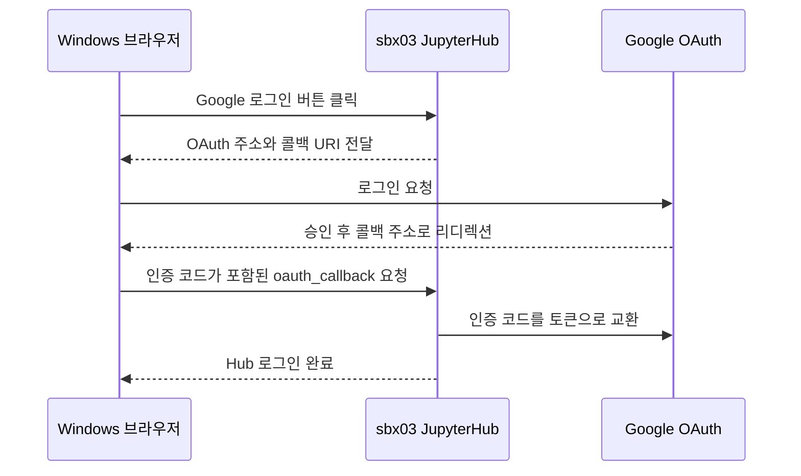

# sbx03 Google OAuth 로그인

JupyterHub가 Google 로그인 후 돌아올 콜백 주소를 OAuth 클라이언트에 등록하는 절차입니다. 브라우저에서 JupyterHub 자체가 열리지 않으면 [내부 HTTPS ALB와 인증서](sbx03-https-certificate-runbook.md)부터 확인합니다.

| 항목 | 테스트 환경 |
|---|---|
| Google Cloud 프로젝트 | `gcp-sbx-edp-gke01` |
| OAuth 클라이언트 | `Web client 1`, 유형 `Web application` |
| JupyterHub 로그인 | `https://jupyter-sbx03.sonmap.net/hub/login` |
| 승인된 리디렉션 URI | `https://jupyter-sbx03.sonmap.net/hub/oauth_callback` |
| 허용 사용자 | 승인 JSON의 `identity.members`, 테스트 계정 `user01@sonmap.net` |
| Secret Manager | `jupyter-oauth-client-id`, `jupyter-oauth-client-secret` |



## 1. Google Auth Platform에서 콜백 주소 추가

1. [Google Auth Platform → 클라이언트](https://console.cloud.google.com/auth/clients?project=gcp-sbx-edp-gke01)를 엽니다. 프로젝트가 `gcp-sbx-edp-gke01`인지 확인하고 **Web client 1**을 선택합니다. 클라이언트가 여러 개라면 Google 오류 세부정보에 나온 `client_id`와 일치하는 항목을 선택합니다.
2. **승인된 리디렉션 URI → URI 추가**에 아래 주소를 추가하고 저장합니다. 기존 과제의 URI는 유지합니다.

   ```text
   https://jupyter-sbx03.sonmap.net/hub/oauth_callback
   ```

3. [JupyterHub 로그인 화면](https://jupyter-sbx03.sonmap.net/hub/login)에서 **Google 로그인 버튼**을 다시 누릅니다. 같은 클라이언트에 URI만 추가하면 Hub의 재배포는 필요 없습니다.

`redirect_uri_mismatch`가 계속 나오면 오류 세부정보의 `redirect_uri`를 복사해 스킴, 호스트, 경로, 마지막 슬래시까지 등록값과 일치하는지 확인합니다. `/hub/login`은 로그인 시작 주소이며, 등록할 주소는 `/hub/oauth_callback`입니다. [Google OAuth 2.0 공식 문서](https://developers.google.com/identity/protocols/oauth2/web-server#authorization-errors-redirect-uri-mismatch)

## 2. Secret Manager와 로그인 검증

기존 클라이언트의 URI만 추가하는 작업에서는 현재 Secret을 사용합니다. 새 클라이언트로 교체하는 경우 [기존 OAuth Secret 등록 절차](jupyterhub-internal-alb-oauth-runbook.md#1-oauth-담당자-준비)에 따라 두 Secret의 새 버전을 등록하고, 배포 절차를 통해 Hub에 반영합니다.

값을 출력하지 않고 버전 상태를 확인합니다.

```bash
gcloud secrets versions describe latest --secret=jupyter-oauth-client-id \
  --project=gcp-sbx-edp-gke01 --account=son@sonmap.net --format='value(state)'
gcloud secrets versions describe latest --secret=jupyter-oauth-client-secret \
  --project=gcp-sbx-edp-gke01 --account=son@sonmap.net --format='value(state)'
```

Windows 브라우저에서 `user01@sonmap.net`으로 로그인한 뒤 Hub로 돌아오는지 확인합니다. Hub 로그의 `302 GET /hub/oauth_callback` 이후 `/hub/` 또는 `/hub/spawn`으로 이동하면 OAuth가 통과한 것입니다.

```bash
CLOUDSDK_CORE_ACCOUNT=son@sonmap.net kubectl --kubeconfig="$HOME/.kube/config-sbx-dns" \
  -n sbx03 logs deployment/hub --since=10m --tail=80
```

| 증상 | 확인할 부분 |
|---|---|
| Google 로그인 화면이 열리지 않음 | Windows VM에서 `accounts.google.com:443` 접속 |
| `400 redirect_uri_mismatch` | 올바른 웹 클라이언트에 실제 콜백 URI가 등록됐는지 확인 |
| `OAuth callback made without a code` | 브라우저에서 콜백 주소를 직접 열지 않고 Hub의 로그인 버튼으로 다시 시작 |
| 로그인 후 사용자 접근 거절 | 승인 JSON의 사용자 목록, `sonmap.net` 도메인, OAuth 앱의 대상 사용자 설정 |
| 로그인 성공 후 Notebook 시작 실패 | `sbx03`의 사용자 Pod 이벤트와 Notebook 로그 확인 |

Terraform이 과제 그룹을 생성하는 Workspace 그룹 관리자 역할은 과제 준비에 사용합니다. 브라우저 로그인은 위 웹 OAuth 클라이언트와 Hub의 사용자 허용 목록을 따릅니다.
