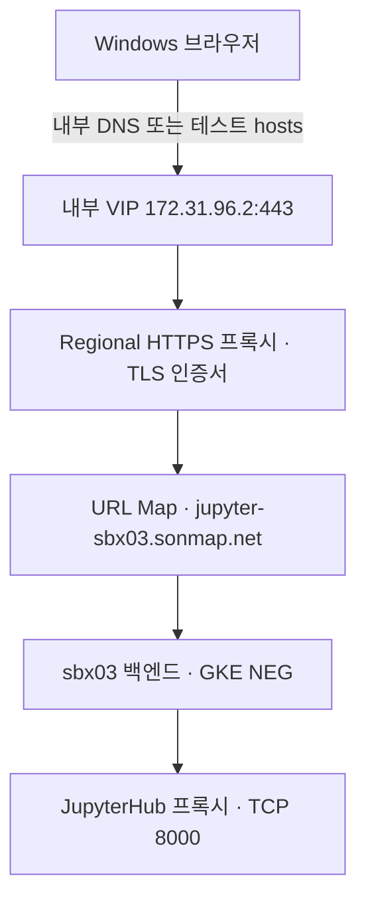

# sbx03 내부 HTTPS ALB와 인증서

이 문서는 `jupyter-sbx03.sonmap.net`을 Windows 테스트 VM에서 접속하는 절차입니다. Google 로그인 설정은 [Google OAuth 절차](sbx03-google-oauth-runbook.md)에 따로 정리했습니다.

| 항목 | 테스트 환경 |
|---|---|
| ALB 프로젝트 / 리전 | `gcp-sbx-edp-gke01` / `asia-northeast3` |
| Shared VPC / VIP 서브넷 | `gcp-prod-edp-hub-vpchost`의 `vpc-prod-edp-hub` / `subnet-prod-edp-alb-frontend-an3` |
| 내부 VIP / 포트 | `172.31.96.2:443` / 예약 이름 `ip-alb-sbxtest01-shared` |
| HTTPS 프록시 / 전달 규칙 | `https-proxy-alb-sbxtest01-shared` / `fr-alb-sbxtest01-shared-https` |
| URL Map / sbx03 백엔드 | `urlmap-alb-sbxtest01-shared` / `bes-jupyter-sbx03` |
| 테스트 인증서 / SAN | `cert-jupyter-sbx03-self` / `jupyter-sbx03.sonmap.net` |
| Windows 테스트 VM | `vm-sbx03-win-test`, 내부 IP `172.31.10.3` |



## 1. 인증서와 HTTPS 프런트엔드 준비

다음 명령은 초기 구성 기록입니다. 리소스가 이미 있다면 생성 명령 대신 마지막 검증 단계로 이동합니다. 공유 프록시에 기존 인증서가 연결되어 있다면 다른 도메인에도 서비스 중일 수 있으므로 연결 목록을 확인한 뒤 필요한 인증서만 추가합니다.

관리 VM에서 테스트용 자체 서명 인증서를 만듭니다. 운영에서는 해당 도메인을 포함하고 클라이언트가 신뢰하는 인증서를 사용합니다.

```bash
umask 077
openssl req -x509 -newkey rsa:2048 -sha256 -nodes -days 90 \
  -keyout /tmp/jupyter-sbx03.key -out /tmp/jupyter-sbx03.crt \
  -subj "/CN=jupyter-sbx03.sonmap.net" \
  -addext "subjectAltName=DNS:jupyter-sbx03.sonmap.net"
```

공개 인증서와 개인키를 사용해 리전 인증서를 등록합니다. 개인키는 인증서를 등록하는 관리 VM에 보관하며 저장소나 Windows 테스트 VM으로 전송하지 않습니다.

```bash
gcloud compute ssl-certificates create cert-jupyter-sbx03-self \
  --project=gcp-sbx-edp-gke01 --region=asia-northeast3 \
  --certificate=/tmp/jupyter-sbx03.crt --private-key=/tmp/jupyter-sbx03.key \
  --account=son@sonmap.net
```

```bash
gcloud compute target-https-proxies create https-proxy-alb-sbxtest01-shared \
  --project=gcp-sbx-edp-gke01 --region=asia-northeast3 \
  --url-map=urlmap-alb-sbxtest01-shared --url-map-region=asia-northeast3 \
  --ssl-certificates=cert-jupyter-sbx03-self --account=son@sonmap.net
```

```bash
gcloud compute forwarding-rules create fr-alb-sbxtest01-shared-https \
  --project=gcp-sbx-edp-gke01 --region=asia-northeast3 \
  --load-balancing-scheme=INTERNAL_MANAGED \
  --network=projects/gcp-prod-edp-hub-vpchost/global/networks/vpc-prod-edp-hub \
  --subnet=projects/gcp-prod-edp-hub-vpchost/regions/asia-northeast3/subnetworks/subnet-prod-edp-alb-frontend-an3 \
  --address=ip-alb-sbxtest01-shared --ports=443 \
  --target-https-proxy=https-proxy-alb-sbxtest01-shared \
  --target-https-proxy-region=asia-northeast3 --account=son@sonmap.net
```

## 2. 내부 DNS와 Windows 테스트 설정

운영 환경은 내부 DNS에 `jupyter-sbx03.sonmap.net → 172.31.96.2` A 레코드를 등록합니다. DNS가 준비되기 전에는 테스트 VM 한 대에서만 hosts 파일을 사용할 수 있습니다. **관리자 권한 PowerShell**에서 아래 명령을 한 번 실행합니다. 기존에 같은 도메인의 항목이 있다면 해당 줄을 수정합니다.

```powershell
Add-Content -Path "$env:SystemRoot\System32\drivers\etc\hosts" -Value "`r`n172.31.96.2 jupyter-sbx03.sonmap.net"
ipconfig /flushdns
```

자체 서명 인증서 테스트는 관리 VM에서 **공개 인증서** `/tmp/jupyter-sbx03.crt`를 Windows 사용자 홈으로 복사합니다. 파일을 직접 작성할 때는 `BEGIN CERTIFICATE`와 `END CERTIFICATE` 구분 줄까지 포함합니다. ALB에 등록한 인증서임을 확인한 뒤 테스트 계정의 신뢰 저장소에 등록합니다.

```powershell
Import-Certificate -FilePath "$env:USERPROFILE\jupyter-sbx03.crt" -CertStoreLocation Cert:\CurrentUser\Root
```

## 3. 접속 검증

관리 VM에서 전달 규칙과 백엔드 상태를 확인합니다.

```bash
gcloud compute forwarding-rules describe fr-alb-sbxtest01-shared-https \
  --project=gcp-sbx-edp-gke01 --region=asia-northeast3 \
  --account=son@sonmap.net --format='yaml(IPAddress,ports,loadBalancingScheme,target)'
gcloud compute backend-services get-health bes-jupyter-sbx03 \
  --project=gcp-sbx-edp-gke01 --region=asia-northeast3 --account=son@sonmap.net
```

Windows VM의 PowerShell에서 이름 확인, TCP 연결, HTTPS 응답을 차례대로 확인합니다.

```powershell
Resolve-DnsName jupyter-sbx03.sonmap.net -Type A
Test-NetConnection 172.31.96.2 -Port 443
curl.exe -sS -o NUL -w "HTTP %{http_code}\n" https://jupyter-sbx03.sonmap.net/hub/login
```

| 결과 | 확인할 부분 |
|---|---|
| 이름 조회 실패 | 내부 DNS 레코드나 테스트 VM의 hosts 파일 |
| TCP 443 실패 | 전달 규칙, VIP, Shared VPC 경로 |
| TCP 성공 후 인증서 오류 | SAN, 유효기간, Windows 신뢰 저장소 |
| `405`와 `x-jupyterhub-version` | `curl -I`의 HEAD 요청에 Hub가 응답한 상태. 위 GET 명령으로 재확인 |
| `502` 또는 `503` | URL Map의 호스트 규칙, 백엔드 `HEALTHY`, GKE NEG |
| 로그인 화면이 열림 | [Google OAuth 설정과 로그인 검증](sbx03-google-oauth-runbook.md)으로 이동 |

참고 [Google Cloud의 Regional Internal ALB 구성](https://cloud.google.com/load-balancing/docs/l7-internal/setting-up-l7-internal), [Windows 인증서 등록](https://learn.microsoft.com/ko-kr/powershell/module/pki/import-certificate).
