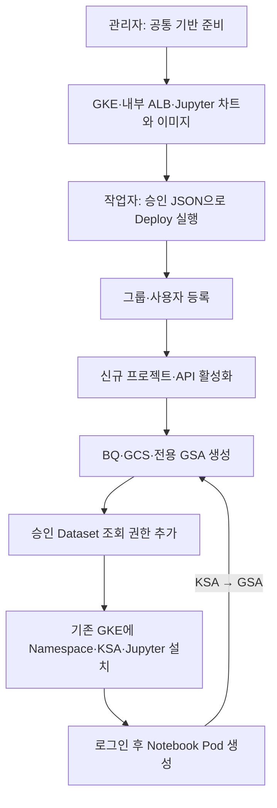
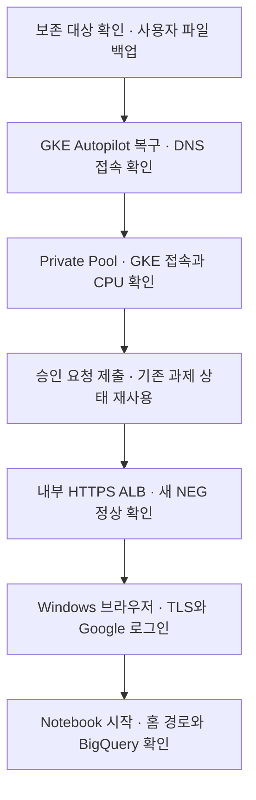
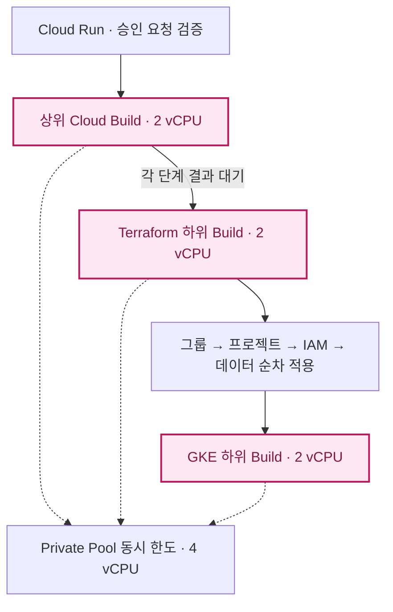
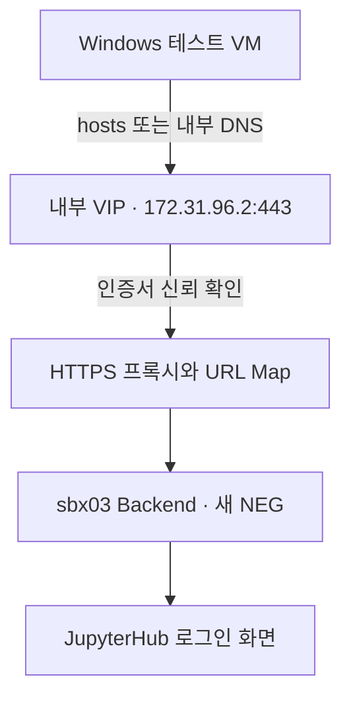
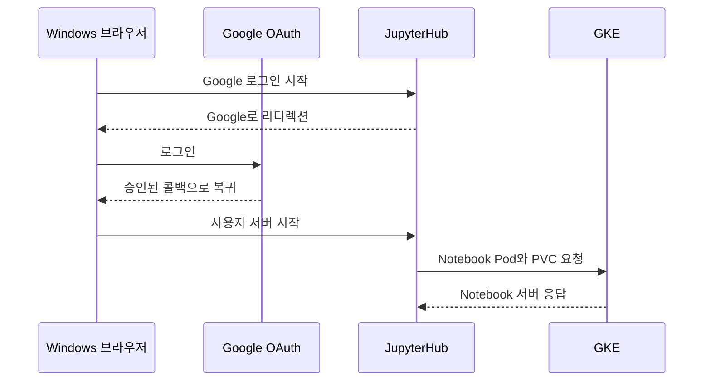
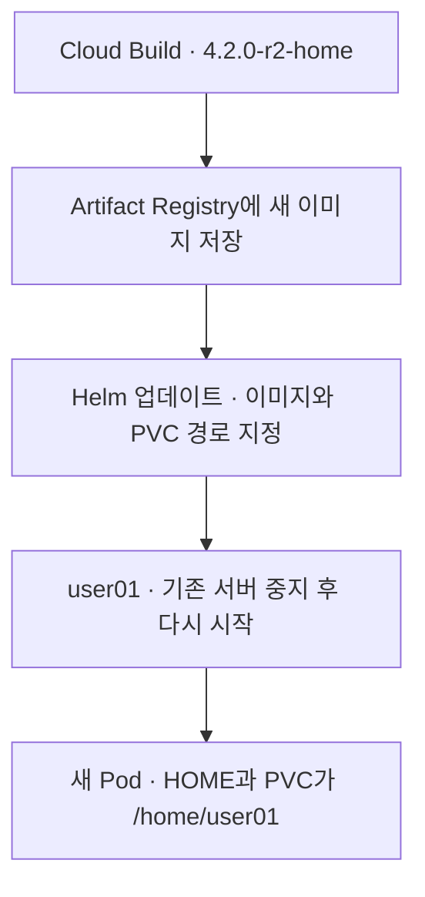

# sbx03 신규 프로젝트 자동 생성

이 문서는 기존 `pjt-net-hub-base` 재사용 절차 대신 사용하는 신규 과제 절차입니다.
GCP 자원은 이 문서 수정만으로 생성되지 않습니다. API 이미지·runner 이미지·Terraform ZIP을 모두 같은 새 release로 발행한 뒤 Deploy합니다.

## 확정 구성

| 구분 | 값 |
|---|---|
| 플랫폼 / 기존 GKE | gcp-sbx-edp-gke01 / gke-sbx-main-an3 |
| 신규 과제 프로젝트 ID 예정 | gcp-sbx-edp-sbx03 (전역 ID 사용 가능 여부는 생성 시 확인) |
| 상위 조직 | 51654893849 (Folder 지정 안 함) |
| 결제 계정 | 019BE7-53DD39-AF5098 |
| Workspace 고객 | C03rw3vtp |
| 그룹 / 사용자 | pgrp-gcp-dev-sbx03@sonmap.net / user01, user02 |
| 신규 BQ / GCS | sbx03_main / gcp-sbx-edp-sbx03-sbx03-data |
| 위치 | asia-northeast3 |
| 신규 GSA | gsa-jupyter-sbx03@gcp-sbx-edp-sbx03.iam.gserviceaccount.com |
| 기존 GKE의 Namespace / KSA | sbx03 / ksa-jupyter-sbx03 |
| 데이터레이크 조회 범위 | pjt-c-admin.dlk_sample 전체 Dataset (TABLE 2개, View 아님) |
| 접속 도메인 예정 | jupyter-sbx03.sonmap.net |

`tf-manager`는 배포 실행, `sbx-manager`는 Run/Workflows 실행 계정으로 유지합니다.
과제의 Notebook은 새 프로젝트의 전용 GSA를 사용합니다. GSA 키를 생성하지 않습니다.



## 1. 최초 관리자 준비 (수동)

수행: `admin@sonmap.net`. 프로젝트 Creator는 조직에, Billing User는 결제 계정에 설정합니다.
이미 적용한 바인딩은 추가할 필요 없습니다. 프로젝트 Owner와 Billing Admin은 별도입니다.

```bash
gcloud organizations add-iam-policy-binding 51654893849 --member="serviceAccount:tf-manager@gcp-sbx-edp-gke01.iam.gserviceaccount.com" --role=roles/resourcemanager.projectCreator --account=admin@sonmap.net
```

결제 계정 CLI IAM 조회/변경이 INVALID_ARGUMENT인 환경에서는 직접 API로 **최신 전체 정책과 etag를 보존**하여 멤버를 추가합니다. 아래 각 명령이 성공한 경우에만 다음 명령을 실행합니다.

```bash
curl --fail-with-body --silent --show-error --max-time 30 -H "Authorization: Bearer $(gcloud auth print-access-token --account=admin@sonmap.net)" "https://cloudbilling.googleapis.com/v1/billingAccounts/019BE7-53DD39-AF5098:getIamPolicy?options.requestedPolicyVersion=3" -o /tmp/sbx-billing-policy.json
```

```bash
jq -e 'select(.etag and .bindings) | if any(.bindings[]; .role == "roles/billing.user") then .bindings |= map(if .role == "roles/billing.user" then .members = ((.members + ["serviceAccount:tf-manager@gcp-sbx-edp-gke01.iam.gserviceaccount.com"]) | unique) else . end) else .bindings += [{"role":"roles/billing.user","members":["serviceAccount:tf-manager@gcp-sbx-edp-gke01.iam.gserviceaccount.com"]}] end | {policy: .}' /tmp/sbx-billing-policy.json > /tmp/sbx-billing-policy-update.json
```

```bash
curl --fail-with-body --silent --show-error --max-time 30 -X POST -H "Authorization: Bearer $(gcloud auth print-access-token --account=admin@sonmap.net)" -H "Content-Type: application/json" --data-binary @/tmp/sbx-billing-policy-update.json "https://cloudbilling.googleapis.com/v1/billingAccounts/019BE7-53DD39-AF5098:setIamPolicy"
```

Workspace Groups Administrator를 tf-manager 고유 ID `110363249940059352517`에 직접 부여하는 작업은 완료된 상태입니다. Workspace roleId는 `51443659324784642`입니다. DWD·SA 키는 필요하지 않습니다.

### 데이터레이크 관리자 사전 위임

Terraform이 **새로 만들어질 GSA**에 Dataset 조회 권한을 자동 추가하려면 tf-manager가 대상 Dataset IAM을 변경할 권한이 필요합니다. 플랫폼 프로젝트 권한만으로는 불가능합니다.
기존 `sa-im-data-admin`의 권한을 자동으로 상속받는 구조도 아닙니다.

최초 수동 작업: `pjt-c-admin`의 BQ 관리자가 승인 Dataset에만 tf-manager의 IAM 관리 권한을 위임합니다. 기본 역할을 사용할 때 `roles/bigquery.dataOwner`는 IAM 외 데이터 변경 권한도 포함하므로 그 범위를 확인해야 합니다. 프로젝트 전체 Owner 부여는 필요하지 않습니다.
위임 전에는 datalake_datasets를 포함한 Deploy를 실행하지 않습니다.

Notebook GSA에는 Terraform이 `roles/bigquery.dataViewer`만 추가합니다. `roles/bigquery.jobUser`는 새 과제 프로젝트에 부여하여 쿼리 비용이 과제 프로젝트에 청구되도록 합니다. 특정 View만 허용할 경우 이 Dataset 전체 조회 설정을 사용하지 말고 View 권한 설계를 별도로 해야 합니다.

## 2. 코드 동기화와 새 릴리스 (수동)

기존 로컬 변경을 먼저 확인하고 필요한 설정 파일을 백업합니다. 로컬 수정이 남아 있으면 덮어쓰지 말고 병합합니다.

```bash
git status --short
```

```bash
git pull --ff-only
```

Customer ID는 더 이상 예시 문자열을 넣지 않고 확인된 실제 값을 사용합니다. DNS 모드는 현재 성공한 연결 방식입니다. DNS 모드 성공만으로 통신회사 사설망 경로 준수까지 입증되는 것은 아닙니다.

```bash
sed -i 's/^CLOUD_IDENTITY_CUSTOMER_ID:.*/CLOUD_IDENTITY_CUSTOMER_ID: C03rw3vtp/' 02.sandbox_setup_01_gcloud/configs/provisioner-env.yaml
```

새 릴리스 이름은 이번 코드 전용 `sbx03-20261107-v1`입니다. 이 태그가 이미 있다면 덮어쓰지 말고 v2 등 새 이름을 사용합니다.
다음 Cloud Build는 공통 배포 도구/API 이미지·Terraform ZIP을 발행하고 Run API를 갱신하며, **과제 프로젝트 생성 자체는 실행하지 않습니다**. 빌드 실행 SA의 Run 배포·이미지/GCS 권한은 공통 준비 사항입니다.

```bash
gcloud builds submit . --config=03.cloudbuild/platform-release.yaml --project=gcp-sbx-edp-gke01 --region=asia-northeast3 --account=son@sonmap.net --service-account=projects/gcp-sbx-edp-gke01/serviceAccounts/tf-manager@gcp-sbx-edp-gke01.iam.gserviceaccount.com --gcs-source-staging-dir=gs://gcp-sbx-edp-gke01-sbxtest01-build-source/source --substitutions="_RELEASE_ID=sbx03-20261107-v1,_COMMIT_SHA=$(git rev-parse HEAD)"
```

## 3. 요청 준비 (포탈 JSON)

[신규 과제 요청 템플릿](../../05.sandbox_json/sbx03-request.template.json)을 사용합니다. `approval.status=PENDING`, 승인 번호/일시 공란, source 해시 0인 **배포 불가 초안**입니다. 포탈의 실제 승인 정보와 새 릴리스 결과를 넣어야 합니다. 예전 승인 정보나 manual-20261107의 ZIP/해시를 재사용하지 않습니다.

```bash
gcloud storage cat gs://gcp-sbx-edp-gke01-sbxtest01-bundles/platform-releases/sbx03-20261107-v1/release.json --account=son@sonmap.net
```

릴리스 확인 후 `source`에 해당 archive_uri/generation/sha256/release_id를 그대로 반영합니다.
과제 프로젝트와 GSA·그룹·BQ·GCS는 수동 생성하지 않습니다. 승인 JSON 업로드 및 Workflows Deploy는 [기존 명령 절차](operator-command-guide.md)를 따릅니다.

## 4. 자동 수행 영역

1. Workspace 그룹과 구성원 생성.
2. 신규 프로젝트 생성·Billing 연결·API 활성화·배포 SA 권한 설정.
3. 그룹의 과제 프로젝트 권한 설정.
4. 새 프로젝트 전용 GSA·BQ·GCS 생성 및 권한 부여.
5. 승인 데이터레이크 Dataset에 전용 GSA의 dataViewer 추가.
6. GKE 프로젝트의 `gcp-sbx-edp-gke01.svc.id.goog[sbx03/ksa-jupyter-sbx03]`를 새 GSA의 workloadIdentityUser로 연결.
7. KSA annotation, JupyterHub 설정, NEG·과제별 ALB 백엔드와 URL Map 경로 구성 및 검증.
8. 로그인한 사용자의 Notebook Pod 생성.

기존 요청은 `identity.create_jupyter_gsa`를 생략하면 기존 공통 SA를 사용합니다. 신규 프로젝트 요청은 이 값을 true로 지정해야 합니다. 전용 GSA 이름 제한 때문에 task.name은 최대 18자입니다.

## 5. 초기 배포 시 별도로 확인할 수동 작업

실제 시험 결과와 재시험 순서는 아래 6절을 따릅니다.

- 내부 ALB VIP 172.31.96.2와 공통 헬스 체크·백엔드·URL Map은 준비됨.
- 인증서·HTTPS 프록시·전달 규칙·DNS 연결은 별도 진행. 이것이 완료되어야 사용자 HTTPS 접속 가능.
- OAuth 실제 값·redirect URI에 신규 도메인 반영 확인.
- 데이터레이크 Dataset IAM 위임 및 신규 프로젝트의 조직 정책·할당량 확인.
- GCS 저장 자동 트리거는 후속 작업. 현재는 작업자가 Deploy만 시작하고 이후 과제 생성은 자동 실행.

로컬 테스트는 통과했지만 실제 새 프로젝트 생성, GSA 토큰 발급, BQ 쿼리는 클라우드 배포 후 검증해야 합니다.

## 6. 실제 작업 기록과 다음 테스트 순서

2026-11-07 시험 기준입니다. 기존 환경의 재시험은 6.1에서 보존할 자원을 확인한 뒤 시작합니다. 처음 만드는 환경이라면 위 1~3단계에서 관리자 준비와 릴리스를 먼저 완료합니다.



### 6.1 삭제 전 확인과 백업

관리 VM `infra-son01`에서 아래 명령으로 테스트 네임스페이스와 사용자 PVC를 확인합니다. GKE에는 다른 과제의 네임스페이스도 있을 수 있으므로 클러스터 삭제 범위를 먼저 확인합니다.

```bash
CLOUDSDK_CORE_ACCOUNT=son@sonmap.net kubectl --kubeconfig="$HOME/.kube/config-sbx-dns" get namespaces
CLOUDSDK_CORE_ACCOUNT=son@sonmap.net kubectl --kubeconfig="$HOME/.kube/config-sbx-dns" -n sbx03 get pods,pvc -o wide
```

1. 사용자에게 작업 저장을 요청하고, 재사용할 Notebook 파일을 승인된 GCS 버킷 또는 별도 저장 위치에 복사해 열어봅니다. 디스크 단위 복원이 필요하면 PVC에 연결된 PV와 디스크를 기록하고 스냅샷을 준비합니다.
2. 과제 프로젝트, Workspace 그룹, Terraform 상태·번들, AR 이미지·Helm 차트, 요청 GCS, OAuth Secrets와 ALB·DNS를 보존 대상으로 기록합니다. GKE만 삭제할 때는 이 자원들을 다음 시험에서 재사용합니다.
3. GKE 삭제 후에도 Windows VM, 별도 디스크·스냅샷, ALB 등 보존 자원은 과금될 수 있습니다. 테스트 VM이 필요 없으면 종료하고, 인터넷 RDP를 위해 추가한 테스트용 방화벽 규칙과 외부 IP 예외 정책의 정리 여부도 확인합니다.

새 클러스터에서 같은 이름의 PVC를 생성해도 이전 파일이 자동으로 연결되는 것은 아닙니다. 파일 백업을 복원하거나 스냅샷에서 복구한 볼륨을 별도로 연결합니다.

### 6.2 GKE 복구와 Private Pool 점검

[공통 기반 18번의 Autopilot 생성 명령](../../02.sandbox_setup_01_gcloud/03-foundation.md)으로 `gcp-sbx-edp-gke01` / `asia-northeast3`의 `gke-sbx-main-an3`을 다시 만듭니다. 기존 Shared VPC `vpc-prod-edp-hub`, 노드 서브넷 `subnet-prod-sbx-gke-01`, Pod 보조 대역 `subnet-prod-sbx-pod-01`을 사용합니다.

생성이 끝나면 관리 VM에서 DNS 엔드포인트를 설정하고 kubeconfig를 다시 받습니다.

```bash
gcloud container clusters update gke-sbx-main-an3 --project=gcp-sbx-edp-gke01 --region=asia-northeast3 --enable-dns-access --account=son@sonmap.net
KUBECONFIG="$HOME/.kube/config-sbx-dns" gcloud container clusters get-credentials gke-sbx-main-an3 --project=gcp-sbx-edp-gke01 --region=asia-northeast3 --dns-endpoint --account=son@sonmap.net
CLOUDSDK_CORE_ACCOUNT=son@sonmap.net kubectl --kubeconfig="$HOME/.kube/config-sbx-dns" get namespaces
```

관리 VM 접속에 성공한 뒤 [Private Pool에서 GKE 접속 확인](git-sync-current-environment.md)을 실행합니다. 배포 설정은 `GKE_ENDPOINT_MODE=dns`를 사용합니다.

```bash
gcloud builds worker-pools describe pool-sbxtest01 --project=gcp-sbx-edp-gke01 --region=asia-northeast3 --account=son@sonmap.net --format='yaml(state,privatePoolV1Config.workerConfig.machineType)'
```

실제 시험에서 풀을 `e2-standard-4`에서 `e2-standard-2`로 줄였습니다. 기존 하위 빌드가 계속 대기해 해당 빌드를 취소했고, 상위 빌드도 종료된 뒤 새 요청으로 재시도했습니다. 동시 CPU 한도 4 vCPU에서 새 상위·하위 빌드가 각각 2 vCPU를 사용해 실행됐습니다. 풀 설정을 바꾼 뒤에는 기존 실행 상태를 먼저 확인합니다.



### 6.3 같은 sbx03을 다시 배포

1. 포털에서 재시험용 승인 요청을 새 ID로 준비합니다. 대상 프로젝트 `gcp-sbx-edp-sbx03`, 과제 이름 `sbx03`, 검증한 릴리스의 `source` 필드를 확인합니다. 시험에서 성공한 릴리스는 `sbx03-20261107-v2`, 최종 요청은 `REQ-20261107-SBX03-003`이었습니다.
2. [승인 JSON 업로드 및 Workflow 제출](operator-command-guide.md)에서 새 요청 ID와 GCS 객체 버전·SHA256을 지정합니다. 기존 요청 ID를 그대로 제출하면 이전 빌드 기록이 반환될 수 있습니다.
3. Workflow 접수 이후 상위 빌드와 Infrastructure Manager의 각 적용 상태를 확인합니다. 같은 과제의 기존 Terraform 배포 상태를 유지해야 이미 만든 그룹·프로젝트·데이터 자원을 이어서 사용합니다.

```bash
gcloud builds list --project=gcp-sbx-edp-gke01 --region=asia-northeast3 --account=son@sonmap.net --limit=8 --format='table(id,createTime,status)'
gcloud infra-manager deployments describe projects/gcp-sbx-edp-gke01/locations/asia-northeast3/deployments/sbxtest01-sbx03-67245d15-project --account=son@sonmap.net --format='yaml(state,latestRevision,latestSuccessfulRevision,errorCode)'
```

| 실제 진행 중 만난 문제 | 조치와 확인 |
|---|---|
| Workflow 400, Cloud Build API 제출 오류 | Cloud Run에 SDK 수정 버전 적용. Workflow에서 승인 요청 접수 확인 |
| 하위 빌드 `QUEUED` | 상위·하위 상태와 동시 CPU 한도 확인. 시험에서는 풀을 2 vCPU로 변경하고 새 요청으로 재시도 |
| 프로젝트 단계 `REVISION_FAILED`와 Cloud Billing API `SERVICE_DISABLED` | 플랫폼 프로젝트 `gcp-sbx-edp-gke01`에서 `cloudbilling.googleapis.com` 활성화 후 새 요청 제출 |

### 6.4 내부 ALB와 테스트 Windows 접속

재배포 후 과제 백엔드에 새 클러스터의 NEG가 연결되어 `HEALTHY`인지 확인합니다. 기존 VIP·프록시·인증서가 남아 있다면 이를 재사용합니다.

```bash
gcloud compute backend-services get-health bes-jupyter-sbx03 --project=gcp-sbx-edp-gke01 --region=asia-northeast3 --account=son@sonmap.net
```

Windows 시험 VM은 Shared VPC의 `subnet-prod-edp-admin-an3`에 배치했습니다. 기존 VM이 있으면 이를 사용합니다. 새 VM이 필요하면 이미지 최소 디스크 크기를 확인하고 외부 IP 없는 Spot VM을 생성합니다.

```bash
WIN_DISK_GB="$(gcloud compute images describe-from-family windows-2022 --project=windows-cloud --account=admin@sonmap.net --format='value(diskSizeGb)')"
if [[ "$WIN_DISK_GB" =~ ^[1-9][0-9]*$ ]]; then
  gcloud compute instances create vm-sbx03-win-test --project=gcp-prod-edp-hub-vpchost \
    --zone=asia-northeast3-c --subnet=subnet-prod-edp-admin-an3 --machine-type=e2-small \
    --provisioning-model=SPOT --instance-termination-action=STOP \
    --no-address --no-service-account --no-scopes \
    --image-family=windows-2022 --image-project=windows-cloud \
    --boot-disk-type=pd-standard --boot-disk-size="${WIN_DISK_GB}GB" --account=admin@sonmap.net
fi
```

부팅이 끝나면 Windows 시험 계정의 비밀번호를 발급합니다. VM이 `RUNNING`이어도 Windows 초기화 중에는 발급이 실패할 수 있습니다. 이때는 부팅 완료 후 다시 실행합니다.

```bash
gcloud compute reset-windows-password vm-sbx03-win-test --project=gcp-prod-edp-hub-vpchost --zone=asia-northeast3-c --user=sbx-test-admin --account=admin@sonmap.net
```

내부 접속 경로가 필요할 때는 IAP용 태그가 적용된 VM에 로컬 PC에서 아래 명령으로 터널을 엽니다. 기존 IAP IAM과 방화벽이 적용돼 있어야 합니다.

```powershell
gcloud compute start-iap-tunnel vm-sbx03-win-test 3389 --project=gcp-prod-edp-hub-vpchost --zone=asia-northeast3-c --local-host-port=localhost:13389 --account=admin@sonmap.net
```

별도 창에서 `mstsc /v:localhost:13389`로 접속합니다. 지난 시험에서는 인터넷 직접 RDP를 위해 테스트 VM 한 대에만 외부 IP 정책 예외를 적용했고, 접속 PC 공인 IP 범위로 RDP를 제한했습니다. 조직 정책과 방화벽 권한을 확인한 뒤 필요한 시험 경로만 사용합니다.



[HTTPS 인증서 문서](sbx03-https-certificate-runbook.md)에서 Windows hosts, `CurrentUser\Root` 공개 인증서 등록, TCP 443과 HTTP GET 점검을 순서대로 실행합니다. `curl -I`에서 `405`와 JupyterHub 헤더가 나오면 GET 요청으로 로그인 화면을 확인합니다.

### 6.5 Google 로그인과 Notebook 시작

[Google OAuth 문서](sbx03-google-oauth-runbook.md)에 따라 `Web client 1`의 승인된 리디렉션 URI에 `https://jupyter-sbx03.sonmap.net/hub/oauth_callback`이 있는지 확인합니다. 시험에서는 이 값을 등록해 `redirect_uri_mismatch`를 해결했고, Hub 로그에서 `user01`의 OAuth 콜백과 서버 시작 요청이 확인됐습니다.



서버가 열리지 않으면 관리 VM에서 Pod와 이벤트를 확인합니다. 지난 시험은 OAuth 이후 Pod 배치·디스크 연결·이미지 다운로드·컨테이너 시작까지 갔지만, 한 차례 Hub가 30초 안에 Notebook 응답을 받지 못했습니다. 이 경우 Notebook 로그를 먼저 확인합니다.

```bash
CLOUDSDK_CORE_ACCOUNT=son@sonmap.net kubectl --kubeconfig="$HOME/.kube/config-sbx-dns" -n sbx03 get pods,pvc -o wide
CLOUDSDK_CORE_ACCOUNT=son@sonmap.net kubectl --kubeconfig="$HOME/.kube/config-sbx-dns" -n sbx03 get events --sort-by=.lastTimestamp | tail -n 20
```

### 6.6 사용자별 홈과 BigQuery 최종 확인

[Notebook 이미지 빌드 및 Helm 적용](../../04.Jupiter-setup-image/README.md)에서 `4.2.0-r2-home`을 적용합니다. 시험 중 Docker 빌더가 `COPY --chmod`를 지원하지 않아 Dockerfile을 `COPY`와 `RUN chmod`로 나눴습니다. 수정 후 빌드가 완료됐고, 기존 `sbx03` Helm 업데이트는 `REVISION: 2`, `STATUS: deployed`로 확인했습니다. 이전 runner 릴리스로 다시 배포하면 현재 Helm 값과 Notebook 이미지 태그를 확인하고 필요하면 홈 설정을 다시 적용합니다.



1. [JupyterHub 제어판](https://jupyter-sbx03.sonmap.net/hub/home)에서 작업을 저장한 뒤 **Stop My Server → Start My Server**를 실행합니다. JupyterLab 터미널에서 `echo "$HOME"`과 `pwd`가 `/home/user01`을 표시하고, 복원한 파일이 보이는지 확인합니다.
2. 같은 Notebook에서 과제 프로젝트 `gcp-sbx-edp-sbx03`, 위치 `asia-northeast3`로 BigQuery 작업을 실행합니다. 승인된 테이블 `pjt-c-admin.dlk_sample.sales_sample`의 `SELECT ... LIMIT 1`이 성공하면 Workload Identity와 조회 권한까지 검증한 것입니다.

기록상 확인된 완료 지점은 **Google 로그인과 Helm 업데이트 성공**입니다. 새 Pod의 홈 경로와 BigQuery 조회는 재시험에서 결과를 확인합니다.
