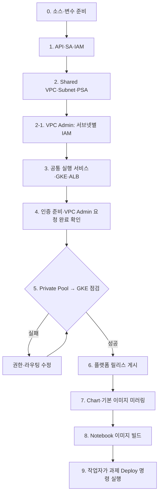
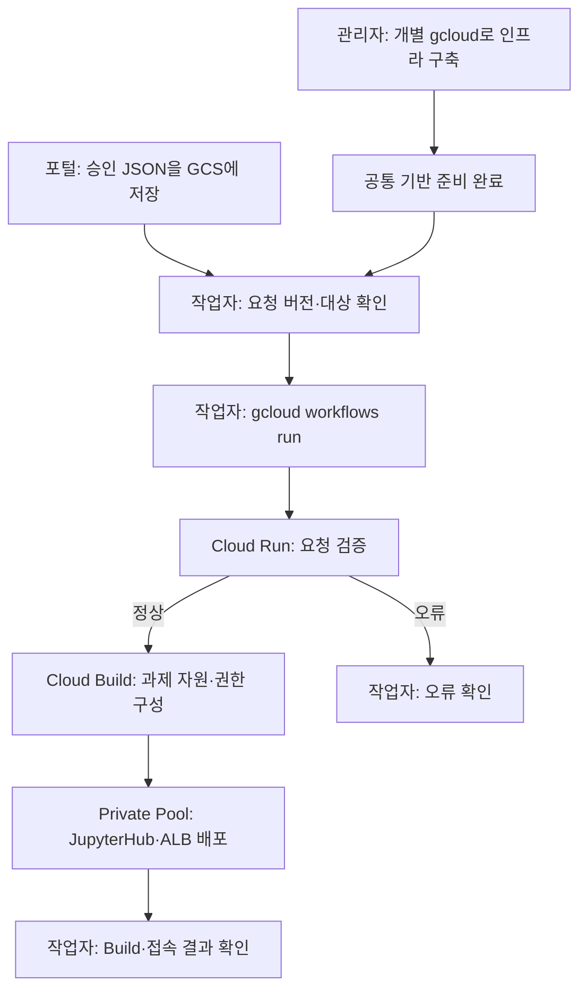

# 작업 순서와 실행 링크

> **[서브넷별 IAM](../../02.sandbox_setup_01_gcloud/02-subnet-iam.md)**: VPC Admin이 네트워크를 준비한 뒤 GKE·ALB VIP 서브넷에 필요한 계정만 사용 권한을 부여합니다. 이후 tf-manager로 내부 ALB를 구성합니다.

> **[내부 사설 ALB 설계](internal-alb-design.md)**: ALB·VIP는 gcp-sbx-edp-gke01, /27 VIP Subnet과 최소 /26 프록시 Subnet은 Shared VPC Host에 둡니다. 후보 CIDR은 VPC Admin 승인 후 적용합니다.

> **[IP 최소화 구성](minimal-ip-design.md)**: Cloud Run·과제별 서브넷은 기본 생성하지 않고, 기존 GKE·Private Pool PSA를 유지·재사용합니다.

> **프로젝트 통합:** GKE·Build·Workflows·AR·GCS·Run·IM과 두 서비스 계정을 모두 **gcp-sbx-edp-gke01**에 구성합니다. [통합 자원·실행 순서·기존 배포 확인](tf-manager-project.md)

> **담당 구분:** Private Pool → GKE 사설 경로와 기존 BigQuery 데이터 조회 권한은 **VPC Admin 요청사항**입니다. 인증서·DNS는 **별도 진행**합니다. tf-manager의 그룹 관리자 역할은 과제 Google Group 관리용, Jupyter OAuth는 사용자 로그인용입니다. [담당자 요청서·인증 설명](admin-requests.md)을 확인하세요.

주 대상은 **SBX_GKE_PROJECT="gcp-sbx-edp-gke01"**입니다. 아래 Mermaid 번호와 표의 번호를 맞춰 작업합니다. **표의 실행 문서 링크를 눌러 명령을 확인하고, 관리 VM의 저장소 루트 GCP_SBX_Test01에서 한 단계씩 실행합니다.** 폴더 링크는 소스 확인용이며 링크 클릭만으로 GCP 작업이 실행되지는 않습니다. 하위 폴더로 이동해서 명령을 실행하면 상대경로가 달라질 수 있습니다.

## ① 공통 기반 준비 — 관리자 수동·반자동

최초 구축하거나 공통 설정·이미지를 변경할 때 수행합니다. 과제마다 반복하지 않습니다. 기존 자원은 조회 후 필요한 명령만 실행합니다.

| 순서 | 작업자 / 작업 | 실행 문서 — 클릭 후 명령 실행 | 관련 폴더 | 완료 기준 |
|---|---|---|---|---|
| 0 | 운영자: 소스 받기·도구·변수 확인 | [소스 준비](runbook-two-stage.md#0-소스-받기기본-변수-설정), [공통 변수](../../02.sandbox_setup_01_gcloud/00-variables.md) | [01.docs](../), [02.gcloud](../../02.sandbox_setup_01_gcloud) | 계정·프로젝트 조회 성공 |
| 1 | 권한 관리자: API·sbx-manager·tf-manager·IAM | [01-admin.md](../../02.sandbox_setup_01_gcloud/01-admin.md) | [02.gcloud](../../02.sandbox_setup_01_gcloud) | 두 SA 조회·위임 성공 |
| 2 | VPC Admin: VPC·Subnet·PSA·방화벽 | [02-network.md](../../02.sandbox_setup_01_gcloud/02-network.md) | [02.gcloud](../../02.sandbox_setup_01_gcloud) | 대역·연결 확인 |
| 2-1 | VPC Admin: 필요한 계정에 Subnet Network User | [02-subnet-iam.md](../../02.sandbox_setup_01_gcloud/02-subnet-iam.md) | [02.gcloud](../../02.sandbox_setup_01_gcloud) | GKE·VIP Subnet 정책 확인 |
| 3 | 인프라 관리자: GCS·AR·Pool·GKE·Run·Workflow·ALB | [03-foundation.md](../../02.sandbox_setup_01_gcloud/03-foundation.md) | [02.gcloud](../../02.sandbox_setup_01_gcloud), [03.cloudbuild](../../03.cloudbuild) | GKE RUNNING·API healthz 정상 |
| 4 | Workspace·OAuth 담당자 인증 준비 / VPC Admin 사설 경로·BQ 권한 요청 / 인증서·DNS 별도 진행 | [OAuth 등록 명령](../../02.sandbox_setup_01_gcloud/04-manual-gcloud.md#4-oauth-값-등록), [그룹 관리자 역할 직접 부여](runbook-two-stage.md#4-2-cloud-identity-그룹-관리자-역할), [인증·도메인 안내](jupyterhub-internal-alb-oauth-runbook.md) | [01.docs](../), [02.gcloud](../../02.sandbox_setup_01_gcloud) | OAuth Secret ENABLED·tf-manager 그룹 관리자 역할 부여·도메인/인증서 준비 |
| 5 | 운영자: Private Pool에서 GKE API 조회 | [접속 점검 명령](runbook-two-stage.md#5-private-pool에서-gke-사설-api-연결-확인), [점검 YAML](../../03.cloudbuild/check-private-gke.yaml) | [01.docs](../) | 점검 Build SUCCESS |
| 6 | 운영자: API·배포 도구 이미지와 Terraform 소스 게시 | [플랫폼 릴리스 명령](../../02.sandbox_setup_01_gcloud/04-manual-gcloud.md#5-플랫폼-릴리스-게시) | [03.cloudbuild](../../03.cloudbuild) | Build SUCCESS·release.json 생성 |
| 7 | 운영자: Chart·기본 이미지를 내부 AR로 복사 | [미러링 명령](../../02.sandbox_setup_01_gcloud/04-manual-gcloud.md#6-chart와-기본-이미지-미러링) | [03.cloudbuild](../../03.cloudbuild) | AR 차트 조회와 기본 이미지 Build SUCCESS |
| 8 | 운영자: Notebook 표준 이미지 빌드 | [Notebook 빌드 명령](../../02.sandbox_setup_01_gcloud/04-manual-gcloud.md#7-notebook-표준-이미지-빌드) | [04.Notebook 이미지](../../04.Jupiter-setup-image) | 이미지 조회 성공 |
| 9 | 운영자: GCS의 승인 JSON을 지정해 Deploy 시작·결과 확인 | [Deploy 실행 명령](../../02.sandbox_setup_01_gcloud/05-deploy.md) | [02.gcloud](../../02.sandbox_setup_01_gcloud), [07.API](../../07.sandbox_request_api) | 부모·자식 Build SUCCESS·사용자 접속 확인 |

3단계의 HTTPS Proxy 구성 전에 인증서가 필요합니다. 인증서가 없다면 해당 명령을 보류하고 4단계 담당자 준비 후 완료합니다. Private Pool의 GKE 사설 경로는 PSA 생성만으로 완성되지 않으며, 5단계 통과가 필수입니다.

## 현재 운영 — 작업자가 Deploy 명령 실행

인프라는 관리자가 개별 gcloud 명령으로 준비합니다. 포털은 승인 JSON을 GCS에 저장하고, 작업자는 [Deploy 명령 문서](../../02.sandbox_setup_01_gcloud/05-deploy.md)에 따라 요청을 지정해 배포를 시작합니다. GCS 이벤트 연결은 현재 필수 작업이 아닙니다.

| 구간 | 지금 수행하는 방식 | 문서·소스 |
|---|---|---|
| 공통 인프라 | 작업자가 gcloud 명령을 한 줄씩 수행 | [01-admin](../../02.sandbox_setup_01_gcloud/01-admin.md), [02-network](../../02.sandbox_setup_01_gcloud/02-network.md), [03-foundation](../../02.sandbox_setup_01_gcloud/03-foundation.md) |
| 공통 이미지 준비 | 작업자가 빌드·릴리스 gcloud 명령을 직접 제출 | [04-manual-gcloud](../../02.sandbox_setup_01_gcloud/04-manual-gcloud.md) |
| 과제 Deploy 시작 | 작업자가 GCS 요청을 지정하고 Deploy 명령 실행 | [05-deploy](../../02.sandbox_setup_01_gcloud/05-deploy.md) |
| Deploy 내부 처리 | 기존 API·Build가 검증·Terraform·GKE 배포 수행 | [07.API](../../07.sandbox_request_api), [08.Terraform](../../08.sandbox_setup_02_terraform), [09.GKE 배포](../../09.sandbox_gke_deployer) |
| 배포 결과 확인 | 작업자가 Build·GKE·접속 결과 확인 | [Deploy 결과 확인](../../02.sandbox_setup_01_gcloud/05-deploy.md#4-deploy-결과-확인) |
| 이후 자동화 | GCS 이벤트 → Deploy 시작·완료 추적·포털 결과 전달 | 향후 작업, 현재 구축 필수 단계에서 제외 |

주 대상은 SBX_GKE_PROJECT=gcp-sbx-edp-gke01입니다. Workflow 성공·ACCEPTED는 접수 성공이며, 배포 완료는 부모·자식 Build 결과로 확인합니다. 사용자 Notebook Pod는 로그인 후 서버를 시작할 때 생성됩니다.

## 수동 연동 시험·장애 점검

포털 연동 전에는 [실제 수행 절차의 9~11단계](runbook-two-stage.md)를 사용해 요청을 제출하고 배포·로그인·BQ를 확인합니다. [10.sandbox_deploy_tools](../../10.sandbox_deploy_tools)는 시험·점검 도구이며 운영 요청마다 사람이 실행하는 필수 단계가 아닙니다. [11.tests](../../11.tests)는 코드 변경 후 검사에 사용합니다.
