# 1차 인프라 구축

관리 VM `infra-son01`의 Test02 저장소 루트에서 작업합니다. Sandbox 프로젝트팀은 플랫폼 프로젝트를 관리합니다. Shared VPC 운영팀은 기존 호스트의 네트워크와 IAM 변경 요청을 처리하고, 필요한 경우 Private Pool 최초 생성을 담당합니다. 각 터미널에서 로그인 계정과 대상 프로젝트를 확인하고 필요한 명령을 한 줄씩 실행합니다.

**Private Pool 적용 시점** · 수동 Helm 설치만 할 때는 Pool 구성을 보류할 수 있습니다. `sbx03` 자동 배포를 실행할 때는 3-17절에서 Pool을 준비하고 GKE 접속을 확인합니다.

| 범위 | 명령서의 기본값 |
|---|---|
| 실행 위치 | 관리 VM `infra-son01`의 Test02 저장소 루트 |
| 플랫폼 프로젝트 | `SBX_GKE_PROJECT=gcp-sbx-edp-gke01` · GKE, ALB, Cloud Build, Cloud Run, Workflows, AR, GCS |
| Shared VPC 호스트 | `VPC_HOST_PROJECT=gcp-prod-edp-hub-vpchost` · VPC, 서브넷, 방화벽, PSA |
| 로그인 계정 | `ADMIN_ACCOUNT=son@sonmap.net`, `VPC_ADMIN_ACCOUNT=admin@sonmap.net`, `AR_ACCOUNT=son@sonmap.net` |
| 서비스 계정 | `TF_MANAGER=tf-manager@gcp-sbx-edp-gke01.iam.gserviceaccount.com`, `SBX_MANAGER=sbx-manager@gcp-sbx-edp-gke01.iam.gserviceaccount.com` |

각 명령 위의 주석에서 대상 프로젝트와 로그인 계정을 확인합니다. `가장`은 `--impersonate-service-account`로 API를 호출하는 계정이고, `워크로드 실행`은 `--service-account`로 지정하는 Build·Cloud Run·Workflows 실행 계정입니다. `--member`에 적힌 계정은 IAM 권한을 받는 주체입니다.

각 대제목 아래의 **내용 펼치기 / 접기**를 눌러 명령과 설명을 볼 수 있습니다.

| 단계 | 명령과 확인 절차 |
|---|---|
| 준비 | [공통 변수](#0-공통-변수) |
| 공통 인프라 | [API·IAM](#1-api와-관리자-권한) → [Shared VPC](#2-shared-vpc와-네트워크) → [서브넷 IAM](#2-2-서브넷별-iam) → [GKE·AR·ALB](#3-공통-기반) |
| JupyterHub 구축·검증 | [차트 반입과 이미지 준비](#4-jupyterhub-이미지-준비와-수동-설치) → [수동 기동 확인](#4-4-jupyterhub-수동-설치와-기동-확인) → [과제 HTTPS·로그인 검증](#4-5-과제용-내부-https-및-로그인-검증) |
| 기존 과제별 자동 배포 준비 | [Workspace 그룹스 관리자 역할](#1-4-2-google-workspace-그룹스-관리자-역할-부여) · [Workspace 고객 ID](#5-기존-과제별-자동-배포용-workspace-설정) · [Private Pool 점검](reference/cloudbuild-private-gke-vpn-design.md) |
| 2차 배포 | [공유 그룹 및 과제 배포](../03.sandbox_deploy/README.md#배포-흐름) · [기존 과제별 Workflows](../03.sandbox_deploy/03.1.request/legacy-deploy.md) |

그룹 공유 PoC만 구성하는 환경에서 공통 자원을 준비할 때는 기존 자동 배포용 Cloud Run·Workflows와 Google OAuth 구간을 구분해 적용합니다. 기존 환경에서는 자원 조회 결과를 확인한 뒤 필요한 생성·갱신 명령만 실행합니다.

<a name="0-공통-변수"></a>

<a name="-0-공통-변수"></a>

## 0. 공통 변수

<details>
<summary>내용 펼치기 / 접기</summary>

<a name="프로젝트-기준과-변수명"></a>

### 0-1. 프로젝트 기준과 변수명

이 작업의 주 대상은 **SBX_GKE_PROJECT=gcp-sbx-edp-gke01**입니다. 공통 GKE와 Sandbox의 JupyterHub·Notebook Pod가 이 프로젝트에서 실행됩니다. 자동화 실행·이미지 보관은 SBX_GKE_PROJECT, Shared VPC는 VPC_HOST_PROJECT, 과제의 데이터·Query Job 자원은 2차 배포 요청의 `project.project_id`에 지정한 프로젝트에 둡니다. 신규 과제는 2차 Sandbox 배포에서 프로젝트를 생성하고, `10-project` Terraform이 필요한 API와 후속 배포용 프로젝트 IAM을 설정합니다.

```bash
export SBX_GKE_PROJECT="gcp-sbx-edp-gke01"          # 주 대상: Sandbox GKE
export SBX_NAME="sbx01"                      # 과제·Namespace 이름
export VPC_HOST_PROJECT="gcp-prod-edp-hub-vpchost"   # Shared VPC
```

변수명은 대소문자를 구분합니다. SBX_GKE_PROJECT를 모든 자동화·GKE 자원의 공통 프로젝트 변수로 사용합니다. Cloud Run API와 Build 배포 코드 사이의 실행 환경변수도 SBX_GKE_PROJECT로 통일했습니다. Cloud Build 사용자 치환 변수는 형식 제약에 맞춰 _SBX_GKE_PROJECT를 사용합니다. Cloud Run 설정과 API·배포 도구 이미지는 함께 갱신해야 합니다. JSON의 project.project_id·gke.project_id와 Terraform 입력 필드명은 포털 요청 규격이므로 유지합니다.

저장소 루트에서 아래 값을 확인한 뒤 블록을 복사합니다. 변수 지정과 프로젝트 번호 조회만 수행하며 자원은 생성하지 않습니다. 새로운 터미널에서는 다시 설정합니다. 이 값은 기존 PoC 기준이며 프로젝트·GKE 변경은 런타임 Schema와 YAML 입력 파일도 함께 맞춰야 합니다.

```bash
unset CLOUDSDK_AUTH_IMPERSONATE_SERVICE_ACCOUNT
export ADMIN_ACCOUNT=son@sonmap.net
# 실행 프로젝트 작업자는 son, Shared VPC·초기 권한 관리자는 admin으로 구분합니다.
export VPC_ADMIN_ACCOUNT="${VPC_ADMIN_ACCOUNT:-admin@sonmap.net}"
export OPERATOR_MEMBER=user:son@sonmap.net
export SBX_GKE_PROJECT="gcp-sbx-edp-gke01"
export VPC_HOST_PROJECT="gcp-prod-edp-hub-vpchost"
export FOLDER_ID=154455658682
export REGION=asia-northeast3
export NETWORK=vpc-prod-edp-hub
# 내부 ALB 대역 후보: VPC Admin의 실제 중복 확인·승인 후 실행합니다.
export ILB_VIP_SUBNET=subnet-prod-edp-alb-frontend-an3
export ILB_VIP_CIDR=172.31.96.0/27
export ILB_VIP_ADDRESS="" # 예약 후 실제 할당 주소 조회
export ILB_PROXY_SUBNET=subnet-prod-sbx-ilb-proxy
export ILB_PROXY_CIDR=172.31.111.64/26
export MAIN_CLUSTER=gke-sbx-main-an3
export MAIN_SUBNET=subnet-prod-sbx-gke-01
export MAIN_NODE_CIDR=10.252.0.0/24
export MAIN_POD_RANGE=subnet-prod-sbx-pod-01
export MAIN_POD_CIDR=100.64.128.0/19
export MAIN_CP_CIDR=10.253.3.0/28
export PSA_NAME=psa-prod-edp-cloudbuild
export PSA_CIDR=10.250.0.0/24
export ADMIN_CIDR=172.31.10.0/24
export BILLING_ACCOUNT=""
export TF_MANAGER="tf-manager@${SBX_GKE_PROJECT}.iam.gserviceaccount.com"
export SBX_MANAGER="sbx-manager@${SBX_GKE_PROJECT}.iam.gserviceaccount.com"
export PSA_ADDRESS="10.250.0.0"
export PSA_PREFIX_LENGTH="24"
# 실행 위치 infra-son01 | 대상 ${SBX_GKE_PROJECT} | 계정 ${ADMIN_ACCOUNT}
export SBX_GKE_PROJECT_NUMBER="$(gcloud projects describe "${SBX_GKE_PROJECT}" --account="${ADMIN_ACCOUNT}" --format='value(projectNumber)')"
```

<a name="조회-결과-확인"></a>

### 0-2. 조회 결과 확인

```bash
export SBX_GKE_PROJECT="gcp-sbx-edp-gke01"
# 실행 위치 infra-son01 | 대상 로컬 gcloud 설정 | 계정 VM 로그인 사용자
gcloud auth list
# 실행 위치 infra-son01 | 대상 ${SBX_GKE_PROJECT} | 계정 ${ADMIN_ACCOUNT}
gcloud projects describe "${SBX_GKE_PROJECT}" --account="${ADMIN_ACCOUNT}" \
  --format='table(projectId,projectNumber)'
```

프로젝트 번호가 숫자가 아니거나 조회가 실패하면 1단계로 진행하지 않습니다. 서비스 계정 표시 이름은 sbx_manager/tf_manager, 실제 ID는 sbx-manager/tf-manager입니다. 관리자는 여러 프로젝트와 Folder/Billing 범위에 필요한 기존 권한을 보유해야 합니다. Google 서비스 에이전트·노드 기본 SA와 Kubernetes KSA는 두 사용자 관리 계정과 별개입니다.

실행 순서: [1 관리자](#1-api와-관리자-권한) → [2 네트워크](#2-shared-vpc와-네트워크) → [2-2 서브넷별 IAM](#2-2-서브넷별-iam) → [3 공통 기반](#3-공통-기반).

</details>

<a name="1-api와-관리자-권한"></a>

<a name="-1-api와-관리자-권한"></a>

## 1. API와 관리자 권한

<details>
<summary>내용 펼치기 / 접기</summary>

API 활성화 후 서비스 에이전트와 사용자 관리 서비스 계정을 준비합니다. 작업에 필요한 IAM을 프로젝트·폴더·Shared VPC 범위별로 적용합니다.

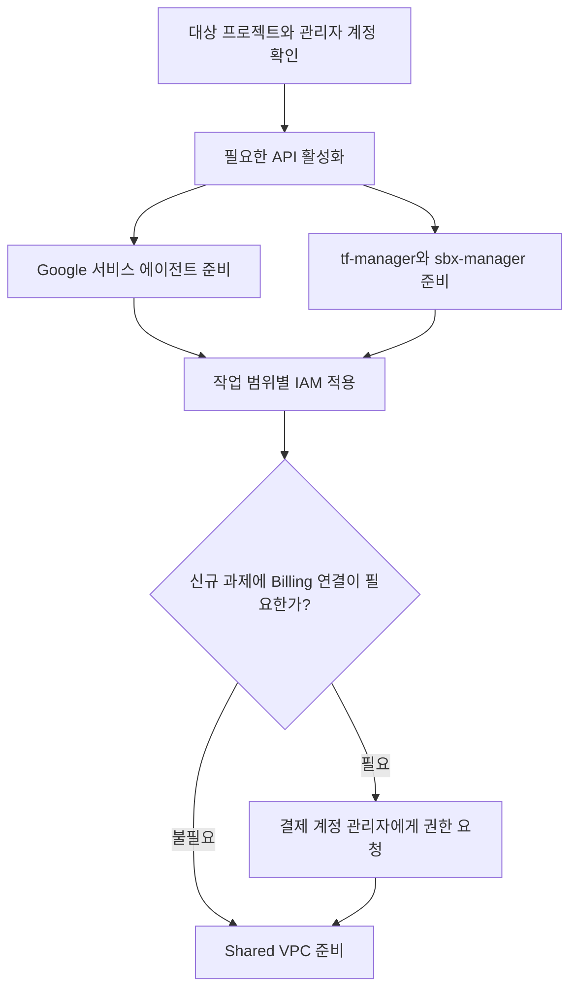

필요한 변수 선언을 아래 코드 블록 맨 앞에 포함했습니다. 별도 문서에서 변수를 설정할 필요 없이, 이 문서의 선언부터 같은 터미널에서 실행합니다. 변수 선언을 실행한 다음 각 단계의 `# 주석`을 보며 순서대로 실행합니다. **계정이 이미 있으면 해당 create 명령을 건너뜁니다.** Billing은 필요한 경우에만 주석을 해제합니다.

```bash
# ── 이 문서에서 사용하는 변수 선언 ──
# 아래 값을 확인하고 이 블록부터 같은 터미널에서 실행합니다.
unset CLOUDSDK_AUTH_IMPERSONATE_SERVICE_ACCOUNT
export ADMIN_ACCOUNT=son@sonmap.net
# 실행 프로젝트 작업자는 son, Shared VPC·초기 권한 관리자는 admin으로 구분합니다.
export VPC_ADMIN_ACCOUNT="${VPC_ADMIN_ACCOUNT:-admin@sonmap.net}"
export OPERATOR_MEMBER=user:son@sonmap.net
export SBX_GKE_PROJECT="gcp-sbx-edp-gke01"
export VPC_HOST_PROJECT="gcp-prod-edp-hub-vpchost"
export FOLDER_ID=154455658682
export BILLING_ACCOUNT=""
export TF_MANAGER="tf-manager@${SBX_GKE_PROJECT}.iam.gserviceaccount.com"
export SBX_MANAGER="sbx-manager@${SBX_GKE_PROJECT}.iam.gserviceaccount.com"
# 실행 위치 infra-son01 | 대상 ${SBX_GKE_PROJECT} | 계정 ${ADMIN_ACCOUNT}
export SBX_GKE_PROJECT_NUMBER="$(gcloud projects describe "${SBX_GKE_PROJECT}" --account="${ADMIN_ACCOUNT}" --format='value(projectNumber)')"
# 프로젝트 번호는 자동 조회합니다. 조회 실패 또는 숫자가 아닌 결과이면 이후 명령을 중단합니다.

```

<a name="-1-필요한-api-활성화--cicd--shared-vpc-host--gke-프로젝트"></a>

<a name="1-필요한-api-활성화--cicd--shared-vpc-host--gke-프로젝트"></a>

### 1-1. 필요한 API 활성화 — CI/CD · Shared VPC Host · GKE 프로젝트

두 활성화 명령의 대상은 플랫폼 프로젝트 `gcp-sbx-edp-gke01`입니다. 도식의 짧은 이름은 명령에 나오는 `*.googleapis.com` 서비스 ID의 앞부분입니다.

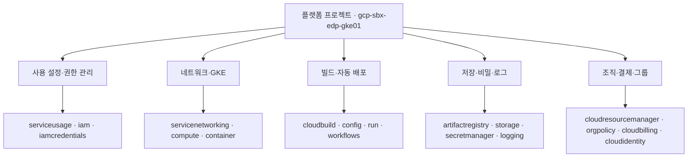

`config`는 Infrastructure Manager에 사용합니다. Shared VPC 호스트의 네트워크·DNS 준비는 [2절](#2-shared-vpc와-네트워크)에서 진행합니다. `certificatemanager.googleapis.com`은 [3-32절 인증서 준비](#3-32-regional-ssl-인증서-확인-및-등록)에서 별도로 활성화합니다.

```bash
# [infra-son01] 플랫폼 운영자 · 대상 ${SBX_GKE_PROJECT}
# 실행 위치 infra-son01 | 대상 ${SBX_GKE_PROJECT} | 계정 ${ADMIN_ACCOUNT}
gcloud services enable servicenetworking.googleapis.com serviceusage.googleapis.com iam.googleapis.com \
  iamcredentials.googleapis.com compute.googleapis.com container.googleapis.com \
  cloudbuild.googleapis.com config.googleapis.com run.googleapis.com workflows.googleapis.com \
  artifactregistry.googleapis.com secretmanager.googleapis.com storage.googleapis.com \
  logging.googleapis.com cloudresourcemanager.googleapis.com cloudbilling.googleapis.com \
  cloudidentity.googleapis.com --project="${SBX_GKE_PROJECT}" --account="${ADMIN_ACCOUNT}"
gcloud services enable container.googleapis.com compute.googleapis.com iam.googleapis.com \
  iamcredentials.googleapis.com cloudresourcemanager.googleapis.com orgpolicy.googleapis.com \
  --project="${SBX_GKE_PROJECT}" --account="${ADMIN_ACCOUNT}"

```

<a name="-2-google-서비스-에이전트-준비--api별로-필요한-시스템-계정"></a>

<a name="2-google-서비스-에이전트-준비--api별로-필요한-시스템-계정"></a>

### 1-2. Google 서비스 에이전트 준비 — API별로 필요한 시스템 계정

```bash
# [infra-son01] 플랫폼 운영자 · 대상 ${SBX_GKE_PROJECT}
# 실행 위치 infra-son01 | 대상 ${SBX_GKE_PROJECT} | 계정 ${ADMIN_ACCOUNT}
gcloud beta services identity create --service=cloudbuild.googleapis.com \
  --project="${SBX_GKE_PROJECT}" --account="${ADMIN_ACCOUNT}"
gcloud beta services identity create --service=servicenetworking.googleapis.com \
  --project="${SBX_GKE_PROJECT}" --account="${ADMIN_ACCOUNT}"
gcloud beta services identity create --service=config.googleapis.com --project="${SBX_GKE_PROJECT}" \
  --account="${ADMIN_ACCOUNT}"
gcloud beta services identity create --service=run.googleapis.com --project="${SBX_GKE_PROJECT}" \
  --account="${ADMIN_ACCOUNT}"
gcloud beta services identity create --service=workflows.googleapis.com --project="${SBX_GKE_PROJECT}" \
  --account="${ADMIN_ACCOUNT}"
gcloud beta services identity create --service=container.googleapis.com --project="${SBX_GKE_PROJECT}" \
  --account="${ADMIN_ACCOUNT}"
# Service Networking 시스템 계정의 역할은 사용자 계정에 부여하지 않습니다.
gcloud projects add-iam-policy-binding "${SBX_GKE_PROJECT}" \
  --member="serviceAccount:service-${SBX_GKE_PROJECT_NUMBER}@service-networking.iam.gserviceaccount.com" \
  --role=roles/servicenetworking.serviceAgent --condition=None --account="${ADMIN_ACCOUNT}"

```

<a name="-3-사용자-관리-서비스-계정--sbx-manager--tf-manager"></a>

<a name="3-사용자-관리-서비스-계정--sbx-manager--tf-manager"></a>

### 1-3. 사용자 관리 서비스 계정 — sbx-manager · tf-manager

```bash

# sbx-manager: 조회 성공(이미 존재)이면 바로 다음 create 한 줄은 건너뜁니다.
# 명시적 Not Found일 때만 create를 실행합니다. 403·인증·연결 오류면 중단합니다.
# 실행 위치 infra-son01 | 대상 ${SBX_GKE_PROJECT} | 계정 ${ADMIN_ACCOUNT}
gcloud iam service-accounts describe "${SBX_MANAGER}" --project="${SBX_GKE_PROJECT}" --format=json \
  --account="${ADMIN_ACCOUNT}"
gcloud iam service-accounts create sbx-manager --project="${SBX_GKE_PROJECT}" \
  --display-name=sbx_manager --account="${ADMIN_ACCOUNT}"

# tf-manager: 조회 성공(이미 존재)이면 바로 다음 create 한 줄은 건너뜁니다.
# 명시적 Not Found일 때만 create를 실행합니다. 403·인증·연결 오류면 중단합니다.
gcloud iam service-accounts describe "${TF_MANAGER}" --project="${SBX_GKE_PROJECT}" --format=json \
  --account="${ADMIN_ACCOUNT}"
gcloud iam service-accounts create tf-manager --project="${SBX_GKE_PROJECT}" --display-name=tf_manager \
  --account="${ADMIN_ACCOUNT}"

```

<a name="-4-tf-manager-권한--cicd-기반-구축--build--infrastructure-manager"></a>

<a name="4-tf-manager-권한--cicd-기반-구축--build--infrastructure-manager"></a>

### 1-4. tf-manager 권한 — CI/CD 기반 구축 · Build · Infrastructure Manager

#### 1-4-1. GCP 프로젝트 IAM 역할 부여

```bash
# 실행 위치 infra-son01 | 대상 ${SBX_GKE_PROJECT} | 계정 ${ADMIN_ACCOUNT}
gcloud projects add-iam-policy-binding "${SBX_GKE_PROJECT}" --member="serviceAccount:${TF_MANAGER}" \
  --role=roles/serviceusage.serviceUsageAdmin --condition=None --account="${ADMIN_ACCOUNT}"
gcloud projects add-iam-policy-binding "${SBX_GKE_PROJECT}" --member="serviceAccount:${TF_MANAGER}" \
  --role=roles/iam.serviceAccountAdmin --condition=None --account="${ADMIN_ACCOUNT}"
gcloud projects add-iam-policy-binding "${SBX_GKE_PROJECT}" --member="serviceAccount:${TF_MANAGER}" \
  --role=roles/resourcemanager.projectIamAdmin --condition=None --account="${ADMIN_ACCOUNT}"
gcloud projects add-iam-policy-binding "${SBX_GKE_PROJECT}" --member="serviceAccount:${TF_MANAGER}" \
  --role=roles/storage.admin --condition=None --account="${ADMIN_ACCOUNT}"
gcloud projects add-iam-policy-binding "${SBX_GKE_PROJECT}" --member="serviceAccount:${TF_MANAGER}" \
  --role=roles/secretmanager.admin --condition=None --account="${ADMIN_ACCOUNT}"
gcloud projects add-iam-policy-binding "${SBX_GKE_PROJECT}" --member="serviceAccount:${TF_MANAGER}" \
  --role=roles/artifactregistry.admin --condition=None --account="${ADMIN_ACCOUNT}"
gcloud projects add-iam-policy-binding "${SBX_GKE_PROJECT}" --member="serviceAccount:${TF_MANAGER}" \
  --role=roles/cloudbuild.builds.editor --condition=None --account="${ADMIN_ACCOUNT}"
gcloud projects add-iam-policy-binding "${SBX_GKE_PROJECT}" --member="serviceAccount:${TF_MANAGER}" \
  --role=roles/cloudbuild.workerPoolUser --condition=None --account="${ADMIN_ACCOUNT}"
gcloud projects add-iam-policy-binding "${SBX_GKE_PROJECT}" --member="serviceAccount:${TF_MANAGER}" \
  --role=roles/config.admin --condition=None --account="${ADMIN_ACCOUNT}"
gcloud projects add-iam-policy-binding "${SBX_GKE_PROJECT}" --member="serviceAccount:${TF_MANAGER}" \
  --role=roles/config.agent --condition=None --account="${ADMIN_ACCOUNT}"
gcloud projects add-iam-policy-binding "${SBX_GKE_PROJECT}" --member="serviceAccount:${TF_MANAGER}" \
  --role=roles/run.admin --condition=None --account="${ADMIN_ACCOUNT}"
gcloud projects add-iam-policy-binding "${SBX_GKE_PROJECT}" --member="serviceAccount:${TF_MANAGER}" \
  --role=roles/workflows.admin --condition=None --account="${ADMIN_ACCOUNT}"
gcloud projects add-iam-policy-binding "${SBX_GKE_PROJECT}" --member="serviceAccount:${TF_MANAGER}" \
  --role=roles/container.admin --condition=None --account="${ADMIN_ACCOUNT}"
gcloud projects add-iam-policy-binding "${SBX_GKE_PROJECT}" --member="serviceAccount:${TF_MANAGER}" \
  --role=roles/compute.viewer --condition=None --account="${ADMIN_ACCOUNT}"
gcloud projects add-iam-policy-binding "${SBX_GKE_PROJECT}" --member="serviceAccount:${TF_MANAGER}" \
  --role=roles/logging.logWriter --condition=None --account="${ADMIN_ACCOUNT}"
gcloud projects add-iam-policy-binding "${SBX_GKE_PROJECT}" --member="serviceAccount:${TF_MANAGER}" \
  --role=roles/serviceusage.serviceUsageConsumer --condition=None --account="${ADMIN_ACCOUNT}"
# 리전 Google 관리형 인증서와 DNS 승인을 관리하는 권한입니다.
gcloud projects add-iam-policy-binding "${SBX_GKE_PROJECT}" --member="serviceAccount:${TF_MANAGER}" \
  --role=roles/certificatemanager.editor --condition=None --account="${ADMIN_ACCOUNT}"

```

<a name="5-1-tf-manager에-그룹스-관리자-역할-부여"></a>

#### 1-4-2. Google Workspace 그룹스 관리자 역할 부여

기존 과제별 자동 배포에서 `tf-manager`가 Workspace 그룹을 생성해야 할 때 1회 수행합니다. 1-4-1절은 **GCP 프로젝트 IAM**, 이 절은 **Google Workspace 디렉터리 관리자 역할**을 설정합니다.

Workspace 최고 관리자로 [admin.google.com/ac/roles](https://admin.google.com/ac/roles)에 접속합니다.

| 순서 | 화면 |
|---|---|
| 1 | **계정 → 관리자 역할** |
| 2 | **그룹스 관리자**(Groups Administrator) 선택 — `그룹스 리더`·`그룹스 편집자`는 생성 권한이 없습니다 |
| 3 | **Admins** 카드 → **서비스 계정** 탭 → **서비스 계정 할당** → **서비스 계정 추가** 화면 |
| 4 | `tf-manager@gcp-sbx-edp-gke01.iam.gserviceaccount.com` 입력 후 **추가** |
| 5 | 조직 단위 `모든 조직 단위`, 만료 `사용 안함` 확인 후 **역할 지정** |

입력란은 **이메일 주소**를 받습니다. 서비스 계정의 uniqueId(숫자)를 넣으면 `올바른 이메일 주소를 입력하세요`로 거부됩니다. 목록에 계정이 표시되면 우측 하단 **역할 지정**을 눌러 저장합니다.

**부여 확인** · Workspace 고객 ID로 기존 그룹을 조회합니다. 아래 명령은 목록 조회 가능 여부를 확인합니다. 실제 그룹 생성 성공 여부는 2차 배포 실행 결과에서 확인합니다.

```bash
# 수행 위치: Cloud Shell | 로그인 계정: son@sonmap.net | 가장: tf-manager
gcloud identity groups search \
  --customer=C03rw3vtp \
  --labels=cloudidentity.googleapis.com/groups.discussion_forum \
  --account=son@sonmap.net \
  --impersonate-service-account=tf-manager@gcp-sbx-edp-gke01.iam.gserviceaccount.com \
  --format='table(name,groupKey.id)'
```

조회에 실패하면 Workspace 고객 ID와 `tf-manager`의 역할 할당을 확인합니다.

<a name="-5-sbx-manager-권한--요청-처리--workflow--build-제출"></a>

<a name="5-sbx-manager-권한--요청-처리--workflow--build-제출"></a>

### 1-5. sbx-manager 권한 — 요청 처리 · Workflow · Build 제출

```bash
# 실행 위치 infra-son01 | 대상 ${SBX_GKE_PROJECT} | 계정 ${ADMIN_ACCOUNT}
gcloud projects add-iam-policy-binding "${SBX_GKE_PROJECT}" --member="serviceAccount:${SBX_MANAGER}" \
  --role=roles/cloudbuild.builds.editor --condition=None --account="${ADMIN_ACCOUNT}"
gcloud projects add-iam-policy-binding "${SBX_GKE_PROJECT}" --member="serviceAccount:${SBX_MANAGER}" \
  --role=roles/cloudbuild.workerPoolUser --condition=None --account="${ADMIN_ACCOUNT}"
gcloud projects add-iam-policy-binding "${SBX_GKE_PROJECT}" --member="serviceAccount:${SBX_MANAGER}" \
  --role=roles/workflows.invoker --condition=None --account="${ADMIN_ACCOUNT}"
gcloud projects add-iam-policy-binding "${SBX_GKE_PROJECT}" --member="serviceAccount:${SBX_MANAGER}" \
  --role=roles/logging.logWriter --condition=None --account="${ADMIN_ACCOUNT}"
gcloud projects add-iam-policy-binding "${SBX_GKE_PROJECT}" --member="serviceAccount:${SBX_MANAGER}" \
  --role=roles/serviceusage.serviceUsageConsumer --condition=None --account="${ADMIN_ACCOUNT}"

```

<a name="-6-shared-vpc-운영팀-요청-및-private-pool-초기-구성-권한-보류"></a>

<a name="6-shared-vpc-운영팀-요청-및-private-pool-초기-구성-권한-보류"></a>

### 1-6. Shared VPC 운영팀 요청 및 Private Pool 초기 구성 권한 (보류)

[2-1절 요청 양식](#2-1-shared-vpc-운영팀-요청-양식)에 [2-2절 서브넷 IAM](#2-2-서브넷별-iam)을 포함해 운영팀에 전달합니다. Private Pool을 운영팀이 서비스 프로젝트에 처음 만드는 경우에만 프로젝트 관리자가 아래 명령으로 운영팀 작업 계정에 권한을 부여합니다. **이번 구축에서는 아래 권한 부여 명령을 건너뜁니다.** 추후 필요할 때 `VPC_ADMIN_ACCOUNT`를 운영팀이 지정한 계정으로 설정합니다.

```bash
# 실행 위치 infra-son01 | 대상 ${SBX_GKE_PROJECT} | 계정 ${ADMIN_ACCOUNT}
gcloud projects add-iam-policy-binding "${SBX_GKE_PROJECT}" --member="user:${VPC_ADMIN_ACCOUNT}" \
  --role=roles/cloudbuild.workerPoolOwner --condition=None --account="${ADMIN_ACCOUNT}"
gcloud projects add-iam-policy-binding "${SBX_GKE_PROJECT}" --member="user:${VPC_ADMIN_ACCOUNT}" \
  --role=roles/serviceusage.serviceUsageConsumer --condition=None --account="${ADMIN_ACCOUNT}"
```

<a name="-7-tf-manager-권한--gke--공통-로드밸런서"></a>

<a name="7-tf-manager-권한--gke--공통-로드밸런서"></a>

### 1-7. tf-manager 권한 — GKE · 공통 로드밸런서

```bash
# 실행 위치 infra-son01 | 대상 ${SBX_GKE_PROJECT} | 계정 ${ADMIN_ACCOUNT}
gcloud projects add-iam-policy-binding "${SBX_GKE_PROJECT}" --member="serviceAccount:${TF_MANAGER}" \
  --role=roles/compute.loadBalancerAdmin --condition=None --account="${ADMIN_ACCOUNT}"

```

<a name="-8-서비스-계정-사용위임-권한--운영자--두-계정--서비스-에이전트"></a>

<a name="8-서비스-계정-사용위임-권한--운영자--두-계정--서비스-에이전트"></a>

### 1-8. 서비스 계정 사용·위임 권한 — 운영자 · 두 계정 · 서비스 에이전트

```bash
# 실행 위치 infra-son01 | 대상 ${SBX_GKE_PROJECT} | 계정 ${ADMIN_ACCOUNT}
gcloud iam service-accounts add-iam-policy-binding "${TF_MANAGER}" --project="${SBX_GKE_PROJECT}" \
  --member="${OPERATOR_MEMBER}" --role=roles/iam.serviceAccountTokenCreator --condition=None \
  --account="${ADMIN_ACCOUNT}"
gcloud iam service-accounts add-iam-policy-binding "${SBX_MANAGER}" --project="${SBX_GKE_PROJECT}" \
  --member="${OPERATOR_MEMBER}" --role=roles/iam.serviceAccountTokenCreator --condition=None \
  --account="${ADMIN_ACCOUNT}"
gcloud iam service-accounts add-iam-policy-binding "${TF_MANAGER}" --project="${SBX_GKE_PROJECT}" \
  --member="${OPERATOR_MEMBER}" --role=roles/iam.serviceAccountUser --condition=None \
  --account="${ADMIN_ACCOUNT}"
gcloud iam service-accounts add-iam-policy-binding "${SBX_MANAGER}" --project="${SBX_GKE_PROJECT}" \
  --member="serviceAccount:${TF_MANAGER}" --role=roles/iam.serviceAccountUser --condition=None \
  --account="${ADMIN_ACCOUNT}"
gcloud iam service-accounts add-iam-policy-binding "${TF_MANAGER}" --project="${SBX_GKE_PROJECT}" \
  --member="serviceAccount:${SBX_MANAGER}" --role=roles/iam.serviceAccountUser --condition=None \
  --account="${ADMIN_ACCOUNT}"
gcloud iam service-accounts add-iam-policy-binding "${TF_MANAGER}" --project="${SBX_GKE_PROJECT}" \
  --member="serviceAccount:${TF_MANAGER}" --role=roles/iam.serviceAccountUser --condition=None \
  --account="${ADMIN_ACCOUNT}"
gcloud iam service-accounts add-iam-policy-binding "${TF_MANAGER}" --project="${SBX_GKE_PROJECT}" \
  --member="serviceAccount:${TF_MANAGER}" --role=roles/iam.serviceAccountTokenCreator --condition=None \
  --account="${ADMIN_ACCOUNT}"
gcloud iam service-accounts add-iam-policy-binding "${TF_MANAGER}" --project="${SBX_GKE_PROJECT}" \
  --member="serviceAccount:service-${SBX_GKE_PROJECT_NUMBER}@gcp-sa-config.iam.gserviceaccount.com" \
  --role=roles/iam.serviceAccountUser --condition=None --account="${ADMIN_ACCOUNT}"
gcloud iam service-accounts add-iam-policy-binding "${TF_MANAGER}" --project="${SBX_GKE_PROJECT}" \
  --member="serviceAccount:service-${SBX_GKE_PROJECT_NUMBER}@gcp-sa-cloudbuild.iam.gserviceaccount.com" \
  --role=roles/iam.serviceAccountTokenCreator --condition=None --account="${ADMIN_ACCOUNT}"

```

<a name="-9-tf-manager-권한--지정-folder의-프로젝트-생성--iam"></a>

<a name="9-tf-manager-권한--지정-folder의-프로젝트-생성--iam"></a>

### 1-9. tf-manager 권한 — 지정 Folder의 프로젝트 생성 · IAM

```bash
# 실행 위치 infra-son01 | 대상 폴더 ${FOLDER_ID} | 계정 ${VPC_ADMIN_ACCOUNT}
gcloud resource-manager folders add-iam-policy-binding "${FOLDER_ID}" \
  --member="serviceAccount:${TF_MANAGER}" --role=roles/resourcemanager.projectCreator --condition=None \
  --account="${VPC_ADMIN_ACCOUNT}"
gcloud resource-manager folders add-iam-policy-binding "${FOLDER_ID}" \
  --member="serviceAccount:${TF_MANAGER}" --role=roles/resourcemanager.projectIamAdmin \
  --condition=None --account="${VPC_ADMIN_ACCOUNT}"

```

<a name="-10-gke-서비스-에이전트의-shared-vpc-사용-권한"></a>

<a name="10-gke-서비스-에이전트의-shared-vpc-사용-권한"></a>

### 1-10. GKE 서비스 에이전트의 Shared VPC 사용 권한

1-2절에서 서비스 프로젝트의 서비스 에이전트를 준비한 뒤, 호스트 프로젝트의 `roles/container.hostServiceAgentUser` 부여를 [2-2절](#2-2-서브넷별-iam)에 따라 Shared VPC 운영팀에 요청합니다.

<a name="-11-gke-노드-기본-계정-권한--노드-실행--tf-manager의-계정-사용"></a>

<a name="11-gke-노드-기본-계정-권한--노드-실행--tf-manager의-계정-사용"></a>

### 1-11. GKE 노드 기본 계정 권한 — 노드 실행 · tf-manager의 계정 사용

```bash
# 실행 위치 infra-son01 | 대상 ${SBX_GKE_PROJECT} | 계정 ${ADMIN_ACCOUNT}
gcloud projects add-iam-policy-binding "${SBX_GKE_PROJECT}" \
  --member="serviceAccount:${SBX_GKE_PROJECT_NUMBER}-compute@developer.gserviceaccount.com" \
  --role=roles/container.defaultNodeServiceAccount --condition=None --account="${ADMIN_ACCOUNT}"
gcloud iam service-accounts add-iam-policy-binding \
  "${SBX_GKE_PROJECT_NUMBER}-compute@developer.gserviceaccount.com" --project="${SBX_GKE_PROJECT}" \
  --member="serviceAccount:${TF_MANAGER}" --role=roles/iam.serviceAccountUser --condition=None \
  --account="${ADMIN_ACCOUNT}"

```

<a name="선택--신규-과제-프로젝트의-billing-연결-권한"></a>

### 1-12. 선택 · 신규 과제 프로젝트의 Billing 연결 권한

신규 과제 프로젝트에 Terraform으로 결제 계정을 연결하는 경우, 아래 내용을 결제 계정 관리자에게 전달합니다.

<a name="결제-계정-번호-확인"></a>

#### 1-12-1. 결제 계정 번호 확인

Cloud Shell에서 결제 계정 관리자 계정으로 다음 명령을 실행합니다.

```bash
gcloud billing accounts list \
  --account=admin@sonmap.net \
  --format='table(name.basename():label=BILLING_ACCOUNT_ID,displayName:label=DISPLAY_NAME,open:label=OPEN)'
```

출력 예시

```text
BILLING_ACCOUNT_ID  DISPLAY_NAME    OPEN
019BE7-53DD39-AF5098 sonmap_billing  True
```

`DISPLAY_NAME`이 `sonmap_billing`이고 `OPEN`이 `True`인 행의 `BILLING_ACCOUNT_ID`를 아래 요청 양식에 사용합니다. 다른 환경에서 작업하는 경우 해당 환경의 활성 결제 계정 번호로 바꿉니다.

<a name="결제-계정-관리자-요청-양식"></a>

#### 1-12-2. 결제 계정 관리자 요청 양식

**제목** · [GCP Sandbox] Terraform 서비스 계정 결제 연결 권한 부여 요청

신규 Sandbox 과제 프로젝트를 생성할 때 Terraform이 지정된 결제 계정을 연결할 수 있도록 아래 서비스 계정에 **Billing Account User** 역할을 부여해 주세요.

| 항목 | 요청 값 |
|---|---|
| 결제 계정 | `sonmap_billing` (`019BE7-53DD39-AF5098`) |
| 권한 부여 위치 | 위 결제 계정의 IAM |
| 권한을 받을 서비스 계정 | `tf-manager@gcp-sbx-edp-gke01.iam.gserviceaccount.com` |
| 역할 | Billing Account User (`roles/billing.user`) |
| IAM 조건 | 없음 |

작업 후 결제 계정 ID와 현재 서비스 계정의 역할 등록 결과를 회신해 주세요.

<a name="관리자-작업-및-확인"></a>

#### 1-12-3. 관리자 작업 및 확인

[결제 계정 목록](https://console.cloud.google.com/billing)에서 `sonmap_billing` 왼쪽 체크박스를 선택합니다. **Permissions → Add principal**에서 요청 양식의 서비스 계정을 입력하고 **Billing Account User → Save**를 선택합니다.

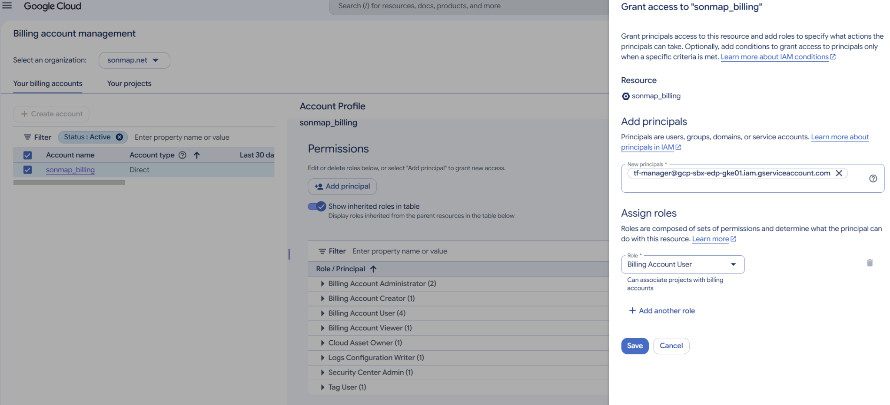

등록 결과는 이 환경에서 조회가 성공한 Cloud Billing REST API로 확인합니다.

```bash
(
  set -euo pipefail
  TOKEN="$(gcloud auth print-access-token --account=admin@sonmap.net)"
  curl -fsS \
    -H "Authorization: Bearer ${TOKEN}" \
    'https://cloudbilling.googleapis.com/v1/billingAccounts/019BE7-53DD39-AF5098:getIamPolicy?options.requestedPolicyVersion=3' |
  jq -er '
    .bindings[]?
    | select(.role == "roles/billing.user" and .condition == null)
    | .members[]?
    | select(. == "serviceAccount:tf-manager@gcp-sbx-edp-gke01.iam.gserviceaccount.com")
  '
)
```

현재 서비스 계정의 `serviceAccount:tf-manager@...` 항목이 출력되면 등록 완료입니다. `deleted:serviceAccount:tf-manager@...?uid=...` 항목은 삭제된 이전 서비스 계정의 바인딩입니다.

Workspace 그룹 자동 생성 권한이 필요한 배포는 [1-4-2절](#1-4-2-google-workspace-그룹스-관리자-역할-부여)의 절차를 따릅니다.

</details>

<a name="2-shared-vpc와-네트워크"></a>

<a name="-2-shared-vpc와-네트워크"></a>

## 2. Shared VPC와 네트워크

<details>
<summary>내용 펼치기 / 접기</summary>

2-2절은 요청할 권한의 기준입니다. 프로젝트 관리자는 2-4절의 첫 조회를 요청 전에, 사용 가능한 서브넷 조회를 운영팀 회신 후에 실행합니다.

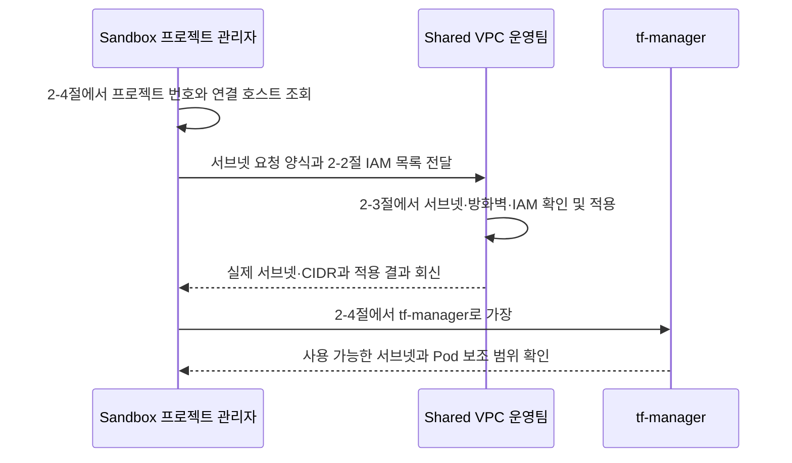

기존 `vpc-prod-edp-hub`를 사용합니다. 호스트 `gcp-prod-edp-hub-vpchost`는 Shared VPC로 활성화되어 있고, 서비스 프로젝트 `gcp-sbx-edp-gke01`의 연결도 확인했습니다. Sandbox 프로젝트팀은 서비스 프로젝트에서 준비와 조회를 수행하고, 호스트 서브넷·방화벽·PSA·IAM 변경은 Shared VPC 운영팀에 요청합니다.

프로젝트팀은 [2-4절의 확인 명령](#2-4-sandbox-프로젝트-관리자-실행-명령)으로 서비스 프로젝트 번호와 현재 연결을 조회한 뒤 아래 요청 양식을 전달합니다.

<a name="shared-vpc-운영팀-요청-양식"></a>

<a name="2-0-shared-vpc-운영팀-요청-양식"></a>

### 2-1. Shared VPC 운영팀 요청 양식

**제목** · [GCP Sandbox] 기존 Shared VPC 서브넷 준비 및 사용 권한 요청

`gcp-sbx-edp-gke01`의 GKE Autopilot과 내부 ALB에서 아래 서브넷을 사용할 수 있도록 기존 구성을 확인하고 필요한 항목을 적용해 주세요.

| 요청 항목 | 요청 내용 |
|---|---|
| 대상 | 호스트 `gcp-prod-edp-hub-vpchost` · VPC `vpc-prod-edp-hub` · 리전 `asia-northeast3` |
| GKE 서브넷 | `subnet-prod-sbx-gke-01` · Primary `10.252.0.0/24` · Pod Secondary `subnet-prod-sbx-pod-01` (`100.64.128.0/19`) |
| 내부 ALB VIP 서브넷 | 기존 `subnet-prod-edp-alb-frontend-an3` 재사용 검토 · 예상 CIDR `172.31.96.0/27` |
| 프록시 전용 서브넷 | 동일 VPC·리전의 `REGIONAL_MANAGED_PROXY` / `ACTIVE` 서브넷 재사용 · 미존재 시 후보 `subnet-prod-sbx-ilb-proxy` (`172.31.111.64/26`) 검토 |
| 컨트롤 플레인용 서브넷 | `subnet-prod-sbx-control-plane-an3` · `10.253.3.16/28` · 기존 사용 대역과 경로 중복 확인 후 생성 |
| ALB 헬스 체크 방화벽 | `fw-sbxtest01-alb-hc` · `35.191.0.0/16`, `130.211.0.0/22` → GKE Pod CIDR · 인바운드 TCP `8000` |
| ALB 프록시 방화벽 | `fw-sbxtest01-ilb-proxy` · 실제 프록시 전용 서브넷 CIDR → GKE Pod CIDR · 인바운드 TCP `8000` |
| Cloud Build Private Pool용 PSA (보류) | `psa-prod-edp-cloudbuild` · 후보 `10.250.0.0/24` · Private Pool 사용 확정 후 요청 |
| IAM | 2-2절의 서비스 계정별 역할 적용 |

CIDR은 운영팀의 중복 검토 후 확정합니다. 완료 회신에 실제 서브넷 이름과 CIDR, Pod 보조 범위 이름, 방화벽 적용 결과, 필요한 경우 PSA 연결 상태를 포함해 주세요. 프로젝트팀은 회신값을 3절 변수와 맞춘 뒤 구축을 진행합니다.

<a name="2-1-서브넷별-iam"></a>

### 2-2. 서브넷별 IAM

프로젝트팀은 2-4절에서 조회한 프로젝트 번호로 `NUM`을 바꿔 Shared VPC 운영팀에 전달합니다. 운영팀은 아래 범위에서 권한을 적용하고 결과를 회신합니다.

| 권한 적용 위치 | 주 구성원 | 역할 |
|---|---|---|
| GKE 서브넷 `subnet-prod-sbx-gke-01` | `tf-manager@gcp-sbx-edp-gke01.iam.gserviceaccount.com` | `roles/compute.networkUser` |
| GKE 서브넷 `subnet-prod-sbx-gke-01` | `service-NUM@container-engine-robot.iam.gserviceaccount.com` | `roles/compute.networkUser` |
| GKE 서브넷 `subnet-prod-sbx-gke-01` | `NUM@cloudservices.gserviceaccount.com` | `roles/compute.networkUser` |
| ALB VIP 서브넷 `subnet-prod-edp-alb-frontend-an3` | `tf-manager@gcp-sbx-edp-gke01.iam.gserviceaccount.com` | `roles/compute.networkUser` |
| 호스트 프로젝트 `gcp-prod-edp-hub-vpchost` | `service-NUM@container-engine-robot.iam.gserviceaccount.com` | `roles/container.hostServiceAgentUser` |
| 호스트 프로젝트 `gcp-prod-edp-hub-vpchost` | `tf-manager@gcp-sbx-edp-gke01.iam.gserviceaccount.com` | `roles/compute.networkViewer`, `roles/serviceusage.serviceUsageConsumer` |

Pod 보조 범위는 GKE 서브넷 IAM을 따릅니다. ALB 프록시 전용 서브넷에는 별도 Network User 부여가 필요하지 않습니다.

운영팀은 GKE에 필요한 호스트 API와 서비스 에이전트도 확인합니다. Private Pool 경로를 사용하는 경우 Service Networking API, 호스트 서비스 에이전트의 `roles/servicenetworking.serviceAgent`, PSA 연결을 함께 확인합니다.

프로젝트팀은 운영팀 회신에서 서브넷별 사용 권한을 확인합니다. 2-4절의 `tf-manager` 가장 조회는 서브넷을 읽을 수 있는지 확인하는 용도입니다.

<a name="2-2-shared-vpc-운영팀-실행-명령"></a>

### 2-3. Shared VPC 운영팀 실행 명령

아래 명령은 `gcp-prod-edp-hub-vpchost`의 네트워크 및 IAM 변경 권한을 가진 운영팀이 실행합니다. `VPC_ADMIN_ACCOUNT`에 실제 작업 계정을 적고 아래 선언을 실행합니다. 프로젝트 번호는 `gcloud`로 조회합니다. 운영팀 계정으로 서비스 프로젝트를 조회할 수 없으면 2-4절의 프로젝트팀 조회 결과를 받아 `export SBX_PROJECT_NUMBER=` 뒤에 숫자 번호를 직접 넣습니다.

```bash
# 수행 위치: infra-son01 또는 Cloud Shell | 수행 계정: VPC_ADMIN_ACCOUNT (예: admin@sonmap.net) | 대상: gcp-prod-edp-hub-vpchost
export VPC_ADMIN_ACCOUNT="admin@sonmap.net"
export SBX_GKE_PROJECT="gcp-sbx-edp-gke01"

# 프로젝트 번호 조회 대상: gcp-sbx-edp-gke01
SBX_PROJECT_NUMBER="$(gcloud projects describe "$SBX_GKE_PROJECT" \
  --account="$VPC_ADMIN_ACCOUNT" --format='value(projectNumber)')"
export SBX_PROJECT_NUMBER
echo "$SBX_PROJECT_NUMBER"
export HOST="gcp-prod-edp-hub-vpchost"
export NETWORK="vpc-prod-edp-hub"
export REGION="asia-northeast3"
export MAIN_SUBNET="subnet-prod-sbx-gke-01"
export VIP_SUBNET="subnet-prod-edp-alb-frontend-an3"
export VIP_CIDR="172.31.96.0/27"
export PROXY_SUBNET="subnet-prod-sbx-ilb-proxy"
export NODE_CIDR="10.252.0.0/24"
export POD_RANGE="subnet-prod-sbx-pod-01"
export POD_CIDR="100.64.128.0/19"
export PROXY_CIDR="172.31.111.64/26"
export TF_MANAGER="tf-manager@gcp-sbx-edp-gke01.iam.gserviceaccount.com"

gcloud compute networks describe "$NETWORK" --project="$HOST" --account="$VPC_ADMIN_ACCOUNT"
gcloud compute networks subnets list --project="$HOST" --account="$VPC_ADMIN_ACCOUNT" \
  --filter="network:$NETWORK AND region:$REGION" \
  --format='table(name,ipCidrRange,purpose,role,secondaryIpRanges)'
```

<a name="gke-서브넷-생성에-필요한-값"></a>

#### 2-3-1. GKE 서브넷 생성에 필요한 값

신규 생성 대상은 **GKE 서브넷**, **내부 ALB VIP 서브넷**, **내부 ALB 프록시 전용 서브넷**, **컨트롤 플레인용 서브넷**입니다. 각 서브넷은 기존 구성을 먼저 조회한 뒤 필요한 경우에만 생성합니다.

| 항목 | 변수 | 설정값 |
|---|---|---|
| 작업 계정 | `VPC_ADMIN_ACCOUNT` | `admin@sonmap.net` |
| Shared VPC 호스트 프로젝트 | `HOST` | `gcp-prod-edp-hub-vpchost` |
| 대상 VPC | `NETWORK` | `vpc-prod-edp-hub` |
| 리전 | `REGION` | `asia-northeast3` |
| GKE 서브넷 이름 | `MAIN_SUBNET` | `subnet-prod-sbx-gke-01` |
| Primary CIDR (노드 IP 대역) | `NODE_CIDR` | `10.252.0.0/24` |
| Secondary 범위 이름 (Pod) | `POD_RANGE` | `subnet-prod-sbx-pod-01` |
| Secondary CIDR (Pod IP 대역) | `POD_CIDR` | `100.64.128.0/19` |
| 내부 ALB VIP 서브넷 이름 | `VIP_SUBNET` | `subnet-prod-edp-alb-frontend-an3` |
| 내부 ALB VIP 서브넷 CIDR | `VIP_CIDR` | `172.31.96.0/27` |
| 내부 ALB 프록시 전용 서브넷 이름 | `PROXY_SUBNET` | `subnet-prod-sbx-ilb-proxy` |
| 내부 ALB 프록시 전용 서브넷 CIDR | `PROXY_CIDR` | `172.31.111.64/26` |
| 프록시 전용 서브넷 용도 및 역할 | `--purpose`, `--role` | `REGIONAL_MANAGED_PROXY`, `ACTIVE` |
| 컨트롤 플레인용 서브넷 이름 | `CP_SUBNET` | `subnet-prod-sbx-control-plane-an3` |
| 컨트롤 플레인용 서브넷 CIDR | `CP_SUBNET_CIDR` | `10.253.3.16/28` · 운영팀 중복 확인 후 사용 |

기존 GKE 서브넷이 있으면 2-3-3절의 조회 명령으로 Primary CIDR과 Pod 보조 범위를 확인합니다. 계획과 다르면 Shared VPC 운영팀에 확인을 요청합니다.

**컨트롤 플레인용 서브넷** · Shared VPC 운영팀이 2-3-6절에서 `10.253.3.16/28` 서브넷을 준비합니다. 향후 신규 클러스터에서 이 서브넷을 사용하려면 `--private-endpoint-subnetwork`로 지정합니다. 해당 서브넷의 CIDR을 `--master-ipv4-cidr` 값으로 사용하면 기존 서브넷 대역과 겹칩니다.

**Kubernetes Service 대역** · `subnet-prod-sbx-svc-01`을 사용자 관리 Service 보조 범위로 쓰려면 별도 CIDR을 확정해야 합니다. `10.252.0.0/24`는 이미 노드 Primary이고, 그 안의 `10.252.0.0/28`도 노드 대역과 겹칩니다.

<a name="1-gke-서브넷-신규-생성"></a>

#### 2-3-2. GKE 서브넷 신규 생성

앞의 조회에서 `$MAIN_SUBNET`이 없고 CIDR 승인이 완료되면 아래 생성 명령을 실행합니다. `--secondary-range`로 Pod 보조 범위도 함께 생성됩니다. **생성 후 2-3-3절에서 확인합니다.**

```bash
# 수행 위치: infra-son01 또는 Cloud Shell | 수행 계정: VPC_ADMIN_ACCOUNT (예: admin@sonmap.net) | 대상: gcp-prod-edp-hub-vpchost
gcloud compute networks subnets create "$MAIN_SUBNET" \
  --project="$HOST" --network="$NETWORK" --region="$REGION" --account="$VPC_ADMIN_ACCOUNT" \
  --range="$NODE_CIDR" --secondary-range="$POD_RANGE=$POD_CIDR"
```

<a name="2-gke-서브넷과-pod-보조-범위-확인"></a>

#### 2-3-3. GKE 서브넷과 Pod 보조 범위 확인

```bash
# 수행 위치: infra-son01 또는 Cloud Shell | 수행 계정: VPC_ADMIN_ACCOUNT (예: admin@sonmap.net) | 대상: gcp-prod-edp-hub-vpchost
gcloud compute networks subnets describe "$MAIN_SUBNET" \
  --project="$HOST" --region="$REGION" --account="$VPC_ADMIN_ACCOUNT" \
  --format='yaml(ipCidrRange,secondaryIpRanges)'
```

Primary `10.252.0.0/24`와 Pod 보조 범위 `subnet-prod-sbx-pod-01` (`100.64.128.0/19`)를 확인합니다. `Range names must be distinct`가 나오면 같은 이름의 보조 범위가 이미 있으므로, 위 조회로 실제 CIDR을 확인한 뒤 다음 단계로 진행합니다.

<a name="3-내부-alb-vip-서브넷-확인-및-신규-생성"></a>

#### 2-3-4. 내부 ALB VIP 서브넷 확인 및 신규 생성

Shared VPC 운영팀이 프런트엔드 VIP에 사용할 일반 서브넷을 조회합니다.

```bash
# 수행 위치: infra-son01 또는 Cloud Shell | 수행 계정: VPC_ADMIN_ACCOUNT (예: admin@sonmap.net) | 대상: gcp-prod-edp-hub-vpchost
gcloud compute networks subnets describe "$VIP_SUBNET" --project="$HOST" \
  --region="$REGION" --account="$VPC_ADMIN_ACCOUNT" \
  --format='yaml(name,network,ipCidrRange,purpose)'
```

- **조회 성공** · 같은 VPC와 리전의 일반 서브넷인지 확인하고 운영팀이 승인한 CIDR로 재사용합니다.
- **`Not Found`** · 이름과 CIDR에 대해 운영팀의 중복 확인 및 승인을 받은 뒤 아래 명령으로 생성합니다.
- **`403` 또는 기타 조회 오류** · 운영팀 계정과 조회 권한을 확인합니다.

```bash
# 수행 위치: infra-son01 또는 Cloud Shell | 수행 계정: VPC_ADMIN_ACCOUNT (예: admin@sonmap.net) | 대상: gcp-prod-edp-hub-vpchost
gcloud compute networks subnets create "$VIP_SUBNET" \
  --project="$HOST" --network="$NETWORK" --region="$REGION" \
  --range="$VIP_CIDR" --account="$VPC_ADMIN_ACCOUNT"
```

생성 후 위 조회 명령을 다시 실행하여 이름과 CIDR을 확인합니다.

<a name="4-프록시-전용-서브넷-확인-및-신규-생성"></a>

#### 2-3-5. 프록시 전용 서브넷 확인 및 신규 생성

같은 VPC·리전에 활성 프록시 전용 서브넷이 있으면 해당 CIDR을 `PROXY_CIDR`에 반영합니다. 활성 서브넷이 없고 대역 승인이 끝났을 때만 아래 명령을 실행합니다.

```bash
# 수행 위치: infra-son01 또는 Cloud Shell | 수행 계정: VPC_ADMIN_ACCOUNT (예: admin@sonmap.net) | 대상: gcp-prod-edp-hub-vpchost
gcloud compute networks subnets create "$PROXY_SUBNET" \
  --project="$HOST" --network="$NETWORK" --region="$REGION" --account="$VPC_ADMIN_ACCOUNT" \
  --range="$PROXY_CIDR" --purpose=REGIONAL_MANAGED_PROXY --role=ACTIVE
```

<a name="5-컨트롤-플레인용-서브넷-신규-생성"></a>

#### 2-3-6. 컨트롤 플레인용 서브넷 신규 생성

Shared VPC 운영팀이 아래 명령으로 기존 서브넷을 조회합니다.

```bash
# 수행 위치: infra-son01 또는 Cloud Shell | 수행 계정: VPC_ADMIN_ACCOUNT (예: admin@sonmap.net) | 대상: gcp-prod-edp-hub-vpchost
export CP_SUBNET="subnet-prod-sbx-control-plane-an3"
export CP_SUBNET_CIDR="10.253.3.16/28"

gcloud compute networks subnets describe "$CP_SUBNET" \
  --project="$HOST" --region="$REGION" --account="$VPC_ADMIN_ACCOUNT" \
  --format='yaml(name,network,ipCidrRange)'
```

조회 결과가 `Not Found`이고 CIDR 중복 확인이 끝났으면 아래 명령을 실행합니다. 생성 후 위 조회 명령으로 `10.253.3.16/28`을 확인합니다.

```bash
# 수행 위치: infra-son01 또는 Cloud Shell | 수행 계정: VPC_ADMIN_ACCOUNT (예: admin@sonmap.net) | 대상: gcp-prod-edp-hub-vpchost
gcloud compute networks subnets create "$CP_SUBNET" \
  --project="$HOST" --network="$NETWORK" --region="$REGION" \
  --range="$CP_SUBNET_CIDR" --account="$VPC_ADMIN_ACCOUNT"
```

<a name="6-방화벽-조회-및-생성"></a>

#### 2-3-7. 방화벽 조회 및 생성

기존 방화벽을 조회합니다. 각 규칙이 없으면 해당 생성 명령을 실행합니다. 기존 규칙의 CIDR이나 포트가 다르면 운영팀 변경 절차에 따라 조정합니다.

<a name="6-1-기존-방화벽-조회"></a>

##### 2-3-7-1. 기존 방화벽 조회

```bash
# 수행 위치: infra-son01 또는 Cloud Shell | 수행 계정: VPC_ADMIN_ACCOUNT (예: admin@sonmap.net) | 대상: gcp-prod-edp-hub-vpchost
gcloud compute firewall-rules list --project="$HOST" --account="$VPC_ADMIN_ACCOUNT" \
  --filter='name=(fw-sbxtest01-alb-hc fw-sbxtest01-ilb-proxy)'
```

<a name="6-2-alb-헬스-체크-방화벽-생성"></a>

##### 2-3-7-2. ALB 헬스 체크 방화벽 생성

```bash
# 수행 위치: infra-son01 또는 Cloud Shell | 수행 계정: VPC_ADMIN_ACCOUNT (예: admin@sonmap.net) | 대상: gcp-prod-edp-hub-vpchost
gcloud compute firewall-rules create fw-sbxtest01-alb-hc \
  --project="$HOST" --network="$NETWORK" --account="$VPC_ADMIN_ACCOUNT" \
  --direction=INGRESS --allow=tcp:8000 \
  --source-ranges=35.191.0.0/16,130.211.0.0/22 --destination-ranges="$POD_CIDR"
```

<a name="6-3-alb-프록시-방화벽-생성"></a>

##### 2-3-7-3. ALB 프록시 방화벽 생성

```bash
# 수행 위치: infra-son01 또는 Cloud Shell | 수행 계정: VPC_ADMIN_ACCOUNT (예: admin@sonmap.net) | 대상: gcp-prod-edp-hub-vpchost
gcloud compute firewall-rules create fw-sbxtest01-ilb-proxy \
  --project="$HOST" --network="$NETWORK" --account="$VPC_ADMIN_ACCOUNT" \
  --direction=INGRESS --allow=tcp:8000 \
  --source-ranges="$PROXY_CIDR" --destination-ranges="$POD_CIDR"
```

<a name="7-서브넷-및-호스트-iam-적용"></a>

#### 2-3-8. 서브넷 및 호스트 IAM 적용

확인한 실제 서브넷 이름을 변수에 반영하고 2-2절 IAM을 적용합니다. 두 서비스 에이전트 주소에 들어가는 프로젝트 번호는 `gcp-sbx-edp-gke01`의 숫자 번호입니다. 위에서 출력된 프로젝트 번호가 숫자로 확인되면 아래 명령을 번호 순서대로 하나씩 실행합니다. 오류가 나오면 해당 명령의 입력값을 확인한 뒤 이어서 진행합니다.

<a name="7-1-서비스-에이전트-변수-선언-및-확인"></a>

##### 2-3-8-1. 서비스 에이전트 변수 선언 및 확인

2-3-8-2 이후 명령과 같은 터미널에서 실행합니다. 새 Cloud Shell을 열었으면 2-3절 첫 변수 선언 블록부터 다시 실행합니다. `SBX_PROJECT_NUMBER`에는 2-4절에서 조회한 숫자만 넣습니다.

```bash
# 수행 위치: infra-son01 또는 Cloud Shell | 수행 계정: VPC_ADMIN_ACCOUNT (예: admin@sonmap.net) | 대상: gcp-prod-edp-hub-vpchost
# 실행 예시: export SBX_PROJECT_NUMBER="프로젝트팀에서 확인한 숫자 번호"
export GKE_AGENT="service-${SBX_PROJECT_NUMBER}@container-engine-robot.iam.gserviceaccount.com"
export GOOGLE_APIS_AGENT="${SBX_PROJECT_NUMBER}@cloudservices.gserviceaccount.com"
printf '프로젝트 번호: %s\nGKE 서비스 에이전트: %s\nGoogle APIs 서비스 에이전트: %s\n' \
  "$SBX_PROJECT_NUMBER" "$GKE_AGENT" "$GOOGLE_APIS_AGENT"
```

프로젝트 번호가 비어 있거나 이메일이 `service-@`로 시작하면 번호를 확인하고 7-1을 다시 실행합니다. 7-3은 프로젝트 번호를 조회해 GKE 서비스 에이전트 이메일을 구성합니다.

<a name="7-2-gke-서브넷--terraform-서비스-계정"></a>

##### 2-3-8-2. GKE 서브넷 · Terraform 서비스 계정

```bash
# 수행 위치: infra-son01 또는 Cloud Shell | 수행 계정: VPC_ADMIN_ACCOUNT (예: admin@sonmap.net) | 대상: gcp-prod-edp-hub-vpchost
gcloud compute networks subnets add-iam-policy-binding "$MAIN_SUBNET" \
  --project="$HOST" --region="$REGION" --account="$VPC_ADMIN_ACCOUNT" \
  --member="serviceAccount:$TF_MANAGER" --role=roles/compute.networkUser
```

<a name="7-3-gke-서브넷--gke-서비스-에이전트"></a>

##### 2-3-8-3. GKE 서브넷 · GKE 서비스 에이전트

프로젝트 번호가 숫자로 조회되면 이어서 권한을 부여합니다. 운영팀 계정에 조회 권한이 없으면 Sandbox 프로젝트팀에서 받은 숫자로 첫 번째 선언을 바꿉니다.

```bash
# 수행 위치: infra-son01 또는 Cloud Shell | 수행 계정: admin@sonmap.net
# 프로젝트 번호 조회 대상: gcp-sbx-edp-gke01 | IAM 적용 대상: gcp-prod-edp-hub-vpchost
export SBX_PROJECT_NUMBER="$(gcloud projects describe gcp-sbx-edp-gke01 \
  --account=admin@sonmap.net --format='value(projectNumber)')"
echo "$SBX_PROJECT_NUMBER"
```

숫자 프로젝트 번호가 출력되면 아래 명령을 실행합니다.

```bash
# 수행 위치: infra-son01 또는 Cloud Shell | 수행 계정: admin@sonmap.net
gcloud compute networks subnets add-iam-policy-binding subnet-prod-sbx-gke-01 \
  --project=gcp-prod-edp-hub-vpchost --region=asia-northeast3 --account=admin@sonmap.net \
  --member="serviceAccount:service-${SBX_PROJECT_NUMBER}@container-engine-robot.iam.gserviceaccount.com" \
  --role=roles/compute.networkUser
```

<a name="7-4-gke-서브넷--google-apis-서비스-에이전트"></a>

##### 2-3-8-4. GKE 서브넷 · Google APIs 서비스 에이전트

```bash
# 수행 위치: infra-son01 또는 Cloud Shell | 수행 계정: VPC_ADMIN_ACCOUNT (예: admin@sonmap.net) | 대상: gcp-prod-edp-hub-vpchost
gcloud compute networks subnets add-iam-policy-binding "$MAIN_SUBNET" \
  --project="$HOST" --region="$REGION" --account="$VPC_ADMIN_ACCOUNT" \
  --member="serviceAccount:$GOOGLE_APIS_AGENT" --role=roles/compute.networkUser
```

<a name="7-5-alb-vip-서브넷--terraform-서비스-계정"></a>

##### 2-3-8-5. ALB VIP 서브넷 · Terraform 서비스 계정

```bash
# 수행 위치: infra-son01 또는 Cloud Shell | 수행 계정: VPC_ADMIN_ACCOUNT (예: admin@sonmap.net) | 대상: gcp-prod-edp-hub-vpchost
gcloud compute networks subnets add-iam-policy-binding "$VIP_SUBNET" \
  --project="$HOST" --region="$REGION" --account="$VPC_ADMIN_ACCOUNT" \
  --member="serviceAccount:$TF_MANAGER" --role=roles/compute.networkUser
```

<a name="7-6-호스트-프로젝트--gke-서비스-에이전트"></a>

##### 2-3-8-6. 호스트 프로젝트 · GKE 서비스 에이전트

```bash
# 수행 위치: infra-son01 또는 Cloud Shell | 수행 계정: VPC_ADMIN_ACCOUNT (예: admin@sonmap.net) | 대상: gcp-prod-edp-hub-vpchost
gcloud projects add-iam-policy-binding "$HOST" --account="$VPC_ADMIN_ACCOUNT" \
  --member="serviceAccount:$GKE_AGENT" --role=roles/container.hostServiceAgentUser --condition=None
```

<a name="7-7-호스트-프로젝트--terraform-네트워크-조회-권한"></a>

##### 2-3-8-7. 호스트 프로젝트 · Terraform 네트워크 조회 권한

```bash
# 수행 위치: infra-son01 또는 Cloud Shell | 수행 계정: VPC_ADMIN_ACCOUNT (예: admin@sonmap.net) | 대상: gcp-prod-edp-hub-vpchost
gcloud projects add-iam-policy-binding "$HOST" --account="$VPC_ADMIN_ACCOUNT" \
  --member="serviceAccount:$TF_MANAGER" --role=roles/compute.networkViewer --condition=None
```

<a name="7-8-호스트-프로젝트--terraform-서비스-사용-권한"></a>

##### 2-3-8-8. 호스트 프로젝트 · Terraform 서비스 사용 권한

```bash
# 수행 위치: infra-son01 또는 Cloud Shell | 수행 계정: VPC_ADMIN_ACCOUNT (예: admin@sonmap.net) | 대상: gcp-prod-edp-hub-vpchost
gcloud projects add-iam-policy-binding "$HOST" --account="$VPC_ADMIN_ACCOUNT" \
  --member="serviceAccount:$TF_MANAGER" --role=roles/serviceusage.serviceUsageConsumer --condition=None
```

<a name="7-9-gke-서브넷-iam-확인"></a>

##### 2-3-8-9. GKE 서브넷 IAM 확인

```bash
# 수행 위치: infra-son01 또는 Cloud Shell | 수행 계정: VPC_ADMIN_ACCOUNT (예: admin@sonmap.net) | 대상: gcp-prod-edp-hub-vpchost
gcloud compute networks subnets get-iam-policy "$MAIN_SUBNET" \
  --project="$HOST" --region="$REGION" --account="$VPC_ADMIN_ACCOUNT" --format=json
```

<a name="7-10-alb-vip-서브넷-iam-확인"></a>

##### 2-3-8-10. ALB VIP 서브넷 IAM 확인

```bash
# 수행 위치: infra-son01 또는 Cloud Shell | 수행 계정: VPC_ADMIN_ACCOUNT (예: admin@sonmap.net) | 대상: gcp-prod-edp-hub-vpchost
gcloud compute networks subnets get-iam-policy "$VIP_SUBNET" \
  --project="$HOST" --region="$REGION" --account="$VPC_ADMIN_ACCOUNT" --format=json
```

<a name="8-private-pool용-psa-보류"></a>

#### 2-3-9. Private Pool용 PSA (보류)

PSA는 Cloud Build Private Pool과 Shared VPC 간 사설 연결에 사용합니다. 예약 범위 및 Service Networking 피어링의 적용 결과를 확인한 뒤 3-17절으로 진행합니다.

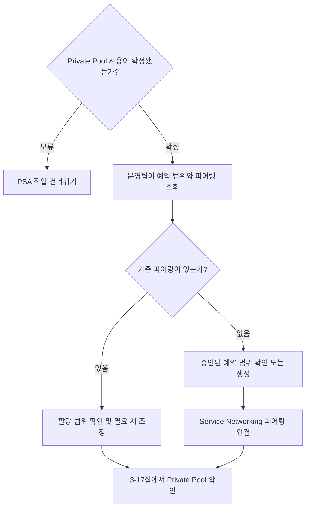

Private Pool 구성을 보류하는 동안 아래 명령을 건너뜁니다. 사용이 확정되면 운영팀에서 기존 PSA 예약 범위와 피어링을 확인합니다. 예약 범위 및 연결이 모두 없는 신규 구성에서는 대역 승인과 Service Networking API 및 서비스 에이전트 준비 후 생성 명령을 실행합니다. 기존 피어링이 있으면 현재 할당 범위를 확인하고 운영팀 절차에 따라 조정합니다.

```bash
# 수행 위치: infra-son01 또는 Cloud Shell | 수행 계정: VPC_ADMIN_ACCOUNT (예: admin@sonmap.net) | 대상: gcp-prod-edp-hub-vpchost
export PSA_NAME="psa-prod-edp-cloudbuild"
gcloud compute addresses describe "$PSA_NAME" --global --project="$HOST" --account="$VPC_ADMIN_ACCOUNT"
gcloud services vpc-peerings list --project="$HOST" --network="$NETWORK" \
  --service=servicenetworking.googleapis.com --account="$VPC_ADMIN_ACCOUNT"

# 예약 범위가 없을 때만
gcloud compute addresses create "$PSA_NAME" --global --project="$HOST" \
  --purpose=VPC_PEERING --addresses=10.250.0.0 --prefix-length=24 \
  --network="$NETWORK" --account="$VPC_ADMIN_ACCOUNT"

# 해당 VPC에 Service Networking 피어링이 없을 때만
gcloud services vpc-peerings connect --project="$HOST" --network="$NETWORK" \
  --service=servicenetworking.googleapis.com --ranges="$PSA_NAME" --account="$VPC_ADMIN_ACCOUNT"
```

<a name="9-gke-노드용-private-google-access와-restricted-vip"></a>

#### 2-3-10. GKE 노드용 Private Google Access와 Restricted VIP

Private DNS가 Google API와 이미지 레지스트리의 이름을 restricted VIP로 해석합니다. 노드에서 VIP로 연결하려면 서브넷 PGA, VPC 라우트, 송신 정책이 모두 맞아야 합니다.

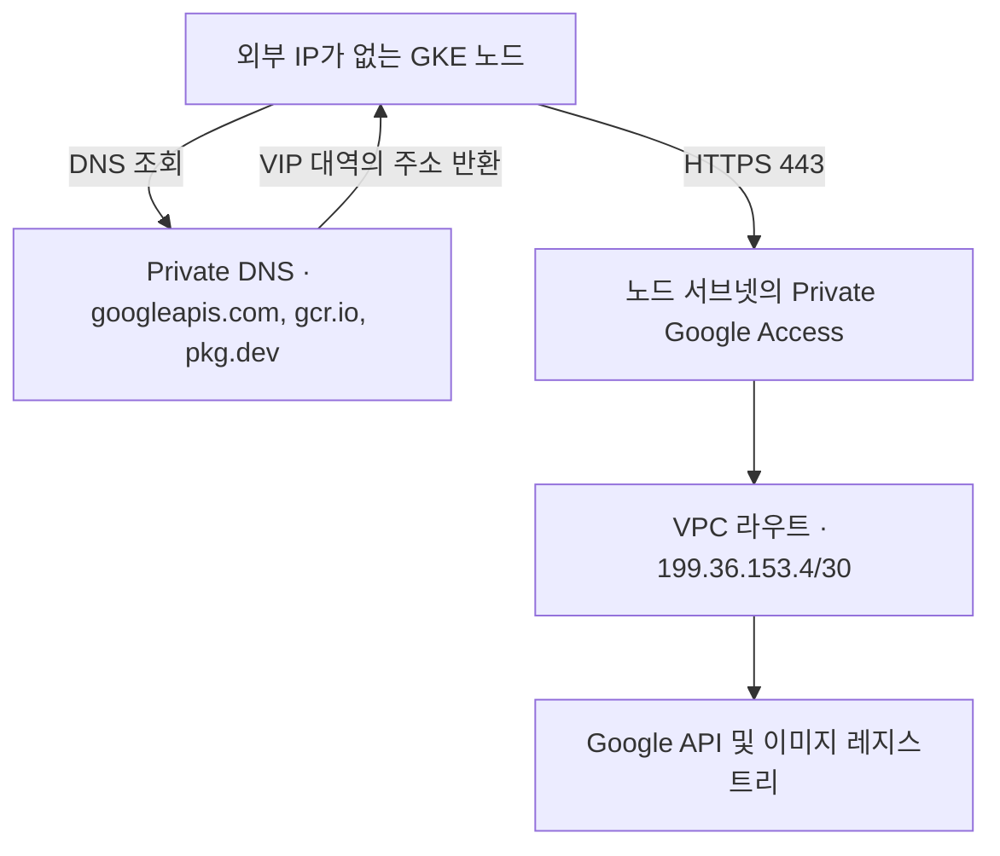

사설 GKE 노드의 Google 관리 이미지 다운로드가 TCP 443 타임아웃으로 실패할 때 사용하는 절차입니다. VPC 운영팀이 `restricted.googleapis.com` 사용을 승인한 환경을 기준으로 합니다. **PGA는 노드 서브넷에 적용되며, 라우트와 DNS는 Shared VPC 전체에 영향을 줄 수 있습니다.** 기존 중앙 DNS, 피어링·포워딩 영역, 라우트 및 보안 정책을 확인하고 승인된 구성을 재사용합니다. [Google Cloud PGA 구성](https://docs.cloud.google.com/vpc/docs/configure-private-google-access) · [GKE 레지스트리 접근](https://docs.cloud.google.com/artifact-registry/docs/gke-private-clusters)

<a name="9-1-변수-선언-및-기존-구성-확인"></a>

##### 2-3-10-1. 변수 선언 및 기존 구성 확인

```bash
# 수행 위치: infra-son01 또는 Cloud Shell | 수행 계정: admin@sonmap.net
export VPC_ADMIN_ACCOUNT="admin@sonmap.net"
export HOST="gcp-prod-edp-hub-vpchost"
export NETWORK="vpc-prod-edp-hub"
export REGION="asia-northeast3"
export PGA_IPS="199.36.153.4,199.36.153.5,199.36.153.6,199.36.153.7"

gcloud compute networks subnets describe subnet-prod-sbx-gke-01 \
  --project="$HOST" --region="$REGION" --account="$VPC_ADMIN_ACCOUNT" \
  --format='yaml(name,ipCidrRange,privateIpGoogleAccess)'

gcloud compute routes list --project="$HOST" --account="$VPC_ADMIN_ACCOUNT" \
  --filter="network:$NETWORK" --format='table(name,destRange,priority,nextHopGateway)'

gcloud dns managed-zones list --project="$HOST" --account="$VPC_ADMIN_ACCOUNT"
```

<a name="9-2-노드-서브넷-pga-활성화"></a>

##### 2-3-10-2. 노드 서브넷 PGA 활성화

`privateIpGoogleAccess: false`일 때 실행합니다.

```bash
# 수행 위치: infra-son01 또는 Cloud Shell | 수행 계정: admin@sonmap.net
gcloud compute networks subnets update subnet-prod-sbx-gke-01 \
  --project="$HOST" --region="$REGION" --account="$VPC_ADMIN_ACCOUNT" \
  --enable-private-ip-google-access
```

<a name="9-3-restricted-vip-라우트-생성"></a>

##### 2-3-10-3. Restricted VIP 라우트 생성

`199.36.153.4/30`으로 가는 유효 경로의 다음 홉이 이미 `default-internet-gateway`라면 재사용합니다. 해당 경로가 없으면 아래 명령을 실행합니다. 적용되는 이그레스 방화벽 정책에서 VIP 대역의 TCP 443 허용 여부도 확인합니다.

```bash
# 수행 위치: infra-son01 또는 Cloud Shell | 수행 계정: admin@sonmap.net
gcloud compute routes create rt-prod-edp-restricted-googleapis \
  --project="$HOST" --network="$NETWORK" --account="$VPC_ADMIN_ACCOUNT" \
  --destination-range=199.36.153.4/30 \
  --next-hop-gateway=default-internet-gateway --priority=1000
```

<a name="9-4-private-dns-영역-생성"></a>

##### 2-3-10-4. Private DNS 영역 생성

해당 도메인의 기존 영역이 없을 때만 해당 명령을 실행합니다. 기존 영역이 있으면 운영팀이 관리하는 영역과 레코드를 확인합니다.

```bash
# 수행 위치: infra-son01 또는 Cloud Shell | 수행 계정: admin@sonmap.net
gcloud dns managed-zones create zone-googleapis-com --dns-name=googleapis.com. \
  --visibility=private --networks="$NETWORK" --description="Restricted Google APIs" \
  --project="$HOST" --account="$VPC_ADMIN_ACCOUNT"

gcloud dns managed-zones create zone-gcr-io --dns-name=gcr.io. \
  --visibility=private --networks="$NETWORK" --description="Restricted Google Registry" \
  --project="$HOST" --account="$VPC_ADMIN_ACCOUNT"

gcloud dns managed-zones create zone-pkg-dev --dns-name=pkg.dev. \
  --visibility=private --networks="$NETWORK" --description="Restricted Artifact Registry" \
  --project="$HOST" --account="$VPC_ADMIN_ACCOUNT"
```

<a name="9-5-restricted-vip-dns-레코드-등록"></a>

##### 2-3-10-5. Restricted VIP DNS 레코드 등록

`gcloud dns record-sets list --zone=영역이름 --project="$HOST" --account="$VPC_ADMIN_ACCOUNT"`로 기존 레코드를 확인합니다. 누락된 레코드만 생성하며, 기존 레코드의 대상이 다르면 운영팀에서 영향 범위를 확인합니다.

```bash
# 수행 위치: infra-son01 또는 Cloud Shell | 수행 계정: admin@sonmap.net
gcloud dns record-sets create restricted.googleapis.com. --zone=zone-googleapis-com \
  --type=A --ttl=300 --rrdatas="$PGA_IPS" --project="$HOST" --account="$VPC_ADMIN_ACCOUNT"
gcloud dns record-sets create "*.googleapis.com." --zone=zone-googleapis-com \
  --type=CNAME --ttl=300 --rrdatas=restricted.googleapis.com. --project="$HOST" --account="$VPC_ADMIN_ACCOUNT"

gcloud dns record-sets create gcr.io. --zone=zone-gcr-io \
  --type=A --ttl=300 --rrdatas="$PGA_IPS" --project="$HOST" --account="$VPC_ADMIN_ACCOUNT"
gcloud dns record-sets create "*.gcr.io." --zone=zone-gcr-io \
  --type=CNAME --ttl=300 --rrdatas=gcr.io. --project="$HOST" --account="$VPC_ADMIN_ACCOUNT"

gcloud dns record-sets create pkg.dev. --zone=zone-pkg-dev \
  --type=A --ttl=300 --rrdatas="$PGA_IPS" --project="$HOST" --account="$VPC_ADMIN_ACCOUNT"
gcloud dns record-sets create "*.pkg.dev." --zone=zone-pkg-dev \
  --type=CNAME --ttl=300 --rrdatas=pkg.dev. --project="$HOST" --account="$VPC_ADMIN_ACCOUNT"
```

<a name="9-6-적용-확인"></a>

##### 2-3-10-6. 적용 확인

같은 Shared VPC의 관리 VM에서 DNS 응답이 `199.36.153.4/30`인지 확인합니다. 이후 GKE 노드의 `Ready`와 JupyterHub Pod 상태를 확인합니다. 관리 VM DNS 확인은 노드의 통신 성공까지 보장하지 않으므로, 여전히 타임아웃이 발생하면 GKE 노드의 이그레스 정책과 유효 경로를 확인합니다.

```bash
# 수행 위치: infra-son01 | 수행 계정: son@sonmap.net
dig +short asia-northeast3-artifactregistry.gcr.io
dig +short asia-northeast3-docker.pkg.dev

export KUBECONFIG="$HOME/.kube/config-sbx-dns"
export CLOUDSDK_CORE_ACCOUNT="son@sonmap.net"
kubectl get nodes
kubectl -n sbx03-smoke get pods -o wide
```

<a name="0-private-google-access와-private-dns-선행-필수"></a>

<a name="9-7-초기-구축-및-송신-방화벽-점검"></a>

##### 2-3-10-7. 초기 구축 및 송신 방화벽 점검

신규 구성에서는 GKE 서브넷을 준비한 뒤 2-3-10-1~2-3-10-6의 기본 경로를 적용합니다. 아래는 기존 DNS·라우트와 송신 방화벽을 함께 점검하는 절차입니다. 기존 자원에 대해서는 조회 후 필요한 명령만 실행합니다.

폐쇄망에서 Private Node GKE를 쓰려면 노드가 Google 레지스트리에 닿을 경로가 먼저 있어야 합니다. 이 단계를 건너뛰면 클러스터 생성은 성공해도 노드가 `NotReady`로 남고, 파드는 계속 `Pending`입니다. GKE 시스템 이미지(pause, cilium)는 내부 AR로 미러링할 수 없고 Autopilot은 containerd 설정도 바꿀 수 없으므로, 네트워크에서 해결해야 합니다.

`restricted.googleapis.com`(199.36.153.4/30)은 인터넷에서 라우팅되지 않는 대역이며 VPC-SC 지원 API만 노출합니다. `--next-hop-gateway=default-internet-gateway`는 이름과 달리 인터넷 송신을 열지 않습니다. 노드에 외부 IP가 없으면 이 경로로는 나가지 못합니다.

<a name="9-7-1-현재-상태-조회"></a>

###### 2-3-10-7-1. 현재 상태 조회

```bash
# 수행 위치: infra-son01 또는 Cloud Shell | 수행 계정: VPC_ADMIN_ACCOUNT | 대상: gcp-prod-edp-hub-vpchost
gcloud dns managed-zones list --project="$HOST" --account="$VPC_ADMIN_ACCOUNT"
gcloud dns policies list --project="$HOST" --account="$VPC_ADMIN_ACCOUNT"
gcloud compute routes list --project="$HOST" --account="$VPC_ADMIN_ACCOUNT" \
  --filter="destRange~199.36.153"
gcloud compute networks subnets describe "$MAIN_SUBNET" \
  --project="$HOST" --region="$REGION" --account="$VPC_ADMIN_ACCOUNT" \
  --format='yaml(name,ipCidrRange,privateIpGoogleAccess)'
```

이미 zone과 route가 있으면 2-3-10-7-2의 서브넷 PGA만 적용합니다. DNS 정책이 조회되면 온프레미스 DNS 포워딩이 걸려 있을 수 있으므로, private zone 대신 사내 DNS에 레코드를 등록해야 하는지 담당자와 확인합니다.

<a name="9-7-2-서브넷-private-google-access-활성화"></a>

###### 2-3-10-7-2. 서브넷 Private Google Access 활성화

```bash
gcloud compute networks subnets update "$MAIN_SUBNET" \
  --project="$HOST" --region="$REGION" --account="$VPC_ADMIN_ACCOUNT" \
  --enable-private-ip-google-access
```

<a name="9-7-3-restricted-vip-라우트"></a>

###### 2-3-10-7-3. restricted VIP 라우트

```bash
gcloud compute routes create rt-prod-edp-restricted-googleapis \
  --project="$HOST" --network="$NETWORK" --account="$VPC_ADMIN_ACCOUNT" \
  --destination-range=199.36.153.4/30 \
  --next-hop-gateway=default-internet-gateway --priority=1000
```

<a name="9-7-4-private-dns-존과-레코드"></a>

###### 2-3-10-7-4. Private DNS 존과 레코드

`gcr.io`는 GKE 시스템 이미지, `pkg.dev`는 내부 AR(Helm 차트·Notebook 이미지), `googleapis.com`은 나머지 API 경로입니다. 셋 중 하나라도 빠지면 배포 중 다른 지점에서 같은 타임아웃이 납니다.

```bash
export PGA_IPS="199.36.153.4,199.36.153.5,199.36.153.6,199.36.153.7"

for Z in googleapis.com gcr.io pkg.dev; do
  gcloud dns managed-zones create "zone-$(echo $Z | tr '.' '-')" \
    --project="$HOST" --account="$VPC_ADMIN_ACCOUNT" \
    --dns-name="$Z." --visibility=private \
    --networks="$NETWORK" --description="Private Google Access"
done

gcloud dns record-sets create restricted.googleapis.com. --project="$HOST" \
  --zone=zone-googleapis-com --type=A --ttl=300 --rrdatas="$PGA_IPS" \
  --account="$VPC_ADMIN_ACCOUNT"
gcloud dns record-sets create "*.googleapis.com." --project="$HOST" \
  --zone=zone-googleapis-com --type=CNAME --ttl=300 \
  --rrdatas=restricted.googleapis.com. --account="$VPC_ADMIN_ACCOUNT"

gcloud dns record-sets create gcr.io. --project="$HOST" --zone=zone-gcr-io \
  --type=A --ttl=300 --rrdatas="$PGA_IPS" --account="$VPC_ADMIN_ACCOUNT"
gcloud dns record-sets create "*.gcr.io." --project="$HOST" --zone=zone-gcr-io \
  --type=CNAME --ttl=300 --rrdatas=gcr.io. --account="$VPC_ADMIN_ACCOUNT"

gcloud dns record-sets create pkg.dev. --project="$HOST" --zone=zone-pkg-dev \
  --type=A --ttl=300 --rrdatas="$PGA_IPS" --account="$VPC_ADMIN_ACCOUNT"
gcloud dns record-sets create "*.pkg.dev." --project="$HOST" --zone=zone-pkg-dev \
  --type=CNAME --ttl=300 --rrdatas=pkg.dev. --account="$VPC_ADMIN_ACCOUNT"
```

<a name="9-7-5-egress-방화벽-deny-all이-있는-경우에만"></a>

###### 2-3-10-7-5. EGRESS 방화벽 (deny-all이 있는 경우에만)

2-3-7-1의 조회에서 커스텀 EGRESS 규칙이 없으면 기본 `default-egress-allow`가 적용되므로 이 명령은 건너뜁니다.

```bash
gcloud compute firewall-rules create fw-prod-edp-egress-restricted-vip \
  --project="$HOST" --network="$NETWORK" --account="$VPC_ADMIN_ACCOUNT" \
  --direction=EGRESS --priority=900 --action=ALLOW --rules=tcp:443 \
  --destination-ranges=199.36.153.4/30
```

<a name="9-7-6-확인"></a>

###### 2-3-10-7-6. 확인

클러스터가 이미 있으면 노드가 `Ready`인지 확인합니다. `NotReady`가 지속되면 노드 이벤트와 이미지 다운로드 경로를 확인합니다.

```bash
# 수행 위치: infra-son01 | 수행 계정: son@sonmap.net
dig +short asia-northeast3-artifactregistry.gcr.io
kubectl get nodes
```

`dig` 결과가 `199.36.153.x`이면 정상입니다. `infra-son01`이 다른 VPC에 있으면 공인 IP가 그대로 나올 수 있으므로 최종 판단은 `kubectl get nodes`로 합니다.

**증상 대조** · 이 단계를 누락하면 다음과 같이 나타납니다.

```text
Warning  FailedCreatePodSandBox  kubelet  failed to pull image
"asia-northeast3-artifactregistry.gcr.io/.../pause:3.8":
dial tcp 142.251.169.82:443: i/o timeout

Ready  False  KubeletNotReady  container runtime network not ready:
NetworkReady=false reason:NetworkPluginNotReady message:Network plugin
returns error: cni plugin not initialized
```

타임아웃 IP가 `142.x` · `172.x` · `192.178.x`이면 공인 IP로 해석되고 있다는 뜻입니다. `199.36.153.x`가 아니면 이 절이 적용되지 않은 상태입니다.

<a name="2-3-sandbox-프로젝트-관리자-실행-명령"></a>

### 2-4. Sandbox 프로젝트 관리자 실행 명령

앞부분에서 운영팀에 전달할 서비스 프로젝트 정보를 수집합니다. 뒷부분에서는 실제 배포 계정인 `tf-manager`로 조회해 운영팀의 회신과 대조합니다.

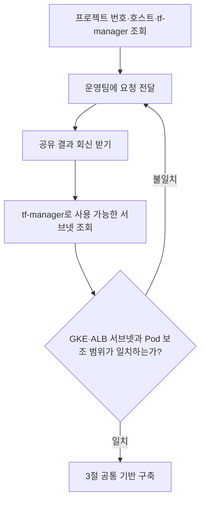

`gcp-sbx-edp-gke01` 관리자는 1절의 프로젝트 API 활성화와 서비스 에이전트 준비를 수행합니다. 운영팀에 요청하기 전에 아래 명령으로 서비스 프로젝트 번호와 연결된 호스트를 확인합니다.

```bash
# 수행 위치: infra-son01 또는 Cloud Shell | 수행 계정: ADMIN_ACCOUNT (son@sonmap.net) | 대상: gcp-sbx-edp-gke01
export ADMIN_ACCOUNT="son@sonmap.net"
export SBX_GKE_PROJECT="gcp-sbx-edp-gke01"
export TF_MANAGER="tf-manager@gcp-sbx-edp-gke01.iam.gserviceaccount.com"

gcloud projects describe "$SBX_GKE_PROJECT" \
  --account="$ADMIN_ACCOUNT" --format='value(projectNumber)'

gcloud compute shared-vpc get-host-project "$SBX_GKE_PROJECT" \
  --account="$ADMIN_ACCOUNT" --format='value(name)'

gcloud iam service-accounts describe "$TF_MANAGER" \
  --project="$SBX_GKE_PROJECT" --account="$ADMIN_ACCOUNT" --format='yaml(email,uniqueId)'
```

운영팀 회신 후 아래 명령을 배포 주체인 `tf-manager`로 실행해 서비스 프로젝트에 사용 가능한 서브넷을 확인합니다. 실행 계정에는 1절에 따라 `tf-manager` 가장 권한이 필요합니다.

```bash
# 수행 위치: infra-son01 또는 Cloud Shell | 로그인 계정: ADMIN_ACCOUNT (son@sonmap.net)
# 수행 계정(가장): TF_MANAGER (tf-manager@gcp-sbx-edp-gke01.iam.gserviceaccount.com)
# 조회 대상: gcp-prod-edp-hub-vpchost | 서비스 프로젝트: gcp-sbx-edp-gke01
gcloud compute networks subnets list-usable --project=gcp-prod-edp-hub-vpchost \
  --service-project="$SBX_GKE_PROJECT" \
  --account="$ADMIN_ACCOUNT" --impersonate-service-account="$TF_MANAGER" --format=json
```

응답에서 운영팀이 회신한 GKE·ALB VIP 서브넷과 GKE Pod 보조 범위를 확인합니다. 서브넷 사용 목록과 운영팀 IAM 적용 결과가 확인되면 3절의 서비스 프로젝트 구축 명령을 실행합니다.

</details>

<a name="3-공통-기반"></a>

<a name="-3-공통-기반"></a>

## 3. 공통 기반

<details>
<summary>내용 펼치기 / 접기</summary>

GCS와 AR을 준비한 뒤 GKE와 배포 이미지를 구성합니다. 기존 Workflows 자동 배포를 사용한다면 해당 런타임 구간을 적용하고, 접속용 내부 ALB와 TLS도 준비합니다.

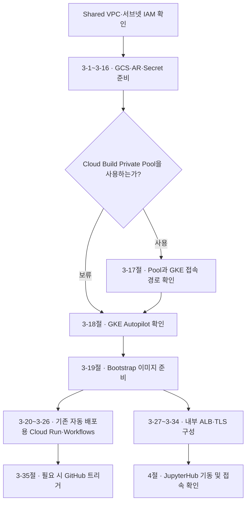

**3-1~3-9절 · Cloud Storage 버킷 구성**

세 버킷은 `gcp-sbx-edp-gke01`의 `asia-northeast3`에 생성합니다. 도식의 이름은 공통 접두사 `gcp-sbx-edp-gke01-sbxtest01-` 뒤에 붙습니다. 생성 시 균일한 버킷 수준 액세스와 공개 액세스 방지를 설정하고, 후속 명령에서 객체 버전 관리를 활성화합니다.

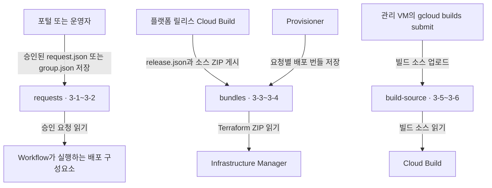

3-7~3-8절은 `sbx-manager`에 두 버킷(`requests`, `bundles`)의 객체 관리 권한을 부여합니다. 3-9절은 Infrastructure Manager 서비스 에이전트에 `bundles`의 객체 읽기 권한을 부여합니다.

필요한 변수 선언을 아래 코드 블록 맨 앞에 포함했습니다. 별도 문서에서 변수를 설정할 필요 없이, 이 문서의 선언부터 같은 터미널에서 실행합니다. `# 주석`을 보며 순서대로 실행하고, **기존 자원이 있으면 해당 생성 명령을 건너뜁니다.** 403·인증·연결 오류면 중단합니다. 선택 작업은 주석을 해제한 경우에만 실행합니다.

```bash
# ── 이 문서에서 사용하는 변수 선언 ──
# 아래 값을 확인하고 이 블록부터 같은 터미널에서 실행합니다.
unset CLOUDSDK_AUTH_IMPERSONATE_SERVICE_ACCOUNT
export ADMIN_ACCOUNT=son@sonmap.net
# 실행 프로젝트 작업자는 son, Shared VPC·초기 권한 관리자는 admin으로 구분합니다.
export VPC_ADMIN_ACCOUNT="${VPC_ADMIN_ACCOUNT:-admin@sonmap.net}"
export OPERATOR_MEMBER=user:son@sonmap.net
export SBX_GKE_PROJECT="gcp-sbx-edp-gke01"
export VPC_HOST_PROJECT="gcp-prod-edp-hub-vpchost"
export REGION=asia-northeast3
export NETWORK=vpc-prod-edp-hub
# 내부 ALB 대역 후보: VPC Admin의 실제 중복 확인·승인 후 실행합니다.
export ILB_VIP_SUBNET=subnet-prod-edp-alb-frontend-an3
export ILB_VIP_CIDR=172.31.96.0/27
export ILB_VIP_ADDRESS="" # 예약 후 실제 할당 주소 조회
export ILB_PROXY_SUBNET=subnet-prod-sbx-ilb-proxy
export ILB_PROXY_CIDR=172.31.111.64/26
export MAIN_CLUSTER=gke-sbx-main-an3
export MAIN_SUBNET=subnet-prod-sbx-gke-01
export MAIN_POD_RANGE=subnet-prod-sbx-pod-01
export MAIN_CP_CIDR=10.253.3.0/28
export PSA_CIDR=10.250.0.0/24
export ADMIN_CIDR=172.31.10.0/24
export TF_MANAGER="tf-manager@${SBX_GKE_PROJECT}.iam.gserviceaccount.com"
export SBX_MANAGER="sbx-manager@${SBX_GKE_PROJECT}.iam.gserviceaccount.com"
# 실행 위치 infra-son01 | 대상 ${SBX_GKE_PROJECT} | 계정 ${ADMIN_ACCOUNT}
export SBX_GKE_PROJECT_NUMBER="$(gcloud projects describe "${SBX_GKE_PROJECT}" --account="${ADMIN_ACCOUNT}" --format='value(projectNumber)')"
# 프로젝트 번호는 자동 조회합니다. 조회 실패 또는 숫자가 아닌 결과이면 이후 명령을 중단합니다.

# 2절의 네트워크·서브넷 IAM 확인 후 저장소 루트에서 실행합니다.
# 기존 GKE는 Autopilot · Private Nodes/Endpoint · Subnet · Pod Range를 확인합니다.
# Private Pool이 필요해지면 GKE 사설 접속 경로를 별도로 검토합니다.

```

<a name="-1-storage-buckets-create-gsgcp-sbx-edp-gke01-sbxtest01-requests"></a>

<a name="1-storage-buckets-create-gsgcp-sbx-edp-gke01-sbxtest01-requests"></a>

### 3-1. storage buckets create gs://gcp-sbx-edp-gke01-sbxtest01-requests

```bash
# 기존 자원 확인
# 실행 위치 infra-son01 | 대상 ${SBX_GKE_PROJECT} | 계정 ${ADMIN_ACCOUNT} | 가장 ${TF_MANAGER}
gcloud storage buckets describe "gs://${SBX_GKE_PROJECT}-sbxtest01-requests" --format=json \
  --account="${ADMIN_ACCOUNT}" --impersonate-service-account="${TF_MANAGER}"
# 조회 결과가 명시적 Not Found일 때만 아래 생성 명령을 실행합니다.
gcloud storage buckets create "gs://${SBX_GKE_PROJECT}-sbxtest01-requests" \
  --project="${SBX_GKE_PROJECT}" --location="${REGION}" --uniform-bucket-level-access \
  --public-access-prevention --account="${ADMIN_ACCOUNT}" \
  --impersonate-service-account="${TF_MANAGER}"

```

<a name="-2-storage-buckets-update-gsgcp-sbx-edp-gke01-sbxtest01-requests"></a>

<a name="2-storage-buckets-update-gsgcp-sbx-edp-gke01-sbxtest01-requests"></a>

### 3-2. storage buckets update gs://gcp-sbx-edp-gke01-sbxtest01-requests

```bash
# 실행 위치 infra-son01 | 대상 ${SBX_GKE_PROJECT} | 계정 ${ADMIN_ACCOUNT} | 가장 ${TF_MANAGER}
gcloud storage buckets update "gs://${SBX_GKE_PROJECT}-sbxtest01-requests" --versioning \
  --public-access-prevention --account="${ADMIN_ACCOUNT}" \
  --impersonate-service-account="${TF_MANAGER}"

```

<a name="-3-storage-buckets-create-gsgcp-sbx-edp-gke01-sbxtest01-bundles"></a>

<a name="3-storage-buckets-create-gsgcp-sbx-edp-gke01-sbxtest01-bundles"></a>

### 3-3. storage buckets create gs://gcp-sbx-edp-gke01-sbxtest01-bundles

```bash
# 기존 자원 확인
# 실행 위치 infra-son01 | 대상 ${SBX_GKE_PROJECT} | 계정 ${ADMIN_ACCOUNT} | 가장 ${TF_MANAGER}
gcloud storage buckets describe "gs://${SBX_GKE_PROJECT}-sbxtest01-bundles" --format=json \
  --account="${ADMIN_ACCOUNT}" --impersonate-service-account="${TF_MANAGER}"
# 조회 결과가 명시적 Not Found일 때만 아래 생성 명령을 실행합니다.
gcloud storage buckets create "gs://${SBX_GKE_PROJECT}-sbxtest01-bundles" \
  --project="${SBX_GKE_PROJECT}" --location="${REGION}" --uniform-bucket-level-access \
  --public-access-prevention --account="${ADMIN_ACCOUNT}" \
  --impersonate-service-account="${TF_MANAGER}"

```

<a name="-4-storage-buckets-update-gsgcp-sbx-edp-gke01-sbxtest01-bundles"></a>

<a name="4-storage-buckets-update-gsgcp-sbx-edp-gke01-sbxtest01-bundles"></a>

### 3-4. storage buckets update gs://gcp-sbx-edp-gke01-sbxtest01-bundles

```bash
# 실행 위치 infra-son01 | 대상 ${SBX_GKE_PROJECT} | 계정 ${ADMIN_ACCOUNT} | 가장 ${TF_MANAGER}
gcloud storage buckets update "gs://${SBX_GKE_PROJECT}-sbxtest01-bundles" --versioning \
  --public-access-prevention --account="${ADMIN_ACCOUNT}" \
  --impersonate-service-account="${TF_MANAGER}"

```

<a name="-5-storage-buckets-create-gsgcp-sbx-edp-gke01-sbxtest01-build-source"></a>

<a name="5-storage-buckets-create-gsgcp-sbx-edp-gke01-sbxtest01-build-source"></a>

### 3-5. storage buckets create gs://gcp-sbx-edp-gke01-sbxtest01-build-source

```bash
# 기존 자원 확인
# 실행 위치 infra-son01 | 대상 ${SBX_GKE_PROJECT} | 계정 ${ADMIN_ACCOUNT} | 가장 ${TF_MANAGER}
gcloud storage buckets describe "gs://${SBX_GKE_PROJECT}-sbxtest01-build-source" --format=json \
  --account="${ADMIN_ACCOUNT}" --impersonate-service-account="${TF_MANAGER}"
# 조회 결과가 명시적 Not Found일 때만 아래 생성 명령을 실행합니다.
gcloud storage buckets create "gs://${SBX_GKE_PROJECT}-sbxtest01-build-source" \
  --project="${SBX_GKE_PROJECT}" --location="${REGION}" --uniform-bucket-level-access \
  --public-access-prevention --account="${ADMIN_ACCOUNT}" \
  --impersonate-service-account="${TF_MANAGER}"

```

<a name="-6-storage-buckets-update-gsgcp-sbx-edp-gke01-sbxtest01-build-source"></a>

<a name="6-storage-buckets-update-gsgcp-sbx-edp-gke01-sbxtest01-build-source"></a>

### 3-6. storage buckets update gs://gcp-sbx-edp-gke01-sbxtest01-build-source

```bash
# 실행 위치 infra-son01 | 대상 ${SBX_GKE_PROJECT} | 계정 ${ADMIN_ACCOUNT} | 가장 ${TF_MANAGER}
gcloud storage buckets update "gs://${SBX_GKE_PROJECT}-sbxtest01-build-source" --versioning \
  --public-access-prevention --account="${ADMIN_ACCOUNT}" \
  --impersonate-service-account="${TF_MANAGER}"

```

<a name="-7-storage-buckets-add-iam-policy-binding-gsgcp-sbx-edp-gke01-sbxtest01-requests--rolesstorageobjectadmin"></a>

<a name="7-storage-buckets-add-iam-policy-binding-gsgcp-sbx-edp-gke01-sbxtest01-requests--rolesstorageobjectadmin"></a>

### 3-7. storage buckets add-iam-policy-binding gs://gcp-sbx-edp-gke01-sbxtest01-requests · roles/storage.objectAdmin

```bash
# 실행 위치 infra-son01 | 대상 ${SBX_GKE_PROJECT} | 계정 ${ADMIN_ACCOUNT} | 가장 ${TF_MANAGER}
gcloud storage buckets add-iam-policy-binding "gs://${SBX_GKE_PROJECT}-sbxtest01-requests" \
  --member="serviceAccount:${SBX_MANAGER}" --role=roles/storage.objectAdmin \
  --account="${ADMIN_ACCOUNT}" --impersonate-service-account="${TF_MANAGER}"

```

<a name="-8-storage-buckets-add-iam-policy-binding-gsgcp-sbx-edp-gke01-sbxtest01-bundles--rolesstorageobjectadmin"></a>

<a name="8-storage-buckets-add-iam-policy-binding-gsgcp-sbx-edp-gke01-sbxtest01-bundles--rolesstorageobjectadmin"></a>

### 3-8. storage buckets add-iam-policy-binding gs://gcp-sbx-edp-gke01-sbxtest01-bundles · roles/storage.objectAdmin

```bash
# 실행 위치 infra-son01 | 대상 ${SBX_GKE_PROJECT} | 계정 ${ADMIN_ACCOUNT} | 가장 ${TF_MANAGER}
gcloud storage buckets add-iam-policy-binding "gs://${SBX_GKE_PROJECT}-sbxtest01-bundles" \
  --member="serviceAccount:${SBX_MANAGER}" --role=roles/storage.objectAdmin \
  --account="${ADMIN_ACCOUNT}" --impersonate-service-account="${TF_MANAGER}"

```

<a name="-9-storage-buckets-add-iam-policy-binding-gsgcp-sbx-edp-gke01-sbxtest01-bundles--rolesstorageobjectviewer"></a>

<a name="9-storage-buckets-add-iam-policy-binding-gsgcp-sbx-edp-gke01-sbxtest01-bundles--rolesstorageobjectviewer"></a>

### 3-9. storage buckets add-iam-policy-binding gs://gcp-sbx-edp-gke01-sbxtest01-bundles · roles/storage.objectViewer

```bash
# 실행 위치 infra-son01 | 대상 ${SBX_GKE_PROJECT} | 계정 ${ADMIN_ACCOUNT} | 가장 ${TF_MANAGER}
gcloud storage buckets add-iam-policy-binding "gs://${SBX_GKE_PROJECT}-sbxtest01-bundles" \
  --member="serviceAccount:service-${SBX_GKE_PROJECT_NUMBER}@gcp-sa-config.iam.gserviceaccount.com" \
  --role=roles/storage.objectViewer --account="${ADMIN_ACCOUNT}" \
  --impersonate-service-account="${TF_MANAGER}"

```

<a name="-10-artifacts-repositories-create-ar-sbxtest01-platform"></a>

<a name="10-artifacts-repositories-create-ar-sbxtest01-platform"></a>

### 3-10. artifacts repositories create ar-sbxtest01-platform

```bash
# 기존 자원 확인
# 실행 위치 infra-son01 | 대상 ${SBX_GKE_PROJECT} | 계정 ${ADMIN_ACCOUNT} | 가장 ${TF_MANAGER}
gcloud artifacts repositories describe ar-sbxtest01-platform --project="${SBX_GKE_PROJECT}" \
  --location="${REGION}" --format=json --account="${ADMIN_ACCOUNT}" \
  --impersonate-service-account="${TF_MANAGER}"
# 조회 결과가 명시적 Not Found일 때만 아래 생성 명령을 실행합니다.
gcloud artifacts repositories create ar-sbxtest01-platform --project="${SBX_GKE_PROJECT}" \
  --location="${REGION}" --repository-format=docker --account="${ADMIN_ACCOUNT}" \
  --impersonate-service-account="${TF_MANAGER}"

```

<a name="-11-artifacts-repositories-add-iam-policy-binding-ar-sbxtest01-platform--rolesartifactregistryreader"></a>

<a name="11-artifacts-repositories-add-iam-policy-binding-ar-sbxtest01-platform--rolesartifactregistryreader"></a>

### 3-11. artifacts repositories add-iam-policy-binding ar-sbxtest01-platform · roles/artifactregistry.reader

```bash
# 실행 위치 infra-son01 | 대상 ${SBX_GKE_PROJECT} | 계정 ${ADMIN_ACCOUNT} | 가장 ${TF_MANAGER}
gcloud artifacts repositories add-iam-policy-binding ar-sbxtest01-platform \
  --project="${SBX_GKE_PROJECT}" --location="${REGION}" \
  --member="serviceAccount:${SBX_GKE_PROJECT_NUMBER}-compute@developer.gserviceaccount.com" \
  --role=roles/artifactregistry.reader --account="${ADMIN_ACCOUNT}" \
  --impersonate-service-account="${TF_MANAGER}"

```

<a name="-12-artifacts-repositories-add-iam-policy-binding-ar-sbxtest01-platform--rolesartifactregistryreader"></a>

<a name="12-artifacts-repositories-add-iam-policy-binding-ar-sbxtest01-platform--rolesartifactregistryreader"></a>

### 3-12. artifacts repositories add-iam-policy-binding ar-sbxtest01-platform · roles/artifactregistry.reader

```bash

```

<a name="-13-secrets-create-jupyter-oauth-client-id"></a>

<a name="13-secrets-create-jupyter-oauth-client-id"></a>

### 3-13. secrets create jupyter-oauth-client-id

3-13~3-16절은 기존 과제별 Hub에서 Google OAuth를 사용할 때 실행합니다. 실제 클라이언트 값은 [4-5-1절](#4-5-1-google-oauth-값-등록--기존-과제별-로그인-사용-시)에서 등록합니다.

```bash
# 기존 자원 확인
# 실행 위치 infra-son01 | 대상 ${SBX_GKE_PROJECT} | 계정 ${ADMIN_ACCOUNT} | 가장 ${TF_MANAGER}
gcloud secrets describe jupyter-oauth-client-id --project="${SBX_GKE_PROJECT}" --format=json \
  --account="${ADMIN_ACCOUNT}" --impersonate-service-account="${TF_MANAGER}"
# 조회 결과가 명시적 Not Found일 때만 아래 생성 명령을 실행합니다.
gcloud secrets create jupyter-oauth-client-id --project="${SBX_GKE_PROJECT}" \
  --replication-policy=user-managed --locations="${REGION}" --account="${ADMIN_ACCOUNT}" \
  --impersonate-service-account="${TF_MANAGER}"

```

<a name="-14-secrets-add-iam-policy-binding-jupyter-oauth-client-id--rolessecretmanagersecretaccessor"></a>

<a name="14-secrets-add-iam-policy-binding-jupyter-oauth-client-id--rolessecretmanagersecretaccessor"></a>

### 3-14. secrets add-iam-policy-binding jupyter-oauth-client-id · roles/secretmanager.secretAccessor

```bash
# 실행 위치 infra-son01 | 대상 ${SBX_GKE_PROJECT} | 계정 ${ADMIN_ACCOUNT} | 가장 ${TF_MANAGER}
gcloud secrets add-iam-policy-binding jupyter-oauth-client-id --project="${SBX_GKE_PROJECT}" \
  --member="serviceAccount:${TF_MANAGER}" --role=roles/secretmanager.secretAccessor \
  --account="${ADMIN_ACCOUNT}" --impersonate-service-account="${TF_MANAGER}"

```

<a name="-15-secrets-create-jupyter-oauth-client-secret"></a>

<a name="15-secrets-create-jupyter-oauth-client-secret"></a>

### 3-15. secrets create jupyter-oauth-client-secret

```bash
# 기존 자원 확인
# 실행 위치 infra-son01 | 대상 ${SBX_GKE_PROJECT} | 계정 ${ADMIN_ACCOUNT} | 가장 ${TF_MANAGER}
gcloud secrets describe jupyter-oauth-client-secret --project="${SBX_GKE_PROJECT}" --format=json \
  --account="${ADMIN_ACCOUNT}" --impersonate-service-account="${TF_MANAGER}"
# 조회 결과가 명시적 Not Found일 때만 아래 생성 명령을 실행합니다.
gcloud secrets create jupyter-oauth-client-secret --project="${SBX_GKE_PROJECT}" \
  --replication-policy=user-managed --locations="${REGION}" --account="${ADMIN_ACCOUNT}" \
  --impersonate-service-account="${TF_MANAGER}"

```

<a name="-16-secrets-add-iam-policy-binding-jupyter-oauth-client-secret--rolessecretmanagersecretaccessor"></a>

<a name="16-secrets-add-iam-policy-binding-jupyter-oauth-client-secret--rolessecretmanagersecretaccessor"></a>

### 3-16. secrets add-iam-policy-binding jupyter-oauth-client-secret · roles/secretmanager.secretAccessor

```bash
# 실행 위치 infra-son01 | 대상 ${SBX_GKE_PROJECT} | 계정 ${ADMIN_ACCOUNT} | 가장 ${TF_MANAGER}
gcloud secrets add-iam-policy-binding jupyter-oauth-client-secret --project="${SBX_GKE_PROJECT}" \
  --member="serviceAccount:${TF_MANAGER}" --role=roles/secretmanager.secretAccessor \
  --account="${ADMIN_ACCOUNT}" --impersonate-service-account="${TF_MANAGER}"

```

<a name="-17-shared-vpc-운영팀-작업--private-pool-초기-구성"></a>

<a name="17-shared-vpc-운영팀-작업--private-pool-초기-구성"></a>

### 3-17. Shared VPC 운영팀 작업 · Private Pool 초기 구성

`sbx03` 자동 배포에 사용할 `pool-sbxtest01`을 준비합니다. **2-3-9절**에서 `psa-prod-edp-cloudbuild`의 `10.250.0.0/24` 예약과 Service Networking 피어링이 확인됐다면 아래 조회부터 진행합니다.

<a name="17-1-기존-pool-조회"></a>

#### 3-17-1. 기존 Pool 조회

```bash
# 수행 위치: Cloud Shell 또는 infra-son01 | 수행 계정: admin@sonmap.net
gcloud builds worker-pools describe pool-sbxtest01 \
  --project=gcp-sbx-edp-gke01 --region=asia-northeast3 \
  --account=admin@sonmap.net --format='value(state)'
```

`RUNNING`이면 생성 단계를 건너뛰고 3-17-3의 접속 점검으로 진행합니다. `NOT_FOUND`이면 3-17-2를 실행합니다.

<a name="17-2-private-pool-생성"></a>

#### 3-17-2. Private Pool 생성

```bash
# 수행 위치: Cloud Shell 또는 infra-son01 | 수행 계정: admin@sonmap.net
gcloud builds worker-pools create pool-sbxtest01 \
  --project=gcp-sbx-edp-gke01 \
  --region=asia-northeast3 \
  --worker-machine-type=e2-standard-4 \
  --worker-disk-size=100GB \
  --no-public-egress \
  --peered-network=projects/gcp-prod-edp-hub-vpchost/global/networks/vpc-prod-edp-hub \
  --peered-network-ip-range=10.250.0.0/24 \
  --account=admin@sonmap.net
```

<a name="17-3-상태-및-gke-접속-확인"></a>

#### 3-17-3. 상태 및 GKE 접속 확인

3-17-1을 다시 실행해 `RUNNING`을 확인합니다. 이어서 `infra-son01`에서 [Private Pool의 GKE 접속 점검](reference/cloudbuild-private-gke-vpn-design.md)을 수행합니다. 점검 빌드가 성공하면 [2차 Sandbox의 Workflow 실행 전 확인](../03.sandbox_deploy/README.md#5-배포-전-확인)으로 진행합니다.

<a name="-18-container-clusters-create-auto-gke-sbx-main-an3"></a>

<a name="18-container-clusters-create-auto-gke-sbx-main-an3"></a>

### 3-18. container clusters create-auto gke-sbx-main-an3

```bash
# 기존 자원 확인
# 실행 위치 infra-son01 | 대상 ${SBX_GKE_PROJECT} | 계정 ${ADMIN_ACCOUNT} | 가장 ${TF_MANAGER}
gcloud container clusters describe "${MAIN_CLUSTER}" --project="${SBX_GKE_PROJECT}" \
  --region="${REGION}" --format=json --account="${ADMIN_ACCOUNT}" \
  --impersonate-service-account="${TF_MANAGER}"
# 조회 결과가 명시적 Not Found일 때만 아래 생성 명령을 실행합니다.
# 기존 자원 확인값: {"autopilot.enabled": true, "privateClusterConfig.enablePrivateNodes": true, "privateClusterConfig.enablePrivateEndpoint": true, "ipAllocationPolicy.clusterSecondaryRangeName": "subnet-prod-sbx-pod-01"} — 다르면 중단합니다.
# 실행 위치 infra-son01 | 대상 ${SBX_GKE_PROJECT} | 계정 ${ADMIN_ACCOUNT} | 가장 ${TF_MANAGER} | Shared VPC ${VPC_HOST_PROJECT}
gcloud container clusters create-auto "${MAIN_CLUSTER}" --project="${SBX_GKE_PROJECT}" \
  --region="${REGION}" --network="projects/${VPC_HOST_PROJECT}/global/networks/${NETWORK}" \
  --subnetwork="projects/${VPC_HOST_PROJECT}/regions/${REGION}/subnetworks/${MAIN_SUBNET}" \
  --cluster-secondary-range-name="${MAIN_POD_RANGE}" --enable-private-nodes --enable-private-endpoint \
  --master-ipv4-cidr="${MAIN_CP_CIDR}" --enable-master-authorized-networks \
  --master-authorized-networks="${ADMIN_CIDR}" --enable-master-global-access \
  --release-channel=regular --account="${ADMIN_ACCOUNT}" --impersonate-service-account="${TF_MANAGER}"

```

<a name="-19-bootstrap-이미지-빌드-및-ar-게시"></a>

<a name="19-bootstrap-이미지-빌드-및-ar-게시"></a>

### 3-19. Bootstrap 이미지 빌드 및 AR 게시

**3-19-1 수동 작업** 또는 **3-19-2 자동 작업** 중 하나를 선택합니다. 이번 구축은 **3-19-1 수동 작업**으로 진행합니다. 두 경로 모두 같은 `:bootstrap` 이미지 2개를 게시한 뒤 3-20절으로 진행합니다.

<a name="19-1-수동-작업--infra-son01에서-helm-차트-반입-및-이미지-빌드"></a>

#### 3-19-1. 수동 작업 · infra-son01에서 Helm 차트 반입 및 이미지 빌드

**1. Helm 차트 반입** · [4-1절 Helm 차트 수동 반입](#4-1-infra-son01에서-helm-차트-수동-반입) 명령을 먼저 실행합니다. `infra-son01`에서 `son@sonmap.net`으로 AR에 로그인하고, 공식 저장소에서 JupyterHub `4.2.0`을 내려받아 `helm push`로 게시합니다. `helm show chart`에서 이미 확인되는 버전은 재사용합니다.

**2. AR 로그인 및 이미지 빌드** · `infra-son01`의 Test02 저장소 루트에서 실행합니다. Docker가 설치되어 있고, `son@sonmap.net`에 AR 업로드 권한이 있어야 합니다.

```bash
# 수행 위치: infra-son01, Test02 저장소 루트 | 수행 계정: son@sonmap.net (AR 인증)
export AR_ACCOUNT="son@sonmap.net"
export AR_HOST="asia-northeast3-docker.pkg.dev"
export AR_REPO="${AR_HOST}/gcp-sbx-edp-gke01/ar-sbxtest01-platform"

gcloud auth print-access-token --account="$AR_ACCOUNT" |
  docker login "$AR_HOST" --username oauth2accesstoken --password-stdin
```

로그인이 성공하면 두 이미지를 빌드합니다.

```bash
# 수행 위치: infra-son01, Test02 저장소 루트 | 수행 계정: VM 로그인 사용자
docker build -f 03.sandbox_deploy/03.3.gke/Dockerfile \
  -t "${AR_REPO}/sbxtest01-automation-runner:bootstrap" .

docker build -t "${AR_REPO}/run-sbxtest01-provisioner:bootstrap" \
  03.sandbox_deploy/03.1.request
```

**3. 이미지 업로드 및 확인** · 두 빌드가 성공하면 같은 터미널에서 실행합니다.

```bash
# 수행 위치: infra-son01 | 수행 계정: son@sonmap.net (AR 인증)
docker push "${AR_REPO}/sbxtest01-automation-runner:bootstrap"
docker push "${AR_REPO}/run-sbxtest01-provisioner:bootstrap"

gcloud artifacts docker images list "$AR_REPO" \
  --include-tags --account="$AR_ACCOUNT"
```

두 이미지에 `bootstrap` 태그가 표시되면 3-20절으로 진행합니다. 4-1절을 실행할 때 차트 버전이 이미 확인되면 차트 업로드를 건너뜁니다.

<a name="19-2-자동-작업--cloud-build로-bootstrap-이미지-빌드-및-게시"></a>

#### 3-19-2. 자동 작업 · Cloud Build로 bootstrap 이미지 빌드 및 게시

`infra-son01`의 Test02 저장소 루트에서 기존 Cloud Build 명령을 실행합니다. 이 명령은 bootstrap 이미지 2개를 게시합니다. JupyterHub Helm 차트는 [4-1절 Helm 차트 수동 반입](#4-1-infra-son01에서-helm-차트-수동-반입)으로 준비합니다. 빌드가 `SUCCESS`이고 두 이미지의 `bootstrap` 태그가 확인되면 3-20절으로 진행합니다.

```bash
# 실행 위치 infra-son01 | 대상 ${SBX_GKE_PROJECT} | 계정 ${ADMIN_ACCOUNT} | 가장 ${TF_MANAGER} | 워크로드 실행 ${TF_MANAGER}
gcloud builds submit . --project="${SBX_GKE_PROJECT}" --region="${REGION}" \
  --service-account="projects/${SBX_GKE_PROJECT}/serviceAccounts/${TF_MANAGER}" \
  --gcs-source-staging-dir="gs://${SBX_GKE_PROJECT}-sbxtest01-build-source/source" \
  --config=03.sandbox_deploy/03.3.gke/cloudbuild/bootstrap-build.yaml --account="${ADMIN_ACCOUNT}" \
  --impersonate-service-account="${TF_MANAGER}"

```

<a name="-20-run-deploy-run-sbxtest01-provisioner"></a>

<a name="20-run-deploy-run-sbxtest01-provisioner"></a>

### 3-20. run deploy run-sbxtest01-provisioner

```bash
# 실행 위치 infra-son01 | 대상 ${SBX_GKE_PROJECT} | 계정 ${ADMIN_ACCOUNT} | 가장 ${TF_MANAGER} | 워크로드 실행 ${SBX_MANAGER}
gcloud run deploy run-sbxtest01-provisioner --project="${SBX_GKE_PROJECT}" --region="${REGION}" \
  --image="${REGION}-docker.pkg.dev/${SBX_GKE_PROJECT}/ar-sbxtest01-platform/run-sbxtest01-provisioner:bootstrap" \
  --service-account="${SBX_MANAGER}" --no-allow-unauthenticated --ingress=all --timeout=300 \
  --max-instances=2 --env-vars-file=03.sandbox_deploy/03.1.request/provisioner-env.yaml \
  --clear-network --account="${ADMIN_ACCOUNT}" --impersonate-service-account="${TF_MANAGER}"

```

<a name="-21-run-services-add-iam-policy-binding-run-sbxtest01-provisioner--rolesruninvoker"></a>

<a name="21-run-services-add-iam-policy-binding-run-sbxtest01-provisioner--rolesruninvoker"></a>

### 3-21. run services add-iam-policy-binding run-sbxtest01-provisioner · roles/run.invoker

```bash
# 실행 위치 infra-son01 | 대상 ${SBX_GKE_PROJECT} | 계정 ${ADMIN_ACCOUNT} | 가장 ${TF_MANAGER}
gcloud run services add-iam-policy-binding run-sbxtest01-provisioner --project="${SBX_GKE_PROJECT}" \
  --region="${REGION}" --member="serviceAccount:${SBX_MANAGER}" --role=roles/run.invoker \
  --account="${ADMIN_ACCOUNT}" --impersonate-service-account="${TF_MANAGER}"

```

<a name="-22-run-services-describe-run-sbxtest01-provisioner"></a>

<a name="22-run-services-describe-run-sbxtest01-provisioner"></a>

### 3-22. run services describe run-sbxtest01-provisioner

```bash
# 실행 위치 infra-son01 | 대상 ${SBX_GKE_PROJECT} | 계정 ${ADMIN_ACCOUNT} | 가장 ${TF_MANAGER}
gcloud run services describe run-sbxtest01-provisioner --project="${SBX_GKE_PROJECT}" \
  --region="${REGION}" '--format=value(status.url)' --account="${ADMIN_ACCOUNT}" \
  --impersonate-service-account="${TF_MANAGER}"

# ── Workflow 입력 파일 준비 ──
# Cloud Run URL 조회가 성공했고 값이 비어 있지 않은지 확인합니다.
# URL만 치환합니다. Workflows의 ${args}, ${response.body}는 그대로 유지합니다.
# 실행 위치 infra-son01 | 대상 ${SBX_GKE_PROJECT} | 계정 ${ADMIN_ACCOUNT} | 가장 ${TF_MANAGER}
export PROVISIONER_URL="$(gcloud run services describe run-sbxtest01-provisioner --project="${SBX_GKE_PROJECT}" --region="${REGION}" --account="${ADMIN_ACCOUNT}" --impersonate-service-account="${TF_MANAGER}" --format='value(status.url)')"
mkdir -p .local
sed "s|__PROVISIONER_URL__|${PROVISIONER_URL}|g" 03.sandbox_deploy/03.1.request/workflow.template.yaml > .local/workflow.yaml

```

<a name="-23-workflows-deploy-workflow-sbxtest01-provision"></a>

<a name="23-workflows-deploy-workflow-sbxtest01-provision"></a>

### 3-23. workflows deploy workflow-sbxtest01-provision

```bash
# 실행 위치 infra-son01 | 대상 ${SBX_GKE_PROJECT} | 계정 ${ADMIN_ACCOUNT} | 가장 ${TF_MANAGER} | 워크로드 실행 ${SBX_MANAGER}
gcloud workflows deploy workflow-sbxtest01-provision --project="${SBX_GKE_PROJECT}" \
  --location="${REGION}" --service-account="${SBX_MANAGER}" --source=.local/workflow.yaml \
  --account="${ADMIN_ACCOUNT}" --impersonate-service-account="${TF_MANAGER}"

```

<a name="-24-projects-add-iam-policy-binding-gcp-sbx-edp-gke01--rolesworkflowsinvoker"></a>

<a name="24-projects-add-iam-policy-binding-gcp-sbx-edp-gke01--rolesworkflowsinvoker"></a>

### 3-24. projects add-iam-policy-binding gcp-sbx-edp-gke01 · roles/workflows.invoker

```bash
# 실행 위치 infra-son01 | 대상 ${SBX_GKE_PROJECT} | 계정 ${ADMIN_ACCOUNT} | 가장 ${TF_MANAGER}
gcloud projects add-iam-policy-binding "${SBX_GKE_PROJECT}" --member="${OPERATOR_MEMBER}" \
  --role=roles/workflows.invoker --condition=None --account="${ADMIN_ACCOUNT}" \
  --impersonate-service-account="${TF_MANAGER}"

```

<a name="-25-storage-buckets-add-iam-policy-binding-gsgcp-sbx-edp-gke01-sbxtest01-requests--rolesstorageobjectadmin"></a>

<a name="25-storage-buckets-add-iam-policy-binding-gsgcp-sbx-edp-gke01-sbxtest01-requests--rolesstorageobjectadmin"></a>

### 3-25. storage buckets add-iam-policy-binding gs://gcp-sbx-edp-gke01-sbxtest01-requests · roles/storage.objectAdmin

```bash
# 실행 위치 infra-son01 | 대상 ${SBX_GKE_PROJECT} | 계정 ${ADMIN_ACCOUNT} | 가장 ${TF_MANAGER}
gcloud storage buckets add-iam-policy-binding "gs://${SBX_GKE_PROJECT}-sbxtest01-requests" \
  --member="${OPERATOR_MEMBER}" --role=roles/storage.objectAdmin --account="${ADMIN_ACCOUNT}" \
  --impersonate-service-account="${TF_MANAGER}"

```

<a name="-26-storage-buckets-add-iam-policy-binding-gsgcp-sbx-edp-gke01-sbxtest01-bundles--rolesstorageobjectviewer"></a>

<a name="26-storage-buckets-add-iam-policy-binding-gsgcp-sbx-edp-gke01-sbxtest01-bundles--rolesstorageobjectviewer"></a>

### 3-26. storage buckets add-iam-policy-binding gs://gcp-sbx-edp-gke01-sbxtest01-bundles · roles/storage.objectViewer

```bash
# 실행 위치 infra-son01 | 대상 ${SBX_GKE_PROJECT} | 계정 ${ADMIN_ACCOUNT} | 가장 ${TF_MANAGER}
gcloud storage buckets add-iam-policy-binding "gs://${SBX_GKE_PROJECT}-sbxtest01-bundles" \
  --member="${OPERATOR_MEMBER}" --role=roles/storage.objectViewer --account="${ADMIN_ACCOUNT}" \
  --impersonate-service-account="${TF_MANAGER}"

# ── ALB 사전 확인: tf-manager로 VIP Subnet 조회 ──
# 실행 위치 infra-son01 | 대상 ${VPC_HOST_PROJECT} | 계정 ${ADMIN_ACCOUNT} | 가장 ${TF_MANAGER}
gcloud compute networks subnets describe "${ILB_VIP_SUBNET}" --project="${VPC_HOST_PROJECT}" \
  --region="${REGION}" --format=json --account="${ADMIN_ACCOUNT}" \
  --impersonate-service-account="${TF_MANAGER}"
# 조회는 Network Viewer로도 성공할 수 있습니다. 실제 사용 권한은 2-1절의 운영팀 회신에서 확인합니다.
# 조회 실패 또는 바인딩 미확인 상태에서는 VPC Admin에게 요청하고 ALB 생성을 중단합니다.

```

<a name="-27-regional-internal-alb-사설-vip-예약"></a>

<a name="27-regional-internal-alb-사설-vip-예약"></a>

### 3-27. Regional Internal ALB: 사설 VIP 예약

```bash
# 서브넷·프록시 전용 Subnet·방화벽 준비가 완료된 뒤 실행합니다.
# 기존 Global 외부 ALB를 제자리 변환하지 않습니다. Regional 자원을 별도로 생성합니다.
# 실행 위치 infra-son01 | 대상 ${SBX_GKE_PROJECT} | 계정 ${ADMIN_ACCOUNT} | 가장 ${TF_MANAGER}
gcloud compute addresses describe ip-alb-sbxtest01-shared --project="${SBX_GKE_PROJECT}" \
  --region="${REGION}" --format=json --account="${ADMIN_ACCOUNT}" \
  --impersonate-service-account="${TF_MANAGER}"
# 명시적 Not Found일 때만 생성합니다.
# 실행 위치 infra-son01 | 대상 ${SBX_GKE_PROJECT} | 계정 ${ADMIN_ACCOUNT} | 가장 ${TF_MANAGER} | Shared VPC ${VPC_HOST_PROJECT}
gcloud compute addresses create ip-alb-sbxtest01-shared --project="${SBX_GKE_PROJECT}" \
  --region="${REGION}" \
  --subnet="projects/${VPC_HOST_PROJECT}/regions/${REGION}/subnetworks/${ILB_VIP_SUBNET}" \
  --purpose=SHARED_LOADBALANCER_VIP --account="${ADMIN_ACCOUNT}" \
  --impersonate-service-account="${TF_MANAGER}"
# 자동 예약된 실제 VIP를 이후 프런트엔드 구성에 사용합니다.
# 실행 위치 infra-son01 | 대상 ${SBX_GKE_PROJECT} | 계정 ${ADMIN_ACCOUNT} | 가장 ${TF_MANAGER}
export ILB_VIP_ADDRESS="$(gcloud compute addresses describe ip-alb-sbxtest01-shared --project="${SBX_GKE_PROJECT}" --region="${REGION}" --account="${ADMIN_ACCOUNT}" --impersonate-service-account="${TF_MANAGER}" --format='value(address)')"

```

<a name="-28-기본-regional-health-checkbackend"></a>

<a name="28-기본-regional-health-checkbackend"></a>

### 3-28. 기본 Regional Health Check·Backend

```bash
# 실행 위치 infra-son01 | 대상 ${SBX_GKE_PROJECT} | 계정 ${ADMIN_ACCOUNT} | 가장 ${TF_MANAGER}
gcloud compute health-checks describe hc-alb-sbxtest01-shared-default --project="${SBX_GKE_PROJECT}" \
  --region="${REGION}" --format=json --account="${ADMIN_ACCOUNT}" \
  --impersonate-service-account="${TF_MANAGER}"
# 명시적 Not Found일 때만 생성합니다.
gcloud compute health-checks create http hc-alb-sbxtest01-shared-default \
  --project="${SBX_GKE_PROJECT}" --region="${REGION}" --port=8000 --request-path=/_chp_healthz \
  --account="${ADMIN_ACCOUNT}" --impersonate-service-account="${TF_MANAGER}"
gcloud compute backend-services describe bes-alb-sbxtest01-shared-default \
  --project="${SBX_GKE_PROJECT}" --region="${REGION}" --format=json --account="${ADMIN_ACCOUNT}" \
  --impersonate-service-account="${TF_MANAGER}"
# 명시적 Not Found일 때만 생성합니다. 기존 scheme은 INTERNAL_MANAGED여야 합니다.
gcloud compute backend-services create bes-alb-sbxtest01-shared-default --project="${SBX_GKE_PROJECT}" \
  --region="${REGION}" --protocol=HTTP --load-balancing-scheme=INTERNAL_MANAGED \
  --health-checks=hc-alb-sbxtest01-shared-default --health-checks-region="${REGION}" \
  --account="${ADMIN_ACCOUNT}" --impersonate-service-account="${TF_MANAGER}"

```

<a name="-29-regional-url-map"></a>

<a name="29-regional-url-map"></a>

### 3-29. Regional URL Map

```bash
# 실행 위치 infra-son01 | 대상 ${SBX_GKE_PROJECT} | 계정 ${ADMIN_ACCOUNT} | 가장 ${TF_MANAGER}
gcloud compute url-maps describe urlmap-alb-sbxtest01-shared --project="${SBX_GKE_PROJECT}" \
  --region="${REGION}" --format=json --account="${ADMIN_ACCOUNT}" \
  --impersonate-service-account="${TF_MANAGER}"
# 명시적 Not Found일 때만 생성합니다.
gcloud compute url-maps create urlmap-alb-sbxtest01-shared --project="${SBX_GKE_PROJECT}" \
  --region="${REGION}" \
  --default-service="projects/${SBX_GKE_PROJECT}/regions/${REGION}/backendServices/bes-alb-sbxtest01-shared-default" \
  --account="${ADMIN_ACCOUNT}" --impersonate-service-account="${TF_MANAGER}"

```

<a name="-30-regional-http-proxy"></a>

<a name="30-regional-http-proxy"></a>

### 3-30. Regional HTTP Proxy

```bash
# 실행 위치 infra-son01 | 대상 ${SBX_GKE_PROJECT} | 계정 ${ADMIN_ACCOUNT} | 가장 ${TF_MANAGER}
gcloud compute target-http-proxies describe http-proxy-alb-sbxtest01-shared \
  --project="${SBX_GKE_PROJECT}" --region="${REGION}" --format=json --account="${ADMIN_ACCOUNT}" \
  --impersonate-service-account="${TF_MANAGER}"
# 명시적 Not Found일 때만 생성합니다.
gcloud compute target-http-proxies create http-proxy-alb-sbxtest01-shared \
  --project="${SBX_GKE_PROJECT}" --region="${REGION}" \
  --url-map="projects/${SBX_GKE_PROJECT}/regions/${REGION}/urlMaps/urlmap-alb-sbxtest01-shared" \
  --account="${ADMIN_ACCOUNT}" --impersonate-service-account="${TF_MANAGER}"

```

<a name="-31-내부-http-forwarding-rule"></a>

<a name="31-내부-http-forwarding-rule"></a>

### 3-31. 내부 HTTP Forwarding Rule

```bash
# 실행 위치 infra-son01 | 대상 ${SBX_GKE_PROJECT} | 계정 ${ADMIN_ACCOUNT} | 가장 ${TF_MANAGER}
gcloud compute forwarding-rules describe fr-alb-sbxtest01-shared-http --project="${SBX_GKE_PROJECT}" \
  --region="${REGION}" --format=json --account="${ADMIN_ACCOUNT}" \
  --impersonate-service-account="${TF_MANAGER}"
# 명시적 Not Found일 때만 생성합니다. global-access는 사설 연결의 리전 제한만 해제합니다.
# 실행 위치 infra-son01 | 대상 ${SBX_GKE_PROJECT} | 계정 ${ADMIN_ACCOUNT} | 가장 ${TF_MANAGER} | Shared VPC ${VPC_HOST_PROJECT}
gcloud compute forwarding-rules create fr-alb-sbxtest01-shared-http --project="${SBX_GKE_PROJECT}" \
  --region="${REGION}" --load-balancing-scheme=INTERNAL_MANAGED \
  --network="projects/${VPC_HOST_PROJECT}/global/networks/${NETWORK}" \
  --subnet="projects/${VPC_HOST_PROJECT}/regions/${REGION}/subnetworks/${ILB_VIP_SUBNET}" \
  --address=ip-alb-sbxtest01-shared --ports=80 --target-http-proxy=http-proxy-alb-sbxtest01-shared \
  --target-http-proxy-region="${REGION}" --allow-global-access --account="${ADMIN_ACCOUNT}" \
  --impersonate-service-account="${TF_MANAGER}"

```

<a name="-32-regional-ssl-인증서-확인-및-등록"></a>

<a name="32-regional-ssl-인증서-확인-및-등록"></a>

### 3-32. Regional SSL 인증서 확인 및 등록

공유 내부 ALB에는 **Certificate Manager의 리전 Google 관리형 인증서만 적용**합니다. 그룹을 추가할 때는 그룹 JSON의 `domain`과 일치하는 호스트에 대해 DNS 승인과 인증서를 준비합니다. 아래 명령은 `jupyter-group01.sonmap.net` 기준입니다.

<a name="32-4-google-관리형-인증서-자동-갱신"></a>

<a name="3-32-4-google-관리형-인증서-자동-갱신"></a>

#### 3-32-1. 대상 및 권한 확인

**실행 위치** `infra-son01` · **로그인 계정** `son@sonmap.net` · **가장 계정** `tf-manager`

1-4절에서 `tf-manager`에 Certificate Manager 권한을 적용했는지 확인합니다. `sonmap.net` 공개 DNS에 검증 레코드를 추가할 권한이 있는 담당자와 협의합니다.

```bash
export SBX_GKE_PROJECT="gcp-sbx-edp-gke01"
export REGION="asia-northeast3"
export ADMIN_ACCOUNT="son@sonmap.net"
export TF_MANAGER="tf-manager@${SBX_GKE_PROJECT}.iam.gserviceaccount.com"
export DOMAIN="jupyter-group01.sonmap.net"
export DNS_AUTH="dns-auth-jupyter-group01"
export MANAGED_CERT="cert-jupyter-group01-managed"

gcloud services enable certificatemanager.googleapis.com \
  --project="${SBX_GKE_PROJECT}" --account="${ADMIN_ACCOUNT}"
```

#### 3-32-2. DNS 승인과 레코드 등록

DNS 승인 리소스가 이미 있으면 조회 명령만 실행합니다. 출력된 `dnsResourceRecord.name`과 `dnsResourceRecord.data`를 공개 CNAME에 그대로 사용합니다.

```bash
gcloud certificate-manager dns-authorizations create "${DNS_AUTH}" \
  --project="${SBX_GKE_PROJECT}" --location="${REGION}" --domain="${DOMAIN}" \
  --account="${ADMIN_ACCOUNT}" --impersonate-service-account="${TF_MANAGER}"

gcloud certificate-manager dns-authorizations describe "${DNS_AUTH}" \
  --project="${SBX_GKE_PROJECT}" --location="${REGION}" \
  --account="${ADMIN_ACCOUNT}" --impersonate-service-account="${TF_MANAGER}" \
  --format='yaml(dnsResourceRecord)'
```

| 등록 위치 | 유형 | 이름 | 값 |
|---|---|---|---|
| `sonmap.net` 공개 DNS | CNAME | `dnsResourceRecord.name` | `dnsResourceRecord.data` |
| 사내 DNS | A | `jupyter-group01.sonmap.net` | 실제 내부 ALB VIP (`172.31.96.2`) |

Google은 공개 CNAME을 발급 및 자동 갱신 검증에 사용합니다. 인증서를 사용하는 동안 CNAME을 유지합니다. 사용자는 사내 DNS에서 내부 ALB IP를 확인해 접속합니다. [리전 Google 관리형 인증서 가이드](https://docs.cloud.google.com/certificate-manager/docs/deploy-google-managed-regional)

#### 3-32-3. 인증서 발급 및 상태 확인

인증서 리소스가 이미 있으면 조회 명령만 실행합니다.

```bash
gcloud certificate-manager certificates create "${MANAGED_CERT}" \
  --project="${SBX_GKE_PROJECT}" --location="${REGION}" \
  --domains="${DOMAIN}" --dns-authorizations="${DNS_AUTH}" \
  --account="${ADMIN_ACCOUNT}" --impersonate-service-account="${TF_MANAGER}"

gcloud certificate-manager certificates describe "${MANAGED_CERT}" \
  --project="${SBX_GKE_PROJECT}" --location="${REGION}" \
  --account="${ADMIN_ACCOUNT}" --impersonate-service-account="${TF_MANAGER}" \
  --format='yaml(managed.domains,managed.state,managed.authorizationAttemptInfo)'
```

`managed.domains`에 접속 호스트가 있고 `managed.state`가 `ACTIVE`이면 3-33절로 진행합니다.

<a name="-33-regional-https-proxy"></a>

<a name="33-regional-https-proxy"></a>

### 3-33. Regional HTTPS Proxy

**실행 위치** `infra-son01` · **로그인 계정** `son@sonmap.net` · **가장 계정** `tf-manager`

공유 프록시와 URL Map을 조회해 호스트와 인증서 연결 상태를 확인합니다.

```bash
gcloud compute target-https-proxies describe https-proxy-alb-sbxtest01-shared \
  --project="${SBX_GKE_PROJECT}" --region="${REGION}" \
  --account="${ADMIN_ACCOUNT}" --impersonate-service-account="${TF_MANAGER}" \
  --format='yaml(name,urlMap,sslCertificates)'

gcloud compute url-maps describe urlmap-alb-sbxtest01-shared \
  --project="${SBX_GKE_PROJECT}" --region="${REGION}" \
  --account="${ADMIN_ACCOUNT}" --impersonate-service-account="${TF_MANAGER}" \
  --format='yaml(hostRules)'
```

아래 `CERT_REFS`는 `group01`만 연결하는 예시입니다. 공유 프록시가 다른 그룹도 서비스한다면 모든 호스트의 리전 Google 관리형 인증서를 `ACTIVE`로 준비하고, 해당 리소스 이름을 쉼표로 이어 붙입니다. 프록시 변경 시 전달한 목록 전체가 적용됩니다. [Google Cloud 인증서 연결 규칙](https://docs.cloud.google.com/load-balancing/docs/ssl-certificates#configuration_method_rules)

```bash
export CERT_REFS="projects/${SBX_GKE_PROJECT}/locations/${REGION}/certificates/${MANAGED_CERT}"
```

#### 3-33-1. 신규 프록시 생성

프록시 조회에서 `NOT_FOUND`가 확인되면 실행합니다.

```bash
gcloud compute target-https-proxies create https-proxy-alb-sbxtest01-shared \
  --project="${SBX_GKE_PROJECT}" --region="${REGION}" \
  --url-map="projects/${SBX_GKE_PROJECT}/regions/${REGION}/urlMaps/urlmap-alb-sbxtest01-shared" \
  --certificate-manager-certificates="${CERT_REFS}" \
  --account="${ADMIN_ACCOUNT}" --impersonate-service-account="${TF_MANAGER}"
```

#### 3-33-2. 기존 프록시 갱신

프록시가 이미 있으면 준비된 인증서 전체 목록으로 갱신합니다.

```bash
gcloud compute target-https-proxies update https-proxy-alb-sbxtest01-shared \
  --project="${SBX_GKE_PROJECT}" --region="${REGION}" \
  --certificate-manager-certificates="${CERT_REFS}" \
  --account="${ADMIN_ACCOUNT}" --impersonate-service-account="${TF_MANAGER}"
```

프록시 조회를 다시 실행해 인증서 연결을 확인합니다. 3-34절에서 HTTPS Forwarding Rule을 확인한 뒤 사내 PC에서 그룹 URL에 접속합니다.

<a name="-34-내부-https-forwarding-rule"></a>

<a name="34-내부-https-forwarding-rule"></a>

### 3-34. 내부 HTTPS Forwarding Rule

```bash
# 실행 위치 infra-son01 | 대상 ${SBX_GKE_PROJECT} | 계정 ${ADMIN_ACCOUNT} | 가장 ${TF_MANAGER}
gcloud compute forwarding-rules describe fr-alb-sbxtest01-shared-https --project="${SBX_GKE_PROJECT}" \
  --region="${REGION}" --format=json --account="${ADMIN_ACCOUNT}" \
  --impersonate-service-account="${TF_MANAGER}"
# 명시적 Not Found일 때만 생성합니다.
# 실행 위치 infra-son01 | 대상 ${SBX_GKE_PROJECT} | 계정 ${ADMIN_ACCOUNT} | 가장 ${TF_MANAGER} | Shared VPC ${VPC_HOST_PROJECT}
gcloud compute forwarding-rules create fr-alb-sbxtest01-shared-https --project="${SBX_GKE_PROJECT}" \
  --region="${REGION}" --load-balancing-scheme=INTERNAL_MANAGED \
  --network="projects/${VPC_HOST_PROJECT}/global/networks/${NETWORK}" \
  --subnet="projects/${VPC_HOST_PROJECT}/regions/${REGION}/subnetworks/${ILB_VIP_SUBNET}" \
  --address=ip-alb-sbxtest01-shared --ports=443 --target-https-proxy=https-proxy-alb-sbxtest01-shared \
  --target-https-proxy-region="${REGION}" --allow-global-access --account="${ADMIN_ACCOUNT}" \
  --impersonate-service-account="${TF_MANAGER}"

```

<a name="-35-선택--builds-triggers-create-github"></a>

<a name="35-선택--builds-triggers-create-github"></a>

### 3-35. 선택 · builds triggers create github

```bash
# 선택 작업: 필요한 경우에만 아래 명령의 주석을 해제합니다.
# 기존 자원 확인
# 실행 위치 infra-son01 | 대상 ${SBX_GKE_PROJECT} | 계정 ${ADMIN_ACCOUNT} | 가장 ${TF_MANAGER}
# gcloud builds triggers describe trigger-sbxtest01-platform-release --project="${SBX_GKE_PROJECT}" \
#   --region="${REGION}" --format=json --account="${ADMIN_ACCOUNT}" \
#   --impersonate-service-account="${TF_MANAGER}"
# 조회 결과가 명시적 Not Found일 때만 아래 생성 명령을 실행합니다.
# 실행 위치 infra-son01 | 대상 ${SBX_GKE_PROJECT} | 계정 ${ADMIN_ACCOUNT} | 가장 ${TF_MANAGER} | 워크로드 실행 ${TF_MANAGER}
# gcloud builds triggers create github --name=trigger-sbxtest01-platform-release \
#   --project="${SBX_GKE_PROJECT}" --region="${REGION}" --repo-owner=sonmap --repo-name=GCP_SBX_Test01 \
#   --branch-pattern="^main$" \
#   --build-config=03.sandbox_deploy/03.3.gke/cloudbuild/platform-release.yaml \
#   --service-account="projects/${SBX_GKE_PROJECT}/serviceAccounts/${TF_MANAGER}" \
#   '--substitutions=_RELEASE_ID=git-$SHORT_SHA,_COMMIT_SHA=$COMMIT_SHA' --account="${ADMIN_ACCOUNT}" \
#   --impersonate-service-account="${TF_MANAGER}"

# 다음: 4절 JupyterHub 준비·검증 → 기존 과제별 자동 배포라면 5절 Workspace 설정 → 2차 배포
# Build 설정은 03.sandbox_deploy/03.3.gke/cloudbuild에, Cloud Run과 Workflows 설정은 03.sandbox_deploy/03.1.request에 있습니다.
```

</details>

## 4. JupyterHub 이미지 준비와 수동 설치

<details>
<summary>내용 펼치기 / 접기</summary>

<a name="7-chart와-기본-이미지-미러링"></a>

<a name="-7-chart와-기본-이미지-미러링"></a>

<a name="infra-son01에서-helm-차트-수동-반입"></a>

<a name="7-1-infra-son01에서-helm-차트-수동-반입"></a>

### 4-1. infra-son01에서 Helm 차트 수동 반입

AR에 승인된 차트 버전이 있는지 먼저 확인합니다. 해당 버전이 없거나 갱신이 필요할 때만 다운로드와 업로드를 실행합니다.

승인된 관리 VM `infra-son01`에 로그인한 뒤, 같은 Bash 창에서 다음 명령을 순서대로 실행합니다. VM에는 Helm 3과 gcloud가 필요하며, 공식 Helm 저장소와 AR에 HTTPS로 접근할 수 있어야 합니다. AR은 Docker 형식 저장소를 사용합니다. `AR_ACCOUNT`는 대상 저장소에서 읽기·업로드 권한이 있는 gcloud 계정으로 지정합니다. 차트 반입은 관리 VM에서 완료하므로 GKE 접속과 Cloud Build 제출이 필요 없습니다.

<a name="7-1-1-대상-설정-및-ar-로그인"></a>

#### 4-1-1. 대상 설정 및 AR 로그인

```bash
CHART_VERSION=4.2.0
CHART_SOURCE=https://hub.jupyter.org/helm-chart/
AR_HOST=asia-northeast3-docker.pkg.dev
AR_REPO="oci://${AR_HOST}/gcp-sbx-edp-gke01/ar-sbxtest01-platform"
JUPYTER_CHART_URI="${AR_REPO}/jupyterhub"
AR_ACCOUNT=son@sonmap.net

# 실행 위치 infra-son01 | 대상 ${SBX_GKE_PROJECT}의 AR ar-sbxtest01-platform | 계정 $AR_ACCOUNT
( set -o pipefail; gcloud auth print-access-token --account="$AR_ACCOUNT" | helm registry login "$AR_HOST" --username oauth2accesstoken --password-stdin )
```

로그인이 성공한 뒤 대상 차트 버전을 조회합니다.

```bash
# 실행 위치 infra-son01 | 대상 ${SBX_GKE_PROJECT}의 AR ar-sbxtest01-platform | 계정 $AR_ACCOUNT의 AR 인증
helm show chart "$JUPYTER_CHART_URI" --version "$CHART_VERSION"
```

`name: jupyterhub`와 `version: 4.2.0`이 보이면 게시된 버전을 사용합니다. `Login Succeeded` 이후 `FetchReference` 오류에 `jupyterhub:4.2.0: not found`가 표시되면, 같은 `infra-son01` 터미널에서 7-1-2절 다운로드와 7-1-3절 업로드를 실행합니다. 인증·권한·네트워크 오류는 먼저 해결합니다.

<a name="7-1-2-공식-helm-저장소에서-패키지-다운로드"></a>

#### 4-1-2. 공식 Helm 저장소에서 패키지 다운로드

```bash
# 실행 위치 infra-son01 | 대상 공식 Helm 저장소 및 VM 로컬 | 계정 VM 로그인 사용자
CHART_DIR="$(mktemp -d)"
CHART_PACKAGE="$CHART_DIR/jupyterhub-${CHART_VERSION}.tgz"

helm pull jupyterhub \
  --repo "$CHART_SOURCE" \
  --version "$CHART_VERSION" \
  --destination "$CHART_DIR"

helm show chart "$CHART_PACKAGE"
```

다운로드한 패키지의 `name: jupyterhub`와 `version: 4.2.0`을 확인합니다.

<a name="7-1-3-내부-ar-업로드-및-검증"></a>

#### 4-1-3. 내부 AR 업로드 및 검증

```bash
# 실행 위치 infra-son01 | 대상 ${SBX_GKE_PROJECT}의 AR ar-sbxtest01-platform | 계정 $AR_ACCOUNT의 AR 인증
helm push "$CHART_PACKAGE" "$AR_REPO"

# 업로드가 성공하면 AR에 등록된 차트를 확인합니다.
helm show chart "$JUPYTER_CHART_URI" --version "$CHART_VERSION"
```

`helm push`의 대상은 저장소 루트입니다. Helm은 차트 이름과 버전을 패키지의 `Chart.yaml`에서 읽습니다. 배포에는 `oci://asia-northeast3-docker.pkg.dev/gcp-sbx-edp-gke01/ar-sbxtest01-platform/jupyterhub`와 `--version 4.2.0`을 사용합니다. 승인된 다른 AR을 사용할 경우 `AR_REPO`와 배포 설정의 차트 URI를 같이 맞춥니다.

<a name="hubproxynotebook-기본-이미지-복사"></a>

<a name="7-2-hubproxynotebook-기본-이미지-복사"></a>

### 4-2. Hub·Proxy·Notebook 기본 이미지 복사

배포에서 참조하는 이미지와 태그가 내부 AR에 없을 때 반입합니다. 수작업과 Cloud Build 중 환경에 맞는 한 경로를 실행합니다. 필요한 버전이 이미 게시돼 있으면 4-3절에서 표준 Notebook 이미지 상태를 확인합니다.

<a name="1-수작업-진행--infra-son01에서-내부-ar로-복사"></a>

<a name="7-2-1-수작업-진행--infra-son01에서-내부-ar로-복사"></a>

#### 4-2-1. 수작업 진행 · infra-son01에서 내부 AR로 복사

**수행 위치** · `infra-son01`  
**수행 계정** · VM 로그인 사용자, AR 인증은 `son@sonmap.net`

VM에 `skopeo`가 설치되어 있고 `quay.io`와 내부 AR에 접속할 수 있어야 합니다. 아래 명령을 같은 터미널에서 순서대로 실행합니다.

```bash
export AR_ACCOUNT="son@sonmap.net"
export AR_HOST="asia-northeast3-docker.pkg.dev"
export IMAGE_AR="$AR_HOST/gcp-sbx-edp-gke01/ar-sbxtest01-platform"

skopeo --version
gcloud auth print-access-token --account="$AR_ACCOUNT" |
  skopeo login "$AR_HOST" --username oauth2accesstoken --password-stdin
```

로그인이 성공하면 내부 AR에 없는 이미지와 태그만 복사합니다. `--all`은 원본에 여러 플랫폼 이미지가 있을 때 모두 복사합니다.

```bash
# 1. Hub
skopeo copy --all \
  docker://quay.io/jupyterhub/k8s-hub:4.2.0 \
  "docker://$IMAGE_AR/jupyterhub-k8s-hub:4.2.0"

# 2. Proxy
skopeo copy --all \
  docker://quay.io/jupyterhub/configurable-http-proxy:4.6.3 \
  "docker://$IMAGE_AR/jupyterhub-configurable-http-proxy:4.6.3"

# 3. Notebook 베이스
skopeo copy --all \
  docker://quay.io/jupyterhub/k8s-singleuser-sample:4.2.0 \
  "docker://$IMAGE_AR/jupyterhub-k8s-singleuser-sample:4.2.0"
```

```bash
# 수행 위치: infra-son01 | 수행 계정: son@sonmap.net
gcloud artifacts docker images list "$IMAGE_AR" \
  --include-tags --account="$AR_ACCOUNT"
```

세 이미지의 태그가 확인되면 4-3절의 표준 Notebook 이미지 확인으로 진행합니다.

<a name="2-자동-작업--관리형-cloud-build에서-복사"></a>

<a name="7-2-2-자동-작업--관리형-cloud-build에서-복사"></a>

#### 4-2-2. 자동 작업 · 관리형 Cloud Build에서 복사

수작업 대신 관리형 Cloud Build로 반입할 때 아래 명령을 실행합니다. 자동 작업을 이미 시작했다면 완료 후 AR 태그를 확인하고 4-3절로 진행합니다.

```bash
export SBX_GKE_PROJECT="gcp-sbx-edp-gke01"
# Test02 저장소 루트에서 실행합니다.
export ADMIN_ACCOUNT="son@sonmap.net"
export REGION="asia-northeast3"
export TF_MANAGER="tf-manager@${SBX_GKE_PROJECT}.iam.gserviceaccount.com"
export TF_MANAGER_RESOURCE="projects/${SBX_GKE_PROJECT}/serviceAccounts/${TF_MANAGER}"
export BUILD_STAGING_BUCKET="${SBX_GKE_PROJECT}-sbxtest01-build-source"
unset CLOUDSDK_AUTH_IMPERSONATE_SERVICE_ACCOUNT

export AUTOMATION_IMAGE="${REGION}-docker.pkg.dev/${SBX_GKE_PROJECT}/ar-sbxtest01-platform/sbxtest01-automation-runner:bootstrap"

# Hub / Proxy / Notebook 기본 이미지를 내부 저장소로 복사합니다.
# 실행 위치 infra-son01 | 대상 ${SBX_GKE_PROJECT} | 계정 ${ADMIN_ACCOUNT} | 가장 ${TF_MANAGER} | 워크로드 실행 ${TF_MANAGER}
gcloud builds submit --no-source --project="${SBX_GKE_PROJECT}" --region="${REGION}" \
  --account="${ADMIN_ACCOUNT}" --impersonate-service-account="${TF_MANAGER}" \
  --service-account="${TF_MANAGER_RESOURCE}" \
  --config=03.sandbox_deploy/03.3.gke/cloudbuild/mirror-jupyterhub-images.yaml \
  --substitutions="_AUTOMATION_IMAGE=${AUTOMATION_IMAGE}"
```

기본 이미지 복사 Build가 SUCCESS인지 확인합니다. 외부 다운로드가 가능한 관리형 Build에서 실행합니다.

<a name="8-notebook-표준-이미지-빌드"></a>

<a name="-8-notebook-표준-이미지-빌드"></a>

### 4-3. Notebook 표준 이미지 빌드

배포에서 사용할 승인 이미지가 AR에 있으면 해당 이미지를 사용합니다. 첫 게시 또는 승인된 이미지 변경 시 아래 명령으로 빌드합니다.

운영자는 승인된 관리 VM `infra-son01`의 Test02 저장소 루트에서 Docker BuildKit으로 표준 이미지를 빌드하고 내부 AR에 게시합니다. 표준 이미지는 공통 APT 도구와 Google Cloud CLI, Python 라이브러리, Notebook 시작 스크립트를 포함합니다. Docker 빌드 환경에서 OS APT 저장소, Google Cloud APT 저장소와 내부 AR에 접근할 수 있어야 합니다. VM에서 접근이 허용된 APT 경로를 사용하고, VM 호스트와 Docker 빌드 환경의 접속 여부를 각각 확인합니다.

```bash
AR_HOST=asia-northeast3-docker.pkg.dev
AR_REPO="$AR_HOST/gcp-sbx-edp-gke01/ar-sbxtest01-platform"
AR_ACCOUNT=son@sonmap.net
BASE_IMAGE="$AR_REPO/jupyterhub-k8s-singleuser-sample:4.2.0"
IMAGE_TAG=4.2.0-r2-home
IMAGE="$AR_REPO/jupyterhub-k8s-singleuser-standard:$IMAGE_TAG"
TARGET_PLATFORM=linux/amd64
NOTEBOOK_PIP_MODE=index
```

`TARGET_PLATFORM`은 GKE 대상 노드에 맞춥니다. 예제 태그가 이미 게시되어 있으면 기존 이미지를 사용하거나, 변경 버전에 새로운 승인 태그를 지정합니다. 기존 과제별 배포에서 새 태그를 사용할 경우 사용자 홈 설정도 함께 적용합니다. [이미지 적용 절차](../03.sandbox_deploy/03.3.gke/notebook-image/README.md)

<a name="8-1-docker를-내부-ar에-인증하고-베이스-이미지를-확인"></a>

#### 4-3-1. Docker를 내부 AR에 인증하고 베이스 이미지를 확인

```bash
# 실행 위치 infra-son01 | 대상 ${SBX_GKE_PROJECT}의 AR ar-sbxtest01-platform | 계정 $AR_ACCOUNT
( set -o pipefail; gcloud auth print-access-token --account="$AR_ACCOUNT" | docker login "$AR_HOST" --username oauth2accesstoken --password-stdin )
# 실행 위치 infra-son01 | 대상 ${SBX_GKE_PROJECT}의 AR ar-sbxtest01-platform | 계정 $AR_ACCOUNT의 AR 인증
docker pull --platform="$TARGET_PLATFORM" "$BASE_IMAGE"
```

<a name="8-2-python-패키지-설치-경로를-선택"></a>

#### 4-3-2. Python 패키지 설치 경로를 선택

- `index`는 Docker 빌드 안에서 필요한 Python 패키지와 의존성을 모두 받을 수 있을 때 사용합니다.
- 일부만 받을 수 있으면 [표준 이미지 wheel 반입 절차](../03.sandbox_deploy/03.3.gke/notebook-image/README.md#표준-이미지-wheel-반입)를 따라 완전한 wheel 모음을 `03.sandbox_deploy/03.3.gke/notebook-image/wheelhouse/`에 준비하고 아래 설정을 적용합니다. Dockerfile은 이 모드에서 Python 인덱스에 접속하지 않습니다. APT 설치에는 승인된 APT 접근 경로가 계속 필요합니다.

```bash
NOTEBOOK_PIP_MODE=wheelhouse
```

<a name="8-3-vm에서-빌드하고-확인-후-ar에-게시"></a>

#### 4-3-3. VM에서 빌드하고 확인 후 AR에 게시

```bash
# 실행 위치 infra-son01 | 대상 VM 로컬 Docker | 계정 VM 로그인 사용자
DOCKER_BUILDKIT=1 docker build --platform="$TARGET_PLATFORM" --build-arg "BASE_IMAGE=$BASE_IMAGE" \
  --build-arg "IMAGE_VERSION=$IMAGE_TAG" --build-arg "NOTEBOOK_PIP_MODE=$NOTEBOOK_PIP_MODE" --tag \
  "$IMAGE" 03.sandbox_deploy/03.3.gke/notebook-image
docker run --rm --platform="$TARGET_PLATFORM" --entrypoint python "$IMAGE" -c \
  'import pandas, pyarrow, db_dtypes; from google.cloud import bigquery, storage'
docker run --rm --platform="$TARGET_PLATFORM" --entrypoint sh "$IMAGE" -c \
  'command -v jupyterhub-singleuser && gcloud version'
# 실행 위치 infra-son01 | 대상 ${SBX_GKE_PROJECT}의 AR ar-sbxtest01-platform | 계정 $AR_ACCOUNT의 AR 인증
docker push "$IMAGE"
docker pull --platform="$TARGET_PLATFORM" "$IMAGE"
# 실행 위치 infra-son01 | 대상 VM 로컬 Docker | 계정 VM 로그인 사용자
docker image inspect "$IMAGE" --format='{{range .RepoDigests}}{{println .}}{{end}}' | grep -F \
  "${IMAGE%:*}@sha256:"
```

각 명령이 성공한 뒤 다음 명령을 실행합니다. 그룹 공유 PoC는 마지막 명령의 `이미지@sha256:…` 값을 승인 과제 JSON의 `image`에 넣고 배포합니다. 개발 중 추가 패키지는 [개발자 인터넷 PC → GCS → Notebook Pod 절차](../03.sandbox_deploy/03.3.gke/notebook-image/README.md#개발자-추가-패키지-gcs-경유)를 사용합니다.

<a name="9-jupyterhub-수동-설치-및-접속-확인"></a>

<a name="-9-jupyterhub-수동-설치-및-접속-확인"></a>

### 4-4. JupyterHub 수동 설치와 기동 확인

`sbx03-smoke`에서 Hub와 Proxy 기동을 확인합니다. 실제 과제의 접속 검증은 과제용 Namespace, ALB 연결, 인증 설정을 갖춘 뒤 진행합니다.

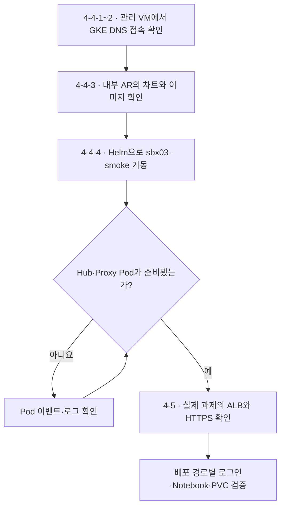

**수행 위치** · `infra-son01`의 Test02 저장소 루트  
**수행 계정** · `son@sonmap.net`으로 GKE와 Artifact Registry에 접속

이 절은 관리 VM에서 직접 Helm으로 설치하는 경로입니다. Private Pool과 2차 Sandbox의 플랫폼 릴리스 게시는 보류한 상태에서 진행할 수 있습니다.

<a name="gke와-내부-https-접속-확인"></a>

<a name="9-0-gke와-내부-https-접속-준비"></a>

<a name="9-1-gke와-내부-https-접속-준비"></a>

#### 4-4-1. GKE와 내부 HTTPS 접속 준비

관리 VM에서 DNS 엔드포인트로 Namespace 목록을 확인합니다. DNS 접속이 아직 비활성화된 클러스터에서만 첫 명령을 실행합니다.

```bash
# 실행 위치 infra-son01 | 대상 gcp-sbx-edp-gke01 | 계정 son@sonmap.net
gcloud container clusters update gke-sbx-main-an3 --project=gcp-sbx-edp-gke01 --region=asia-northeast3 \
  --enable-dns-access --account=son@sonmap.net

KUBECONFIG="$HOME/.kube/config-sbx-dns" gcloud container clusters get-credentials gke-sbx-main-an3 \
  --project=gcp-sbx-edp-gke01 --region=asia-northeast3 --dns-endpoint --account=son@sonmap.net

# 실행 위치 infra-son01 | 대상 ${SBX_GKE_PROJECT}의 gke-sbx-main-an3 | 계정 son@sonmap.net
CLOUDSDK_CORE_ACCOUNT=son@sonmap.net kubectl --kubeconfig="$HOME/.kube/config-sbx-dns" get namespaces
```

<a name="dns-엔드포인트로-kubectl과-helm-실행"></a>

<a name="9-1-1-dns-엔드포인트로-kubectl과-helm-실행"></a>

##### 4-4-1-1. DNS 엔드포인트로 kubectl과 Helm 실행

`kubectl get pods -A` 실행 시 `https://10.253.3.2/api`에서 `EOF`가 발생하면 현재 터미널이 사설 IP를 가리키는 kubeconfig를 읽고 있는지 확인합니다. 위에서 만든 DNS용 kubeconfig를 같은 터미널에 지정합니다.

```bash
# 수행 위치: infra-son01 | 수행 계정: son@sonmap.net | 대상: gke-sbx-main-an3
export KUBECONFIG="$HOME/.kube/config-sbx-dns"
export CLOUDSDK_CORE_ACCOUNT="son@sonmap.net"

kubectl config view --minify -o jsonpath='{.clusters[0].cluster.server}{"\n"}'
kubectl get namespaces
kubectl get pods -A
```

서버 주소가 `https://…gke.goog`로 표시되고 목록 조회가 성공하면 같은 터미널에서 `kubectl`과 `helm`을 실행합니다. 새 터미널에서는 두 `export` 명령을 다시 실행합니다.

기존 Workflows 경로에서 Private Pool 사용이 확정되면 [Private Pool 접속 점검](reference/cloudbuild-private-gke-vpn-design.md)도 실행합니다. DNS·인증서 담당자와 [내부 HTTPS 연결](reference/sbx03-https-certificate-runbook.md)을 확인한 뒤 [2차 Sandbox 구축](../03.sandbox_deploy/README.md)로 진행합니다.

<a name="8-1-gke-dns-접속-확인"></a>

<a name="9-1-gke-dns-접속-확인"></a>

<a name="9-2-gke-dns-접속-확인"></a>

#### 4-4-2. GKE DNS 접속 확인

```bash
export KUBECONFIG="$HOME/.kube/config-sbx-dns"
export CLOUDSDK_CORE_ACCOUNT="son@sonmap.net"

kubectl config view --minify -o jsonpath='{.clusters[0].cluster.server}{"\n"}'
kubectl get pods -A
```

서버 주소가 `gke.goog`이고 Pod 목록이 조회되면 진행합니다. kubeconfig 파일이 아직 없으면 [GKE와 내부 HTTPS 접속 확인](#gke와-내부-https-접속-확인)에서 생성합니다.

<a name="8-2-내부-ar-차트와-이미지-확인"></a>

<a name="9-2-내부-ar-차트와-이미지-확인"></a>

<a name="9-3-내부-ar-차트와-이미지-확인"></a>

#### 4-4-3. 내부 AR 차트와 이미지 확인

```bash
export AR_REPO="asia-northeast3-docker.pkg.dev/gcp-sbx-edp-gke01/ar-sbxtest01-platform"
export CHART_URI="oci://${AR_REPO}/jupyterhub"
export CHART_VERSION="4.2.0"

helm show chart "$CHART_URI" --version "$CHART_VERSION"

gcloud artifacts docker images list "$AR_REPO" \
  --include-tags --account=son@sonmap.net
```

| 대상 | 확인할 버전 또는 태그 |
|---|---|
| Helm 차트 | `jupyterhub` · `4.2.0` |
| Hub 이미지 | `jupyterhub-k8s-hub:4.2.0` |
| Proxy 이미지 | `jupyterhub-configurable-http-proxy:4.6.3` |
| 표준 Notebook 이미지 | `jupyterhub-k8s-singleuser-standard:4.2.0-r2-home` 또는 승인된 이미지 |

차트가 없거나 Helm 인증이 만료됐으면 [4-1절 Helm 차트 수동 반입](#4-1-infra-son01에서-helm-차트-수동-반입)을 확인합니다. 표준 Notebook 이미지가 없으면 [4-3절](#4-3-notebook-표준-이미지-빌드)에서 빌드합니다.

<a name="8-3-수동-기동-확인용-values-파일-생성-및-helm-설치"></a>

<a name="9-3-수동-기동-확인용-values-파일-생성-및-helm-설치"></a>

<a name="9-4-수동-기동-확인용-values-파일-생성-및-helm-설치"></a>

#### 4-4-4. 수동 기동 확인용 values 파일 생성 및 Helm 설치

`infra-son01`의 Test02 저장소 루트에서 아래 명령으로 `$HOME/.config/jupyterhub/sbx03-smoke-values.yaml`을 생성합니다. 기존 과제 릴리스와 구분하기 위해 `sbx03-smoke` Namespace와 릴리스를 사용합니다. 이 파일은 Hub와 Proxy 기동 확인용입니다. 실제 로그인과 사용자 Notebook 시험은 과제용 인증·저장소 설정을 준비한 뒤 진행합니다.

```bash
# 수행 위치: infra-son01 | 수행 계정: VM 로그인 사용자
export NAMESPACE="sbx03-smoke"
export RELEASE="sbx03-smoke"
export VALUES_FILE="$HOME/.config/jupyterhub/sbx03-smoke-values.yaml"
mkdir -p "$HOME/.config/jupyterhub"

cat > "$VALUES_FILE" <<'YAML'
hub:
  image:
    name: asia-northeast3-docker.pkg.dev/gcp-sbx-edp-gke01/ar-sbxtest01-platform/jupyterhub-k8s-hub
    tag: "4.2.0"
proxy:
  service:
    type: ClusterIP
  chp:
    image:
      name: asia-northeast3-docker.pkg.dev/gcp-sbx-edp-gke01/ar-sbxtest01-platform/jupyterhub-configurable-http-proxy
      tag: "4.6.3"
singleuser:
  image:
    name: asia-northeast3-docker.pkg.dev/gcp-sbx-edp-gke01/ar-sbxtest01-platform/jupyterhub-k8s-singleuser-standard
    tag: "4.2.0-r2-home"
prePuller:
  hook:
    enabled: false
  continuous:
    enabled: false
scheduling:
  userScheduler:
    enabled: false
  userPlaceholder:
    enabled: false
YAML

ls -l "$VALUES_FILE"
helm list -n "$NAMESPACE"
```

파일과 대상 릴리스를 확인한 뒤 아래 명령을 실행합니다. 같은 이름의 릴리스가 있으면 설정을 갱신합니다.

```bash
helm upgrade --install "$RELEASE" "$CHART_URI" \
  --version "$CHART_VERSION" --namespace "$NAMESPACE" --create-namespace \
  --values "$VALUES_FILE" --wait --timeout 15m

kubectl -n "$NAMESPACE" get pods,svc
```

<a name="8-4-과제용-내부-https-및-로그인-확인"></a>

<a name="9-4-과제용-내부-https-및-로그인-확인"></a>

<a name="9-5-과제용-내부-https-및-로그인-확인"></a>

### 4-5. 과제용 내부 HTTPS 및 로그인 검증

4-4절의 `sbx03-smoke`는 Hub와 Proxy 기동을 확인하는 릴리스입니다. 아래 절차는 과제용 values와 인증 설정이 적용된 실제 배포에 사용합니다. 내부 ALB TLS 인증서는 [3-32절](#3-32-regional-ssl-인증서-확인-및-등록)에서 관리하고, 이 절에서 브라우저 접속과 사용자 로그인을 확인합니다.

<a name="4-oauth-값-등록"></a>

<a name="-4-oauth-값-등록"></a>

#### 4-5-1. Google OAuth 값 등록 · 기존 과제별 로그인 사용 시

Google OAuth는 사용자가 Google 계정으로 로그인하도록 하는 설정입니다. 내부 ALB의 TLS 인증서는 브라우저와 ALB 사이의 HTTPS 연결에 사용됩니다. Google 로그인 경로를 사용할 때만 OAuth 클라이언트와 두 개의 Secret Manager 값이 필요합니다. 공유 그룹 PoC는 승인된 이메일과 테스트 비밀번호로 Hub에 로그인합니다.

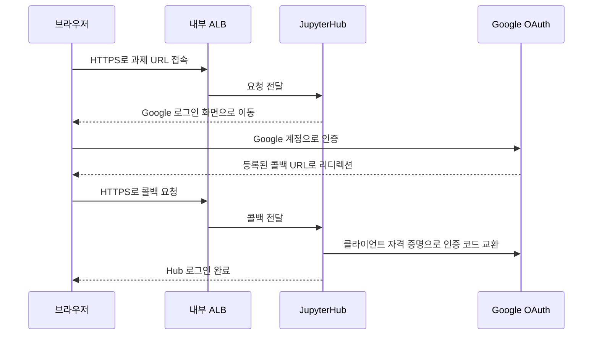

OAuth 클라이언트에 실제 과제의 HTTPS 콜백 URL을 먼저 등록합니다. 3-13~3-16절에서 Secret과 접근 권한을 준비한 뒤, 처음 연결하거나 클라이언트 값을 변경할 때 아래 명령을 실행합니다. [Google OAuth 콜백 등록](reference/sbx03-google-oauth-runbook.md)

`infra-son01`에서 아래 두 변수에 발급받은 값을 넣고 실행합니다. 실제 값은 VM 터미널에서만 설정합니다. 이 블록을 실행하기 전에 `set +x`와 `set +o history`로 출력 추적과 Bash 명령 기록을 끕니다.

```bash
# 수행 위치: infra-son01 | 로그인 계정: son@sonmap.net
# 수행 계정(가장): tf-manager@gcp-sbx-edp-gke01.iam.gserviceaccount.com
# 대상 프로젝트: gcp-sbx-edp-gke01
set +x
set +o history
```

```bash
export SBX_GKE_PROJECT="gcp-sbx-edp-gke01"
export ADMIN_ACCOUNT="son@sonmap.net"
export TF_MANAGER="tf-manager@${SBX_GKE_PROJECT}.iam.gserviceaccount.com"

# 아래 두 값을 발급받은 OAuth 값으로 바꾼 뒤 실행합니다.
export OAUTH_CLIENT_ID='발급받은 OAuth Client ID'
export OAUTH_CLIENT_SECRET='발급받은 OAuth Client Secret'

printf '%s' "$OAUTH_CLIENT_ID" | gcloud secrets versions add jupyter-oauth-client-id \
  --project="$SBX_GKE_PROJECT" --account="$ADMIN_ACCOUNT" \
  --impersonate-service-account="$TF_MANAGER" --data-file=-

printf '%s' "$OAUTH_CLIENT_SECRET" | gcloud secrets versions add jupyter-oauth-client-secret \
  --project="$SBX_GKE_PROJECT" --account="$ADMIN_ACCOUNT" \
  --impersonate-service-account="$TF_MANAGER" --data-file=-

unset OAUTH_CLIENT_ID OAUTH_CLIENT_SECRET
```

두 Secret에 새 버전이 생성됐는지 확인합니다. 이전에 Bash 기록을 사용하던 터미널이라면 `set -o history`로 다시 켤 수 있습니다.

#### 4-5-2. 과제 접속 및 Notebook 확인

1. Hub와 Proxy Pod가 준비됐는지 확인합니다.
2. 내부 ALB URL Map의 호스트 규칙과 백엔드 `HEALTHY` 상태를 확인합니다. [내부 HTTPS와 인증서](reference/sbx03-https-certificate-runbook.md)
3. 사내 테스트 PC에서 내부 DNS와 HTTPS 접속을 확인합니다. 공유 그룹은 Hub 로컬 계정으로, 기존 Google OAuth 경로는 등록한 Google 계정으로 로그인합니다.
4. Notebook을 시작하고 `kubectl -n "$NAMESPACE" get pods,pvc`로 사용자 Pod와 PVC를 확인합니다.

</details>

<a name="5-그룹-관리-사전-설정"></a>

<a name="-5-그룹-관리-사전-설정"></a>

## 5. 기존 과제별 자동 배포용 Workspace 설정

<details>
<summary>내용 펼치기 / 접기</summary>

**수행 주체** · Workspace 최고 관리자(디렉터리 역할) + 플랫폼 운영자(릴리스 반영)
**수행 위치** · admin.google.com + `infra-son01`의 Test02 저장소 루트

기존 과제별 자동 배포에서 Provisioner가 Google Workspace 그룹을 새로 만들 때 필요한 1회성 설정입니다. Workspace 최고 관리자가 [1-4-2절에서 그룹 생성 권한을 부여](#1-4-2-google-workspace-그룹스-관리자-역할-부여)한 뒤 플랫폼 운영자가 이 절에서 Customer ID를 확인합니다. 이후 [2차 배포 문서의 플랫폼 릴리스 게시](../03.sandbox_deploy/README.md#a-플랫폼-릴리스-게시)로 진행합니다. 공유 그룹의 Hub 로컬 로그인과 수동 기동 확인에는 적용하지 않습니다.

<a name="5-2-cloud_identity_customer_id-확인-및-커밋"></a>

### 5-1. CLOUD_IDENTITY_CUSTOMER_ID 확인 및 커밋

Provisioner는 이 값으로 대상 Workspace 디렉터리를 지정합니다. 1-4-2절에서 사용한 실제 고객 ID와 일치하는지 확인합니다.

```bash
# 수행 위치: infra-son01의 Test02 저장소 루트
git show HEAD:03.sandbox_deploy/03.1.request/provisioner-env.yaml | grep '^CLOUD_IDENTITY_CUSTOMER_ID:'
```

`__SET_CUSTOMER_ID__`가 남아 있으면 실제 값으로 수정하고 커밋합니다. 값은 admin.google.com의 **계정 → 계정 설정**에서 확인합니다.

```bash
sed -i 's/^CLOUD_IDENTITY_CUSTOMER_ID: __SET_CUSTOMER_ID__$/CLOUD_IDENTITY_CUSTOMER_ID: C03rw3vtp/' \
  03.sandbox_deploy/03.1.request/provisioner-env.yaml
git diff -- 03.sandbox_deploy/03.1.request/provisioner-env.yaml
```

변경 내용을 확인한 뒤 파일을 커밋합니다.

```bash
git commit --only -m 'Set Workspace customer ID for sandbox provisioning' -- \
  03.sandbox_deploy/03.1.request/provisioner-env.yaml
```

기존 그룹을 재사용하는 경우에는 승인 요청의 import 정보를 준비합니다. 상세 설정은 [Cloud Identity 그룹 Terraform 설정](reference/cloud-identity-group-terraform.md)에 있습니다.

</details>
