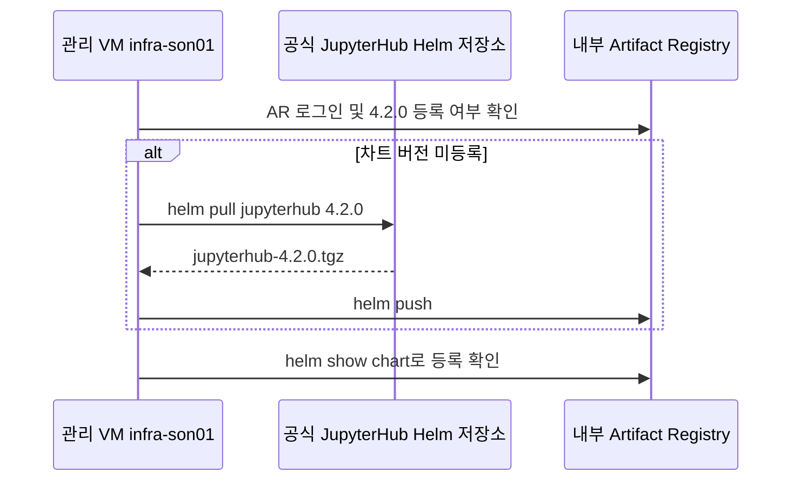

# 1차 인프라 구축

관리 VM `infra-son01`의 Test02 저장소 루트에서 작업합니다. 플랫폼 운영자는 플랫폼 프로젝트를 관리하고, VPC 관리자는 Shared VPC·서브넷·방화벽과 Private Pool 최초 생성을 담당합니다. 각 터미널에서 로그인 계정과 대상 프로젝트를 확인하고 필요한 명령을 한 줄씩 실행합니다.

| 범위 | 명령서의 기본값 |
|---|---|
| 실행 위치 | 관리 VM `infra-son01`의 Test02 저장소 루트 |
| 플랫폼 프로젝트 | `SBX_GKE_PROJECT=gcp-sbx-edp-gke01` · GKE, ALB, Cloud Build, Cloud Run, Workflows, AR, GCS |
| Shared VPC 호스트 | `VPC_HOST_PROJECT=gcp-prod-edp-hub-vpchost` · VPC, 서브넷, 방화벽, PSA |
| 로그인 계정 | `ADMIN_ACCOUNT=son@sonmap.net`, `VPC_ADMIN_ACCOUNT=admin@sonmap.net`, `AR_ACCOUNT=son@sonmap.net` |
| 서비스 계정 | `TF_MANAGER=tf-manager@gcp-sbx-edp-gke01.iam.gserviceaccount.com`, `SBX_MANAGER=sbx-manager@gcp-sbx-edp-gke01.iam.gserviceaccount.com` |

각 명령 위의 주석에서 대상 프로젝트와 로그인 계정을 확인합니다. `가장`은 `--impersonate-service-account`로 API를 호출하는 계정이고, `워크로드 실행`은 `--service-account`로 지정하는 Build·Cloud Run·Workflows 실행 계정입니다. `--member`에 적힌 계정은 IAM 권한을 받는 주체입니다.

| 단계 | 명령과 확인 절차 |
|---|---|
| 준비 | [공통 변수](#0-공통-변수) |
| 공통 인프라 | [API·IAM](#1-api와-관리자-권한) → [Shared VPC](#2-shared-vpc와-네트워크) → [서브넷 IAM](#2-1-서브넷별-iam) → [GKE·AR·ALB](#3-공통-기반) |
| 기존 Workflows 경로 | [OAuth 설정](#4-oauth-값-등록), [그룹 권한](reference/cloud-identity-group-terraform.md), [Private Pool 점검](reference/cloudbuild-private-gke-vpn-design.md), [플랫폼 릴리스](#5-플랫폼-릴리스-게시) |
| 이미지 준비 | [Helm 차트와 기본 이미지](#6-chart와-기본-이미지-미러링) → [표준 Notebook 이미지](#7-notebook-표준-이미지-빌드) |
| 접속 검증 | [관리 VM에서 GKE 접속](#gke와-내부-https-접속-확인), [내부 HTTPS·DNS](reference/sbx03-https-certificate-runbook.md) |
| 과제 배포 | [그룹 공유 Sandbox 자동 배포](../03.sandbox_deploy/README.md#그룹-공유-sandbox-자동-배포) 또는 [기존 Workflows 배포](../03.sandbox_deploy/03.1.request/legacy-deploy.md) |

그룹 공유 PoC만 구성하는 환경에서 공통 자원을 준비할 때는 기존 자동 배포용 Cloud Run·Workflows와 Google OAuth 구간을 구분해 적용합니다. 기존 환경에서는 자원 조회 결과를 확인한 뒤 필요한 생성·갱신 명령만 실행합니다.

### Cloud Build 파일을 사용하는 시점

| 파일 | 사용 시점 |
|---|---|
| [bootstrap-build.yaml](../03.sandbox_deploy/03.3.gke/cloudbuild/bootstrap-build.yaml) | 공통 기반을 처음 만들 때 요청 API와 배포 Runner의 `:bootstrap` 이미지를 게시합니다. |
| [mirror-jupyterhub-images.yaml](../03.sandbox_deploy/03.3.gke/cloudbuild/mirror-jupyterhub-images.yaml) | Hub·Proxy·Notebook 베이스 이미지가 내부 AR에 없거나 버전을 올릴 때 사용합니다. |
| [platform-release.yaml](../03.sandbox_deploy/03.3.gke/cloudbuild/platform-release.yaml) | 승인된 플랫폼 버전을 게시할 때 API·Runner 이미지를 만들고 Cloud Run을 갱신합니다. |
| [publish-sandbox-source.sh](../03.sandbox_deploy/03.3.gke/cloudbuild/publish-sandbox-source.sh) | 플랫폼 릴리스가 자동 호출해 Terraform ZIP을 GCS에 게시합니다. |

Private Pool 접속은 [점검 절차](reference/cloudbuild-private-gke-vpn-design.md)에서 확인합니다. 표준 Notebook 이미지는 [7번 관리 VM 빌드](#7-notebook-표준-이미지-빌드)를 사용하고, 의존성 변경으로 별도 후보 이미지가 필요할 때는 [Notebook 운영 릴리스](../03.sandbox_deploy/03.3.gke/notebook-image/README.md#notebook-이미지-운영-릴리스)를 사용합니다.

## 0. 공통 변수

### 프로젝트 기준과 변수명

이 작업의 주 대상은 **SBX_GKE_PROJECT=gcp-sbx-edp-gke01**입니다. 공통 GKE와 Sandbox의 JupyterHub·Notebook Pod가 이 프로젝트에서 실행됩니다. 자동화 실행·이미지 보관은 SBX_GKE_PROJECT, Shared VPC는 VPC_HOST_PROJECT, 과제의 데이터·Query Job 자원은 2차 배포 요청의 `project.project_id`에 지정한 프로젝트에 둡니다. 신규 과제는 2차 Sandbox 배포에서 프로젝트를 생성하고, `10-project` Terraform이 필요한 API와 후속 배포용 프로젝트 IAM을 설정합니다.

```bash
export SBX_GKE_PROJECT="gcp-sbx-edp-gke01"          # 주 대상: Sandbox GKE
export SBX_NAME="sbx01"                      # 과제·Namespace 이름
export VPC_HOST_PROJECT="gcp-prod-edp-hub-vpchost"   # Shared VPC
```

변수명은 대소문자를 구분합니다. SBX_GKE_PROJECT를 모든 자동화·GKE 자원의 공통 프로젝트 변수로 사용합니다. Cloud Run API와 Build 배포 코드 사이의 실행 환경변수도 SBX_GKE_PROJECT로 통일했습니다. Cloud Build 사용자 치환 변수는 형식 제약에 맞춰 _SBX_GKE_PROJECT를 사용합니다. Cloud Run 설정과 API·배포 도구 이미지는 함께 갱신해야 합니다. JSON의 project.project_id·gke.project_id와 Terraform 입력 필드명은 포털 요청 규격이므로 유지합니다.

저장소 루트에서 아래 값을 확인한 뒤 블록을 복사합니다. 변수 지정과 프로젝트 번호 조회만 수행하며 자원은 생성하지 않습니다. 새로운 터미널에서는 다시 설정합니다. 이 값은 기존 PoC 기준이며 프로젝트·GKE 변경은 런타임 Schema와 YAML 입력 파일도 함께 맞춰야 합니다.

```bash
unset CLOUDSDK_AUTH_IMPERSONATE_SERVICE_ACCOUNT
export ADMIN_ACCOUNT=son@sonmap.net
# 실행 프로젝트 작업자는 son, Shared VPC·초기 권한 관리자는 admin으로 구분합니다.
export VPC_ADMIN_ACCOUNT="${VPC_ADMIN_ACCOUNT:-admin@sonmap.net}"
export OPERATOR_MEMBER=user:son@sonmap.net
export SBX_GKE_PROJECT="gcp-sbx-edp-gke01"
export VPC_HOST_PROJECT="gcp-prod-edp-hub-vpchost"
export FOLDER_ID=154455658682
export REGION=asia-northeast3
export NETWORK=vpc-prod-edp-hub
# 내부 ALB 대역 후보: VPC Admin의 실제 중복 확인·승인 후 실행합니다.
export ILB_VIP_SUBNET=subnet-prod-edp-alb-frontend-an3
export ILB_VIP_CIDR=172.31.96.0/27
export ILB_VIP_ADDRESS="" # 예약 후 실제 할당 주소 조회
export ILB_PROXY_SUBNET=subnet-prod-sbx-ilb-proxy
export ILB_PROXY_CIDR=172.31.111.64/26
export MAIN_CLUSTER=gke-sbx-main-an3
export MAIN_SUBNET=subnet-prod-sbx-gke-01
export MAIN_NODE_CIDR=10.252.0.0/24
export MAIN_POD_RANGE=subnet-prod-sbx-pod-01
export MAIN_POD_CIDR=100.64.128.0/19
export MAIN_CP_CIDR=10.253.3.0/28
export PSA_NAME=psa-prod-edp-cloudbuild
export PSA_CIDR=10.250.0.0/24
export ADMIN_CIDR=172.31.10.0/24
export SSL_CERTIFICATE=cert-jupyter-sbx01-self
export BILLING_ACCOUNT=""
export TF_MANAGER="tf-manager@${SBX_GKE_PROJECT}.iam.gserviceaccount.com"
export SBX_MANAGER="sbx-manager@${SBX_GKE_PROJECT}.iam.gserviceaccount.com"
export PSA_ADDRESS="10.250.0.0"
export PSA_PREFIX_LENGTH="24"
# 실행 위치 infra-son01 | 대상 ${SBX_GKE_PROJECT} | 계정 ${ADMIN_ACCOUNT}
export SBX_GKE_PROJECT_NUMBER="$(gcloud projects describe "${SBX_GKE_PROJECT}" --account="${ADMIN_ACCOUNT}" --format='value(projectNumber)')"
```

### 조회 결과 확인

```bash
export SBX_GKE_PROJECT="gcp-sbx-edp-gke01"
# 실행 위치 infra-son01 | 대상 로컬 gcloud 설정 | 계정 VM 로그인 사용자
gcloud auth list
# 실행 위치 infra-son01 | 대상 ${SBX_GKE_PROJECT} | 계정 ${ADMIN_ACCOUNT}
gcloud projects describe "${SBX_GKE_PROJECT}" --account="${ADMIN_ACCOUNT}" \
  --format='table(projectId,projectNumber)'
```

프로젝트 번호가 숫자가 아니거나 조회가 실패하면 1단계로 진행하지 않습니다. 서비스 계정 표시 이름은 sbx_manager/tf_manager, 실제 ID는 sbx-manager/tf-manager입니다. 관리자는 여러 프로젝트와 Folder/Billing 범위에 필요한 기존 권한을 보유해야 합니다. Google 서비스 에이전트·노드 기본 SA와 Kubernetes KSA는 두 사용자 관리 계정과 별개입니다.

실행 순서: [1 관리자](#1-api와-관리자-권한) → [2 네트워크](#2-shared-vpc와-네트워크) → [2-1 서브넷별 IAM](#2-1-서브넷별-iam) → [3 공통 기반](#3-공통-기반).

## 1. API와 관리자 권한

필요한 변수 선언을 아래 코드 블록 맨 앞에 포함했습니다. 별도 문서에서 변수를 설정할 필요 없이, 이 문서의 선언부터 같은 터미널에서 실행합니다. 아래 한 개의 코드 블록에서 `# 주석`을 보며 순서대로 실행합니다. **계정이 이미 있으면 해당 create 명령을 건너뜁니다.** Billing은 필요한 경우에만 주석을 해제합니다.

```bash
# ── 이 문서에서 사용하는 변수 선언 ──
# 아래 값을 확인하고 이 블록부터 같은 터미널에서 실행합니다.
unset CLOUDSDK_AUTH_IMPERSONATE_SERVICE_ACCOUNT
export ADMIN_ACCOUNT=son@sonmap.net
# 실행 프로젝트 작업자는 son, Shared VPC·초기 권한 관리자는 admin으로 구분합니다.
export VPC_ADMIN_ACCOUNT="${VPC_ADMIN_ACCOUNT:-admin@sonmap.net}"
export OPERATOR_MEMBER=user:son@sonmap.net
export SBX_GKE_PROJECT="gcp-sbx-edp-gke01"
export VPC_HOST_PROJECT="gcp-prod-edp-hub-vpchost"
export FOLDER_ID=154455658682
export BILLING_ACCOUNT=""
export TF_MANAGER="tf-manager@${SBX_GKE_PROJECT}.iam.gserviceaccount.com"
export SBX_MANAGER="sbx-manager@${SBX_GKE_PROJECT}.iam.gserviceaccount.com"
# 실행 위치 infra-son01 | 대상 ${SBX_GKE_PROJECT} | 계정 ${ADMIN_ACCOUNT}
export SBX_GKE_PROJECT_NUMBER="$(gcloud projects describe "${SBX_GKE_PROJECT}" --account="${ADMIN_ACCOUNT}" --format='value(projectNumber)')"
# 프로젝트 번호는 자동 조회합니다. 조회 실패 또는 숫자가 아닌 결과이면 이후 명령을 중단합니다.

```

### 🔴 **1.** 필요한 API 활성화 — CI/CD · Shared VPC Host · GKE 프로젝트

```bash
# [infra-son01] 플랫폼 운영자 · 대상 ${SBX_GKE_PROJECT}
# 실행 위치 infra-son01 | 대상 ${SBX_GKE_PROJECT} | 계정 ${ADMIN_ACCOUNT}
gcloud services enable servicenetworking.googleapis.com serviceusage.googleapis.com iam.googleapis.com \
  iamcredentials.googleapis.com compute.googleapis.com container.googleapis.com \
  cloudbuild.googleapis.com config.googleapis.com run.googleapis.com workflows.googleapis.com \
  artifactregistry.googleapis.com secretmanager.googleapis.com storage.googleapis.com \
  logging.googleapis.com cloudresourcemanager.googleapis.com cloudbilling.googleapis.com \
  cloudidentity.googleapis.com --project="${SBX_GKE_PROJECT}" --account="${ADMIN_ACCOUNT}"
gcloud services enable container.googleapis.com compute.googleapis.com iam.googleapis.com \
  iamcredentials.googleapis.com cloudresourcemanager.googleapis.com orgpolicy.googleapis.com \
  --project="${SBX_GKE_PROJECT}" --account="${ADMIN_ACCOUNT}"

# [infra-son01] VPC 관리자 · 대상 ${VPC_HOST_PROJECT}
# 실행 위치 infra-son01 | 대상 ${VPC_HOST_PROJECT} | 계정 ${VPC_ADMIN_ACCOUNT}
gcloud services enable compute.googleapis.com container.googleapis.com \
  servicenetworking.googleapis.com --project="${VPC_HOST_PROJECT}" --account="${VPC_ADMIN_ACCOUNT}"

```

### 🔴 **2.** Google 서비스 에이전트 준비 — API별로 필요한 시스템 계정

```bash
# [infra-son01] 플랫폼 운영자 · 대상 ${SBX_GKE_PROJECT}
# 실행 위치 infra-son01 | 대상 ${SBX_GKE_PROJECT} | 계정 ${ADMIN_ACCOUNT}
gcloud beta services identity create --service=cloudbuild.googleapis.com \
  --project="${SBX_GKE_PROJECT}" --account="${ADMIN_ACCOUNT}"
gcloud beta services identity create --service=servicenetworking.googleapis.com \
  --project="${SBX_GKE_PROJECT}" --account="${ADMIN_ACCOUNT}"
gcloud beta services identity create --service=config.googleapis.com --project="${SBX_GKE_PROJECT}" \
  --account="${ADMIN_ACCOUNT}"
gcloud beta services identity create --service=run.googleapis.com --project="${SBX_GKE_PROJECT}" \
  --account="${ADMIN_ACCOUNT}"
gcloud beta services identity create --service=workflows.googleapis.com --project="${SBX_GKE_PROJECT}" \
  --account="${ADMIN_ACCOUNT}"
gcloud beta services identity create --service=container.googleapis.com --project="${SBX_GKE_PROJECT}" \
  --account="${ADMIN_ACCOUNT}"
# Service Networking 시스템 계정의 역할은 사용자 계정에 부여하지 않습니다.
gcloud projects add-iam-policy-binding "${SBX_GKE_PROJECT}" \
  --member="serviceAccount:service-${SBX_GKE_PROJECT_NUMBER}@service-networking.iam.gserviceaccount.com" \
  --role=roles/servicenetworking.serviceAgent --condition=None --account="${ADMIN_ACCOUNT}"

# [infra-son01] VPC 관리자 · 대상 ${VPC_HOST_PROJECT}
# 실행 위치 infra-son01 | 대상 ${VPC_HOST_PROJECT} | 계정 ${VPC_ADMIN_ACCOUNT}
gcloud beta services identity create --service=container.googleapis.com \
  --project="${VPC_HOST_PROJECT}" --account="${VPC_ADMIN_ACCOUNT}"
# 호스트 PSA 조회 오류 시 Service Networking 에이전트 역할도 확인합니다.
gcloud beta services identity create --service=servicenetworking.googleapis.com \
  --project="${VPC_HOST_PROJECT}" --account="${VPC_ADMIN_ACCOUNT}"
export VPC_HOST_PROJECT_NUMBER="$(gcloud projects describe "${VPC_HOST_PROJECT}" --account="${VPC_ADMIN_ACCOUNT}" --format='value(projectNumber)')"
gcloud projects add-iam-policy-binding "${VPC_HOST_PROJECT}" \
  --member="serviceAccount:service-${VPC_HOST_PROJECT_NUMBER}@service-networking.iam.gserviceaccount.com" \
  --role=roles/servicenetworking.serviceAgent --condition=None --account="${VPC_ADMIN_ACCOUNT}"

```

### 🔴 **3.** 사용자 관리 서비스 계정 — sbx-manager · tf-manager

```bash

# sbx-manager: 조회 성공(이미 존재)이면 바로 다음 create 한 줄은 건너뜁니다.
# 명시적 Not Found일 때만 create를 실행합니다. 403·인증·연결 오류면 중단합니다.
# 실행 위치 infra-son01 | 대상 ${SBX_GKE_PROJECT} | 계정 ${ADMIN_ACCOUNT}
gcloud iam service-accounts describe "${SBX_MANAGER}" --project="${SBX_GKE_PROJECT}" --format=json \
  --account="${ADMIN_ACCOUNT}"
gcloud iam service-accounts create sbx-manager --project="${SBX_GKE_PROJECT}" \
  --display-name=sbx_manager --account="${ADMIN_ACCOUNT}"

# tf-manager: 조회 성공(이미 존재)이면 바로 다음 create 한 줄은 건너뜁니다.
# 명시적 Not Found일 때만 create를 실행합니다. 403·인증·연결 오류면 중단합니다.
gcloud iam service-accounts describe "${TF_MANAGER}" --project="${SBX_GKE_PROJECT}" --format=json \
  --account="${ADMIN_ACCOUNT}"
gcloud iam service-accounts create tf-manager --project="${SBX_GKE_PROJECT}" --display-name=tf_manager \
  --account="${ADMIN_ACCOUNT}"

```

### 🔴 **4.** tf-manager 권한 — CI/CD 기반 구축 · Build · Infrastructure Manager

```bash
# 실행 위치 infra-son01 | 대상 ${SBX_GKE_PROJECT} | 계정 ${ADMIN_ACCOUNT}
gcloud projects add-iam-policy-binding "${SBX_GKE_PROJECT}" --member="serviceAccount:${TF_MANAGER}" \
  --role=roles/serviceusage.serviceUsageAdmin --condition=None --account="${ADMIN_ACCOUNT}"
gcloud projects add-iam-policy-binding "${SBX_GKE_PROJECT}" --member="serviceAccount:${TF_MANAGER}" \
  --role=roles/iam.serviceAccountAdmin --condition=None --account="${ADMIN_ACCOUNT}"
gcloud projects add-iam-policy-binding "${SBX_GKE_PROJECT}" --member="serviceAccount:${TF_MANAGER}" \
  --role=roles/resourcemanager.projectIamAdmin --condition=None --account="${ADMIN_ACCOUNT}"
gcloud projects add-iam-policy-binding "${SBX_GKE_PROJECT}" --member="serviceAccount:${TF_MANAGER}" \
  --role=roles/storage.admin --condition=None --account="${ADMIN_ACCOUNT}"
gcloud projects add-iam-policy-binding "${SBX_GKE_PROJECT}" --member="serviceAccount:${TF_MANAGER}" \
  --role=roles/secretmanager.admin --condition=None --account="${ADMIN_ACCOUNT}"
gcloud projects add-iam-policy-binding "${SBX_GKE_PROJECT}" --member="serviceAccount:${TF_MANAGER}" \
  --role=roles/artifactregistry.admin --condition=None --account="${ADMIN_ACCOUNT}"
gcloud projects add-iam-policy-binding "${SBX_GKE_PROJECT}" --member="serviceAccount:${TF_MANAGER}" \
  --role=roles/cloudbuild.builds.editor --condition=None --account="${ADMIN_ACCOUNT}"
gcloud projects add-iam-policy-binding "${SBX_GKE_PROJECT}" --member="serviceAccount:${TF_MANAGER}" \
  --role=roles/cloudbuild.workerPoolUser --condition=None --account="${ADMIN_ACCOUNT}"
gcloud projects add-iam-policy-binding "${SBX_GKE_PROJECT}" --member="serviceAccount:${TF_MANAGER}" \
  --role=roles/config.admin --condition=None --account="${ADMIN_ACCOUNT}"
gcloud projects add-iam-policy-binding "${SBX_GKE_PROJECT}" --member="serviceAccount:${TF_MANAGER}" \
  --role=roles/config.agent --condition=None --account="${ADMIN_ACCOUNT}"
gcloud projects add-iam-policy-binding "${SBX_GKE_PROJECT}" --member="serviceAccount:${TF_MANAGER}" \
  --role=roles/run.admin --condition=None --account="${ADMIN_ACCOUNT}"
gcloud projects add-iam-policy-binding "${SBX_GKE_PROJECT}" --member="serviceAccount:${TF_MANAGER}" \
  --role=roles/workflows.admin --condition=None --account="${ADMIN_ACCOUNT}"
gcloud projects add-iam-policy-binding "${SBX_GKE_PROJECT}" --member="serviceAccount:${TF_MANAGER}" \
  --role=roles/container.admin --condition=None --account="${ADMIN_ACCOUNT}"
gcloud projects add-iam-policy-binding "${SBX_GKE_PROJECT}" --member="serviceAccount:${TF_MANAGER}" \
  --role=roles/compute.viewer --condition=None --account="${ADMIN_ACCOUNT}"
gcloud projects add-iam-policy-binding "${SBX_GKE_PROJECT}" --member="serviceAccount:${TF_MANAGER}" \
  --role=roles/logging.logWriter --condition=None --account="${ADMIN_ACCOUNT}"
gcloud projects add-iam-policy-binding "${SBX_GKE_PROJECT}" --member="serviceAccount:${TF_MANAGER}" \
  --role=roles/serviceusage.serviceUsageConsumer --condition=None --account="${ADMIN_ACCOUNT}"

```

### 🔴 **5.** sbx-manager 권한 — 요청 처리 · Workflow · Build 제출

```bash
# 실행 위치 infra-son01 | 대상 ${SBX_GKE_PROJECT} | 계정 ${ADMIN_ACCOUNT}
gcloud projects add-iam-policy-binding "${SBX_GKE_PROJECT}" --member="serviceAccount:${SBX_MANAGER}" \
  --role=roles/cloudbuild.builds.editor --condition=None --account="${ADMIN_ACCOUNT}"
gcloud projects add-iam-policy-binding "${SBX_GKE_PROJECT}" --member="serviceAccount:${SBX_MANAGER}" \
  --role=roles/cloudbuild.workerPoolUser --condition=None --account="${ADMIN_ACCOUNT}"
gcloud projects add-iam-policy-binding "${SBX_GKE_PROJECT}" --member="serviceAccount:${SBX_MANAGER}" \
  --role=roles/workflows.invoker --condition=None --account="${ADMIN_ACCOUNT}"
gcloud projects add-iam-policy-binding "${SBX_GKE_PROJECT}" --member="serviceAccount:${SBX_MANAGER}" \
  --role=roles/logging.logWriter --condition=None --account="${ADMIN_ACCOUNT}"
gcloud projects add-iam-policy-binding "${SBX_GKE_PROJECT}" --member="serviceAccount:${SBX_MANAGER}" \
  --role=roles/serviceusage.serviceUsageConsumer --condition=None --account="${ADMIN_ACCOUNT}"

```

### 🔴 **6.** Shared VPC 조회와 VPC Admin의 Pool 초기 구성 권한

```bash
# tf-manager에는 Host 전체 Network User/Network Admin/Security Admin을 부여하지 않습니다.
# 서브넷 사용 권한은 서브넷 생성 후 02-subnet-iam.md에서 부여합니다.
# 실행 위치 infra-son01 | 대상 ${VPC_HOST_PROJECT} | 계정 ${VPC_ADMIN_ACCOUNT}
gcloud projects add-iam-policy-binding "${VPC_HOST_PROJECT}" --member="serviceAccount:${TF_MANAGER}" \
  --role=roles/compute.networkViewer --condition=None --account="${VPC_ADMIN_ACCOUNT}"
gcloud projects add-iam-policy-binding "${VPC_HOST_PROJECT}" --member="serviceAccount:${TF_MANAGER}" \
  --role=roles/serviceusage.serviceUsageConsumer --condition=None --account="${VPC_ADMIN_ACCOUNT}"
# VPC Admin은 Host 네트워크 관리 권한을 이미 보유한 계정입니다.
# Pool 자원은 gcp-sbx-edp-gke01에 생성하므로 해당 프로젝트의 초기 Pool 관리 권한을 부여합니다.
# 실행 위치 infra-son01 | 대상 ${SBX_GKE_PROJECT} | 계정 ${ADMIN_ACCOUNT}
gcloud projects add-iam-policy-binding "${SBX_GKE_PROJECT}" --member="user:${VPC_ADMIN_ACCOUNT}" \
  --role=roles/cloudbuild.workerPoolOwner --condition=None --account="${ADMIN_ACCOUNT}"
gcloud projects add-iam-policy-binding "${SBX_GKE_PROJECT}" --member="user:${VPC_ADMIN_ACCOUNT}" \
  --role=roles/serviceusage.serviceUsageConsumer --condition=None --account="${ADMIN_ACCOUNT}"

```

### 🔴 **7.** tf-manager 권한 — GKE · 공통 로드밸런서

```bash
# 실행 위치 infra-son01 | 대상 ${SBX_GKE_PROJECT} | 계정 ${ADMIN_ACCOUNT}
gcloud projects add-iam-policy-binding "${SBX_GKE_PROJECT}" --member="serviceAccount:${TF_MANAGER}" \
  --role=roles/compute.loadBalancerAdmin --condition=None --account="${ADMIN_ACCOUNT}"

```

### 🔴 **8.** 서비스 계정 사용·위임 권한 — 운영자 · 두 계정 · 서비스 에이전트

```bash
# 실행 위치 infra-son01 | 대상 ${SBX_GKE_PROJECT} | 계정 ${ADMIN_ACCOUNT}
gcloud iam service-accounts add-iam-policy-binding "${TF_MANAGER}" --project="${SBX_GKE_PROJECT}" \
  --member="${OPERATOR_MEMBER}" --role=roles/iam.serviceAccountTokenCreator --condition=None \
  --account="${ADMIN_ACCOUNT}"
gcloud iam service-accounts add-iam-policy-binding "${SBX_MANAGER}" --project="${SBX_GKE_PROJECT}" \
  --member="${OPERATOR_MEMBER}" --role=roles/iam.serviceAccountTokenCreator --condition=None \
  --account="${ADMIN_ACCOUNT}"
gcloud iam service-accounts add-iam-policy-binding "${TF_MANAGER}" --project="${SBX_GKE_PROJECT}" \
  --member="${OPERATOR_MEMBER}" --role=roles/iam.serviceAccountUser --condition=None \
  --account="${ADMIN_ACCOUNT}"
gcloud iam service-accounts add-iam-policy-binding "${SBX_MANAGER}" --project="${SBX_GKE_PROJECT}" \
  --member="serviceAccount:${TF_MANAGER}" --role=roles/iam.serviceAccountUser --condition=None \
  --account="${ADMIN_ACCOUNT}"
gcloud iam service-accounts add-iam-policy-binding "${TF_MANAGER}" --project="${SBX_GKE_PROJECT}" \
  --member="serviceAccount:${SBX_MANAGER}" --role=roles/iam.serviceAccountUser --condition=None \
  --account="${ADMIN_ACCOUNT}"
gcloud iam service-accounts add-iam-policy-binding "${TF_MANAGER}" --project="${SBX_GKE_PROJECT}" \
  --member="serviceAccount:${TF_MANAGER}" --role=roles/iam.serviceAccountUser --condition=None \
  --account="${ADMIN_ACCOUNT}"
gcloud iam service-accounts add-iam-policy-binding "${TF_MANAGER}" --project="${SBX_GKE_PROJECT}" \
  --member="serviceAccount:${TF_MANAGER}" --role=roles/iam.serviceAccountTokenCreator --condition=None \
  --account="${ADMIN_ACCOUNT}"
gcloud iam service-accounts add-iam-policy-binding "${TF_MANAGER}" --project="${SBX_GKE_PROJECT}" \
  --member="serviceAccount:service-${SBX_GKE_PROJECT_NUMBER}@gcp-sa-config.iam.gserviceaccount.com" \
  --role=roles/iam.serviceAccountUser --condition=None --account="${ADMIN_ACCOUNT}"
gcloud iam service-accounts add-iam-policy-binding "${TF_MANAGER}" --project="${SBX_GKE_PROJECT}" \
  --member="serviceAccount:service-${SBX_GKE_PROJECT_NUMBER}@gcp-sa-cloudbuild.iam.gserviceaccount.com" \
  --role=roles/iam.serviceAccountTokenCreator --condition=None --account="${ADMIN_ACCOUNT}"

```

### 🔴 **9.** tf-manager 권한 — 지정 Folder의 프로젝트 생성 · IAM

```bash
# 실행 위치 infra-son01 | 대상 폴더 ${FOLDER_ID} | 계정 ${VPC_ADMIN_ACCOUNT}
gcloud resource-manager folders add-iam-policy-binding "${FOLDER_ID}" \
  --member="serviceAccount:${TF_MANAGER}" --role=roles/resourcemanager.projectCreator --condition=None \
  --account="${VPC_ADMIN_ACCOUNT}"
gcloud resource-manager folders add-iam-policy-binding "${FOLDER_ID}" \
  --member="serviceAccount:${TF_MANAGER}" --role=roles/resourcemanager.projectIamAdmin \
  --condition=None --account="${VPC_ADMIN_ACCOUNT}"

```

### 🔴 **10.** GCP 서비스 에이전트 권한 — Shared VPC 사용

2번에서 GKE 서비스 프로젝트의 서비스 에이전트를 준비한 뒤 실행합니다. 새 Cloud Shell에서도 아래 블록을 한 번에 실행할 수 있습니다. 프로젝트 번호 조회 권한이 있는 계정으로 조회하고, Shared VPC 호스트 관리자 계정으로 권한을 부여합니다.

```bash
# 실행 위치 infra-son01 또는 Cloud Shell
(
  SBX_GKE_PROJECT="${SBX_GKE_PROJECT:-gcp-sbx-edp-gke01}"
  VPC_HOST_PROJECT="${VPC_HOST_PROJECT:-gcp-prod-edp-hub-vpchost}"
  VPC_ADMIN_ACCOUNT="admin@sonmap.net"
  ADMIN_ACCOUNT="admin@sonmap.net"

  # 대상 GKE 서비스 프로젝트 | 계정 ${ADMIN_ACCOUNT}
  SBX_GKE_PROJECT_NUMBER="$(gcloud projects describe "${SBX_GKE_PROJECT}" \
    --account="${ADMIN_ACCOUNT}" --format='value(projectNumber)')" || exit 1
  if [[ ! "${SBX_GKE_PROJECT_NUMBER}" =~ ^[0-9]+$ ]]; then
    echo "GKE 프로젝트 번호를 확인할 수 없습니다: ${SBX_GKE_PROJECT}" >&2
    exit 1
  fi

  # 대상 Shared VPC 호스트 프로젝트 | 계정 ${VPC_ADMIN_ACCOUNT}
  gcloud projects add-iam-policy-binding "${VPC_HOST_PROJECT}" \
    --member="serviceAccount:service-${SBX_GKE_PROJECT_NUMBER}@container-engine-robot.iam.gserviceaccount.com" \
    --role=roles/container.hostServiceAgentUser --condition=None --account="${VPC_ADMIN_ACCOUNT}"
)
```

### 🔴 **11.** GKE 노드 기본 계정 권한 — 노드 실행 · tf-manager의 계정 사용

```bash
# 실행 위치 infra-son01 | 대상 ${SBX_GKE_PROJECT} | 계정 ${ADMIN_ACCOUNT}
gcloud projects add-iam-policy-binding "${SBX_GKE_PROJECT}" \
  --member="serviceAccount:${SBX_GKE_PROJECT_NUMBER}-compute@developer.gserviceaccount.com" \
  --role=roles/container.defaultNodeServiceAccount --condition=None --account="${ADMIN_ACCOUNT}"
gcloud iam service-accounts add-iam-policy-binding \
  "${SBX_GKE_PROJECT_NUMBER}-compute@developer.gserviceaccount.com" --project="${SBX_GKE_PROJECT}" \
  --member="serviceAccount:${TF_MANAGER}" --role=roles/iam.serviceAccountUser --condition=None \
  --account="${ADMIN_ACCOUNT}"

```

#### 선택 · 신규 과제 프로젝트의 Billing 연결 권한

결제 계정의 IAM 변경 권한(`billing.accounts.setIamPolicy`)이 있는 VPC 관리자가 실행합니다. 목록에서 활성 결제 계정을 확인한 뒤 ID를 입력합니다.

```bash
# 실행 위치 infra-son01 | 계정 ${VPC_ADMIN_ACCOUNT}
(
  VPC_ADMIN_ACCOUNT="admin@sonmap.net"

  gcloud billing accounts list \
    --account="${VPC_ADMIN_ACCOUNT}" \
    --format='table(name.basename():label=BILLING_ACCOUNT_ID,displayName,open)' || exit 1

  read -r -p '사용할 OPEN=True 결제 계정 ID (Enter로 건너뛰기): ' BILLING_ACCOUNT || exit 1
  [[ -n "${BILLING_ACCOUNT}" ]] || exit 0
  if [[ ! "${BILLING_ACCOUNT}" =~ ^[[:xdigit:]]{6}(-[[:xdigit:]]{6}){2}$ ]]; then
    echo '목록의 BILLING_ACCOUNT_ID를 XXXXXX-XXXXXX-XXXXXX 형식으로 입력하세요.' >&2
    exit 1
  fi

  TF_MANAGER="$(gcloud iam service-accounts describe \
    tf-manager@gcp-sbx-edp-gke01.iam.gserviceaccount.com \
    --project=gcp-sbx-edp-gke01 --account="${VPC_ADMIN_ACCOUNT}" \
    --format='value(email)')" || exit 1
  if [[ "${TF_MANAGER}" != "tf-manager@gcp-sbx-edp-gke01.iam.gserviceaccount.com" ]]; then
    echo "tf-manager 서비스 계정 이메일 조회 결과가 올바르지 않습니다." >&2
    exit 1
  fi

  gcloud billing accounts add-iam-policy-binding "${BILLING_ACCOUNT}" \
    --member="serviceAccount:${TF_MANAGER}" \
    --role=roles/billing.user --account="${VPC_ADMIN_ACCOUNT}" || exit 1

  # 결제 계정 IAM 정책에서 직접 부여된 권한을 확인합니다.
  gcloud billing accounts get-iam-policy "${BILLING_ACCOUNT}" \
    --account="${VPC_ADMIN_ACCOUNT}" --format=json |
    jq -e --arg member "serviceAccount:${TF_MANAGER}" '
      any(.bindings[]?; .role == "roles/billing.user"
        and .condition == null and (.members | index($member) != null))
    '
)
```

```bash
# ── Cloud Identity 그룹 관리자 역할 직접 부여에 사용할 서비스 계정 Unique ID ──
# 출력값은 tf-manager 서비스 계정의 숫자형 고유 ID입니다.
# Workspace 최고 관리자는 이 ID로 tf-manager에 Groups Administrator 역할을 직접 부여합니다.
# GCP IAM 역할과 별개이며 사용자 대신 실행하는 Domain-wide Delegation은 사용하지 않습니다.
# 실행 위치 infra-son01 | 대상 ${SBX_GKE_PROJECT} | 계정 ${ADMIN_ACCOUNT}
gcloud iam service-accounts describe "${TF_MANAGER}" --project="${SBX_GKE_PROJECT}" \
  --account="${ADMIN_ACCOUNT}" --format='value(uniqueId)'
```

## 2. Shared VPC와 네트워크

필요한 변수 선언을 아래 코드 블록 맨 앞에 포함했습니다. 별도 문서에서 변수를 설정할 필요 없이, 이 문서의 선언부터 같은 터미널에서 실행합니다. `# 주석`을 보며 순서대로 실행하고, **기존 자원이 있으면 해당 생성 명령을 건너뜁니다.** 403·인증·연결 오류면 중단합니다. 선택 작업은 주석을 해제한 경우에만 실행합니다.

```bash
# ── 이 문서에서 사용하는 변수 선언 ──
# 아래 값을 확인하고 이 블록부터 같은 터미널에서 실행합니다.
unset CLOUDSDK_AUTH_IMPERSONATE_SERVICE_ACCOUNT
export ADMIN_ACCOUNT=admin@sonmap.net
# 실행 프로젝트 작업자는 son, Shared VPC·초기 권한 관리자는 admin으로 구분합니다.
export VPC_ADMIN_ACCOUNT="${VPC_ADMIN_ACCOUNT:-admin@sonmap.net}"
export SBX_GKE_PROJECT="gcp-sbx-edp-gke01"
export VPC_HOST_PROJECT="gcp-prod-edp-hub-vpchost"
export REGION=asia-northeast3
export NETWORK=vpc-prod-edp-hub
# 내부 ALB 대역 후보: VPC Admin의 실제 중복 확인·승인 후 실행합니다.
export ILB_VIP_SUBNET=subnet-prod-edp-alb-frontend-an3
export ILB_VIP_CIDR=172.31.96.0/27
export ILB_VIP_ADDRESS="" # 예약 후 실제 할당 주소 조회
export ILB_PROXY_SUBNET=subnet-prod-sbx-ilb-proxy
export ILB_PROXY_CIDR=172.31.111.64/26
export MAIN_SUBNET=subnet-prod-sbx-gke-01
export MAIN_NODE_CIDR=10.252.0.0/24
export MAIN_POD_RANGE=subnet-prod-sbx-pod-01
export MAIN_POD_CIDR=100.64.128.0/19
export PSA_NAME=psa-prod-edp-cloudbuild
export PSA_ADDRESS="10.250.0.0"
export PSA_PREFIX_LENGTH="24"
# 이 문서는 VPC Admin 계정으로 수행합니다. 초기 Shared VPC 연결·Subnet·방화벽·PSA를 관리할 권한이 필요합니다.
# 완료 후 2-1절 서브넷별 IAM을 적용한 뒤 3절 공통 기반으로 진행합니다.

# 먼저 기존 Primary/Secondary 대역을 확인합니다.
# Node · Pod · Control Plane · PSA 대역이 겹치거나 기존 설정과 다르면 중단합니다.

# ── 기존 대역 먼저 확인 ──
# 실행 위치 infra-son01 | 대상 ${VPC_HOST_PROJECT} | 계정 ${VPC_ADMIN_ACCOUNT}
gcloud compute networks subnets list --project="${VPC_HOST_PROJECT}" --format=json \
  --account="${VPC_ADMIN_ACCOUNT}"

```

### 🔴 **1.** compute networks create vpc-prod-edp-hub

```bash
# 기존 자원 확인
# 실행 위치 infra-son01 | 대상 ${VPC_HOST_PROJECT} | 계정 ${VPC_ADMIN_ACCOUNT}
gcloud compute networks describe "${NETWORK}" --project="${VPC_HOST_PROJECT}" --format=json \
  --account="${VPC_ADMIN_ACCOUNT}"
# 조회 결과가 명시적 Not Found일 때만 아래 생성 명령을 실행합니다.
# 기존 자원 확인값: {"autoCreateSubnetworks": false} — 다르면 중단합니다.
gcloud compute networks create "${NETWORK}" --project="${VPC_HOST_PROJECT}" --subnet-mode=custom \
  --account="${VPC_ADMIN_ACCOUNT}"

```

### 🔴 **2.** compute shared-vpc get-host-project gcp-prod-edp-hub-vpchost

```bash
# 기존 자원 확인
# 실행 위치 infra-son01 | 대상 ${VPC_HOST_PROJECT} | 계정 ${VPC_ADMIN_ACCOUNT}
gcloud compute shared-vpc get-host-project "${VPC_HOST_PROJECT}" --format=json \
  --account="${VPC_ADMIN_ACCOUNT}"

```

### 🔴 **3.** compute shared-vpc enable gcp-prod-edp-hub-vpchost

```bash
# 앞의 조회에서 이미 같은 Host에 연결되어 있으면 아래 명령은 건너뜁니다. 다른 Host면 중단합니다.
# 실행 위치 infra-son01 | 대상 ${VPC_HOST_PROJECT} | 계정 ${VPC_ADMIN_ACCOUNT}
gcloud compute shared-vpc enable "${VPC_HOST_PROJECT}" --account="${VPC_ADMIN_ACCOUNT}"

```

### 🔴 **4.** compute shared-vpc get-host-project gcp-sbx-edp-gke01

```bash
# 기존 자원 확인
# 실행 위치 infra-son01 | 대상 ${SBX_GKE_PROJECT} | 계정 ${VPC_ADMIN_ACCOUNT}
gcloud compute shared-vpc get-host-project "${SBX_GKE_PROJECT}" --format=json --account="${VPC_ADMIN_ACCOUNT}"

```

### 🔴 **5.** compute shared-vpc associated-projects add gcp-sbx-edp-gke01

```bash
# 앞의 조회에서 이미 같은 Host에 연결되어 있으면 아래 명령은 건너뜁니다. 다른 Host면 중단합니다.
# 실행 위치 infra-son01 | 대상 ${SBX_GKE_PROJECT} | 계정 ${VPC_ADMIN_ACCOUNT} | Shared VPC ${VPC_HOST_PROJECT}
gcloud compute shared-vpc associated-projects add "${SBX_GKE_PROJECT}" \
  --host-project="${VPC_HOST_PROJECT}" --account="${VPC_ADMIN_ACCOUNT}"

```

### 🔴 **6.** compute networks subnets create subnet-prod-sbx-gke-01

```bash
# 기존 자원 확인
# 실행 위치 infra-son01 | 대상 ${VPC_HOST_PROJECT} | 계정 ${VPC_ADMIN_ACCOUNT}
gcloud compute networks subnets describe "${MAIN_SUBNET}" --project="${VPC_HOST_PROJECT}" \
  --region="${REGION}" --format=json --account="${VPC_ADMIN_ACCOUNT}"
# 조회 결과가 명시적 Not Found일 때만 아래 생성 명령을 실행합니다.
# 기존 자원 확인값: {"ipCidrRange": "10.252.0.0/24", "network": "https://www.googleapis.com/compute/v1/projects/gcp-prod-edp-hub-vpchost/global/networks/vpc-prod-edp-hub"} — 다르면 중단합니다.
gcloud compute networks subnets create "${MAIN_SUBNET}" --project="${VPC_HOST_PROJECT}" \
  --region="${REGION}" --network="${NETWORK}" --range="${MAIN_NODE_CIDR}" \
  --enable-private-ip-google-access --secondary-range="${MAIN_POD_RANGE}=${MAIN_POD_CIDR}" \
  --account="${VPC_ADMIN_ACCOUNT}"

```

### 🔴 **7.** compute networks subnets update subnet-prod-sbx-gke-01

```bash
# 실행 위치 infra-son01 | 대상 ${VPC_HOST_PROJECT} | 계정 ${VPC_ADMIN_ACCOUNT}
gcloud compute networks subnets update "${MAIN_SUBNET}" --project="${VPC_HOST_PROJECT}" \
  --region="${REGION}" --enable-private-ip-google-access --account="${VPC_ADMIN_ACCOUNT}"

# IP 최소화: Cloud Run·과제 전용 Subnet을 생성하지 않습니다.
# 과제 Namespace는 기존 Main GKE Pod 대역을 공유합니다.

```

### 🔴 **8.** compute addresses create psa-prod-edp-cloudbuild

```bash
# 기존 자원 확인
# 실행 위치 infra-son01 | 대상 ${VPC_HOST_PROJECT} | 계정 ${VPC_ADMIN_ACCOUNT}
gcloud compute addresses describe "${PSA_NAME}" --project="${VPC_HOST_PROJECT}" --global --format=json \
  --account="${VPC_ADMIN_ACCOUNT}"
# 조회 결과가 명시적 Not Found일 때만 아래 생성 명령을 실행합니다.
# 기존 자원 확인값: {"address": "10.250.0.0", "prefixLength": 24, "purpose": "VPC_PEERING"} — 다르면 중단합니다.
# 실행 위치 infra-son01 | 대상 ${VPC_HOST_PROJECT} | 계정 ${VPC_ADMIN_ACCOUNT} | Shared VPC ${VPC_HOST_PROJECT}
gcloud compute addresses create "${PSA_NAME}" --project="${VPC_HOST_PROJECT}" --global \
  --purpose=VPC_PEERING --addresses="${PSA_ADDRESS}" --prefix-length="${PSA_PREFIX_LENGTH}" \
  --network="projects/${VPC_HOST_PROJECT}/global/networks/${NETWORK}" --account="${VPC_ADMIN_ACCOUNT}"

```

### 🔴 **9.** services vpc-peerings list

```bash
# 기존 자원 확인
# 실행 위치 infra-son01 | 대상 ${VPC_HOST_PROJECT} | 계정 ${VPC_ADMIN_ACCOUNT}
gcloud services vpc-peerings list --project="${VPC_HOST_PROJECT}" --network="${NETWORK}" \
  --service=servicenetworking.googleapis.com --format=json --account="${VPC_ADMIN_ACCOUNT}"

```

### 🔴 **10.** services vpc-peerings connect

```bash
# 앞의 조회에 PSA Range 연결이 이미 있으면 건너뜁니다. 기존 Range를 덮어쓰지 않습니다.
# 실행 위치 infra-son01 | 대상 ${VPC_HOST_PROJECT} | 계정 ${VPC_ADMIN_ACCOUNT}
gcloud services vpc-peerings connect --project="${VPC_HOST_PROJECT}" --network="${NETWORK}" \
  --service=servicenetworking.googleapis.com --ranges="${PSA_NAME}" --account="${VPC_ADMIN_ACCOUNT}"

```

### 🔴 **11.** compute firewall-rules create fw-sbxtest01-alb-hc

```bash
# 기존 자원 확인
# 실행 위치 infra-son01 | 대상 ${VPC_HOST_PROJECT} | 계정 ${VPC_ADMIN_ACCOUNT}
gcloud compute firewall-rules describe fw-sbxtest01-alb-hc --project="${VPC_HOST_PROJECT}" \
  --format=json --account="${VPC_ADMIN_ACCOUNT}"
# 조회 결과가 명시적 Not Found일 때만 아래 생성 명령을 실행합니다.
# 기존 자원 확인값: {"sourceRanges": ["35.191.0.0/16", "130.211.0.0/22"], "destinationRanges": ["100.64.128.0/19"]} — 다르면 중단합니다.
gcloud compute firewall-rules create fw-sbxtest01-alb-hc --project="${VPC_HOST_PROJECT}" \
  --network="${NETWORK}" --direction=INGRESS --allow=tcp:8000 \
  --source-ranges=35.191.0.0/16,130.211.0.0/22 --destination-ranges="${MAIN_POD_CIDR}" \
  --account="${VPC_ADMIN_ACCOUNT}"

# ── 내부 ALB VIP용 일반 Subnet /27 — Shared VPC Host 소유 ──
# 후보 CIDR은 반드시 VPC Admin이 전체 사내망과 중복 여부를 확인합니다.
# 실행 위치 infra-son01 | 대상 ${VPC_HOST_PROJECT} | 계정 ${VPC_ADMIN_ACCOUNT}
gcloud compute networks subnets describe "${ILB_VIP_SUBNET}" --project="${VPC_HOST_PROJECT}" \
  --region="${REGION}" --format=json --account="${VPC_ADMIN_ACCOUNT}"
# 명시적 Not Found일 때만 생성합니다. 403이면 중단합니다.
gcloud compute networks subnets create "${ILB_VIP_SUBNET}" --project="${VPC_HOST_PROJECT}" \
  --region="${REGION}" --network="${NETWORK}" --range="${ILB_VIP_CIDR}" \
  --enable-private-ip-google-access --account="${VPC_ADMIN_ACCOUNT}"

# ── 프록시 전용 Subnet — 같은 VPC·리전에 ACTIVE가 있으면 재사용 ──
# 목록의 network·region·purpose·role을 확인합니다. 기존 ACTIVE가 있으면
# ILB_PROXY_SUBNET·ILB_PROXY_CIDR을 그 값으로 맞추고 아래 create를 건너뜁니다.
# 실행 위치 infra-son01 | 대상 ${VPC_HOST_PROJECT} | 계정 ${VPC_ADMIN_ACCOUNT}
gcloud compute networks subnets list --project="${VPC_HOST_PROJECT}" \
  --filter="purpose=REGIONAL_MANAGED_PROXY AND region:${REGION}" --format=json \
  --account="${VPC_ADMIN_ACCOUNT}"
# 호환 ACTIVE가 없고 CIDR 승인이 완료된 경우에만 생성합니다. /28은 사용할 수 없습니다.
gcloud compute networks subnets create "${ILB_PROXY_SUBNET}" --project="${VPC_HOST_PROJECT}" \
  --region="${REGION}" --network="${NETWORK}" --range="${ILB_PROXY_CIDR}" \
  --purpose=REGIONAL_MANAGED_PROXY --role=ACTIVE --account="${VPC_ADMIN_ACCOUNT}"

# ── ALB 프록시에서 GKE NEG의 Proxy Pod로 HTTP 전달 ──
# 실행 위치 infra-son01 | 대상 ${VPC_HOST_PROJECT} | 계정 ${VPC_ADMIN_ACCOUNT}
gcloud compute firewall-rules describe fw-sbxtest01-ilb-proxy --project="${VPC_HOST_PROJECT}" \
  --format=json --account="${VPC_ADMIN_ACCOUNT}"
# 명시적 Not Found일 때만 생성합니다. 기존 규칙이면 실제 CIDR·포트를 비교합니다.
gcloud compute firewall-rules create fw-sbxtest01-ilb-proxy --project="${VPC_HOST_PROJECT}" \
  --network="${NETWORK}" --direction=INGRESS --allow=tcp:8000 --source-ranges="${ILB_PROXY_CIDR}" \
  --destination-ranges="${MAIN_POD_CIDR}" --account="${VPC_ADMIN_ACCOUNT}"
```

## 2-1. 서브넷별 IAM

**01-admin → 02-network → 이 문서 → 03-foundation 순서**입니다. Subnet이 실제 존재한 뒤 수행합니다. VPC Admin은 Subnet IAM 수정 권한이 필요하며, Host 프로젝트 역할 변경은 해당 프로젝트 IAM 관리자 권한으로 수행합니다. 권한은 Subnet 소유 프로젝트 gcp-prod-edp-hub-vpchost에 적용하며, 서비스 계정의 프로젝트 번호는 gcp-sbx-edp-gke01에서 조회합니다. 후보 서브넷 이름이 실제와 다르면 아래 값을 맞춥니다.

| Subnet | 주체 | 역할 |
|---|---|---|
| Main GKE Node | tf-manager@gcp-sbx-edp-gke01.iam.gserviceaccount.com | roles/compute.networkUser |
| Main GKE Node | service-NUM@container-engine-robot.iam.gserviceaccount.com | roles/compute.networkUser |
| Main GKE Node | NUM@cloudservices.gserviceaccount.com | roles/compute.networkUser |
| ALB VIP /27 | tf-manager@gcp-sbx-edp-gke01.iam.gserviceaccount.com | roles/compute.networkUser |
| 프록시 전용 /26 | 별도 사용자 Network User 바인딩 없음 | VPC Admin이 생성·관리, Envoy가 사용 |
| GKE Pod Secondary | 별도 IAM 없음 | Main GKE Subnet 정책으로 처리 |
| Private Pool PSA | Subnet IAM 대상 아님 | VPC Admin의 프로젝트·연결 관리 |

NUM은 아래에서 조회하는 gcp-sbx-edp-gke01의 프로젝트 번호입니다. sbx-manager·Cloud Run 서비스 에이전트·Notebook KSA에는 Subnet Network User를 부여하지 않습니다. Cloud Run은 VPC 미연결이며, Notebook은 이미 생성된 GKE 네트워크를 사용합니다.

```bash
export ADMIN_ACCOUNT="son@sonmap.net"
# 실제 VPC Admin 계정으로 변경합니다.
export VPC_ADMIN_ACCOUNT="${VPC_ADMIN_ACCOUNT:-admin@sonmap.net}"
export VPC_HOST_PROJECT="gcp-prod-edp-hub-vpchost"
export SBX_GKE_PROJECT="gcp-sbx-edp-gke01"
export REGION="asia-northeast3"
export MAIN_SUBNET="subnet-prod-sbx-gke-01"
export ILB_VIP_SUBNET="subnet-prod-edp-alb-frontend-an3"
export TF_MANAGER="tf-manager@${SBX_GKE_PROJECT}.iam.gserviceaccount.com"
# 실행 위치 infra-son01 | 대상 ${SBX_GKE_PROJECT} | 계정 ${VPC_ADMIN_ACCOUNT}
export SBX_GKE_PROJECT_NUMBER="$(gcloud projects describe "${SBX_GKE_PROJECT}" --account="${VPC_ADMIN_ACCOUNT}" --format='value(projectNumber)')"
# 프로젝트 번호가 숫자인지 확인하고 조회 실패 시 중단합니다.

# 존재 여부와 현재 IAM을 확인합니다.
# 실행 위치 infra-son01 | 대상 ${VPC_HOST_PROJECT} | 계정 ${VPC_ADMIN_ACCOUNT}
gcloud compute networks subnets describe "${MAIN_SUBNET}" --project="${VPC_HOST_PROJECT}" \
  --region="${REGION}" --account="${VPC_ADMIN_ACCOUNT}"
gcloud compute networks subnets describe "${ILB_VIP_SUBNET}" --project="${VPC_HOST_PROJECT}" \
  --region="${REGION}" --account="${VPC_ADMIN_ACCOUNT}"
gcloud compute networks subnets get-iam-policy "${MAIN_SUBNET}" --project="${VPC_HOST_PROJECT}" \
  --region="${REGION}" --account="${VPC_ADMIN_ACCOUNT}"
gcloud compute networks subnets get-iam-policy "${ILB_VIP_SUBNET}" --project="${VPC_HOST_PROJECT}" \
  --region="${REGION}" --account="${VPC_ADMIN_ACCOUNT}"

# 1. GKE를 구축·사용할 배포 계정
gcloud compute networks subnets add-iam-policy-binding "${MAIN_SUBNET}" \
  --project="${VPC_HOST_PROJECT}" --region="${REGION}" --member="serviceAccount:${TF_MANAGER}" \
  --role=roles/compute.networkUser --account="${VPC_ADMIN_ACCOUNT}"

# 2. GKE 서비스 에이전트
gcloud compute networks subnets add-iam-policy-binding "${MAIN_SUBNET}" \
  --project="${VPC_HOST_PROJECT}" --region="${REGION}" \
  --member="serviceAccount:service-${SBX_GKE_PROJECT_NUMBER}@container-engine-robot.iam.gserviceaccount.com" \
  --role=roles/compute.networkUser --account="${VPC_ADMIN_ACCOUNT}"

# 3. Google APIs 서비스 에이전트
gcloud compute networks subnets add-iam-policy-binding "${MAIN_SUBNET}" \
  --project="${VPC_HOST_PROJECT}" --region="${REGION}" \
  --member="serviceAccount:${SBX_GKE_PROJECT_NUMBER}@cloudservices.gserviceaccount.com" \
  --role=roles/compute.networkUser --account="${VPC_ADMIN_ACCOUNT}"

# 4. 내부 ALB VIP 서브넷 사용자
gcloud compute networks subnets add-iam-policy-binding "${ILB_VIP_SUBNET}" \
  --project="${VPC_HOST_PROJECT}" --region="${REGION}" --member="serviceAccount:${TF_MANAGER}" \
  --role=roles/compute.networkUser --account="${VPC_ADMIN_ACCOUNT}"

# 적용 후 다시 조회합니다.
gcloud compute networks subnets get-iam-policy "${MAIN_SUBNET}" --project="${VPC_HOST_PROJECT}" \
  --region="${REGION}" --account="${VPC_ADMIN_ACCOUNT}"
gcloud compute networks subnets get-iam-policy "${ILB_VIP_SUBNET}" --project="${VPC_HOST_PROJECT}" \
  --region="${REGION}" --account="${VPC_ADMIN_ACCOUNT}"
```

GKE 서비스 에이전트의 roles/container.hostServiceAgentUser는 1절에서 **Host 프로젝트 범위로 유지**합니다. tf-manager의 Host roles/compute.networkViewer도 네트워크 조회용으로 유지하며, 사용·변경 권한을 대신하지 않습니다. ALB 생성·인증서·Backend 관리 권한은 gcp-sbx-edp-gke01의 roles/compute.loadBalancerAdmin 등으로 처리합니다.

### 기존 권한을 줄이는 경우

기존 Host 전체 Network User가 남아 있으면 Subnet별로 추가해도 사용 범위는 제한되지 않습니다. 새 Subnet 바인딩과 GKE·ALB·Pool 동작 검증 후 [기존 광역 권한 정리](#부록-기존-host-광역-iam-정리)를 수행합니다. 신규 구축에서는 이 정리 절차가 필요하지 않습니다.

추가 서브넷 생성·Shared VPC 연결 변경을 과제 Deploy에서 요청하지 않습니다. 기본 요청은 network.required=false입니다. 추가 네트워크가 필요하면 VPC Admin이 먼저 구성하고 승인된 범위에 별도 사용 권한을 부여해야 합니다.

## 3. 공통 기반

필요한 변수 선언을 아래 코드 블록 맨 앞에 포함했습니다. 별도 문서에서 변수를 설정할 필요 없이, 이 문서의 선언부터 같은 터미널에서 실행합니다. `# 주석`을 보며 순서대로 실행하고, **기존 자원이 있으면 해당 생성 명령을 건너뜁니다.** 403·인증·연결 오류면 중단합니다. 선택 작업은 주석을 해제한 경우에만 실행합니다.

```bash
# ── 이 문서에서 사용하는 변수 선언 ──
# 아래 값을 확인하고 이 블록부터 같은 터미널에서 실행합니다.
unset CLOUDSDK_AUTH_IMPERSONATE_SERVICE_ACCOUNT
export ADMIN_ACCOUNT=son@sonmap.net
# 실행 프로젝트 작업자는 son, Shared VPC·초기 권한 관리자는 admin으로 구분합니다.
export VPC_ADMIN_ACCOUNT="${VPC_ADMIN_ACCOUNT:-admin@sonmap.net}"
export OPERATOR_MEMBER=user:son@sonmap.net
export SBX_GKE_PROJECT="gcp-sbx-edp-gke01"
export VPC_HOST_PROJECT="gcp-prod-edp-hub-vpchost"
export REGION=asia-northeast3
export NETWORK=vpc-prod-edp-hub
# 내부 ALB 대역 후보: VPC Admin의 실제 중복 확인·승인 후 실행합니다.
export ILB_VIP_SUBNET=subnet-prod-edp-alb-frontend-an3
export ILB_VIP_CIDR=172.31.96.0/27
export ILB_VIP_ADDRESS="" # 예약 후 실제 할당 주소 조회
export ILB_PROXY_SUBNET=subnet-prod-sbx-ilb-proxy
export ILB_PROXY_CIDR=172.31.111.64/26
export MAIN_CLUSTER=gke-sbx-main-an3
export MAIN_SUBNET=subnet-prod-sbx-gke-01
export MAIN_POD_RANGE=subnet-prod-sbx-pod-01
export MAIN_CP_CIDR=10.253.3.0/28
export PSA_CIDR=10.250.0.0/24
export ADMIN_CIDR=172.31.10.0/24
export SSL_CERTIFICATE=cert-jupyter-sbx01-self
export TF_MANAGER="tf-manager@${SBX_GKE_PROJECT}.iam.gserviceaccount.com"
export SBX_MANAGER="sbx-manager@${SBX_GKE_PROJECT}.iam.gserviceaccount.com"
# 실행 위치 infra-son01 | 대상 ${SBX_GKE_PROJECT} | 계정 ${ADMIN_ACCOUNT}
export SBX_GKE_PROJECT_NUMBER="$(gcloud projects describe "${SBX_GKE_PROJECT}" --account="${ADMIN_ACCOUNT}" --format='value(projectNumber)')"
# 프로젝트 번호는 자동 조회합니다. 조회 실패 또는 숫자가 아닌 결과이면 이후 명령을 중단합니다.

# 2절과 2-1절 완료 후 저장소 루트에서 실행합니다.
# 기존 GKE는 Autopilot · Private Nodes/Endpoint · Subnet · Pod Range를 확인합니다.
# Private Pool → GKE 사설 경로는 별도로 준비합니다.

```

### 🔴 **1.** storage buckets create gs://gcp-sbx-edp-gke01-sbxtest01-requests

```bash
# 기존 자원 확인
# 실행 위치 infra-son01 | 대상 ${SBX_GKE_PROJECT} | 계정 ${ADMIN_ACCOUNT} | 가장 ${TF_MANAGER}
gcloud storage buckets describe "gs://${SBX_GKE_PROJECT}-sbxtest01-requests" --format=json \
  --account="${ADMIN_ACCOUNT}" --impersonate-service-account="${TF_MANAGER}"
# 조회 결과가 명시적 Not Found일 때만 아래 생성 명령을 실행합니다.
gcloud storage buckets create "gs://${SBX_GKE_PROJECT}-sbxtest01-requests" \
  --project="${SBX_GKE_PROJECT}" --location="${REGION}" --uniform-bucket-level-access \
  --public-access-prevention --account="${ADMIN_ACCOUNT}" \
  --impersonate-service-account="${TF_MANAGER}"

```

### 🔴 **2.** storage buckets update gs://gcp-sbx-edp-gke01-sbxtest01-requests

```bash
# 실행 위치 infra-son01 | 대상 ${SBX_GKE_PROJECT} | 계정 ${ADMIN_ACCOUNT} | 가장 ${TF_MANAGER}
gcloud storage buckets update "gs://${SBX_GKE_PROJECT}-sbxtest01-requests" --versioning \
  --public-access-prevention --account="${ADMIN_ACCOUNT}" \
  --impersonate-service-account="${TF_MANAGER}"

```

### 🔴 **3.** storage buckets create gs://gcp-sbx-edp-gke01-sbxtest01-bundles

```bash
# 기존 자원 확인
# 실행 위치 infra-son01 | 대상 ${SBX_GKE_PROJECT} | 계정 ${ADMIN_ACCOUNT} | 가장 ${TF_MANAGER}
gcloud storage buckets describe "gs://${SBX_GKE_PROJECT}-sbxtest01-bundles" --format=json \
  --account="${ADMIN_ACCOUNT}" --impersonate-service-account="${TF_MANAGER}"
# 조회 결과가 명시적 Not Found일 때만 아래 생성 명령을 실행합니다.
gcloud storage buckets create "gs://${SBX_GKE_PROJECT}-sbxtest01-bundles" \
  --project="${SBX_GKE_PROJECT}" --location="${REGION}" --uniform-bucket-level-access \
  --public-access-prevention --account="${ADMIN_ACCOUNT}" \
  --impersonate-service-account="${TF_MANAGER}"

```

### 🔴 **4.** storage buckets update gs://gcp-sbx-edp-gke01-sbxtest01-bundles

```bash
# 실행 위치 infra-son01 | 대상 ${SBX_GKE_PROJECT} | 계정 ${ADMIN_ACCOUNT} | 가장 ${TF_MANAGER}
gcloud storage buckets update "gs://${SBX_GKE_PROJECT}-sbxtest01-bundles" --versioning \
  --public-access-prevention --account="${ADMIN_ACCOUNT}" \
  --impersonate-service-account="${TF_MANAGER}"

```

### 🔴 **5.** storage buckets create gs://gcp-sbx-edp-gke01-sbxtest01-build-source

```bash
# 기존 자원 확인
# 실행 위치 infra-son01 | 대상 ${SBX_GKE_PROJECT} | 계정 ${ADMIN_ACCOUNT} | 가장 ${TF_MANAGER}
gcloud storage buckets describe "gs://${SBX_GKE_PROJECT}-sbxtest01-build-source" --format=json \
  --account="${ADMIN_ACCOUNT}" --impersonate-service-account="${TF_MANAGER}"
# 조회 결과가 명시적 Not Found일 때만 아래 생성 명령을 실행합니다.
gcloud storage buckets create "gs://${SBX_GKE_PROJECT}-sbxtest01-build-source" \
  --project="${SBX_GKE_PROJECT}" --location="${REGION}" --uniform-bucket-level-access \
  --public-access-prevention --account="${ADMIN_ACCOUNT}" \
  --impersonate-service-account="${TF_MANAGER}"

```

### 🔴 **6.** storage buckets update gs://gcp-sbx-edp-gke01-sbxtest01-build-source

```bash
# 실행 위치 infra-son01 | 대상 ${SBX_GKE_PROJECT} | 계정 ${ADMIN_ACCOUNT} | 가장 ${TF_MANAGER}
gcloud storage buckets update "gs://${SBX_GKE_PROJECT}-sbxtest01-build-source" --versioning \
  --public-access-prevention --account="${ADMIN_ACCOUNT}" \
  --impersonate-service-account="${TF_MANAGER}"

```

### 🔴 **7.** storage buckets add-iam-policy-binding gs://gcp-sbx-edp-gke01-sbxtest01-requests · roles/storage.objectAdmin

```bash
# 실행 위치 infra-son01 | 대상 ${SBX_GKE_PROJECT} | 계정 ${ADMIN_ACCOUNT} | 가장 ${TF_MANAGER}
gcloud storage buckets add-iam-policy-binding "gs://${SBX_GKE_PROJECT}-sbxtest01-requests" \
  --member="serviceAccount:${SBX_MANAGER}" --role=roles/storage.objectAdmin \
  --account="${ADMIN_ACCOUNT}" --impersonate-service-account="${TF_MANAGER}"

```

### 🔴 **8.** storage buckets add-iam-policy-binding gs://gcp-sbx-edp-gke01-sbxtest01-bundles · roles/storage.objectAdmin

```bash
# 실행 위치 infra-son01 | 대상 ${SBX_GKE_PROJECT} | 계정 ${ADMIN_ACCOUNT} | 가장 ${TF_MANAGER}
gcloud storage buckets add-iam-policy-binding "gs://${SBX_GKE_PROJECT}-sbxtest01-bundles" \
  --member="serviceAccount:${SBX_MANAGER}" --role=roles/storage.objectAdmin \
  --account="${ADMIN_ACCOUNT}" --impersonate-service-account="${TF_MANAGER}"

```

### 🔴 **9.** storage buckets add-iam-policy-binding gs://gcp-sbx-edp-gke01-sbxtest01-bundles · roles/storage.objectViewer

```bash
# 실행 위치 infra-son01 | 대상 ${SBX_GKE_PROJECT} | 계정 ${ADMIN_ACCOUNT} | 가장 ${TF_MANAGER}
gcloud storage buckets add-iam-policy-binding "gs://${SBX_GKE_PROJECT}-sbxtest01-bundles" \
  --member="serviceAccount:service-${SBX_GKE_PROJECT_NUMBER}@gcp-sa-config.iam.gserviceaccount.com" \
  --role=roles/storage.objectViewer --account="${ADMIN_ACCOUNT}" \
  --impersonate-service-account="${TF_MANAGER}"

```

### 🔴 **10.** artifacts repositories create ar-sbxtest01-platform

```bash
# 기존 자원 확인
# 실행 위치 infra-son01 | 대상 ${SBX_GKE_PROJECT} | 계정 ${ADMIN_ACCOUNT} | 가장 ${TF_MANAGER}
gcloud artifacts repositories describe ar-sbxtest01-platform --project="${SBX_GKE_PROJECT}" \
  --location="${REGION}" --format=json --account="${ADMIN_ACCOUNT}" \
  --impersonate-service-account="${TF_MANAGER}"
# 조회 결과가 명시적 Not Found일 때만 아래 생성 명령을 실행합니다.
gcloud artifacts repositories create ar-sbxtest01-platform --project="${SBX_GKE_PROJECT}" \
  --location="${REGION}" --repository-format=docker --account="${ADMIN_ACCOUNT}" \
  --impersonate-service-account="${TF_MANAGER}"

```

### 🔴 **11.** artifacts repositories add-iam-policy-binding ar-sbxtest01-platform · roles/artifactregistry.reader

```bash
# 실행 위치 infra-son01 | 대상 ${SBX_GKE_PROJECT} | 계정 ${ADMIN_ACCOUNT} | 가장 ${TF_MANAGER}
gcloud artifacts repositories add-iam-policy-binding ar-sbxtest01-platform \
  --project="${SBX_GKE_PROJECT}" --location="${REGION}" \
  --member="serviceAccount:${SBX_GKE_PROJECT_NUMBER}-compute@developer.gserviceaccount.com" \
  --role=roles/artifactregistry.reader --account="${ADMIN_ACCOUNT}" \
  --impersonate-service-account="${TF_MANAGER}"

```

### 🔴 **12.** artifacts repositories add-iam-policy-binding ar-sbxtest01-platform · roles/artifactregistry.reader

```bash

```

### 🔴 **13.** secrets create jupyter-oauth-client-id

```bash
# 기존 자원 확인
# 실행 위치 infra-son01 | 대상 ${SBX_GKE_PROJECT} | 계정 ${ADMIN_ACCOUNT} | 가장 ${TF_MANAGER}
gcloud secrets describe jupyter-oauth-client-id --project="${SBX_GKE_PROJECT}" --format=json \
  --account="${ADMIN_ACCOUNT}" --impersonate-service-account="${TF_MANAGER}"
# 조회 결과가 명시적 Not Found일 때만 아래 생성 명령을 실행합니다.
gcloud secrets create jupyter-oauth-client-id --project="${SBX_GKE_PROJECT}" \
  --replication-policy=user-managed --locations="${REGION}" --account="${ADMIN_ACCOUNT}" \
  --impersonate-service-account="${TF_MANAGER}"

```

### 🔴 **14.** secrets add-iam-policy-binding jupyter-oauth-client-id · roles/secretmanager.secretAccessor

```bash
# 실행 위치 infra-son01 | 대상 ${SBX_GKE_PROJECT} | 계정 ${ADMIN_ACCOUNT} | 가장 ${TF_MANAGER}
gcloud secrets add-iam-policy-binding jupyter-oauth-client-id --project="${SBX_GKE_PROJECT}" \
  --member="serviceAccount:${TF_MANAGER}" --role=roles/secretmanager.secretAccessor \
  --account="${ADMIN_ACCOUNT}" --impersonate-service-account="${TF_MANAGER}"

```

### 🔴 **15.** secrets create jupyter-oauth-client-secret

```bash
# 기존 자원 확인
# 실행 위치 infra-son01 | 대상 ${SBX_GKE_PROJECT} | 계정 ${ADMIN_ACCOUNT} | 가장 ${TF_MANAGER}
gcloud secrets describe jupyter-oauth-client-secret --project="${SBX_GKE_PROJECT}" --format=json \
  --account="${ADMIN_ACCOUNT}" --impersonate-service-account="${TF_MANAGER}"
# 조회 결과가 명시적 Not Found일 때만 아래 생성 명령을 실행합니다.
gcloud secrets create jupyter-oauth-client-secret --project="${SBX_GKE_PROJECT}" \
  --replication-policy=user-managed --locations="${REGION}" --account="${ADMIN_ACCOUNT}" \
  --impersonate-service-account="${TF_MANAGER}"

```

### 🔴 **16.** secrets add-iam-policy-binding jupyter-oauth-client-secret · roles/secretmanager.secretAccessor

```bash
# 실행 위치 infra-son01 | 대상 ${SBX_GKE_PROJECT} | 계정 ${ADMIN_ACCOUNT} | 가장 ${TF_MANAGER}
gcloud secrets add-iam-policy-binding jupyter-oauth-client-secret --project="${SBX_GKE_PROJECT}" \
  --member="serviceAccount:${TF_MANAGER}" --role=roles/secretmanager.secretAccessor \
  --account="${ADMIN_ACCOUNT}" --impersonate-service-account="${TF_MANAGER}"

```

### 🔴 **17.** VPC Admin: Private Pool 초기 구성

```bash
# 이 절만 VPC_ADMIN_ACCOUNT로 실행합니다. 이후 GKE·ALB 등은 tf-manager 위임입니다.
# 기존 자원 확인
# 실행 위치 infra-son01 | 대상 ${SBX_GKE_PROJECT} | 계정 ${VPC_ADMIN_ACCOUNT}
gcloud builds worker-pools describe pool-sbxtest01 --project="${SBX_GKE_PROJECT}" --region="${REGION}" \
  --format=json --account="${VPC_ADMIN_ACCOUNT}"
# 조회 결과가 명시적 Not Found일 때만 아래 생성 명령을 실행합니다.
# 실행 위치 infra-son01 | 대상 ${SBX_GKE_PROJECT} | 계정 ${VPC_ADMIN_ACCOUNT} | Shared VPC ${VPC_HOST_PROJECT}
gcloud builds worker-pools create pool-sbxtest01 --project="${SBX_GKE_PROJECT}" --region="${REGION}" \
  --worker-machine-type=e2-standard-4 --worker-disk-size=100GB --no-public-egress \
  --peered-network="projects/${VPC_HOST_PROJECT}/global/networks/${NETWORK}" \
  --peered-network-ip-range="${PSA_CIDR}" --account="${VPC_ADMIN_ACCOUNT}"

```

### 🔴 **18.** container clusters create-auto gke-sbx-main-an3

```bash
# 기존 자원 확인
# 실행 위치 infra-son01 | 대상 ${SBX_GKE_PROJECT} | 계정 ${ADMIN_ACCOUNT} | 가장 ${TF_MANAGER}
gcloud container clusters describe "${MAIN_CLUSTER}" --project="${SBX_GKE_PROJECT}" \
  --region="${REGION}" --format=json --account="${ADMIN_ACCOUNT}" \
  --impersonate-service-account="${TF_MANAGER}"
# 조회 결과가 명시적 Not Found일 때만 아래 생성 명령을 실행합니다.
# 기존 자원 확인값: {"autopilot.enabled": true, "privateClusterConfig.enablePrivateNodes": true, "privateClusterConfig.enablePrivateEndpoint": true, "ipAllocationPolicy.clusterSecondaryRangeName": "subnet-prod-sbx-pod-01"} — 다르면 중단합니다.
# 실행 위치 infra-son01 | 대상 ${SBX_GKE_PROJECT} | 계정 ${ADMIN_ACCOUNT} | 가장 ${TF_MANAGER} | Shared VPC ${VPC_HOST_PROJECT}
gcloud container clusters create-auto "${MAIN_CLUSTER}" --project="${SBX_GKE_PROJECT}" \
  --region="${REGION}" --network="projects/${VPC_HOST_PROJECT}/global/networks/${NETWORK}" \
  --subnetwork="projects/${VPC_HOST_PROJECT}/regions/${REGION}/subnetworks/${MAIN_SUBNET}" \
  --cluster-secondary-range-name="${MAIN_POD_RANGE}" --enable-private-nodes --enable-private-endpoint \
  --master-ipv4-cidr="${MAIN_CP_CIDR}" --enable-master-authorized-networks \
  --master-authorized-networks="${ADMIN_CIDR},${PSA_CIDR}" --enable-master-global-access \
  --release-channel=regular --account="${ADMIN_ACCOUNT}" --impersonate-service-account="${TF_MANAGER}"

```

### 🔴 **19.** builds submit .

```bash
# 실행 위치 infra-son01 | 대상 ${SBX_GKE_PROJECT} | 계정 ${ADMIN_ACCOUNT} | 가장 ${TF_MANAGER} | 워크로드 실행 ${TF_MANAGER}
gcloud builds submit . --project="${SBX_GKE_PROJECT}" --region="${REGION}" \
  --service-account="projects/${SBX_GKE_PROJECT}/serviceAccounts/${TF_MANAGER}" \
  --gcs-source-staging-dir="gs://${SBX_GKE_PROJECT}-sbxtest01-build-source/source" \
  --config=03.sandbox_deploy/03.3.gke/cloudbuild/bootstrap-build.yaml --account="${ADMIN_ACCOUNT}" \
  --impersonate-service-account="${TF_MANAGER}"

```

### 🔴 **20.** run deploy run-sbxtest01-provisioner

```bash
# 실행 위치 infra-son01 | 대상 ${SBX_GKE_PROJECT} | 계정 ${ADMIN_ACCOUNT} | 가장 ${TF_MANAGER} | 워크로드 실행 ${SBX_MANAGER}
gcloud run deploy run-sbxtest01-provisioner --project="${SBX_GKE_PROJECT}" --region="${REGION}" \
  --image="${REGION}-docker.pkg.dev/${SBX_GKE_PROJECT}/ar-sbxtest01-platform/run-sbxtest01-provisioner:bootstrap" \
  --service-account="${SBX_MANAGER}" --no-allow-unauthenticated --ingress=all --timeout=300 \
  --max-instances=2 --env-vars-file=03.sandbox_deploy/03.1.request/provisioner-env.yaml \
  --clear-network --account="${ADMIN_ACCOUNT}" --impersonate-service-account="${TF_MANAGER}"

```

### 🔴 **21.** run services add-iam-policy-binding run-sbxtest01-provisioner · roles/run.invoker

```bash
# 실행 위치 infra-son01 | 대상 ${SBX_GKE_PROJECT} | 계정 ${ADMIN_ACCOUNT} | 가장 ${TF_MANAGER}
gcloud run services add-iam-policy-binding run-sbxtest01-provisioner --project="${SBX_GKE_PROJECT}" \
  --region="${REGION}" --member="serviceAccount:${SBX_MANAGER}" --role=roles/run.invoker \
  --account="${ADMIN_ACCOUNT}" --impersonate-service-account="${TF_MANAGER}"

```

### 🔴 **22.** run services describe run-sbxtest01-provisioner

```bash
# 실행 위치 infra-son01 | 대상 ${SBX_GKE_PROJECT} | 계정 ${ADMIN_ACCOUNT} | 가장 ${TF_MANAGER}
gcloud run services describe run-sbxtest01-provisioner --project="${SBX_GKE_PROJECT}" \
  --region="${REGION}" '--format=value(status.url)' --account="${ADMIN_ACCOUNT}" \
  --impersonate-service-account="${TF_MANAGER}"

# ── Workflow 입력 파일 준비 ──
# Cloud Run URL 조회가 성공했고 값이 비어 있지 않은지 확인합니다.
# URL만 치환합니다. Workflows의 ${args}, ${response.body}는 그대로 유지합니다.
# 실행 위치 infra-son01 | 대상 ${SBX_GKE_PROJECT} | 계정 ${ADMIN_ACCOUNT} | 가장 ${TF_MANAGER}
export PROVISIONER_URL="$(gcloud run services describe run-sbxtest01-provisioner --project="${SBX_GKE_PROJECT}" --region="${REGION}" --account="${ADMIN_ACCOUNT}" --impersonate-service-account="${TF_MANAGER}" --format='value(status.url)')"
mkdir -p .local
sed "s|__PROVISIONER_URL__|${PROVISIONER_URL}|g" 03.sandbox_deploy/03.1.request/workflow.template.yaml > .local/workflow.yaml

```

### 🔴 **23.** workflows deploy workflow-sbxtest01-provision

```bash
# 실행 위치 infra-son01 | 대상 ${SBX_GKE_PROJECT} | 계정 ${ADMIN_ACCOUNT} | 가장 ${TF_MANAGER} | 워크로드 실행 ${SBX_MANAGER}
gcloud workflows deploy workflow-sbxtest01-provision --project="${SBX_GKE_PROJECT}" \
  --location="${REGION}" --service-account="${SBX_MANAGER}" --source=.local/workflow.yaml \
  --account="${ADMIN_ACCOUNT}" --impersonate-service-account="${TF_MANAGER}"

```

### 🔴 **24.** projects add-iam-policy-binding gcp-sbx-edp-gke01 · roles/workflows.invoker

```bash
# 실행 위치 infra-son01 | 대상 ${SBX_GKE_PROJECT} | 계정 ${ADMIN_ACCOUNT} | 가장 ${TF_MANAGER}
gcloud projects add-iam-policy-binding "${SBX_GKE_PROJECT}" --member="${OPERATOR_MEMBER}" \
  --role=roles/workflows.invoker --condition=None --account="${ADMIN_ACCOUNT}" \
  --impersonate-service-account="${TF_MANAGER}"

```

### 🔴 **25.** storage buckets add-iam-policy-binding gs://gcp-sbx-edp-gke01-sbxtest01-requests · roles/storage.objectAdmin

```bash
# 실행 위치 infra-son01 | 대상 ${SBX_GKE_PROJECT} | 계정 ${ADMIN_ACCOUNT} | 가장 ${TF_MANAGER}
gcloud storage buckets add-iam-policy-binding "gs://${SBX_GKE_PROJECT}-sbxtest01-requests" \
  --member="${OPERATOR_MEMBER}" --role=roles/storage.objectAdmin --account="${ADMIN_ACCOUNT}" \
  --impersonate-service-account="${TF_MANAGER}"

```

### 🔴 **26.** storage buckets add-iam-policy-binding gs://gcp-sbx-edp-gke01-sbxtest01-bundles · roles/storage.objectViewer

```bash
# 실행 위치 infra-son01 | 대상 ${SBX_GKE_PROJECT} | 계정 ${ADMIN_ACCOUNT} | 가장 ${TF_MANAGER}
gcloud storage buckets add-iam-policy-binding "gs://${SBX_GKE_PROJECT}-sbxtest01-bundles" \
  --member="${OPERATOR_MEMBER}" --role=roles/storage.objectViewer --account="${ADMIN_ACCOUNT}" \
  --impersonate-service-account="${TF_MANAGER}"

# ── ALB 사전 확인: tf-manager로 VIP Subnet 조회 ──
# 실행 위치 infra-son01 | 대상 ${VPC_HOST_PROJECT} | 계정 ${ADMIN_ACCOUNT} | 가장 ${TF_MANAGER}
gcloud compute networks subnets describe "${ILB_VIP_SUBNET}" --project="${VPC_HOST_PROJECT}" \
  --region="${REGION}" --format=json --account="${ADMIN_ACCOUNT}" \
  --impersonate-service-account="${TF_MANAGER}"
# 조회는 Network Viewer로도 성공할 수 있습니다. 실제 사용 권한은 02-subnet-iam.md의 바인딩을 확인합니다.
# 조회 실패 또는 바인딩 미확인 상태에서는 VPC Admin에게 요청하고 ALB 생성을 중단합니다.

```

### 🔴 **27.** Regional Internal ALB: 사설 VIP 예약

```bash
# 서브넷·프록시 전용 Subnet·방화벽 준비가 완료된 뒤 실행합니다.
# 기존 Global 외부 ALB를 제자리 변환하지 않습니다. Regional 자원을 별도로 생성합니다.
# 실행 위치 infra-son01 | 대상 ${SBX_GKE_PROJECT} | 계정 ${ADMIN_ACCOUNT} | 가장 ${TF_MANAGER}
gcloud compute addresses describe ip-alb-sbxtest01-shared --project="${SBX_GKE_PROJECT}" \
  --region="${REGION}" --format=json --account="${ADMIN_ACCOUNT}" \
  --impersonate-service-account="${TF_MANAGER}"
# 명시적 Not Found일 때만 생성합니다.
# 실행 위치 infra-son01 | 대상 ${SBX_GKE_PROJECT} | 계정 ${ADMIN_ACCOUNT} | 가장 ${TF_MANAGER} | Shared VPC ${VPC_HOST_PROJECT}
gcloud compute addresses create ip-alb-sbxtest01-shared --project="${SBX_GKE_PROJECT}" \
  --region="${REGION}" \
  --subnet="projects/${VPC_HOST_PROJECT}/regions/${REGION}/subnetworks/${ILB_VIP_SUBNET}" \
  --purpose=SHARED_LOADBALANCER_VIP --account="${ADMIN_ACCOUNT}" \
  --impersonate-service-account="${TF_MANAGER}"
# 자동 예약된 실제 VIP를 이후 프런트엔드 구성에 사용합니다.
# 실행 위치 infra-son01 | 대상 ${SBX_GKE_PROJECT} | 계정 ${ADMIN_ACCOUNT} | 가장 ${TF_MANAGER}
export ILB_VIP_ADDRESS="$(gcloud compute addresses describe ip-alb-sbxtest01-shared --project="${SBX_GKE_PROJECT}" --region="${REGION}" --account="${ADMIN_ACCOUNT}" --impersonate-service-account="${TF_MANAGER}" --format='value(address)')"

```

### 🔴 **28.** 기본 Regional Health Check·Backend

```bash
# 실행 위치 infra-son01 | 대상 ${SBX_GKE_PROJECT} | 계정 ${ADMIN_ACCOUNT} | 가장 ${TF_MANAGER}
gcloud compute health-checks describe hc-alb-sbxtest01-shared-default --project="${SBX_GKE_PROJECT}" \
  --region="${REGION}" --format=json --account="${ADMIN_ACCOUNT}" \
  --impersonate-service-account="${TF_MANAGER}"
# 명시적 Not Found일 때만 생성합니다.
gcloud compute health-checks create http hc-alb-sbxtest01-shared-default \
  --project="${SBX_GKE_PROJECT}" --region="${REGION}" --port=8000 --request-path=/_chp_healthz \
  --account="${ADMIN_ACCOUNT}" --impersonate-service-account="${TF_MANAGER}"
gcloud compute backend-services describe bes-alb-sbxtest01-shared-default \
  --project="${SBX_GKE_PROJECT}" --region="${REGION}" --format=json --account="${ADMIN_ACCOUNT}" \
  --impersonate-service-account="${TF_MANAGER}"
# 명시적 Not Found일 때만 생성합니다. 기존 scheme은 INTERNAL_MANAGED여야 합니다.
gcloud compute backend-services create bes-alb-sbxtest01-shared-default --project="${SBX_GKE_PROJECT}" \
  --region="${REGION}" --protocol=HTTP --load-balancing-scheme=INTERNAL_MANAGED \
  --health-checks=hc-alb-sbxtest01-shared-default --health-checks-region="${REGION}" \
  --account="${ADMIN_ACCOUNT}" --impersonate-service-account="${TF_MANAGER}"

```

### 🔴 **29.** Regional URL Map

```bash
# 실행 위치 infra-son01 | 대상 ${SBX_GKE_PROJECT} | 계정 ${ADMIN_ACCOUNT} | 가장 ${TF_MANAGER}
gcloud compute url-maps describe urlmap-alb-sbxtest01-shared --project="${SBX_GKE_PROJECT}" \
  --region="${REGION}" --format=json --account="${ADMIN_ACCOUNT}" \
  --impersonate-service-account="${TF_MANAGER}"
# 명시적 Not Found일 때만 생성합니다.
gcloud compute url-maps create urlmap-alb-sbxtest01-shared --project="${SBX_GKE_PROJECT}" \
  --region="${REGION}" \
  --default-service="projects/${SBX_GKE_PROJECT}/regions/${REGION}/backendServices/bes-alb-sbxtest01-shared-default" \
  --account="${ADMIN_ACCOUNT}" --impersonate-service-account="${TF_MANAGER}"

```

### 🔴 **30.** Regional HTTP Proxy

```bash
# 실행 위치 infra-son01 | 대상 ${SBX_GKE_PROJECT} | 계정 ${ADMIN_ACCOUNT} | 가장 ${TF_MANAGER}
gcloud compute target-http-proxies describe http-proxy-alb-sbxtest01-shared \
  --project="${SBX_GKE_PROJECT}" --region="${REGION}" --format=json --account="${ADMIN_ACCOUNT}" \
  --impersonate-service-account="${TF_MANAGER}"
# 명시적 Not Found일 때만 생성합니다.
gcloud compute target-http-proxies create http-proxy-alb-sbxtest01-shared \
  --project="${SBX_GKE_PROJECT}" --region="${REGION}" \
  --url-map="projects/${SBX_GKE_PROJECT}/regions/${REGION}/urlMaps/urlmap-alb-sbxtest01-shared" \
  --account="${ADMIN_ACCOUNT}" --impersonate-service-account="${TF_MANAGER}"

```

### 🔴 **31.** 내부 HTTP Forwarding Rule

```bash
# 실행 위치 infra-son01 | 대상 ${SBX_GKE_PROJECT} | 계정 ${ADMIN_ACCOUNT} | 가장 ${TF_MANAGER}
gcloud compute forwarding-rules describe fr-alb-sbxtest01-shared-http --project="${SBX_GKE_PROJECT}" \
  --region="${REGION}" --format=json --account="${ADMIN_ACCOUNT}" \
  --impersonate-service-account="${TF_MANAGER}"
# 명시적 Not Found일 때만 생성합니다. global-access는 사설 연결의 리전 제한만 해제합니다.
# 실행 위치 infra-son01 | 대상 ${SBX_GKE_PROJECT} | 계정 ${ADMIN_ACCOUNT} | 가장 ${TF_MANAGER} | Shared VPC ${VPC_HOST_PROJECT}
gcloud compute forwarding-rules create fr-alb-sbxtest01-shared-http --project="${SBX_GKE_PROJECT}" \
  --region="${REGION}" --load-balancing-scheme=INTERNAL_MANAGED \
  --network="projects/${VPC_HOST_PROJECT}/global/networks/${NETWORK}" \
  --subnet="projects/${VPC_HOST_PROJECT}/regions/${REGION}/subnetworks/${ILB_VIP_SUBNET}" \
  --address=ip-alb-sbxtest01-shared --ports=80 --target-http-proxy=http-proxy-alb-sbxtest01-shared \
  --target-http-proxy-region="${REGION}" --allow-global-access --account="${ADMIN_ACCOUNT}" \
  --impersonate-service-account="${TF_MANAGER}"

```

### 🔴 **32.** Regional SSL 인증서 별도 준비 확인

```bash
# Global 인증서는 재사용할 수 없습니다. 아래 Regional 인증서가 없으면 HTTPS 생성을 중단합니다.
# 실행 위치 infra-son01 | 대상 ${SBX_GKE_PROJECT} | 계정 ${ADMIN_ACCOUNT} | 가장 ${TF_MANAGER}
gcloud compute ssl-certificates describe "${SSL_CERTIFICATE}" --project="${SBX_GKE_PROJECT}" \
  --region="${REGION}" --format=json --account="${ADMIN_ACCOUNT}" \
  --impersonate-service-account="${TF_MANAGER}"

```

### 🔴 **33.** Regional HTTPS Proxy

```bash
# 실행 위치 infra-son01 | 대상 ${SBX_GKE_PROJECT} | 계정 ${ADMIN_ACCOUNT} | 가장 ${TF_MANAGER}
gcloud compute target-https-proxies describe https-proxy-alb-sbxtest01-shared \
  --project="${SBX_GKE_PROJECT}" --region="${REGION}" --format=json --account="${ADMIN_ACCOUNT}" \
  --impersonate-service-account="${TF_MANAGER}"
# 명시적 Not Found이고 Regional 인증서가 준비된 경우에만 생성합니다.
gcloud compute target-https-proxies create https-proxy-alb-sbxtest01-shared \
  --project="${SBX_GKE_PROJECT}" --region="${REGION}" \
  --url-map="projects/${SBX_GKE_PROJECT}/regions/${REGION}/urlMaps/urlmap-alb-sbxtest01-shared" \
  --ssl-certificates="${SSL_CERTIFICATE}" --ssl-certificates-region="${REGION}" \
  --account="${ADMIN_ACCOUNT}" --impersonate-service-account="${TF_MANAGER}"

```

### 🔴 **34.** 내부 HTTPS Forwarding Rule

```bash
# 실행 위치 infra-son01 | 대상 ${SBX_GKE_PROJECT} | 계정 ${ADMIN_ACCOUNT} | 가장 ${TF_MANAGER}
gcloud compute forwarding-rules describe fr-alb-sbxtest01-shared-https --project="${SBX_GKE_PROJECT}" \
  --region="${REGION}" --format=json --account="${ADMIN_ACCOUNT}" \
  --impersonate-service-account="${TF_MANAGER}"
# 명시적 Not Found일 때만 생성합니다.
# 실행 위치 infra-son01 | 대상 ${SBX_GKE_PROJECT} | 계정 ${ADMIN_ACCOUNT} | 가장 ${TF_MANAGER} | Shared VPC ${VPC_HOST_PROJECT}
gcloud compute forwarding-rules create fr-alb-sbxtest01-shared-https --project="${SBX_GKE_PROJECT}" \
  --region="${REGION}" --load-balancing-scheme=INTERNAL_MANAGED \
  --network="projects/${VPC_HOST_PROJECT}/global/networks/${NETWORK}" \
  --subnet="projects/${VPC_HOST_PROJECT}/regions/${REGION}/subnetworks/${ILB_VIP_SUBNET}" \
  --address=ip-alb-sbxtest01-shared --ports=443 --target-https-proxy=https-proxy-alb-sbxtest01-shared \
  --target-https-proxy-region="${REGION}" --allow-global-access --account="${ADMIN_ACCOUNT}" \
  --impersonate-service-account="${TF_MANAGER}"

```

### 🔴 **35.** 선택 · builds triggers create github

```bash
# 선택 작업: 필요한 경우에만 아래 명령의 주석을 해제합니다.
# 기존 자원 확인
# 실행 위치 infra-son01 | 대상 ${SBX_GKE_PROJECT} | 계정 ${ADMIN_ACCOUNT} | 가장 ${TF_MANAGER}
# gcloud builds triggers describe trigger-sbxtest01-platform-release --project="${SBX_GKE_PROJECT}" \
#   --region="${REGION}" --format=json --account="${ADMIN_ACCOUNT}" \
#   --impersonate-service-account="${TF_MANAGER}"
# 조회 결과가 명시적 Not Found일 때만 아래 생성 명령을 실행합니다.
# 실행 위치 infra-son01 | 대상 ${SBX_GKE_PROJECT} | 계정 ${ADMIN_ACCOUNT} | 가장 ${TF_MANAGER} | 워크로드 실행 ${TF_MANAGER}
# gcloud builds triggers create github --name=trigger-sbxtest01-platform-release \
#   --project="${SBX_GKE_PROJECT}" --region="${REGION}" --repo-owner=sonmap --repo-name=GCP_SBX_Test01 \
#   --branch-pattern="^main$" \
#   --build-config=03.sandbox_deploy/03.3.gke/cloudbuild/platform-release.yaml \
#   --service-account="projects/${SBX_GKE_PROJECT}/serviceAccounts/${TF_MANAGER}" \
#   '--substitutions=_RELEASE_ID=git-$SHORT_SHA,_COMMIT_SHA=$COMMIT_SHA' --account="${ADMIN_ACCOUNT}" \
#   --impersonate-service-account="${TF_MANAGER}"

# 다음: OAuth Secret 값 등록 → Workspace tf-manager 그룹 관리자 역할 부여 → 릴리스 → 이미지 미러링 → 과제 요청
# Build 설정은 03.sandbox_deploy/03.3.gke/cloudbuild에, Cloud Run과 Workflows 설정은 03.sandbox_deploy/03.1.request에 있습니다.
```

## 4. OAuth 값 등록

```bash
export SBX_GKE_PROJECT="gcp-sbx-edp-gke01"
# Test02 저장소 루트에서 실행합니다.
export ADMIN_ACCOUNT="son@sonmap.net"
export REGION="asia-northeast3"
export TF_MANAGER="tf-manager@${SBX_GKE_PROJECT}.iam.gserviceaccount.com"
export TF_MANAGER_RESOURCE="projects/${SBX_GKE_PROJECT}/serviceAccounts/${TF_MANAGER}"
export BUILD_STAGING_BUCKET="${SBX_GKE_PROJECT}-sbxtest01-build-source"
unset CLOUDSDK_AUTH_IMPERSONATE_SERVICE_ACCOUNT

# 입력값은 화면에 표시하지 않습니다. set -x를 사용하지 않습니다.
read -r -s -p "OAuth Client ID: " OAUTH_CLIENT_ID
printf '\n'
read -r -s -p "OAuth Client Secret: " OAUTH_CLIENT_SECRET
printf '\n'
# 둘 다 입력했는지 확인한 뒤 아래 명령을 실행합니다.
test -n "${OAUTH_CLIENT_ID}" && test -n "${OAUTH_CLIENT_SECRET}"

# 입력이 비어 있으면 중단합니다. 값은 표준입력으로만 전달합니다.
if [ -n "${OAUTH_CLIENT_ID}" ] && [ -n "${OAUTH_CLIENT_SECRET}" ]; then
  # 실행 위치 infra-son01 | 대상 ${SBX_GKE_PROJECT} | 계정 ${ADMIN_ACCOUNT} | 가장 ${TF_MANAGER}
  printf '%s' "${OAUTH_CLIENT_ID}" | gcloud secrets versions add jupyter-oauth-client-id --project="${SBX_GKE_PROJECT}" --account="${ADMIN_ACCOUNT}" --impersonate-service-account="${TF_MANAGER}" --data-file=-
  printf '%s' "${OAUTH_CLIENT_SECRET}" | gcloud secrets versions add jupyter-oauth-client-secret --project="${SBX_GKE_PROJECT}" --account="${ADMIN_ACCOUNT}" --impersonate-service-account="${TF_MANAGER}" --data-file=-
fi
unset OAUTH_CLIENT_ID OAUTH_CLIENT_SECRET
```

두 Secret의 최신 버전이 ENABLED인지 확인합니다.

## 5. 플랫폼 릴리스 게시

플랫폼 운영자가 공통 인프라 초기 구성 후, 또는 요청 API·GKE 배포 Runner·Terraform 소스를 새 버전으로 게시할 때 관리 VM에서 실행합니다. 게시 과정에서 Cloud Run Provisioner가 새 버전으로 갱신됩니다.

```bash
export SBX_GKE_PROJECT="gcp-sbx-edp-gke01"
# Test02 저장소 루트에서 실행합니다.
export ADMIN_ACCOUNT="son@sonmap.net"
export REGION="asia-northeast3"
export TF_MANAGER="tf-manager@${SBX_GKE_PROJECT}.iam.gserviceaccount.com"
export TF_MANAGER_RESOURCE="projects/${SBX_GKE_PROJECT}/serviceAccounts/${TF_MANAGER}"
export BUILD_STAGING_BUCKET="${SBX_GKE_PROJECT}-sbxtest01-build-source"
unset CLOUDSDK_AUTH_IMPERSONATE_SERVICE_ACCOUNT

# 로컬 수정이 있으면 아래 Build 제출을 실행하지 않습니다.
export COMMIT_SHA="$(git rev-parse HEAD)"
export RELEASE_ID="git-$(git rev-parse HEAD | cut -c1-12)"
if [ -z "$(git status --porcelain)" ]; then
  # 실행 위치 infra-son01 | 대상 ${SBX_GKE_PROJECT} | 계정 ${ADMIN_ACCOUNT} | 가장 ${TF_MANAGER} | 워크로드 실행 ${TF_MANAGER}
  gcloud builds submit . --project="${SBX_GKE_PROJECT}" --region="${REGION}" \
    --account="${ADMIN_ACCOUNT}" --impersonate-service-account="${TF_MANAGER}" \
    --service-account="${TF_MANAGER_RESOURCE}" \
    --gcs-source-staging-dir="gs://${BUILD_STAGING_BUCKET}/source" \
    --config=03.sandbox_deploy/03.3.gke/cloudbuild/platform-release.yaml \
    --substitutions="_RELEASE_ID=${RELEASE_ID},_COMMIT_SHA=${COMMIT_SHA}"
else
  echo "로컬 변경을 커밋하거나 정리한 뒤 다시 실행하세요."
fi
```

Build SUCCESS 후 bundles 버킷의 platform-releases/${RELEASE_ID}/release.json을 확인합니다.

## 6. Chart와 기본 이미지 미러링

### infra-son01에서 Helm 차트 수동 반입

승인된 관리 VM `infra-son01`에 로그인한 뒤, 같은 Bash 창에서 다음 명령을 순서대로 실행합니다. VM에는 Helm 3과 gcloud가 필요하며, 공식 Helm 저장소와 AR에 HTTPS로 접근할 수 있어야 합니다. AR은 Docker 형식 저장소를 사용합니다. `AR_ACCOUNT`는 대상 저장소에서 읽기·업로드 권한이 있는 gcloud 계정으로 지정합니다. 차트 반입은 관리 VM에서 완료하므로 GKE 접속과 Cloud Build 제출이 필요 없습니다.



**1. 대상 설정 및 AR 로그인**

```bash
CHART_VERSION=4.2.0
CHART_SOURCE=https://hub.jupyter.org/helm-chart/
AR_HOST=asia-northeast3-docker.pkg.dev
AR_REPO="oci://${AR_HOST}/gcp-sbx-edp-gke01/ar-sbxtest01-platform"
JUPYTER_CHART_URI="${AR_REPO}/jupyterhub"
AR_ACCOUNT=son@sonmap.net

# 실행 위치 infra-son01 | 대상 ${SBX_GKE_PROJECT}의 AR ar-sbxtest01-platform | 계정 $AR_ACCOUNT
( set -o pipefail; gcloud auth print-access-token --account="$AR_ACCOUNT" | helm registry login "$AR_HOST" --username oauth2accesstoken --password-stdin )
```

로그인이 성공한 뒤 대상 차트 버전을 조회합니다.

```bash
# 실행 위치 infra-son01 | 대상 ${SBX_GKE_PROJECT}의 AR ar-sbxtest01-platform | 계정 $AR_ACCOUNT의 AR 인증
helm show chart "$JUPYTER_CHART_URI" --version "$CHART_VERSION"
```

`name: jupyterhub`와 `version: 4.2.0`이 보이면 게시된 버전을 사용합니다. 해당 버전이 등록되어 있지 않다고 확인한 경우 2단계로 진행합니다. 인증·권한·네트워크 오류는 먼저 해결합니다.

**2. 공식 Helm 저장소에서 패키지 다운로드**

```bash
# 실행 위치 infra-son01 | 대상 공식 Helm 저장소 및 VM 로컬 | 계정 VM 로그인 사용자
CHART_DIR="$(mktemp -d)" && CHART_PACKAGE="$CHART_DIR/jupyterhub-${CHART_VERSION}.tgz" && helm pull jupyterhub --repo "$CHART_SOURCE" --version "$CHART_VERSION" --destination "$CHART_DIR" && helm show chart "$CHART_PACKAGE"
```

다운로드한 패키지의 `name: jupyterhub`와 `version: 4.2.0`을 확인합니다.

**3. 내부 AR 업로드 및 검증**

```bash
# 실행 위치 infra-son01 | 대상 ${SBX_GKE_PROJECT}의 AR ar-sbxtest01-platform | 계정 $AR_ACCOUNT의 AR 인증
helm push "$CHART_PACKAGE" "$AR_REPO" && helm show chart "$JUPYTER_CHART_URI" --version "$CHART_VERSION"
```

`helm push`의 대상은 저장소 루트입니다. Helm은 차트 이름과 버전을 패키지의 `Chart.yaml`에서 읽습니다. 배포에는 `oci://asia-northeast3-docker.pkg.dev/gcp-sbx-edp-gke01/ar-sbxtest01-platform/jupyterhub`와 `--version 4.2.0`을 사용합니다. 승인된 다른 AR을 사용할 경우 `AR_REPO`와 배포 설정의 차트 URI를 같이 맞춥니다.

### Hub·Proxy·Notebook 기본 이미지 복사

```bash
export SBX_GKE_PROJECT="gcp-sbx-edp-gke01"
# Test02 저장소 루트에서 실행합니다.
export ADMIN_ACCOUNT="son@sonmap.net"
export REGION="asia-northeast3"
export TF_MANAGER="tf-manager@${SBX_GKE_PROJECT}.iam.gserviceaccount.com"
export TF_MANAGER_RESOURCE="projects/${SBX_GKE_PROJECT}/serviceAccounts/${TF_MANAGER}"
export BUILD_STAGING_BUCKET="${SBX_GKE_PROJECT}-sbxtest01-build-source"
unset CLOUDSDK_AUTH_IMPERSONATE_SERVICE_ACCOUNT

export AUTOMATION_IMAGE="${REGION}-docker.pkg.dev/${SBX_GKE_PROJECT}/ar-sbxtest01-platform/sbxtest01-automation-runner:bootstrap"

# Hub / Proxy / Notebook 기본 이미지를 내부 저장소로 복사합니다.
# 실행 위치 infra-son01 | 대상 ${SBX_GKE_PROJECT} | 계정 ${ADMIN_ACCOUNT} | 가장 ${TF_MANAGER} | 워크로드 실행 ${TF_MANAGER}
gcloud builds submit --no-source --project="${SBX_GKE_PROJECT}" --region="${REGION}" \
  --account="${ADMIN_ACCOUNT}" --impersonate-service-account="${TF_MANAGER}" \
  --service-account="${TF_MANAGER_RESOURCE}" \
  --config=03.sandbox_deploy/03.3.gke/cloudbuild/mirror-jupyterhub-images.yaml \
  --substitutions="_AUTOMATION_IMAGE=${AUTOMATION_IMAGE}"
```

기본 이미지 복사 Build가 SUCCESS인지 확인합니다. 외부 다운로드가 가능한 관리형 Build에서 실행합니다.

## 7. Notebook 표준 이미지 빌드

운영자는 승인된 관리 VM `infra-son01`의 Test02 저장소 루트에서 Docker BuildKit으로 표준 이미지를 빌드하고 내부 AR에 게시합니다. 표준 이미지는 공통 APT 도구와 Google Cloud CLI, Python 라이브러리, Notebook 시작 스크립트를 포함합니다. Docker 빌드 환경에서 OS APT 저장소, Google Cloud APT 저장소와 내부 AR에 접근할 수 있어야 합니다. VM에서 접근이 허용된 APT 경로를 사용하고, VM 호스트와 Docker 빌드 환경의 접속 여부를 각각 확인합니다.

```bash
AR_HOST=asia-northeast3-docker.pkg.dev
AR_REPO="$AR_HOST/gcp-sbx-edp-gke01/ar-sbxtest01-platform"
AR_ACCOUNT=son@sonmap.net
BASE_IMAGE="$AR_REPO/jupyterhub-k8s-singleuser-sample:4.2.0"
IMAGE_TAG=4.2.0-r2-home
IMAGE="$AR_REPO/jupyterhub-k8s-singleuser-standard:$IMAGE_TAG"
TARGET_PLATFORM=linux/amd64
NOTEBOOK_PIP_MODE=index
```

`TARGET_PLATFORM`은 GKE 대상 노드에 맞춥니다. 예제 태그가 이미 게시되어 있으면 기존 이미지를 사용하거나, 변경 버전에 새로운 승인 태그를 지정합니다. 기존 과제별 배포에서 새 태그를 사용할 경우 사용자 홈 설정도 함께 적용합니다. [이미지 적용 절차](../03.sandbox_deploy/03.3.gke/notebook-image/README.md)

**1. Docker를 내부 AR에 인증하고 베이스 이미지를 확인합니다.**

```bash
# 실행 위치 infra-son01 | 대상 ${SBX_GKE_PROJECT}의 AR ar-sbxtest01-platform | 계정 $AR_ACCOUNT
( set -o pipefail; gcloud auth print-access-token --account="$AR_ACCOUNT" | docker login "$AR_HOST" --username oauth2accesstoken --password-stdin )
# 실행 위치 infra-son01 | 대상 ${SBX_GKE_PROJECT}의 AR ar-sbxtest01-platform | 계정 $AR_ACCOUNT의 AR 인증
docker pull --platform="$TARGET_PLATFORM" "$BASE_IMAGE"
```

**2. Python 패키지 설치 경로를 선택합니다.**

- `index`는 Docker 빌드 안에서 필요한 Python 패키지와 의존성을 모두 받을 수 있을 때 사용합니다.
- 일부만 받을 수 있으면 [표준 이미지 wheel 반입 절차](../03.sandbox_deploy/03.3.gke/notebook-image/README.md#표준-이미지-wheel-반입)를 따라 완전한 wheel 모음을 `03.sandbox_deploy/03.3.gke/notebook-image/wheelhouse/`에 준비하고 아래 설정을 적용합니다. Dockerfile은 이 모드에서 Python 인덱스에 접속하지 않습니다. APT 설치에는 승인된 APT 접근 경로가 계속 필요합니다.

```bash
NOTEBOOK_PIP_MODE=wheelhouse
```

**3. VM에서 빌드하고 확인 후 AR에 올립니다.**

```bash
# 실행 위치 infra-son01 | 대상 VM 로컬 Docker | 계정 VM 로그인 사용자
DOCKER_BUILDKIT=1 docker build --platform="$TARGET_PLATFORM" --build-arg "BASE_IMAGE=$BASE_IMAGE" \
  --build-arg "IMAGE_VERSION=$IMAGE_TAG" --build-arg "NOTEBOOK_PIP_MODE=$NOTEBOOK_PIP_MODE" --tag \
  "$IMAGE" 03.sandbox_deploy/03.3.gke/notebook-image
docker run --rm --platform="$TARGET_PLATFORM" --entrypoint python "$IMAGE" -c \
  'import pandas, pyarrow, db_dtypes; from google.cloud import bigquery, storage'
docker run --rm --platform="$TARGET_PLATFORM" --entrypoint sh "$IMAGE" -c \
  'command -v jupyterhub-singleuser && gcloud version'
# 실행 위치 infra-son01 | 대상 ${SBX_GKE_PROJECT}의 AR ar-sbxtest01-platform | 계정 $AR_ACCOUNT의 AR 인증
docker push "$IMAGE"
docker pull --platform="$TARGET_PLATFORM" "$IMAGE"
# 실행 위치 infra-son01 | 대상 VM 로컬 Docker | 계정 VM 로그인 사용자
docker image inspect "$IMAGE" --format='{{range .RepoDigests}}{{println .}}{{end}}' | grep -F \
  "${IMAGE%:*}@sha256:"
```

각 명령이 성공한 뒤 다음 명령을 실행합니다. 그룹 공유 PoC는 마지막 명령의 `이미지@sha256:…` 값을 승인 과제 JSON의 `image`에 넣고 배포합니다. 개발 중 추가 패키지는 [개발자 인터넷 PC → GCS → Notebook Pod 절차](../03.sandbox_deploy/03.3.gke/notebook-image/README.md#개발자-추가-패키지-gcs-경유)를 사용합니다.

## 운영 자동화 경계

공통 기반은 최초에 준비합니다. 과제마다 [2차 그룹 공유 자동 배포](../03.sandbox_deploy/README.md)를 사용합니다. 포털은 승인된 그룹 JSON을 GCS에 저장하고 Workflow를 호출합니다. 기존 과제별 Hub 경로는 [기존 Workflows 배포](../03.sandbox_deploy/03.1.request/legacy-deploy.md)를 따릅니다.

## 그룹 관리 사전 설정

[Cloud Identity 그룹 Terraform 설정](reference/cloud-identity-group-terraform.md)에 따라 tf-manager에 그룹 관리자 역할을 직접 부여하고, provisioner-env.yaml의 CLOUD_IDENTITY_CUSTOMER_ID를 실제 값으로 수정·커밋한 뒤 릴리스합니다. 기존 그룹은 승인 요청의 import 정보를 준비합니다. Jupyter 로그인용 OAuth는 유지합니다.

## GKE와 내부 HTTPS 접속 확인

관리 VM에서 DNS 엔드포인트로 Namespace 목록을 확인합니다. DNS 접속이 아직 비활성화된 클러스터에서만 첫 명령을 실행합니다.

```bash
# 실행 위치 infra-son01 | 대상 gcp-sbx-edp-gke01 | 계정 son@sonmap.net
gcloud container clusters update gke-sbx-main-an3 --project=gcp-sbx-edp-gke01 --region=asia-northeast3 \
  --enable-dns-access --account=son@sonmap.net

KUBECONFIG="$HOME/.kube/config-sbx-dns" gcloud container clusters get-credentials gke-sbx-main-an3 \
  --project=gcp-sbx-edp-gke01 --region=asia-northeast3 --dns-endpoint --account=son@sonmap.net

# 실행 위치 infra-son01 | 대상 ${SBX_GKE_PROJECT}의 gke-sbx-main-an3 | 계정 son@sonmap.net
CLOUDSDK_CORE_ACCOUNT=son@sonmap.net kubectl --kubeconfig="$HOME/.kube/config-sbx-dns" get namespaces
```

기존 Workflows 경로를 사용할 때는 [Private Pool 접속 점검](reference/cloudbuild-private-gke-vpn-design.md)도 실행합니다. DNS·인증서 담당자와 [내부 HTTPS 연결](reference/sbx03-https-certificate-runbook.md)을 확인한 뒤 [2차 Sandbox 구축](../03.sandbox_deploy/README.md)로 진행합니다.

## 부록. 기존 Host 광역 IAM 정리

신규 설치의 필수 단계가 아닙니다. 이전 저장소의 명령으로 부여한 **동일한 무조건부 바인딩**만 정리합니다. 현재 권한이 다른 시스템에도 사용되는지, 조직·Folder·그룹 상속이나 조건부 정책이 있는지 먼저 확인합니다. 서브넷별 권한을 먼저 추가하고 VPC Admin이 네트워크·PSA·Pool 준비를 맡은 뒤 실제 GKE·내부 ALB·배포가 정상인지 확인해야 합니다. 실제 IAM을 이 소스 수정 과정에서 변경하지 않았습니다.

```bash
export ADMIN_ACCOUNT="son@sonmap.net"
export VPC_ADMIN_ACCOUNT="${VPC_ADMIN_ACCOUNT:-admin@sonmap.net}"
export VPC_HOST_PROJECT="gcp-prod-edp-hub-vpchost"
export SBX_GKE_PROJECT="gcp-sbx-edp-gke01"
export FOLDER_ID="154455658682"
export TF_MANAGER="tf-manager@${SBX_GKE_PROJECT}.iam.gserviceaccount.com"
# 실행 위치 infra-son01 | 대상 ${SBX_GKE_PROJECT} | 계정 ${VPC_ADMIN_ACCOUNT}
export SBX_GKE_PROJECT_NUMBER="$(gcloud projects describe "${SBX_GKE_PROJECT}" --account="${VPC_ADMIN_ACCOUNT}" --format='value(projectNumber)')"

# 조회·권한 출처 확인 후 아래 정리 명령을 개별 실행합니다.
# 실행 위치 infra-son01 | 대상 ${VPC_HOST_PROJECT} | 계정 ${VPC_ADMIN_ACCOUNT}
gcloud projects get-iam-policy "${VPC_HOST_PROJECT}" --account="${VPC_ADMIN_ACCOUNT}" --format=json

# 새 Subnet별 Network User 바인딩이 실제 적용된 경우에만 기존 Host 전체 바인딩을 제거합니다.
gcloud projects remove-iam-policy-binding "${VPC_HOST_PROJECT}" \
  --member="serviceAccount:${TF_MANAGER}" --role=roles/compute.networkUser --condition=None \
  --account="${VPC_ADMIN_ACCOUNT}"
gcloud projects remove-iam-policy-binding "${VPC_HOST_PROJECT}" \
  --member="serviceAccount:service-${SBX_GKE_PROJECT_NUMBER}@container-engine-robot.iam.gserviceaccount.com" \
  --role=roles/compute.networkUser --condition=None --account="${VPC_ADMIN_ACCOUNT}"
gcloud projects remove-iam-policy-binding "${VPC_HOST_PROJECT}" \
  --member="serviceAccount:${SBX_GKE_PROJECT_NUMBER}@cloudservices.gserviceaccount.com" \
  --role=roles/compute.networkUser --condition=None --account="${VPC_ADMIN_ACCOUNT}"

# Host 관리 작업을 VPC Admin으로 이전하고, tf-manager의 기존 관리 권한을 정리합니다.
gcloud projects remove-iam-policy-binding "${VPC_HOST_PROJECT}" \
  --member="serviceAccount:${TF_MANAGER}" --role=roles/compute.networkAdmin --condition=None \
  --account="${VPC_ADMIN_ACCOUNT}"
gcloud projects remove-iam-policy-binding "${VPC_HOST_PROJECT}" \
  --member="serviceAccount:${TF_MANAGER}" --role=roles/compute.securityAdmin --condition=None \
  --account="${VPC_ADMIN_ACCOUNT}"
gcloud projects remove-iam-policy-binding "${VPC_HOST_PROJECT}" \
  --member="serviceAccount:${TF_MANAGER}" --role=roles/servicenetworking.networksAdmin \
  --condition=None --account="${VPC_ADMIN_ACCOUNT}"

# Pool 초기 관리 권한을 VPC Admin에게 이전한 뒤 기존 tf-manager의 Pool Owner를 정리합니다.
# 실행 위치 infra-son01 | 대상 ${SBX_GKE_PROJECT} | 계정 ${ADMIN_ACCOUNT}
gcloud projects remove-iam-policy-binding "${SBX_GKE_PROJECT}" --member="serviceAccount:${TF_MANAGER}" \
  --role=roles/cloudbuild.workerPoolOwner --condition=None --account="${ADMIN_ACCOUNT}"

# 이전 단계에서 tf-manager에 아래 Folder 역할도 부여했다면, 다른 업무 의존성 확인 후에만 정리합니다.
# 실행 위치 infra-son01 | 대상 폴더 ${FOLDER_ID} | 계정 ${ADMIN_ACCOUNT}
gcloud resource-manager folders get-iam-policy "${FOLDER_ID}" --account="${ADMIN_ACCOUNT}" --format=json
gcloud resource-manager folders remove-iam-policy-binding "${FOLDER_ID}" \
  --member="serviceAccount:${TF_MANAGER}" --role=roles/compute.xpnAdmin --condition=None \
  --account="${ADMIN_ACCOUNT}"
```

Host Service Agent User·Network Viewer·서비스 에이전트 본래 역할은 삭제 대상이 아닙니다. 바인딩이 없으면 실패를 무시해 일괄 실행하지 말고 실제 정책과 조건을 확인합니다. 남은 상위 상속·다른 역할까지 자동 제거하거나 최소 권한이 완성되었다고 간주하지 않습니다. 정리 후 GKE 접속·ALB 생성/Backend health·과제 Deploy를 다시 확인합니다.
