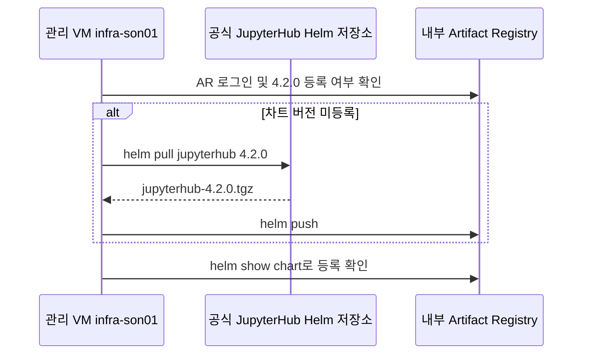

# 관리자 수동·반자동 작업 — 개별 gcloud 실행

Bash shell 파일을 실행하지 않고 아래 명령을 순서대로 복사해 실행합니다. 변수 선언과 비밀값 입력은 터미널 준비 명령이며, 실제 GCP 작업은 gcloud가 수행합니다. 오류가 발생하면 다음 단계로 넘어가지 않습니다. 실제 GCP에는 이 문서 작성 과정에서 명령을 실행하지 않았습니다.

## 1~3. 공통 인프라 준비

다음 문서는 이미 셸 실행기 없이 변수·주석·개별 gcloud 명령으로 작성되어 있습니다. 각 문서의 변수 선언부터 순서대로 실행합니다.

1. [API·SA·IAM](01-admin.md)
2. [네트워크](02-network.md)
3. [서브넷별 IAM](02-subnet-iam.md) — VPC Admin, 서브넷 생성 후
4. [공통 서비스](03-foundation.md) — Pool 초기 구성은 VPC Admin, 나머지는 tf-manager

OAuth 및 tf-manager 그룹 관리자 역할 준비 후 [Private GKE 접속 점검](../01.docs/reference/runbook-two-stage.md#5-private-pool에서-gke-사설-api-연결-확인)을 통과해야 과제 배포를 시작합니다. Workspace tf-manager 그룹 관리자 역할 부여·DNS·인증서·기존 BQ 데이터 조회 권한은 담당자가 별도로 준비합니다.

## 4. OAuth 값 등록

```bash
export SBX_GKE_PROJECT="gcp-sbx-edp-gke01"
# 저장소 루트 GCP_SBX_Test01에서 실행합니다.
export ADMIN_ACCOUNT="son@sonmap.net"
export REGION="asia-northeast3"
export TF_MANAGER="tf-manager@${SBX_GKE_PROJECT}.iam.gserviceaccount.com"
export TF_MANAGER_RESOURCE="projects/${SBX_GKE_PROJECT}/serviceAccounts/${TF_MANAGER}"
export BUILD_STAGING_BUCKET="${SBX_GKE_PROJECT}-sbxtest01-build-source"
unset CLOUDSDK_AUTH_IMPERSONATE_SERVICE_ACCOUNT

# 입력값은 화면에 표시하지 않습니다. set -x를 사용하지 않습니다.
read -r -s -p "OAuth Client ID: " OAUTH_CLIENT_ID
printf '\n'
read -r -s -p "OAuth Client Secret: " OAUTH_CLIENT_SECRET
printf '\n'
# 둘 다 입력했는지 확인한 뒤 아래 명령을 실행합니다.
test -n "${OAUTH_CLIENT_ID}" && test -n "${OAUTH_CLIENT_SECRET}"

# 입력이 비어 있으면 중단합니다. 값은 표준입력으로만 전달합니다.
if [ -n "${OAUTH_CLIENT_ID}" ] && [ -n "${OAUTH_CLIENT_SECRET}" ]; then
  printf '%s' "${OAUTH_CLIENT_ID}" | gcloud secrets versions add jupyter-oauth-client-id --project="${SBX_GKE_PROJECT}" --account="${ADMIN_ACCOUNT}" --impersonate-service-account="${TF_MANAGER}" --data-file=-
  printf '%s' "${OAUTH_CLIENT_SECRET}" | gcloud secrets versions add jupyter-oauth-client-secret --project="${SBX_GKE_PROJECT}" --account="${ADMIN_ACCOUNT}" --impersonate-service-account="${TF_MANAGER}" --data-file=-
fi
unset OAUTH_CLIENT_ID OAUTH_CLIENT_SECRET
```

두 Secret의 최신 버전이 ENABLED인지 확인합니다.

## 5. 플랫폼 릴리스 게시

```bash
export SBX_GKE_PROJECT="gcp-sbx-edp-gke01"
# 저장소 루트 GCP_SBX_Test01에서 실행합니다.
export ADMIN_ACCOUNT="son@sonmap.net"
export REGION="asia-northeast3"
export TF_MANAGER="tf-manager@${SBX_GKE_PROJECT}.iam.gserviceaccount.com"
export TF_MANAGER_RESOURCE="projects/${SBX_GKE_PROJECT}/serviceAccounts/${TF_MANAGER}"
export BUILD_STAGING_BUCKET="${SBX_GKE_PROJECT}-sbxtest01-build-source"
unset CLOUDSDK_AUTH_IMPERSONATE_SERVICE_ACCOUNT

# 로컬 수정이 있으면 아래 Build 제출을 실행하지 않습니다.
export COMMIT_SHA="$(git rev-parse HEAD)"
export RELEASE_ID="git-$(git rev-parse HEAD | cut -c1-12)"
if [ -z "$(git status --porcelain)" ]; then
  gcloud builds submit . --project="${SBX_GKE_PROJECT}" --region="${REGION}" --account="${ADMIN_ACCOUNT}" --impersonate-service-account="${TF_MANAGER}" --service-account="${TF_MANAGER_RESOURCE}" --gcs-source-staging-dir="gs://${BUILD_STAGING_BUCKET}/source" --config=03.cloudbuild/platform-release.yaml --substitutions="_RELEASE_ID=${RELEASE_ID},_COMMIT_SHA=${COMMIT_SHA}"
else
  echo "로컬 변경을 커밋하거나 정리한 뒤 다시 실행하세요."
fi
```

Build SUCCESS 후 bundles 버킷의 platform-releases/${RELEASE_ID}/release.json을 확인합니다.

## 6. Chart와 기본 이미지 미러링

### infra-son01에서 Helm 차트 수동 반입

승인된 관리 VM `infra-son01`에 로그인한 뒤, 같은 Bash 창에서 다음 명령을 순서대로 실행합니다. VM에는 Helm 3과 gcloud가 필요하며, 공식 Helm 저장소와 AR에 HTTPS로 접근할 수 있어야 합니다. AR은 Docker 형식 저장소를 사용합니다. `AR_ACCOUNT`는 대상 저장소에서 읽기·업로드 권한이 있는 gcloud 계정으로 지정합니다. 차트 반입은 관리 VM에서 완료하므로 GKE 접속과 Cloud Build 제출이 필요 없습니다.



**1. 대상 설정 및 AR 로그인**

```bash
CHART_VERSION=4.2.0
CHART_SOURCE=https://hub.jupyter.org/helm-chart/
AR_HOST=asia-northeast3-docker.pkg.dev
AR_REPO="oci://${AR_HOST}/gcp-sbx-edp-gke01/ar-sbxtest01-platform"
JUPYTER_CHART_URI="${AR_REPO}/jupyterhub"
AR_ACCOUNT=son@sonmap.net

( set -o pipefail; gcloud auth print-access-token --account="$AR_ACCOUNT" | helm registry login "$AR_HOST" --username oauth2accesstoken --password-stdin )
```

로그인이 성공한 뒤 대상 차트 버전을 조회합니다.

```bash
helm show chart "$JUPYTER_CHART_URI" --version "$CHART_VERSION"
```

`name: jupyterhub`와 `version: 4.2.0`이 보이면 게시된 버전을 사용합니다. 해당 버전이 등록되어 있지 않다고 확인한 경우 2단계로 진행합니다. 인증·권한·네트워크 오류는 먼저 해결합니다.

**2. 공식 Helm 저장소에서 패키지 다운로드**

```bash
CHART_DIR="$(mktemp -d)" && CHART_PACKAGE="$CHART_DIR/jupyterhub-${CHART_VERSION}.tgz" && helm pull jupyterhub --repo "$CHART_SOURCE" --version "$CHART_VERSION" --destination "$CHART_DIR" && helm show chart "$CHART_PACKAGE"
```

다운로드한 패키지의 `name: jupyterhub`와 `version: 4.2.0`을 확인합니다.

**3. 내부 AR 업로드 및 검증**

```bash
helm push "$CHART_PACKAGE" "$AR_REPO" && helm show chart "$JUPYTER_CHART_URI" --version "$CHART_VERSION"
```

`helm push`의 대상은 저장소 루트입니다. Helm은 차트 이름과 버전을 패키지의 `Chart.yaml`에서 읽습니다. 배포에는 `oci://asia-northeast3-docker.pkg.dev/gcp-sbx-edp-gke01/ar-sbxtest01-platform/jupyterhub`와 `--version 4.2.0`을 사용합니다. 승인된 다른 AR을 사용할 경우 `AR_REPO`와 배포 설정의 차트 URI를 같이 맞춥니다.

### Hub·Proxy·Notebook 기본 이미지 복사

```bash
export SBX_GKE_PROJECT="gcp-sbx-edp-gke01"
# 저장소 루트 GCP_SBX_Test01에서 실행합니다.
export ADMIN_ACCOUNT="son@sonmap.net"
export REGION="asia-northeast3"
export TF_MANAGER="tf-manager@${SBX_GKE_PROJECT}.iam.gserviceaccount.com"
export TF_MANAGER_RESOURCE="projects/${SBX_GKE_PROJECT}/serviceAccounts/${TF_MANAGER}"
export BUILD_STAGING_BUCKET="${SBX_GKE_PROJECT}-sbxtest01-build-source"
unset CLOUDSDK_AUTH_IMPERSONATE_SERVICE_ACCOUNT

export AUTOMATION_IMAGE="${REGION}-docker.pkg.dev/${SBX_GKE_PROJECT}/ar-sbxtest01-platform/sbxtest01-automation-runner:bootstrap"

# Hub / Proxy / Notebook 기본 이미지를 내부 저장소로 복사합니다.
gcloud builds submit --no-source --project="${SBX_GKE_PROJECT}" --region="${REGION}" --account="${ADMIN_ACCOUNT}" --impersonate-service-account="${TF_MANAGER}" --service-account="${TF_MANAGER_RESOURCE}" --config=03.cloudbuild/mirror-jupyterhub-images.yaml --substitutions="_AUTOMATION_IMAGE=${AUTOMATION_IMAGE}"
```

기본 이미지 복사 Build가 SUCCESS인지 확인합니다. 외부 다운로드가 가능한 관리형 Build에서 실행합니다.

## 7. Notebook 표준 이미지 빌드

운영자는 승인된 관리 VM `infra-son01`의 Test02 저장소 루트에서 Docker BuildKit으로 표준 이미지를 빌드하고 내부 AR에 게시합니다. 표준 이미지는 공통 APT 도구와 Google Cloud CLI, Python 라이브러리, Notebook 시작 스크립트를 포함합니다. Docker 빌드 환경에서 OS APT 저장소, Google Cloud APT 저장소와 내부 AR에 접근할 수 있어야 합니다. VM에서 접근이 허용된 APT 경로를 사용하고, VM 호스트와 Docker 빌드 환경의 접속 여부를 각각 확인합니다.

```bash
AR_HOST=asia-northeast3-docker.pkg.dev
AR_REPO="$AR_HOST/gcp-sbx-edp-gke01/ar-sbxtest01-platform"
AR_ACCOUNT=son@sonmap.net
BASE_IMAGE="$AR_REPO/jupyterhub-k8s-singleuser-sample:4.2.0"
IMAGE_TAG=4.2.0-r2-home
IMAGE="$AR_REPO/jupyterhub-k8s-singleuser-standard:$IMAGE_TAG"
TARGET_PLATFORM=linux/amd64
NOTEBOOK_PIP_MODE=index
```

`TARGET_PLATFORM`은 GKE 대상 노드에 맞춥니다. 예제 태그가 이미 게시되어 있으면 기존 이미지를 사용하거나, 변경 버전에 새로운 승인 태그를 지정합니다. 기존 과제별 배포에서 새 태그를 사용할 경우 사용자 홈 설정도 함께 적용합니다. [이미지 적용 절차](../04.Jupiter-setup-image/README.md)

**1. Docker를 내부 AR에 인증하고 베이스 이미지를 확인합니다.**

```bash
( set -o pipefail; gcloud auth print-access-token --account="$AR_ACCOUNT" | docker login "$AR_HOST" --username oauth2accesstoken --password-stdin )
docker pull --platform="$TARGET_PLATFORM" "$BASE_IMAGE"
```

**2. Python 패키지 설치 경로를 선택합니다.**

- `index`는 Docker 빌드 안에서 필요한 Python 패키지와 의존성을 모두 받을 수 있을 때 사용합니다.
- 일부만 받을 수 있으면 [표준 이미지 wheel 반입 절차](../04.Jupiter-setup-image/README.md#표준-이미지-wheel-반입)를 따라 완전한 wheel 모음을 `04.Jupiter-setup-image/wheelhouse/`에 준비하고 아래 설정을 적용합니다. Dockerfile은 이 모드에서 Python 인덱스에 접속하지 않습니다. APT 설치에는 승인된 APT 접근 경로가 계속 필요합니다.

```bash
NOTEBOOK_PIP_MODE=wheelhouse
```

**3. VM에서 빌드하고 확인 후 AR에 올립니다.**

```bash
DOCKER_BUILDKIT=1 docker build --platform="$TARGET_PLATFORM" --build-arg "BASE_IMAGE=$BASE_IMAGE" --build-arg "IMAGE_VERSION=$IMAGE_TAG" --build-arg "NOTEBOOK_PIP_MODE=$NOTEBOOK_PIP_MODE" --tag "$IMAGE" 04.Jupiter-setup-image
docker run --rm --platform="$TARGET_PLATFORM" --entrypoint python "$IMAGE" -c 'import pandas, pyarrow, db_dtypes; from google.cloud import bigquery, storage'
docker run --rm --platform="$TARGET_PLATFORM" --entrypoint sh "$IMAGE" -c 'command -v jupyterhub-singleuser && gcloud version'
docker push "$IMAGE"
docker pull --platform="$TARGET_PLATFORM" "$IMAGE"
docker image inspect "$IMAGE" --format='{{range .RepoDigests}}{{println .}}{{end}}' | grep -F "${IMAGE%:*}@sha256:"
```

각 명령이 성공한 뒤 다음 명령을 실행합니다. 그룹 공유 PoC는 마지막 명령의 `이미지@sha256:…` 값을 승인 과제 JSON의 `image`에 넣고 배포합니다. 개발 중 추가 패키지는 [개발자 인터넷 PC → GCS → Notebook Pod 절차](../04.Jupiter-setup-image/README.md#개발자-추가-패키지-gcs-경유)를 사용합니다.

## 운영 자동화 경계

이 문서는 공통 기반 준비용입니다. 과제마다 위 명령을 반복하지 않습니다. 포털은 승인 JSON을 GCS에 저장하고, 작업자가 05-deploy.md의 명령으로 Deploy를 시작합니다. GCS 이벤트 시작·입력 변환·포털 결과 전달은 나중에 자동화할 항목입니다. 포털 없이 수행하는 JSON 작성·업로드는 연동 시험용입니다. 기존 .sh 파일은 호환·참고용으로 유지하며 본 문서의 명령과 중복 실행하지 않습니다.

## 그룹 관리 사전 설정

[Cloud Identity 그룹 Terraform 설정](../01.docs/reference/cloud-identity-group-terraform.md)에 따라 tf-manager에 그룹 관리자 역할을 직접 부여하고, provisioner-env.yaml의 CLOUD_IDENTITY_CUSTOMER_ID를 실제 값으로 수정·커밋한 뒤 릴리스합니다. 기존 그룹은 승인 요청의 import 정보를 준비합니다. Jupyter 로그인용 OAuth는 유지합니다.
