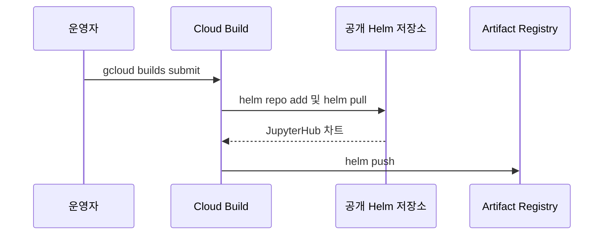
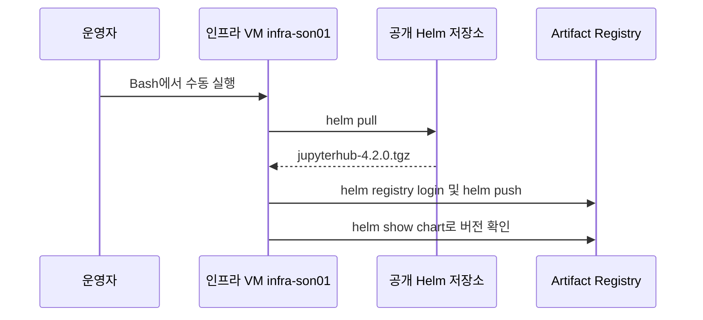

# 관리자 수동·반자동 작업 — 개별 gcloud 실행

Bash shell 파일을 실행하지 않고 아래 명령을 순서대로 복사해 실행합니다. 변수 선언과 비밀값 입력은 터미널 준비 명령이며, 실제 GCP 작업은 gcloud가 수행합니다. 오류가 발생하면 다음 단계로 넘어가지 않습니다. 실제 GCP에는 이 문서 작성 과정에서 명령을 실행하지 않았습니다.

## 1~3. 공통 인프라 준비

다음 문서는 이미 셸 실행기 없이 변수·주석·개별 gcloud 명령으로 작성되어 있습니다. 각 문서의 변수 선언부터 순서대로 실행합니다.

1. [API·SA·IAM](01-admin.md)
2. [네트워크](02-network.md)
3. [서브넷별 IAM](02-subnet-iam.md) — VPC Admin, 서브넷 생성 후
4. [공통 서비스](03-foundation.md) — Pool 초기 구성은 VPC Admin, 나머지는 tf-manager

OAuth 및 tf-manager 그룹 관리자 역할 준비 후 [Private GKE 접속 점검](../01.docs/reference/runbook-two-stage.md#5-private-pool에서-gke-사설-api-연결-확인)을 통과해야 과제 배포를 시작합니다. Workspace tf-manager 그룹 관리자 역할 부여·DNS·인증서·기존 BQ 데이터 조회 권한은 담당자가 별도로 준비합니다.

## 4. OAuth 값 등록

```bash
export SBX_GKE_PROJECT="gcp-sbx-edp-gke01"
# 저장소 루트 GCP_SBX_Test01에서 실행합니다.
export ADMIN_ACCOUNT="son@sonmap.net"
export REGION="asia-northeast3"
export TF_MANAGER="tf-manager@${SBX_GKE_PROJECT}.iam.gserviceaccount.com"
export TF_MANAGER_RESOURCE="projects/${SBX_GKE_PROJECT}/serviceAccounts/${TF_MANAGER}"
export BUILD_STAGING_BUCKET="${SBX_GKE_PROJECT}-sbxtest01-build-source"
unset CLOUDSDK_AUTH_IMPERSONATE_SERVICE_ACCOUNT

# 입력값은 화면에 표시하지 않습니다. set -x를 사용하지 않습니다.
read -r -s -p "OAuth Client ID: " OAUTH_CLIENT_ID
printf '\n'
read -r -s -p "OAuth Client Secret: " OAUTH_CLIENT_SECRET
printf '\n'
# 둘 다 입력했는지 확인한 뒤 아래 명령을 실행합니다.
test -n "${OAUTH_CLIENT_ID}" && test -n "${OAUTH_CLIENT_SECRET}"

# 입력이 비어 있으면 중단합니다. 값은 표준입력으로만 전달합니다.
if [ -n "${OAUTH_CLIENT_ID}" ] && [ -n "${OAUTH_CLIENT_SECRET}" ]; then
  printf '%s' "${OAUTH_CLIENT_ID}" | gcloud secrets versions add jupyter-oauth-client-id --project="${SBX_GKE_PROJECT}" --account="${ADMIN_ACCOUNT}" --impersonate-service-account="${TF_MANAGER}" --data-file=-
  printf '%s' "${OAUTH_CLIENT_SECRET}" | gcloud secrets versions add jupyter-oauth-client-secret --project="${SBX_GKE_PROJECT}" --account="${ADMIN_ACCOUNT}" --impersonate-service-account="${TF_MANAGER}" --data-file=-
fi
unset OAUTH_CLIENT_ID OAUTH_CLIENT_SECRET
```

두 Secret의 최신 버전이 ENABLED인지 확인합니다.

## 5. 플랫폼 릴리스 게시

```bash
export SBX_GKE_PROJECT="gcp-sbx-edp-gke01"
# 저장소 루트 GCP_SBX_Test01에서 실행합니다.
export ADMIN_ACCOUNT="son@sonmap.net"
export REGION="asia-northeast3"
export TF_MANAGER="tf-manager@${SBX_GKE_PROJECT}.iam.gserviceaccount.com"
export TF_MANAGER_RESOURCE="projects/${SBX_GKE_PROJECT}/serviceAccounts/${TF_MANAGER}"
export BUILD_STAGING_BUCKET="${SBX_GKE_PROJECT}-sbxtest01-build-source"
unset CLOUDSDK_AUTH_IMPERSONATE_SERVICE_ACCOUNT

# 로컬 수정이 있으면 아래 Build 제출을 실행하지 않습니다.
export COMMIT_SHA="$(git rev-parse HEAD)"
export RELEASE_ID="git-$(git rev-parse HEAD | cut -c1-12)"
if [ -z "$(git status --porcelain)" ]; then
  gcloud builds submit . --project="${SBX_GKE_PROJECT}" --region="${REGION}" --account="${ADMIN_ACCOUNT}" --impersonate-service-account="${TF_MANAGER}" --service-account="${TF_MANAGER_RESOURCE}" --gcs-source-staging-dir="gs://${BUILD_STAGING_BUCKET}/source" --config=03.cloudbuild/platform-release.yaml --substitutions="_RELEASE_ID=${RELEASE_ID},_COMMIT_SHA=${COMMIT_SHA}"
else
  echo "로컬 변경을 커밋하거나 정리한 뒤 다시 실행하세요."
fi
```

Build SUCCESS 후 bundles 버킷의 platform-releases/${RELEASE_ID}/release.json을 확인합니다.

## 6. Chart와 기본 이미지 미러링

**기존 · Cloud Build에서 차트 반입**



**변경 · infra-son01에서 차트 반입**



### infra-son01에서 Helm 차트 수동 반입

`infra-son01`에 로그인한 뒤 같은 Bash 창에서 실행합니다. VM에서 외부 Helm 저장소의 HTTPS 주소와 대상 AR에 접속할 수 있어야 합니다. Helm과 gcloud가 필요합니다. `AR_ACCOUNT`에는 대상 저장소의 읽기·쓰기 권한을 가진 gcloud 로그인 계정을 사용합니다. 아래 대상은 현재 배포가 읽는 Sandbox AR입니다. Edge AR을 사용하려면 업로드 대상과 배포 환경의 `JUPYTER_CHART_URI`를 같은 저장소로 맞춥니다.

**1. 외부 차트 다운로드**

```bash
CHART_VERSION=4.2.0
CHART_DIR="$(mktemp -d)"

helm pull jupyterhub --repo https://hub.jupyter.org/helm-chart/ \
  --version "$CHART_VERSION" --destination "$CHART_DIR" &&
  helm show chart "$CHART_DIR/jupyterhub-${CHART_VERSION}.tgz"
```

`name: jupyterhub`와 `version: 4.2.0`을 확인합니다.

**2. AR 인증과 기존 차트 확인**

```bash
AR_HOST=asia-northeast3-docker.pkg.dev
AR_REPO="oci://${AR_HOST}/gcp-sbx-edp-gke01/ar-sbxtest01-platform"
AR_ACCOUNT=son@sonmap.net

(
  set -o pipefail
  gcloud auth print-access-token --account="$AR_ACCOUNT" |
    helm registry login "$AR_HOST" --username oauth2accesstoken --password-stdin
) &&
  helm show chart "$AR_REPO/jupyterhub" --version "$CHART_VERSION"
```

해당 버전이 조회되면 그대로 사용합니다. 인증·통신 오류가 나면 원인을 확인합니다. **해당 버전이 없다고 확인된 경우에만** 아래 명령으로 올립니다.

**3. 업로드와 조회**

```bash
helm push "$CHART_DIR/jupyterhub-${CHART_VERSION}.tgz" "$AR_REPO" &&
  helm show chart "$AR_REPO/jupyterhub" --version "$CHART_VERSION"
```

### Hub·Proxy·Notebook 기본 이미지 복사

```bash
export SBX_GKE_PROJECT="gcp-sbx-edp-gke01"
# 저장소 루트 GCP_SBX_Test01에서 실행합니다.
export ADMIN_ACCOUNT="son@sonmap.net"
export REGION="asia-northeast3"
export TF_MANAGER="tf-manager@${SBX_GKE_PROJECT}.iam.gserviceaccount.com"
export TF_MANAGER_RESOURCE="projects/${SBX_GKE_PROJECT}/serviceAccounts/${TF_MANAGER}"
export BUILD_STAGING_BUCKET="${SBX_GKE_PROJECT}-sbxtest01-build-source"
unset CLOUDSDK_AUTH_IMPERSONATE_SERVICE_ACCOUNT

export AUTOMATION_IMAGE="${REGION}-docker.pkg.dev/${SBX_GKE_PROJECT}/ar-sbxtest01-platform/sbxtest01-automation-runner:bootstrap"

# Hub / Proxy / Notebook 기본 이미지를 내부 저장소로 복사합니다.
gcloud builds submit --no-source --project="${SBX_GKE_PROJECT}" --region="${REGION}" --account="${ADMIN_ACCOUNT}" --impersonate-service-account="${TF_MANAGER}" --service-account="${TF_MANAGER_RESOURCE}" --config=03.cloudbuild/mirror-jupyterhub-images.yaml --substitutions="_AUTOMATION_IMAGE=${AUTOMATION_IMAGE}"
```

기본 이미지 복사 Build가 SUCCESS인지 확인합니다. 외부 다운로드가 가능한 관리형 Build에서 실행합니다.

## 7. Notebook 표준 이미지 빌드

```bash
export SBX_GKE_PROJECT="gcp-sbx-edp-gke01"
# 저장소 루트 GCP_SBX_Test01에서 실행합니다.
export ADMIN_ACCOUNT="son@sonmap.net"
export REGION="asia-northeast3"
export TF_MANAGER="tf-manager@${SBX_GKE_PROJECT}.iam.gserviceaccount.com"
export TF_MANAGER_RESOURCE="projects/${SBX_GKE_PROJECT}/serviceAccounts/${TF_MANAGER}"
export BUILD_STAGING_BUCKET="${SBX_GKE_PROJECT}-sbxtest01-build-source"
unset CLOUDSDK_AUTH_IMPERSONATE_SERVICE_ACCOUNT

export IMAGE_REPO="${REGION}-docker.pkg.dev/${SBX_GKE_PROJECT}/ar-sbxtest01-platform/jupyterhub-k8s-singleuser-standard"
export IMAGE_TAG="4.2.0-r2-home"
export BASE_IMAGE="${REGION}-docker.pkg.dev/${SBX_GKE_PROJECT}/ar-sbxtest01-platform/jupyterhub-k8s-singleuser-sample:4.2.0"

# 버킷 location이 asia-northeast3인지 확인합니다. 다르면 중단합니다.
gcloud storage buckets describe "gs://${BUILD_STAGING_BUCKET}" --project="${SBX_GKE_PROJECT}" --account="${ADMIN_ACCOUNT}" --impersonate-service-account="${TF_MANAGER}" --format='value(location)'

# Build 실행 계정의 소스 읽기 권한을 준비합니다.
gcloud storage buckets add-iam-policy-binding "gs://${BUILD_STAGING_BUCKET}" --member="serviceAccount:${TF_MANAGER}" --role=roles/storage.objectViewer --account="${ADMIN_ACCOUNT}" --impersonate-service-account="${TF_MANAGER}"

# Notebook 이미지를 빌드합니다. 성공한 뒤 이미지 조회로 확인합니다.
gcloud builds submit 04.Jupiter-setup-image --project="${SBX_GKE_PROJECT}" --region="${REGION}" --account="${ADMIN_ACCOUNT}" --impersonate-service-account="${TF_MANAGER}" --service-account="${TF_MANAGER_RESOURCE}" --gcs-source-staging-dir="gs://${BUILD_STAGING_BUCKET}/jupyter-source" --config=04.Jupiter-setup-image/cloudbuild.yaml --substitutions="_BASE_IMAGE=${BASE_IMAGE},_IMAGE_REPO=${IMAGE_REPO},_IMAGE_TAG=${IMAGE_TAG}"
```

Build SUCCESS 후 아래 이미지 조회가 성공해야 합니다.

```bash
gcloud artifacts docker images describe "${IMAGE_REPO}:${IMAGE_TAG}" --project="${SBX_GKE_PROJECT}" --account="${ADMIN_ACCOUNT}" --impersonate-service-account="${TF_MANAGER}"
```

## 운영 자동화 경계

이 문서는 공통 기반 준비용입니다. 과제마다 위 명령을 반복하지 않습니다. 포털은 승인 JSON을 GCS에 저장하고, 작업자가 05-deploy.md의 명령으로 Deploy를 시작합니다. GCS 이벤트 시작·입력 변환·포털 결과 전달은 나중에 자동화할 항목입니다. 포털 없이 수행하는 JSON 작성·업로드는 연동 시험용입니다. 기존 .sh 파일은 호환·참고용으로 유지하며 본 문서의 명령과 중복 실행하지 않습니다.

## 그룹 관리 사전 설정

[Cloud Identity 그룹 Terraform 설정](../01.docs/reference/cloud-identity-group-terraform.md)에 따라 tf-manager에 그룹 관리자 역할을 직접 부여하고, provisioner-env.yaml의 CLOUD_IDENTITY_CUSTOMER_ID를 실제 값으로 수정·커밋한 뒤 릴리스합니다. 기존 그룹은 승인 요청의 import 정보를 준비합니다. Jupyter 로그인용 OAuth는 유지합니다.
