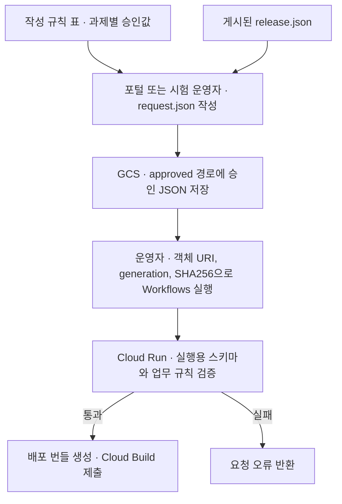

# Sandbox 과제 요청 작성 규칙

포털과 시험 운영자는 아래 표에 따라 과제별 `request.json`을 작성합니다. 과제 일련번호, 대상 프로젝트, 사용자, 승인 정보는 신청할 때마다 실제 값으로 채웁니다. `<과제명>`과 `<NN>`은 설명용 자리표시자입니다.

| JSON 경로 | 필수 여부 | 현재 입력 기준 |
|---|---|---|
| `schema_version`, `action` | 필수 | 각각 `"1.0"`, `"CREATE"` |
| `request_id` | 필수 | 요청별 고유 값. `REQ-` 뒤 대문자·숫자·하이픈 6~64자. GCS 경로와 Workflow 입력에도 같은 값 사용 |
| `approval.status`, `approval.approval_id`, `approval.approved_at` | 필수 | 최종 승인 상태 `APPROVED`, 실제 승인 번호(3~128자), 시간대가 포함된 승인 일시 |
| `task.name`, `task.display_name`, `task.expires_on` | 필수 | `sbx<NN>`에 실제 일련번호 적용. 과제명은 소문자로 시작하고 소문자·숫자·하이픈 3~20자. 전용 GSA 사용 시 최대 18자. 표시명 3~80자, 종료일 `YYYY-MM-DD` |
| `identity.group_email`, `identity.members` | 필수 | 그룹 `pgrp-gcp-dev-<과제명>@sonmap.net`, 승인된 `@sonmap.net` 구성원 1~20개, 중복 제외 |
| `identity.create_jupyter_gsa` | 조건부 | 신규 프로젝트 또는 데이터레이크 Dataset 조회 요청 시 `true` |
| `identity.group_resource_name`, `identity.membership_resource_names` | 선택 | 기존 그룹·멤버십 편입 시 사용. 멤버십은 지정한 그룹에 속하고 키는 승인된 구성원 이메일 |
| `project.create_project`, `project.project_id`, `project.project_name` | 필수 | 신규 생성은 `true`, 기존 프로젝트 재사용은 `false`. 실제 과제 프로젝트 ID와 이름 입력 |
| `project.billing_account`, `project.org_id`, `project.folder_id` | 신규 생성 시 | 승인된 Billing 계정과 상위 리소스 입력. 상위 리소스는 숫자 문자열인 `org_id` 또는 `folder_id` 중 하나 |
| `network.required`, `network.host_project_id`, `network.network_name`, `network.region`, `network.shared_vpc_join` | 필수 | 현재 Host 프로젝트 `gcp-prod-edp-hub-vpchost`, VPC `vpc-prod-edp-hub`, 리전 `asia-northeast3`. `shared_vpc_join=false`. 과제별 네트워크 단계가 필요 없으면 `required=false` |
| `network.create_subnet`, `network.subnet_name`, `network.subnet_cidr`, `network.private_google_access` | 조건부·선택 | `required=true`일 때 `create_subnet=false`를 명시하고 VPC 관리자가 준비한 기존 `subnet-<과제명>-an3`와 실제 IPv4 `/24` CIDR을 입력. `private_google_access`는 선택 |
| `data.bigquery_dataset`, `data.gcs_bucket` | 필수 | 승인된 과제 Dataset ID와 GCS 버킷 이름 |
| `data.adopt_existing_resources`, `data.datalake_datasets` | 선택 | 기존 Dataset·버킷을 편입할 때 `adopt_existing_resources=true`. 데이터레이크 조회 시 `pjt-c-admin`의 승인 Dataset을 최대 10개 지정 |
| `gke.project_id`, `gke.cluster_name`, `gke.location`, `gke.namespace`, `gke.jupyter_domain` | 필수 | 현재 공용 GKE는 `gcp-sbx-edp-gke01` / `gke-sbx-main-an3` / `asia-northeast3`. Namespace는 `task.name`과 동일. 승인된 `*.sonmap.net` 도메인 입력 |
| `source.release_id`, `source.archive_uri`, `source.generation`, `source.sha256` | 필수 | 사용할 `release.json`의 실제 값. 내부 번들 버킷의 `platform-releases/` 아래 ZIP, 양의 정수 generation, 소문자 16진수 SHA256 64자 |

실제 검사는 [Cloud Run 실행용 JSON Schema](../sandbox-request.schema.json)와 [업무 검증 코드](../main.py)가 수행합니다. 실행 규칙이 바뀌면 관련 코드와 이 표를 함께 갱신합니다. 승인 요청 제출은 [Workflows 배포 명령](../legacy-deploy.md#공통-workflows-배포-명령)을 따릅니다.
