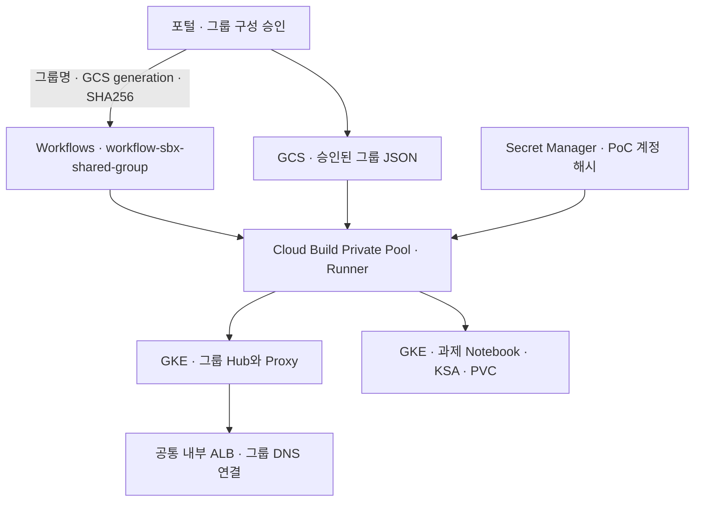

# 03 · 2차 Sandbox 구축

[1차 인프라 구축](../01.docs/01-infra-setup.md)을 완료한 후 진행합니다.

| 폴더 | 용도 |
|---|---|
| [03.1.request](03.1.request/) | 승인 JSON, Workflows와 요청 API |
| [03.2.terraform](03.2.terraform/) | 기존 과제별 경로의 프로젝트·IAM·데이터 구성 |
| [03.3.gke](03.3.gke/) | Runner, 그룹 공유 배포, Cloud Build와 Notebook 이미지 |

## 그룹 공유 Sandbox 자동 배포



### 1. 플랫폼 운영자 · Workflow 최초 등록

1차에서 GKE, Private Pool의 GKE 접근, 내부 ALB, 그룹 DNS·리전 인증서, 내부 AR의 Helm 차트와 실행 이미지를 준비합니다. Runner에는 그룹 배포 코드가 포함된 버전을 사용합니다. 기존 Runner만 있으면 관리 VM에서 아래와 같이 전용 버전을 게시합니다. 1차 플랫폼 릴리스로 새 Runner를 이미 게시했다면 해당 태그를 사용할 수 있습니다.

```bash
# 1차 문서의 프로젝트, 리전, 계정, 서비스 계정 변수를 설정하고 저장소 루트에서 실행
export BUILD_STAGING_BUCKET="${SBX_GKE_PROJECT}-sbxtest01-build-source"
export TF_MANAGER_RESOURCE="projects/${SBX_GKE_PROJECT}/serviceAccounts/${TF_MANAGER}"
export AR_REPO="${REGION}-docker.pkg.dev/${SBX_GKE_PROJECT}/ar-sbxtest01-platform"
export RUNNER_IMAGE="${AR_REPO}/sbxtest01-automation-runner:shared-$(git rev-parse --short=12 HEAD)"
export WORKER_POOL="projects/${SBX_GKE_PROJECT}/locations/${REGION}/workerPools/pool-sbxtest01"

# 아래 config는 Runner만 빌드합니다.
gcloud builds submit . --project="$SBX_GKE_PROJECT" --region="$REGION" \
  --account="$ADMIN_ACCOUNT" --impersonate-service-account="$TF_MANAGER" \
  --service-account="$TF_MANAGER_RESOURCE" --gcs-source-staging-dir="gs://${BUILD_STAGING_BUCKET}/source" \
  --config=03.sandbox_deploy/03.3.gke/cloudbuild/shared-group-runner.yaml --substitutions="_RUNNER_IMAGE=$RUNNER_IMAGE"

gcloud workflows deploy workflow-sbx-shared-group --project="$SBX_GKE_PROJECT" \
  --location="$REGION" --account="$ADMIN_ACCOUNT" --impersonate-service-account="$TF_MANAGER" \
  --service-account="$SBX_MANAGER" --source=03.sandbox_deploy/03.1.request/shared-group-workflow.yaml \
  --set-env-vars="SBX_REGION=$REGION,SBX_RUNNER_SA=$TF_MANAGER_RESOURCE,SBX_RUNNER_IMAGE=$RUNNER_IMAGE,SBX_WORKER_POOL=$WORKER_POOL,SBX_GKE_CLUSTER=gke-sbx-main-an3,SBX_GKE_ENDPOINT_MODE=dns,SBX_REQUEST_BUCKET=${SBX_GKE_PROJECT}-sbxtest01-requests,SBX_CHART_URI=oci://$AR_REPO/jupyterhub,SBX_CHART_VERSION=4.2.0,SBX_URL_MAP=urlmap-alb-sbxtest01-shared"
```

Workflow 실행 계정 `sbx-manager`에는 Build 제출·조회, Private Pool 사용, `tf-manager` 사용 권한이 필요합니다. Runner의 `tf-manager`에는 GKE·ALB 권한, 요청 버킷의 객체 읽기·잠금 객체 생성 및 삭제 권한, 그룹 Secret 접근 권한, 과제 GSA에 Workload Identity 바인딩을 추가할 권한이 필요합니다. 포털 서비스 계정에 승인 JSON 게시 및 이 Workflow 호출 권한을 부여합니다.

### 2. 플랫폼 운영자 · 그룹 계정과 데이터 준비

그룹별 `shared-test-accounts-<그룹명>` Secret Manager 리소스에 `prepare_test_accounts.py`가 생성한 해시 JSON을 등록하고 Runner 계정에 해당 Secret의 `roles/secretmanager.secretAccessor`를 부여합니다. 새 멤버 등록 또는 비밀번호 변경 때 Secret 버전을 갱신합니다. 승인 JSON과 Git에는 해시나 비밀번호를 넣지 않습니다.

과제별 GSA와 BigQuery·GCS 접근 권한을 준비합니다. 기존 Filestore를 사용할 경우 과제 Namespace에 `sandbox-group=<그룹명>` 라벨과 기존 RWX PVC, 필요한 전용 디렉터리를 미리 준비합니다. 신규 PVC를 자동 생성하려면 승인 JSON에 검증된 `storage_class`를 넣습니다. 기존 그룹에 과제를 추가할 때는 JSON에 기존 과제와 신규 과제를 함께 넣습니다. 멤버 교체 전에는 기존 `stop` 절차로 과제를 중지하고 세션을 정리합니다.

### 3. 포털 · 승인할 때마다 실행

1. [그룹 JSON 예시](../04.tests/fixtures/group.example.json)를 바탕으로 전체 그룹 구성을 작성합니다. 실제 내부 AR digest, 그룹 DNS와 과제 PVC 정보를 넣습니다.
2. 승인한 바이트를 `gs://<요청 버킷>/approved-groups/<그룹명>/group.json`에 게시합니다. 그룹별 최신 승인본만 적용합니다. 동시에 승인하는 경우 GCS 업로드의 generation 조건을 사용해 이전 승인본을 덮어쓰는 충돌을 방지합니다.
3. 같은 바이트의 SHA256과 업로드에서 반환된 generation을 사용해 포털이 Workflows Executions API를 호출합니다. 운영자는 연동 시험 시 아래 예시를 실행할 수 있습니다.

```bash
gcloud workflows run workflow-sbx-shared-group --project="$SBX_GKE_PROJECT" --location="$REGION" \
  --data='{"group":"sandbox-group-01","generation":"<GCS generation>","sha256":"<SHA256>"}'
```

Workflow는 Build 완료를 기다립니다. 실행 ID로 결과를 조회하고 Build에서 Helm, 과제 Deployment, NEG·ALB 적용 결과를 확인합니다. 공통 ALB 갱신은 GCS 잠금으로 직렬화됩니다. 빌드 강제 종료로 잠금이 남으면 운영자는 객체에 기록된 Build ID가 종료된 것을 확인하고, 해당 객체 generation을 조건으로 잠금을 제거한 뒤 최신 승인본을 다시 제출합니다.

기존 과제별 Hub 구성은 [기존 Workflows 배포](03.1.request/legacy-deploy.md)를 참고합니다.
