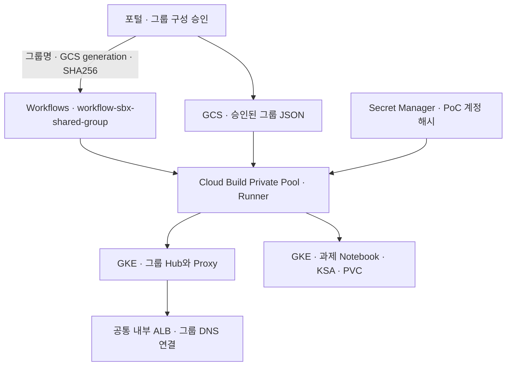

# 03 · 2차 Sandbox 구축

[1차 인프라 구축](../02.infra-setup/infra-setup-commend.md)을 완료한 후 진행합니다.

[sbx04 그룹으로 새 과제 배포](#2-4-그룹-이름을-바꿔-sbx04로-배포)

## sbx03 2차 배포 따라 하기

포털 대신 운영자가 승인 JSON을 작성하는 경우, 아래 순서대로 실제 과제 배포와 검증을 진행합니다.

**수행 위치** · `infra-son01`의 Test02 저장소 루트  
**수행 계정** · `son@sonmap.net`

0. [실행 환경 확인](#0-실행-환경과-준비-상태-확인)
   - [0-1. 사전준비 · 플랫폼 릴리스 게시](#0-1-사전준비-플랫폼-릴리스-게시)
1. [릴리스 조회](#1-게시된-릴리스-조회)
2. [요청 JSON 생성](#2-요청-json-생성) · [종료된 빌드 재시도](#2-3-종료된-빌드-재시도)
3. [GCS 게시](#3-승인-요청-게시)
4. [게시 결과와 Workflow 입력 검증](#4-게시-결과와-workflow-입력-검증)

5. [배포 전 확인](#5-workflow-실행-전-private-pool과-서비스-확인)
6. [Workflow 실행](#6-sbx03-workflow-실행)
7. [배포 결과 확인](#7-cloud-build-gke-및-alb-확인)
8. [로그인과 Notebook 검증](#8-내부-https-google-로그인-및-notebook-검증)

### 0. 실행 환경과 준비 상태 확인

`infra-son01`에서 Test02를 내려받은 경로로 이동합니다. 아래 경로는 이번 작업에서 사용한 경로입니다.

```bash
cd "$HOME/GCP_SBX_Test02-fresh"
export KUBECONFIG="$HOME/.kube/config-sbx-dns"
export CLOUDSDK_CORE_ACCOUNT="son@sonmap.net"
kubectl get nodes
kubectl get storageclass standard-rwo
```

GKE 노드가 `Ready`이고 `standard-rwo`가 조회되는지 확인합니다. 1차에서 완료한 `sbx03-smoke`는 기동 확인용입니다. 실제 `sbx03` Namespace와 서비스 계정은 아래 Workflow가 준비합니다. 신규 프로젝트 생성에 필요한 조직·결제·Workspace 권한은 [sbx03 관리자 준비](../02.infra-setup/reference/sbx03-new-project-runbook.md#1-최초-관리자-준비-수동)에서 확인합니다. 승인 번호·시각·종료일·사용자 이메일을 확보한 뒤 1번으로 진행합니다.

#### 0-1. 사전준비 · 플랫폼 릴리스 게시

**수행 위치** · `infra-son01`의 Test02 저장소 루트  
**수행 계정** · `son@sonmap.net`으로 로그인하고 `tf-manager`로 가장

플랫폼 운영자가 배포에 사용할 Terraform ZIP과 `release.json`을 `bundles` 버킷에 게시합니다. Runner·Provisioner 이미지도 게시하고, Cloud Run Provisioner를 갱신합니다. 이후 포털 또는 시험 운영자는 이 릴리스를 참조하는 과제별 `request.json`을 별도로 작성해 `requests` 버킷에 게시합니다.

먼저 승인된 릴리스가 있는지 확인합니다.

```bash
gcloud storage ls \
  'gs://gcp-sbx-edp-gke01-sbxtest01-bundles/platform-releases/*/release.json' \
  --account=son@sonmap.net
```

사용할 릴리스가 조회되면 1번으로 진행합니다. `One or more URLs matched no objects`가 나오거나 승인된 새 버전이 필요하면 아래 게시 절차를 실행합니다.

**1. 배포할 커밋의 설정 확인**

```bash
git show HEAD:03.sandbox_deploy/03.1.request/provisioner-env.yaml | grep '^CLOUD_IDENTITY_CUSTOMER_ID:'
git status --porcelain
```

`CLOUD_IDENTITY_CUSTOMER_ID: C03rw3vtp`가 표시되고 `git status --porcelain` 출력이 비어 있으면 **2번을 건너뛰고 3번**을 실행합니다. 이번 시험 VM에서 이미 수정한 커밋 `0ce39d7`을 사용하고 있다면 이 경로에 해당합니다.

**2. Customer ID 수정이 필요한 경우에만 실행**

현재 커밋에 `__SET_CUSTOMER_ID__`가 남아 있으면 다음과 같이 수정합니다. 이 값이 빌드 입력에 남아 있으면 Cloud Build의 0번 단계가 실패합니다.

```bash
sed -i 's/^CLOUD_IDENTITY_CUSTOMER_ID: __SET_CUSTOMER_ID__$/CLOUD_IDENTITY_CUSTOMER_ID: C03rw3vtp/' \
  03.sandbox_deploy/03.1.request/provisioner-env.yaml
git diff -- 03.sandbox_deploy/03.1.request/provisioner-env.yaml
```

현재 VM에서 직접 수정한 경우에만 커밋합니다. Git 작성자 정보가 설정되어 있지 않으면 아래 두 `git config` 명령을 이 저장소에서 실행합니다. 이번 VM 제출 방식에서 `git push`는 필요하지 않습니다.

```bash
git config --local user.name "Son"
git config --local user.email "son@sonmap.net"

git commit -m "Set Cloud Identity customer ID for platform release" -- \
  03.sandbox_deploy/03.1.request/provisioner-env.yaml

git status --porcelain
```

**SSM 전환 후** · Secure Source Manager에 배포 설정을 반영한 커밋을 사용합니다. VM에서 계속 제출한다면 승인된 SSM 커밋을 체크아웃하고 1번 확인 후 3번을 실행합니다. SSM 소스를 사용하는 빌드 연동이 구성되면 해당 빌드가 가져온 커밋 SHA를 릴리스 ID에 사용합니다. 배포 VM에서 작성자 설정이나 추가 커밋은 필요하지 않습니다.

**3. 최신 커밋으로 릴리스 ID 재계산 및 빌드 제출**

`git status --porcelain` 출력이 비어 있으면 아래 블록 전체를 실행합니다. 커밋 후에도 기존 셸 변수는 그대로이므로, 이전 실패 빌드의 ID로 조회하기 전에 새 ID를 계산하고 빌드를 제출합니다.

```bash
export SBX_GKE_PROJECT="gcp-sbx-edp-gke01"
# Test02 저장소 루트에서 실행합니다.
export ADMIN_ACCOUNT="son@sonmap.net"
export REGION="asia-northeast3"
export TF_MANAGER="tf-manager@${SBX_GKE_PROJECT}.iam.gserviceaccount.com"
export TF_MANAGER_RESOURCE="projects/${SBX_GKE_PROJECT}/serviceAccounts/${TF_MANAGER}"
export BUILD_STAGING_BUCKET="${SBX_GKE_PROJECT}-sbxtest01-build-source"
unset CLOUDSDK_AUTH_IMPERSONATE_SERVICE_ACCOUNT

# 로컬 수정이 있으면 아래 Build 제출을 실행하지 않습니다.
export COMMIT_SHA="$(git rev-parse HEAD)"
export RELEASE_ID="git-$(git rev-parse --short=12 HEAD)"
echo "$RELEASE_ID"
if [ -z "$(git status --porcelain)" ]; then
  # 실행 위치 infra-son01 | 대상 ${SBX_GKE_PROJECT} | 계정 ${ADMIN_ACCOUNT} | 가장 ${TF_MANAGER} | 워크로드 실행 ${TF_MANAGER}
  gcloud builds submit . --project="${SBX_GKE_PROJECT}" --region="${REGION}" \
    --account="${ADMIN_ACCOUNT}" --impersonate-service-account="${TF_MANAGER}" \
    --service-account="${TF_MANAGER_RESOURCE}" \
    --gcs-source-staging-dir="gs://${BUILD_STAGING_BUCKET}/source" \
    --config=03.sandbox_deploy/03.3.gke/cloudbuild/platform-release.yaml \
    --substitutions="_RELEASE_ID=${RELEASE_ID},_COMMIT_SHA=${COMMIT_SHA}"
else
  echo "로컬 변경을 커밋하거나 정리한 뒤 다시 실행하세요."
fi
```

**4. 게시 결과 확인**

방금 제출한 Cloud Build가 `SUCCESS`이면, 같은 터미널에서 새 `RELEASE_ID`의 게시 결과를 확인합니다. `release_id`, `archive_uri`, `generation`, `sha256`이 조회되면 1번으로 진행합니다.

```bash
gcloud storage cat \
  "gs://gcp-sbx-edp-gke01-sbxtest01-bundles/platform-releases/${RELEASE_ID}/release.json" \
  --account=son@sonmap.net
```

### 1. 게시된 릴리스 조회

**수행 이유** · 이번 배포에 사용할 Terraform 소스 버전을 고르기 위해서입니다. `release.json`에서 ZIP 경로(`archive_uri`), GCS 객체 버전(`generation`), 파일 해시(`sha256`)를 가져옵니다. 이 세 값으로 승인 요청에 배포할 ZIP을 정확히 지정합니다.

```bash
gcloud storage ls \
  'gs://gcp-sbx-edp-gke01-sbxtest01-bundles/platform-releases/*/release.json' \
  --account=son@sonmap.net
```

목록에서 이번 시험에 사용할 릴리스 ID를 확인합니다. 릴리스가 없으면 [0-1 사전준비](#0-1-사전준비-플랫폼-릴리스-게시)에서 먼저 게시합니다.

### 2. 요청 JSON 생성

**수행 이유** · 누가 승인했고 어떤 자원을 어느 프로젝트에 배포할지 전달하기 위해서입니다. 이번 요청에는 `gcp-sbx-edp-sbx03` 프로젝트, 승인된 사용자, BigQuery·GCS 설정, 기존 GKE의 `sbx03` Namespace, 1번에서 선택한 소스 버전을 기록합니다. 결과는 로컬 `.local/<요청 ID>.json`입니다.

#### 2-1. 실제 승인값 설정

아래 값으로 로컬 요청 JSON 생성을 시험할 수 있습니다. GCS 게시 전에는 승인 번호·시각·종료일을 실제 승인값으로 바꾸고 사용자 이메일이 승인 내역과 일치하는지 확인한 뒤 2-2를 다시 실행합니다. 3번 게시 명령은 `EXAMPLE-`로 시작하는 승인 번호를 거부합니다. 승인시각은 시간대를 포함한 ISO 8601, 종료일은 `YYYY-MM-DD` 형식입니다. 현재 시험에서 확인한 릴리스는 `git-0ce39d7333eb`입니다. 다른 릴리스를 사용한다면 1번에서 조회한 ID로 바꿉니다. 새 요청에는 고유한 `REQUEST_ID`를 사용합니다.

```bash
export RELEASE_ID="git-0ce39d7333eb"
export REQUEST_ID="REQ-20261114-SBX03-001"
export APPROVAL_ID="EXAMPLE-APPROVAL-SBX03-001"
export APPROVED_AT="2026-11-14T16:30:00+09:00"
export EXPIRES_ON="2026-11-30"
export MEMBER1="user01@sonmap.net"
export MEMBER2="user02@sonmap.net"
```

**개인 Sandbox 시험 배포를 직접 승인하는 경우** · 해당 환경에서 본인에게 시험 배포 승인 권한이 있다면, 승인자·요청 ID·시험 범위·실제 승인 시각을 기록합니다. 아래는 그 결정과 동시에 새 승인 기록을 남길 때 실행하는 명령입니다. 기존 승인 기록이 있으면 그 기록의 번호와 실제 완료 시각을 사용합니다.

```bash
export APPROVAL_ID="${REQUEST_ID}-TEST"
export APPROVED_AT="$(TZ=Asia/Seoul date --iso-8601=seconds)"
```

이 두 값을 승인 기록에 함께 남긴 후 **2-2만 다시 실행**합니다. 예시 변수 블록을 다시 실행하면 예시값으로 돌아갑니다. 기존 승인 기록이 UTC라면 원래의 `+00:00` 시각도 사용할 수 있습니다.

#### 2-2. 요청 파일 생성

신규 프로젝트 생성 예시입니다. 프로젝트가 이미 있으면 기존 프로젝트와 Terraform 상태를 확인해 [요청 작성 규칙](03.1.request/request-format/README.md)에 따라 재사용 설정을 결정합니다. 아래 코드 블록만 복사해 같은 터미널에서 실행합니다.

```bash
mkdir -p .local
gcloud storage cp \
  "gs://gcp-sbx-edp-gke01-sbxtest01-bundles/platform-releases/${RELEASE_ID}/release.json" \
  .local/sbx03-release.json --account=son@sonmap.net &&
jq -ne --slurpfile release .local/sbx03-release.json '
  {
    schema_version: "1.0",
    action: "CREATE",
    request_id: env.REQUEST_ID,
    approval: {status: "APPROVED", approval_id: env.APPROVAL_ID, approved_at: env.APPROVED_AT},
    task: {name: "sbx03", display_name: "Sandbox sbx03", expires_on: env.EXPIRES_ON},
    identity: {
      group_email: "pgrp-gcp-dev-sbx03@sonmap.net",
      members: [env.MEMBER1, env.MEMBER2],
      create_jupyter_gsa: true
    },
    project: {
      create_project: true, project_id: "gcp-sbx-edp-sbx03",
      project_name: "Sandbox sbx03", billing_account: "019BE7-53DD39-AF5098",
      org_id: "51654893849"
    },
    network: {
      required: false, host_project_id: "gcp-prod-edp-hub-vpchost",
      network_name: "vpc-prod-edp-hub", region: "asia-northeast3", shared_vpc_join: false
    },
    data: {bigquery_dataset: "sbx03_main", gcs_bucket: "gcp-sbx-edp-sbx03-sbx03-data"},
    gke: {
      project_id: "gcp-sbx-edp-gke01", cluster_name: "gke-sbx-main-an3",
      location: "asia-northeast3", namespace: "sbx03", jupyter_domain: "jupyter-sbx03.sonmap.net"
    },
    source: ($release[0] | {release_id, archive_uri, generation, sha256})
  }
' > ".local/${REQUEST_ID}.json"
```

데이터레이크 조회 권한이 필요한 경우 승인 범위와 관리자 위임을 확인한 뒤 `data.datalake_datasets`에 추가합니다.

#### 2-3. 종료된 빌드 재시도

1. **이전 빌드 종료 확인** · 7번의 Cloud Build 조회로 이전 상위·하위 빌드가 종료됐고 배포가 실패·취소됐는지 확인합니다.
2. **Private Pool을 2 vCPU로 변경** · 동시 CPU 한도가 4 vCPU이고 상위·하위 빌드가 같은 풀을 사용하는 경우에 적용합니다. 이미 `e2-standard-2`라면 상태만 확인합니다.

Cloud Shell에서 `admin@sonmap.net`으로 실행합니다. [Cloud Build Private Pool 업데이트 명령](https://docs.cloud.google.com/sdk/gcloud/reference/builds/worker-pools/update)

```bash
gcloud builds worker-pools update pool-sbxtest01 \
  --project=gcp-sbx-edp-gke01 --region=asia-northeast3 \
  --worker-machine-type=e2-standard-2 \
  --account=admin@sonmap.net

gcloud builds worker-pools describe pool-sbxtest01 \
  --project=gcp-sbx-edp-gke01 --region=asia-northeast3 \
  --account=admin@sonmap.net \
  --format='yaml(state,privatePoolV1Config.workerConfig.machineType)'
```

`state: RUNNING`과 `machineType: e2-standard-2`가 표시되면 새 요청을 준비합니다.

**3. 새 요청 ID 생성** · 기존 승인이 같은 배포 범위의 재시도에 적용되는 경우, 아래 명령은 GCS의 `-001` 승인 JSON에서 요청 ID만 `-002`로 바꿉니다. 다른 재시도라면 `PREVIOUS_REQUEST_ID`와 `REQUEST_ID`를 실제 값으로 바꿉니다.

```bash
# 수행 위치: infra-son01의 Test02 저장소 루트 | 수행 계정: son@sonmap.net
export PREVIOUS_REQUEST_ID="REQ-20261114-SBX03-001"
export REQUEST_ID="REQ-20261114-SBX03-002"
REQUEST_FILE=".local/${REQUEST_ID}.json"

mkdir -p .local &&
(
  set -o pipefail
  gcloud storage cat \
    "gs://gcp-sbx-edp-gke01-sbxtest01-requests/approved/${PREVIOUS_REQUEST_ID}/request.json" \
    --account=son@sonmap.net |
  jq -e --arg previous "$PREVIOUS_REQUEST_ID" --arg next "$REQUEST_ID" '
    select(.request_id == $previous and .approval.status == "APPROVED"
      and .task.name == "sbx03" and $previous != $next)
    | .request_id = $next
  '
) > "${REQUEST_FILE}.tmp" &&
mv -- "${REQUEST_FILE}.tmp" "$REQUEST_FILE" &&
export RELEASE_ID="$(jq -r '.source.release_id' "$REQUEST_FILE")" \
       APPROVAL_ID="$(jq -r '.approval.approval_id' "$REQUEST_FILE")" \
       APPROVED_AT="$(jq -r '.approval.approved_at' "$REQUEST_FILE")" \
       EXPIRES_ON="$(jq -r '.task.expires_on' "$REQUEST_FILE")" \
       MEMBER1="$(jq -r '.identity.members[0]' "$REQUEST_FILE")" \
       MEMBER2="$(jq -r '.identity.members[1]' "$REQUEST_FILE")" &&
jq -r '.request_id' "$REQUEST_FILE"
```

`REQ-20261114-SBX03-002`가 출력되면 같은 터미널에서 **3번 → 4번 → 5번 확인 → 6번 실행**으로 진행합니다. 2-1의 예시 블록을 다시 실행하면 `-001`과 예시 승인값으로 돌아갑니다.

#### 2-4. 그룹 이름을 바꿔 sbx04로 배포

**수행 위치** · `infra-son01`의 Test02 저장소 루트  
**수행 계정** · `son@sonmap.net`

Provisioner는 그룹 이메일이 `pgrp-gcp-dev-<과제명>@sonmap.net`이고 GKE Namespace가 과제명과 일치해야 요청을 받습니다. `pgrp-gcp-dev-sbx04@sonmap.net`을 사용하려면 새 `sbx04` 과제 요청을 제출합니다. 아래 예시는 과제 프로젝트도 `gcp-sbx-edp-sbx04`로 새로 생성합니다.

**1. 새 요청 JSON 만들기**

`sbx04` 배포가 승인됐고 승인된 구성원이 이전 `sbx03`과 동일할 때 아래 명령을 사용합니다. 이전 JSON에서 공용 GKE·네트워크·릴리스 설정을 가져옵니다. 해당 릴리스가 이번 승인에도 적용되는지 확인하세요.

**1-1. 승인 값 입력**

아래 세 값을 `sbx04` 승인 기록의 번호·시각·종료일로 바꾼 다음 실행하세요. 승인 시각은 `2026-11-14T17:30:00+09:00` 같은 형식이고 종료일은 `YYYY-MM-DD` 형식입니다. 실제 승인 값이 준비되면 1-2로 진행하세요.

```bash
export REQUEST_ID='REQ-20261114-SBX04-001'
export APPROVAL_ID='실제-승인번호'
export APPROVED_AT='실제-승인시각'
export EXPIRES_ON='실제-종료일'
```

**테스트 승인권자가 직접 승인하는 경우**

`sbx04` 시험을 직접 승인할 권한이 있고, 지금 승인하며 종료일을 **2026-11-30**로 정한 경우 아래 블록을 사용하세요. 승인 기록에 `REQ-20261114-SBX04-001-TEST`를 남기고, 승인하는 시점에 실행하면 `APPROVED_AT`에 한국 시간이 들어갑니다. 이미 승인된 건은 위 블록에 승인 기록의 번호·시각·종료일을 입력하세요.

```bash
export REQUEST_ID='REQ-20261114-SBX04-001'
export APPROVAL_ID='REQ-20261114-SBX04-001-TEST'
export APPROVED_AT="$(TZ=Asia/Seoul date --iso-8601=seconds)"
export EXPIRES_ON='2026-11-30'
```

같은 터미널에서 바로 **1-2. 요청 JSON 생성**을 실행하세요.

**1-2. 요청 JSON 생성**

같은 터미널에서 실행하세요. `APPROVAL_ID`, `APPROVED_AT`, `EXPIRES_ON` 중 하나가 오류에 표시되면 1-1에서 해당 값을 수정한 뒤 1-2를 다시 실행합니다. 성공하면 `sbx04` 요청 내용이 출력됩니다.

```bash
PREVIOUS_URI='gs://gcp-sbx-edp-gke01-sbxtest01-requests/approved/REQ-20261114-SBX03-001/request.json'
REQUEST_FILE=".local/${REQUEST_ID}.json"

mkdir -p .local &&
gcloud storage cat "$PREVIOUS_URI" --account=son@sonmap.net > .local/sbx03-previous.json &&
jq -e '
  if .task.name != "sbx03" or .approval.status != "APPROVED" or .network.required then
    error("sbx03 원본과 과제별 네트워크 설정을 확인하세요.")
  elif ((env.APPROVAL_ID // "") | test("^[^[:space:]].{2,127}$") and . != "실제-승인번호" and (startswith("EXAMPLE-") | not) | not) then
    error("APPROVAL_ID에 실제 sbx04 승인 번호를 입력하세요. EXAMPLE- 값은 예시입니다.")
  elif ((env.APPROVED_AT // "") | test("^[0-9]{4}-[0-9]{2}-[0-9]{2}T[0-9]{2}:[0-9]{2}:[0-9]{2}(\\.[0-9]+)?(Z|[+-][0-9]{2}:[0-9]{2})$") | not) then
    error("APPROVED_AT에 sbx04 승인 시각을 시간대까지 입력하세요.")
  elif ((env.EXPIRES_ON // "") | test("^[0-9]{4}-[0-9]{2}-[0-9]{2}$") | not) then
    error("EXPIRES_ON에 sbx04 종료일을 YYYY-MM-DD 형식으로 입력하세요.")
  else
    .request_id = env.REQUEST_ID
    | .approval.approval_id = env.APPROVAL_ID
    | .approval.approved_at = env.APPROVED_AT
    | .task = {name: "sbx04", display_name: "Sandbox sbx04", expires_on: env.EXPIRES_ON}
    | .identity.group_email = "pgrp-gcp-dev-sbx04@sonmap.net"
    | del(.identity.group_resource_name, .identity.membership_resource_names)
    | .project.create_project = true
    | .project.project_id = "gcp-sbx-edp-sbx04"
    | .project.project_name = "Sandbox sbx04"
    | .identity.create_jupyter_gsa = true
    | .data.bigquery_dataset = "sbx04_main"
    | .data.gcs_bucket = "gcp-sbx-edp-sbx04-sbx04-data"
    | del(.data.adopt_existing_resources, .data.datalake_datasets)
    | .gke.namespace = "sbx04"
    | .gke.jupyter_domain = "jupyter-sbx04.sonmap.net"
  end
' .local/sbx03-previous.json > "${REQUEST_FILE}.tmp" &&
mv -- "${REQUEST_FILE}.tmp" "$REQUEST_FILE" &&
jq '{request_id, approval, task, identity, project, data, gke, source}' "$REQUEST_FILE"
```

**2. 새 요청을 GCS에 게시하고 Workflow 입력 만들기**

1번에서 출력된 `sbx04` 요청이 승인 내역과 일치하는지 확인한 뒤 같은 셸에서 실행하세요. 동일한 요청 ID가 이미 게시되어 `412`가 나오면 해당 객체가 이번 요청과 같은지 먼저 확인하세요.

```bash
REQUEST_URI="gs://gcp-sbx-edp-gke01-sbxtest01-requests/approved/${REQUEST_ID}/request.json"

rm -f .local/sbx04-workflow-input.json &&
jq -e '
  .request_id == env.REQUEST_ID and .task.name == "sbx04"
  and .identity.group_email == "pgrp-gcp-dev-sbx04@sonmap.net"
  and .project.project_id == "gcp-sbx-edp-sbx04"
  and .gke.namespace == "sbx04" and .approval.status == "APPROVED"
  and .approval.approval_id == env.APPROVAL_ID and .approval.approved_at == env.APPROVED_AT
  and .task.expires_on == env.EXPIRES_ON
' "$REQUEST_FILE" &&
gcloud storage cp --if-generation-match=0 "$REQUEST_FILE" "$REQUEST_URI" --account=son@sonmap.net &&
REQUEST_GENERATION="$(gcloud storage objects describe "$REQUEST_URI" --account=son@sonmap.net --format='value(generation)')" &&
gcloud storage cp "${REQUEST_URI}#${REQUEST_GENERATION}" .local/sbx04-published.json --account=son@sonmap.net &&
cmp "$REQUEST_FILE" .local/sbx04-published.json &&
REQUEST_SHA256="$(sha256sum .local/sbx04-published.json | cut -d ' ' -f1)" &&
jq -n --arg id "$REQUEST_ID" --arg uri "$REQUEST_URI" --arg gen "$REQUEST_GENERATION" --arg sha "$REQUEST_SHA256" \
  '{request_id:$id,approved_json_uri:$uri,generation:($gen|tonumber),sha256:$sha}' \
  > .local/sbx04-workflow-input.json
```

**3. Workflow 실행 및 그룹 확인**

[5번](#5-workflow-실행-전-private-pool과-서비스-확인)의 Pool·Workflow·Cloud Run 상태를 확인한 뒤, 2번에서 생성한 입력으로 실행하세요.

```bash
test -s .local/sbx04-workflow-input.json &&
gcloud workflows run workflow-sbxtest01-provision \
  --project=gcp-sbx-edp-gke01 --location=asia-northeast3 \
  --account=son@sonmap.net --data="$(cat .local/sbx04-workflow-input.json)"
```

`ACCEPTED`는 요청 접수입니다. [7번](#7-cloud-build-gke-및-alb-확인)의 Cloud Build 조회로 이번 실행을 추적하고 그룹 배포가 완료된 후 아래 명령을 실행하세요. 새 호스트의 HTTPS·OAuth 접속 시험에는 `jupyter-sbx04.sonmap.net`에 맞는 DNS, 인증서, OAuth 리디렉션 URI가 필요합니다.

```bash
gcloud identity groups describe pgrp-gcp-dev-sbx04@sonmap.net \
  --account=son@sonmap.net \
  --impersonate-service-account=tf-manager@gcp-sbx-edp-gke01.iam.gserviceaccount.com \
  --format='yaml(name,groupKey.id,createTime)'
```

### 3. 승인 요청 게시

실제 시험 배포가 승인됐다면 담당자가 승인한 메일·티켓·결재 기록의 번호와 완료 시각을 2-1의 `APPROVAL_ID`, `APPROVED_AT`에 사용합니다. 2-2로 JSON을 다시 생성한 뒤 아래 게시 명령을 실행합니다. 승인 기록이 아직 없고 GCS 읽기·쓰기만 확인하려면 [승인 전 GCS 읽기·쓰기 시험](#승인-전-gcs-읽기쓰기-시험)으로 이동합니다.

**수행 이유** · Workflow와 요청 API가 읽을 승인 요청 원본을 GCS에 두기 위해서입니다. 로컬 JSON을 `approved/<요청 ID>/request.json`으로 올립니다. 같은 ID의 객체가 이미 있으면 덮어쓰지 않습니다. 현재 반자동 경로의 배포 시작은 별도 Workflow 실행 단계에서 이루어집니다.

아래 조회 명령으로 로컬 JSON의 승인 번호·시각·종료일·사용자·릴리스가 실제 승인 내역과 일치하는지 확인합니다.

```bash
jq '{request_id, approval, expires_on: .task.expires_on, members: .identity.members, source}' \
  ".local/${REQUEST_ID}.json"
```

확인이 끝나면 게시합니다. 아래 명령은 빈 값, 예시 승인 번호(`EXAMPLE-…`), 날짜 형식 오류 또는 현재 선언과 다른 요청 파일을 발견하면 업로드 전에 멈춥니다.

```bash
jq -e '
  [
    if (.request_id == env.REQUEST_ID) then empty else "REQUEST_ID" end,
    if (.approval.status == "APPROVED") then empty else "approval.status" end,
    if ((.approval.approval_id | type == "string" and . == env.APPROVAL_ID
    and test("^[^[:space:]].{2,127}$") and . != "실제-내부-승인번호" and (startswith("EXAMPLE-") | not))) then empty else "APPROVAL_ID" end,
    if ((.approval.approved_at | type == "string" and . == env.APPROVED_AT
    and test("^[0-9]{4}-[0-9]{2}-[0-9]{2}T[0-9]{2}:[0-9]{2}:[0-9]{2}(\\.[0-9]+)?(Z|[+-][0-9]{2}:[0-9]{2})$"))) then empty else "APPROVED_AT" end,
    if ((.task.expires_on | type == "string" and . == env.EXPIRES_ON and test("^[0-9]{4}-[0-9]{2}-[0-9]{2}$"))) then empty else "EXPIRES_ON" end,
    if ((.identity.members | . == [env.MEMBER1, env.MEMBER2]
    and all(.[]; type == "string" and test("^[^@[:space:]]+@sonmap\\.net$")))) then empty else "MEMBER1 / MEMBER2" end,
    if ((.source.release_id | type == "string" and . == env.RELEASE_ID and length > 0)) then empty else "RELEASE_ID" end
  ] | if length == 0 then true else error("확인할 항목: " + join(", ")) end
' ".local/${REQUEST_ID}.json" &&
gcloud storage cp --if-generation-match=0 \
  ".local/${REQUEST_ID}.json" \
  "gs://gcp-sbx-edp-gke01-sbxtest01-requests/approved/${REQUEST_ID}/request.json" \
  --account=son@sonmap.net
```

**게시 완료 확인** · `jq`의 `true`와 GCS 복사 성공을 모두 확인한 뒤 4번으로 진행합니다. `412`가 나오면 `approved/`에 동일 요청 ID의 객체가 있는지 먼저 확인합니다. 기존 객체가 이번 승인 요청과 일치하면 해당 객체로 4번을 진행하고, 이번 재시도인데 복사 로그에 이전 `-001` 경로가 보이면 [2-3](#2-3-종료된-빌드-재시도)에서 새 `-002` 요청을 만든 뒤 3번을 다시 실행합니다.

#### 승인 전 GCS 읽기·쓰기 시험

실제 승인 번호와 완료 시각이 아직 없으면, 2-2에서 만든 로컬 JSON으로 아래 시험만 수행할 수 있습니다. 이미 로컬 JSON이 있으면 2-2를 다시 실행할 필요가 없습니다.

```bash
# 수행 위치: infra-son01 | 수행 계정: son@sonmap.net
TEST_URI="gs://gcp-sbx-edp-gke01-sbxtest01-requests/test/${REQUEST_ID}/request.json"

gcloud storage cp --if-generation-match=0 \
  ".local/${REQUEST_ID}.json" "$TEST_URI" --account=son@sonmap.net &&
gcloud storage cat "$TEST_URI" --account=son@sonmap.net
```

JSON이 출력되면 테스트 경로의 업로드와 읽기가 확인된 것입니다. 같은 테스트 객체가 이미 있어 업로드가 중단되면 `gcloud storage cat "$TEST_URI" --account=son@sonmap.net`으로 기존 객체를 읽을 수 있습니다. 이 경로로는 4번 Workflow 입력 검증이나 배포를 진행하지 않습니다.

### 4. 게시 결과와 Workflow 입력 검증

**수행 이유** · 방금 게시한 파일이 승인된 `sbx03` 요청인지 확인하고, Workflow에 전달할 입력을 만들기 위해서입니다. GCS 객체의 특정 세대를 다운로드해 요청 ID·승인 상태·과제 및 프로젝트를 확인하고, 해당 요청 JSON의 SHA256을 계산합니다. `.local/sbx03-workflow-input.json`에는 요청 ID, GCS 경로, generation, SHA256이 저장됩니다. 이 SHA256은 1번의 Terraform ZIP 해시와 별개입니다.

2번에서 지정한 `REQUEST_ID`를 유지한 채, 같은 터미널에서 실행합니다.

```bash
REQUEST_URI="gs://gcp-sbx-edp-gke01-sbxtest01-requests/approved/${REQUEST_ID}/request.json"
mkdir -p .local &&
  rm -f .local/sbx03-workflow-input.json &&
  REQUEST_GENERATION="$(gcloud storage objects describe "$REQUEST_URI" --account=son@sonmap.net --format='value(generation)')" &&
  gcloud storage cp "${REQUEST_URI}#${REQUEST_GENERATION}" .local/sbx03-request.json --account=son@sonmap.net &&
  jq -e --arg id "$REQUEST_ID" '
    .request_id == $id and .approval.status == "APPROVED"
    and .task.name == "sbx03"
    and .project.project_id == "gcp-sbx-edp-sbx03"
    and .gke.project_id == "gcp-sbx-edp-gke01"
  ' .local/sbx03-request.json &&
  REQUEST_SHA256="$(sha256sum .local/sbx03-request.json | cut -d ' ' -f1)" &&
  jq -n --arg id "$REQUEST_ID" --arg uri "$REQUEST_URI" --arg gen "$REQUEST_GENERATION" --arg sha "$REQUEST_SHA256" \
    '{request_id:$id,approved_json_uri:$uri,generation:($gen|tonumber),sha256:$sha}' \
    > .local/sbx03-workflow-input.json
```

`true`가 출력되고 `.local/sbx03-workflow-input.json`이 생성되면 검증이 완료됩니다. Private Pool을 보류 중이면 여기까지 진행합니다. Pool이 준비되면 5번으로 진행합니다.

### 5. Workflow 실행 전 Private Pool과 서비스 확인

1~4번은 요청 준비입니다. 5번부터는 실제 리소스를 배포하는 기존 과제별 자동화 경로입니다. **Private Pool을 보류 중이면 4번에서 멈춥니다.**

```bash
gcloud builds worker-pools describe pool-sbxtest01 \
  --project=gcp-sbx-edp-gke01 --region=asia-northeast3 \
  --account=son@sonmap.net --format='value(state)'

gcloud workflows describe workflow-sbxtest01-provision \
  --project=gcp-sbx-edp-gke01 --location=asia-northeast3 \
  --account=son@sonmap.net --format='value(state)'

gcloud run services describe run-sbxtest01-provisioner \
  --project=gcp-sbx-edp-gke01 --region=asia-northeast3 \
  --account=son@sonmap.net --format='value(status.url)'
```

Pool 상태가 `RUNNING`, Workflow 상태가 `ACTIVE`이고 Cloud Run URL이 조회되는지 확인합니다. Pool이 준비되면 [Private Pool의 GKE 접속 점검](../02.infra-setup/reference/cloudbuild-private-gke-vpn-design.md)을 수행합니다.

### 6. sbx03 Workflow 실행

검증한 입력 파일로 승인된 요청을 제출합니다. 아래 실행으로 과제 프로젝트, 권한, 데이터 자원과 GKE 배포가 시작될 수 있습니다.

```bash
test -s .local/sbx03-workflow-input.json &&
  gcloud workflows run workflow-sbxtest01-provision \
    --project=gcp-sbx-edp-gke01 --location=asia-northeast3 \
    --account=son@sonmap.net --data="$(cat .local/sbx03-workflow-input.json)"
```

Workflow의 `SUCCEEDED`와 응답의 `ACCEPTED`를 확인합니다. 이 상태는 배포 접수입니다.

### 7. Cloud Build, GKE 및 ALB 확인

먼저 이번 요청의 실행 시각과 로그를 대조해 상위·하위 빌드가 `SUCCESS`인지 확인합니다.

```bash
gcloud builds list --project=gcp-sbx-edp-gke01 --region=asia-northeast3 \
  --account=son@sonmap.net --limit=10 --format='table(id,status,createTime)'
```

빌드 완료 후 실제 과제 Namespace와 ALB를 확인합니다.

```bash
helm list -n sbx03
kubectl -n sbx03 get pods,svc,svcneg,pvc
gcloud compute backend-services get-health bes-jupyter-sbx03 \
  --project=gcp-sbx-edp-gke01 --region=asia-northeast3 --account=son@sonmap.net
```

Hub와 Proxy가 `1/1 Running`이고 이번 배포에서 생성된 NEG의 엔드포인트가 `HEALTHY`이면 8번으로 진행합니다. 빌드가 실패하거나 대기하면 [sbx03 배포 결과 확인](03.1.request/legacy-deploy.md#3-배포-결과와-접속-확인)을 따릅니다.

### 8. 내부 HTTPS, Google 로그인 및 Notebook 검증

1. 사내 테스트 PC에서 [sbx03 JupyterHub](https://jupyter-sbx03.sonmap.net/hub/login)에 접속합니다.
2. 승인 JSON에 넣은 사용자로 Google 로그인하고 Notebook 서버를 시작합니다.
3. `infra-son01`에서 `kubectl -n sbx03 get pods,pvc`를 실행합니다. 사용자 Notebook Pod가 `Running`, 해당 PVC가 `Bound`이면 확인 완료입니다.

접속 또는 인증 오류는 [내부 HTTPS와 인증서](../02.infra-setup/reference/sbx03-https-certificate-runbook.md), [Google OAuth 로그인](../02.infra-setup/reference/sbx03-google-oauth-runbook.md)을 확인합니다.

| 폴더 | 용도 |
|---|---|
| [03.1.request](03.1.request/) | 승인 JSON, Workflows와 요청 API |
| [03.2.terraform](03.2.terraform/) | 기존 과제별 경로의 프로젝트·IAM·데이터 구성 |
| [03.3.gke](03.3.gke/) | Runner, 그룹 공유 배포, Cloud Build와 Notebook 이미지 |

| 실행 시점 | 담당 | 명령 |
|---|---|---|
| 최초 한 번 또는 Runner 버전 변경 | 플랫폼 운영자 · `infra-son01` | `gcloud builds submit` → `gcloud workflows deploy` |
| 그룹 최초 개설 또는 계정 변경 | 플랫폼 운영자 · `infra-son01` | `prepare_test_accounts.py` → Secret Manager에 해시 등록 |
| 과제 승인마다 | 포털 | GCS에 승인 JSON 저장 → Workflow 호출 |
| 배포 후 점검 | 플랫폼 운영자 · `infra-son01` | Workflow·Build 결과 확인 → GKE 조회 → 브라우저 로그인 |

## 그룹 공유 Sandbox 자동 배포



### 1. 플랫폼 운영자 · Workflow 최초 등록

1차에서 GKE, Private Pool의 GKE 접근, 내부 ALB, 그룹 DNS·리전 인증서, 내부 AR의 Helm 차트와 실행 이미지를 준비합니다. Runner에는 그룹 배포 코드가 포함된 버전을 사용합니다. 기존 Runner만 있으면 관리 VM에서 아래와 같이 전용 버전을 게시합니다. 1차 플랫폼 릴리스로 새 Runner를 이미 게시했다면 해당 태그를 사용할 수 있습니다.

```bash
# 1차 문서의 프로젝트, 리전, 계정, 서비스 계정 변수를 설정하고 저장소 루트에서 실행
export SBX_GKE_PROJECT="gcp-sbx-edp-gke01"
export REGION="asia-northeast3"
export ADMIN_ACCOUNT="son@sonmap.net"
export TF_MANAGER="tf-manager@${SBX_GKE_PROJECT}.iam.gserviceaccount.com"
export SBX_MANAGER="sbx-manager@${SBX_GKE_PROJECT}.iam.gserviceaccount.com"
export REQUEST_BUCKET="${SBX_GKE_PROJECT}-sbxtest01-requests"
export WORKFLOW="workflow-sbx-shared-group"
export BUILD_STAGING_BUCKET="${SBX_GKE_PROJECT}-sbxtest01-build-source"
export TF_MANAGER_RESOURCE="projects/${SBX_GKE_PROJECT}/serviceAccounts/${TF_MANAGER}"
export AR_REPO="${REGION}-docker.pkg.dev/${SBX_GKE_PROJECT}/ar-sbxtest01-platform"
export RUNNER_IMAGE="${AR_REPO}/sbxtest01-automation-runner:shared-$(git rev-parse --short=12 HEAD)"
export WORKER_POOL="projects/${SBX_GKE_PROJECT}/locations/${REGION}/workerPools/pool-sbxtest01"

# 아래 config는 Runner만 빌드합니다.
gcloud builds submit . --project="$SBX_GKE_PROJECT" --region="$REGION" \
  --account="$ADMIN_ACCOUNT" --impersonate-service-account="$TF_MANAGER" \
  --service-account="$TF_MANAGER_RESOURCE" --gcs-source-staging-dir="gs://${BUILD_STAGING_BUCKET}/source" \
  --config=03.sandbox_deploy/03.3.gke/cloudbuild/shared-group-runner.yaml --substitutions="_RUNNER_IMAGE=$RUNNER_IMAGE"

gcloud workflows deploy "$WORKFLOW" --project="$SBX_GKE_PROJECT" \
  --location="$REGION" --account="$ADMIN_ACCOUNT" --impersonate-service-account="$TF_MANAGER" \
  --service-account="$SBX_MANAGER" --source=03.sandbox_deploy/03.1.request/shared-group-workflow.yaml \
  --set-env-vars="SBX_REGION=$REGION,SBX_RUNNER_SA=$TF_MANAGER_RESOURCE,SBX_RUNNER_IMAGE=$RUNNER_IMAGE,SBX_WORKER_POOL=$WORKER_POOL,SBX_GKE_CLUSTER=gke-sbx-main-an3,SBX_GKE_ENDPOINT_MODE=dns,SBX_REQUEST_BUCKET=$REQUEST_BUCKET,SBX_CHART_URI=oci://$AR_REPO/jupyterhub,SBX_CHART_VERSION=4.2.0,SBX_URL_MAP=urlmap-alb-sbxtest01-shared"
```

Workflow 실행 계정 `sbx-manager`에는 Build 제출·조회, Private Pool 사용, `tf-manager` 사용 권한이 필요합니다. Runner의 `tf-manager`에는 GKE·ALB 권한, 요청 버킷의 객체 읽기·잠금 객체 생성 및 삭제 권한, 그룹 Secret 접근 권한, 과제 GSA에 Workload Identity 바인딩을 추가할 권한이 필요합니다. 포털 서비스 계정에 승인 JSON 게시 및 이 Workflow 호출 권한을 부여합니다.

### 2. 플랫폼 운영자 · 그룹 계정과 데이터 준비

그룹별 `shared-test-accounts-<그룹명>` Secret Manager 리소스에 `prepare_test_accounts.py`가 생성한 해시 JSON을 등록하고 Runner 계정에 해당 Secret의 `roles/secretmanager.secretAccessor`를 부여합니다. 새 멤버 등록 또는 비밀번호 변경 때 Secret 버전을 갱신합니다. 승인 JSON과 Git에는 해시나 비밀번호를 넣지 않습니다.

아래 명령은 승인된 실제 JSON을 준비한 뒤 같은 관리 VM 터미널에서 실행합니다. 해시 파일은 제한된 로컬 디렉터리에 보관합니다.

```bash
GROUP=sandbox-group-01
GROUP_CONFIG="$HOME/.sandbox-approvals/$GROUP/group.json"
HASH_FILE="$HOME/.sandbox-approvals/$GROUP/accounts.json"
ACCOUNT_SECRET="shared-test-accounts-$GROUP"

mkdir -p -m 700 "$(dirname "$GROUP_CONFIG")"
python3 03.sandbox_deploy/03.3.gke/shared-group/prepare_test_accounts.py "$GROUP_CONFIG" "$HASH_FILE"
gcloud secrets describe "$ACCOUNT_SECRET" --project="$SBX_GKE_PROJECT" --account="$ADMIN_ACCOUNT"
```

Secret이 명시적으로 없을 때 아래 두 명령을 실행합니다. 기존 Secret은 생성 명령을 건너뛰고 필요한 권한과 버전만 확인합니다.

```bash
gcloud secrets create "$ACCOUNT_SECRET" --replication-policy=automatic --project="$SBX_GKE_PROJECT" --account="$ADMIN_ACCOUNT"
gcloud secrets add-iam-policy-binding "$ACCOUNT_SECRET" --member="serviceAccount:$TF_MANAGER" --role=roles/secretmanager.secretAccessor --project="$SBX_GKE_PROJECT" --account="$ADMIN_ACCOUNT"
```

최초 등록 또는 계정 해시 변경 시 새 버전을 추가합니다. 특정 계정의 비밀번호를 바꿀 때는 해시 생성 명령 끝에 `--rotate <GW 이메일>`을 붙입니다.

```bash
gcloud secrets versions add "$ACCOUNT_SECRET" --data-file="$HASH_FILE" --project="$SBX_GKE_PROJECT" --account="$ADMIN_ACCOUNT"
```

과제별 GSA와 BigQuery·GCS 접근 권한을 준비합니다. 기존 Filestore를 사용할 경우 과제 Namespace에 `sandbox-group=<그룹명>` 라벨과 기존 RWX PVC, 필요한 전용 디렉터리를 미리 준비합니다. 신규 PVC를 자동 생성하려면 승인 JSON에 검증된 `storage_class`를 넣습니다. 기존 그룹에 과제를 추가할 때는 JSON에 기존 과제와 신규 과제를 함께 넣습니다. 멤버 교체 전에는 기존 `stop` 절차로 과제를 중지하고 세션을 정리합니다.

### 3. 포털 · 승인할 때마다 실행

1. [그룹 JSON 예시](../04.tests/fixtures/group.example.json)를 바탕으로 전체 그룹 구성을 작성합니다. 실제 내부 AR digest, 그룹 DNS와 과제 PVC 정보를 넣습니다.
2. 승인한 바이트를 `gs://<요청 버킷>/approved-groups/<그룹명>/group.json`에 게시합니다. 그룹별 최신 승인본만 적용합니다. 동시에 승인하는 경우 GCS 업로드의 generation 조건을 사용해 이전 승인본을 덮어쓰는 충돌을 방지합니다.
3. 같은 바이트의 SHA256과 업로드에서 반환된 generation을 사용해 포털이 Workflows Executions API를 호출합니다.

#### 포털 연동 시험 · 관리 VM에서 직접 실행

포털 대신 운영자가 승인된 JSON으로 시험할 때만 실행합니다. `GROUP`과 `GROUP_CONFIG`는 2절에서 지정한 값을 사용합니다. 최초 등록은 `EXPECTED_GENERATION=0`, 기존 승인본을 교체할 때는 교체하기로 승인한 객체의 generation을 지정합니다. 충돌 시 최신 승인본을 확인합니다.

```bash
(
  set -euo pipefail
  REQUEST_URI="gs://$REQUEST_BUCKET/approved-groups/$GROUP/group.json"
  EXPECTED_GENERATION=0

  jq -e --arg group "$GROUP" '.group == $group' "$GROUP_CONFIG" >/dev/null
  SHA256="$(sha256sum "$GROUP_CONFIG" | awk '{print $1}')"
  gcloud storage cp "$GROUP_CONFIG" "$REQUEST_URI" --if-generation-match="$EXPECTED_GENERATION" --account="$ADMIN_ACCOUNT"
  GENERATION="$(gcloud storage objects describe "$REQUEST_URI" --account="$ADMIN_ACCOUNT" --format='value(generation)')"
  [[ "$GENERATION" =~ ^[0-9]+$ ]]
  UPLOADED_SHA="$(gcloud storage cat "${REQUEST_URI}#${GENERATION}" --account="$ADMIN_ACCOUNT" | sha256sum | awk '{print $1}')"
  [[ "$UPLOADED_SHA" == "$SHA256" ]]

  INPUT="$(jq -nc --arg group "$GROUP" --arg generation "$GENERATION" --arg sha256 "$SHA256" '{group:$group,generation:$generation,sha256:$sha256}')"
  gcloud workflows run "$WORKFLOW" --project="$SBX_GKE_PROJECT" --location="$REGION" --account="$ADMIN_ACCOUNT" --data="$INPUT"
)
```

### 4. 플랫폼 운영자 · 결과 확인

포털이 반환한 Workflow 실행 ID 또는 시험 명령이 출력한 실행 ID를 사용합니다. Workflow는 Build 완료를 기다립니다.

```bash
EXECUTION_ID="<Workflow 실행 ID>"
gcloud workflows executions describe "$EXECUTION_ID" --workflow="$WORKFLOW" --location="$REGION" --project="$SBX_GKE_PROJECT" --account="$ADMIN_ACCOUNT" --format='yaml(state,result,error)'

gcloud builds list --project="$SBX_GKE_PROJECT" --region="$REGION" --account="$ADMIN_ACCOUNT" --impersonate-service-account="$TF_MANAGER" --limit=10
BUILD_ID="<해당 실행의 Build ID>"
gcloud builds log "$BUILD_ID" --project="$SBX_GKE_PROJECT" --region="$REGION" --account="$ADMIN_ACCOUNT" --impersonate-service-account="$TF_MANAGER"
```

1차에서 준비한 관리 VM의 GKE DNS kubeconfig로 그룹과 과제를 확인합니다.

```bash
TASK="<승인된 과제 Namespace>"
KUBE_CONFIG="$HOME/.kube/config-sbx-dns"
CLOUDSDK_CORE_ACCOUNT="$ADMIN_ACCOUNT" kubectl --kubeconfig="$KUBE_CONFIG" -n "$GROUP" get pods,svc,svcneg
CLOUDSDK_CORE_ACCOUNT="$ADMIN_ACCOUNT" kubectl --kubeconfig="$KUBE_CONFIG" -n "$TASK" get deployment/notebook,pvc
gcloud compute url-maps describe urlmap-alb-sbxtest01-shared --project="$SBX_GKE_PROJECT" --region="$REGION" --account="$ADMIN_ACCOUNT" --impersonate-service-account="$TF_MANAGER" --format='yaml(hostRules,pathMatchers)'
```

Workflow가 `SUCCEEDED`이고 Build가 `SUCCESS`인지 확인합니다. 그룹 DNS의 HTTPS 주소에서 승인된 계정으로 로그인해 과제 Notebook과 홈 파일을 확인합니다.

공통 ALB 갱신은 GCS 잠금으로 직렬화됩니다. 빌드 강제 종료로 잠금이 남으면 운영자는 객체에 기록된 Build ID가 종료된 것을 확인하고, 해당 객체 generation을 조건으로 잠금을 제거한 뒤 최신 승인본을 다시 제출합니다.

기존 과제별 Hub 구성은 [기존 Workflows 배포](03.1.request/legacy-deploy.md)를 참고합니다.
