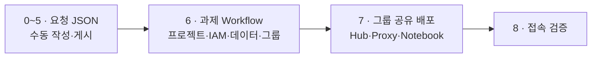

# 03 · 2차 Sandbox 구축

[1차 인프라 구축](../02.infra-setup/infra-setup-commend.md)을 완료한 후 진행합니다.

## 배포 흐름

포털이 승인 JSON을 자동으로 게시하기 전까지, **0~5번은 개발자가 수동으로** 수행합니다. 6번부터는 포털이 호출할 자동화 구간이며, 지금은 같은 명령을 운영자가 직접 실행합니다.

| 단계 | 하는 일 | 지금 | 포털 개발 후 |
|---|---|---|---|
| 최초 1회 | 릴리스 게시, Workflow 등록, 그룹 계정 준비 | 운영자 | 운영자(동일) |
| 0~5 | 과제 요청 JSON 작성·게시·검증 | **개발자 수동** | 포털 자동 |
| 6 | 과제 Workflow 실행 → 프로젝트·IAM·데이터·그룹 생성 | 운영자 | 포털 자동 |
| 7 | 그룹 공유 배포 → Hub·Proxy·Notebook | 운영자 | 포털 자동 |
| 8 | 접속 검증 | 개발자 | 개발자 |



**구성 단위** · Hub와 Proxy는 **그룹당 1개**입니다. 과제를 추가해도 Hub는 늘지 않고 Namespace와 Notebook Pod만 늘어납니다. 접속 호스트도 그룹당 하나입니다.

**수행 위치** · `infra-son01`의 Test02 저장소 루트
**수행 계정** · `son@sonmap.net`

---

## 최초 1회 · 플랫폼 준비

그룹을 처음 만들 때와 Runner 버전을 바꿀 때만 실행합니다. 이미 끝났으면 [0번](#0-실행-환경-확인)으로 바로 갑니다.

### A. 플랫폼 릴리스 게시

배포에 쓸 Terraform ZIP과 Runner·Provisioner 이미지를 게시합니다.

```bash
cd "$HOME/GCP_SBX_Test02-fresh"
export SBX_GKE_PROJECT="gcp-sbx-edp-gke01"
export ADMIN_ACCOUNT="son@sonmap.net"
export REGION="asia-northeast3"
export TF_MANAGER="tf-manager@${SBX_GKE_PROJECT}.iam.gserviceaccount.com"
export TF_MANAGER_RESOURCE="projects/${SBX_GKE_PROJECT}/serviceAccounts/${TF_MANAGER}"
export BUILD_STAGING_BUCKET="${SBX_GKE_PROJECT}-sbxtest01-build-source"
unset CLOUDSDK_AUTH_IMPERSONATE_SERVICE_ACCOUNT

export COMMIT_SHA="$(git rev-parse HEAD)"
export RELEASE_ID="git-$(git rev-parse --short=12 HEAD)"
echo "RELEASE_ID=$RELEASE_ID"
git status --porcelain
```

> **확인** · `RELEASE_ID`가 이번에 배포할 커밋의 값인지, `git status --porcelain`이 비어 있는지 봅니다. 소스를 고친 뒤 커밋하지 않으면 **이전 릴리스가 그대로 다시 게시되어** 수정이 반영되지 않습니다.

```bash
gcloud builds submit . --project="$SBX_GKE_PROJECT" --region="$REGION" \
  --account="$ADMIN_ACCOUNT" --impersonate-service-account="$TF_MANAGER" \
  --service-account="$TF_MANAGER_RESOURCE" \
  --gcs-source-staging-dir="gs://${BUILD_STAGING_BUCKET}/source" \
  --config=03.sandbox_deploy/03.3.gke/cloudbuild/platform-release.yaml \
  --substitutions="_RELEASE_ID=${RELEASE_ID},_COMMIT_SHA=${COMMIT_SHA}"
```

`SUCCESS` 후 게시된 ZIP에 의도한 수정이 들어갔는지 확인합니다.

```bash
gcloud storage cat \
  "gs://${SBX_GKE_PROJECT}-sbxtest01-bundles/platform-releases/${RELEASE_ID}/release.json" \
  --account="$ADMIN_ACCOUNT"
```

`provisioner-env.yaml`에 `__SET_CUSTOMER_ID__`가 남아 있으면 빌드가 실패합니다. 실제 Workspace customer ID로 바꿔 커밋한 뒤 다시 게시합니다.

### B. 그룹 공유 Workflow 등록

```bash
export SBX_MANAGER="sbx-manager@${SBX_GKE_PROJECT}.iam.gserviceaccount.com"
export REQUEST_BUCKET="${SBX_GKE_PROJECT}-sbxtest01-requests"
export WORKFLOW="workflow-sbx-shared-group"
export AR_REPO="${REGION}-docker.pkg.dev/${SBX_GKE_PROJECT}/ar-sbxtest01-platform"
export RUNNER_IMAGE="${AR_REPO}/sbxtest01-automation-runner:shared-$(git rev-parse --short=12 HEAD)"
export WORKER_POOL="projects/${SBX_GKE_PROJECT}/locations/${REGION}/workerPools/pool-sbxtest01"

gcloud builds submit . --project="$SBX_GKE_PROJECT" --region="$REGION" \
  --account="$ADMIN_ACCOUNT" --impersonate-service-account="$TF_MANAGER" \
  --service-account="$TF_MANAGER_RESOURCE" \
  --gcs-source-staging-dir="gs://${BUILD_STAGING_BUCKET}/source" \
  --config=03.sandbox_deploy/03.3.gke/cloudbuild/shared-group-runner.yaml \
  --substitutions="_RUNNER_IMAGE=$RUNNER_IMAGE"

gcloud workflows deploy "$WORKFLOW" --project="$SBX_GKE_PROJECT" \
  --location="$REGION" --account="$ADMIN_ACCOUNT" --impersonate-service-account="$TF_MANAGER" \
  --service-account="$SBX_MANAGER" \
  --source=03.sandbox_deploy/03.1.request/shared-group-workflow.yaml \
  --set-env-vars="SBX_REGION=$REGION,SBX_RUNNER_SA=$TF_MANAGER_RESOURCE,SBX_RUNNER_IMAGE=$RUNNER_IMAGE,SBX_WORKER_POOL=$WORKER_POOL,SBX_GKE_CLUSTER=gke-sbx-main-an3,SBX_GKE_ENDPOINT_MODE=dns,SBX_REQUEST_BUCKET=$REQUEST_BUCKET,SBX_CHART_URI=oci://$AR_REPO/jupyterhub,SBX_CHART_VERSION=4.2.0,SBX_URL_MAP=urlmap-alb-sbxtest01-shared"

gcloud workflows describe "$WORKFLOW" --project="$SBX_GKE_PROJECT" \
  --location="$REGION" --account="$ADMIN_ACCOUNT" --format='value(state)'
```

`ACTIVE`가 나오면 완료입니다.

### C. 그룹 계정과 Secret 준비

그룹 공유 경로는 Google OAuth가 아니라 **Hub 로컬 로그인**을 씁니다. 승인된 이메일을 로그인 ID로 쓰고 비밀번호 해시로 검증합니다.

```bash
export GROUP="sandbox-group-01"
export GROUP_CONFIG="$HOME/.sandbox-approvals/$GROUP/group.json"
export HASH_FILE="$HOME/.sandbox-approvals/$GROUP/accounts.json"
export ACCOUNT_SECRET="shared-test-accounts-$GROUP"

mkdir -p -m 700 "$(dirname "$GROUP_CONFIG")"
```

그룹 JSON을 작성합니다. 과제 하나당 **멤버는 정확히 5명**이어야 합니다(과제 Pod 안에서 멤버별 컨테이너 5개를 실행하는 구조).

```bash
cat > "$GROUP_CONFIG" <<'JSON'
{
  "group": "sandbox-group-01",
  "domain": "jupyter-group01.sonmap.net",
  "test_accounts_secret": "shared-test-accounts-sandbox-group-01",
  "platform_registry": "asia-northeast3-docker.pkg.dev/gcp-sbx-edp-gke01/ar-sbxtest01-platform",
  "tasks": {
    "sbx04": {
      "members": [
        "user01@sonmap.net",
        "user02@sonmap.net",
        "user03@sonmap.net",
        "user04@sonmap.net",
        "user05@sonmap.net"
      ],
      "gsa": "gsa-jupyter-sbx04@gcp-sbx-edp-sbx04.iam.gserviceaccount.com",
      "image": "asia-northeast3-docker.pkg.dev/gcp-sbx-edp-gke01/ar-sbxtest01-platform/jupyterhub-k8s-singleuser-standard@sha256:...",
      "uid": 1000,
      "gid": 100,
      "storage": { "claim": "notebook-home", "sub_path": "sbx04" }
    }
  }
}
JSON
```

`domain`은 1차에서 준비한 **그룹 호스트**이며 인증서 SAN과 같아야 합니다. `image`의 digest는 아래로 조회합니다.

```bash
gcloud artifacts docker images list "$AR_REPO" --include-tags \
  --account="$ADMIN_ACCOUNT" --format='table(package,tags,version)' | grep singleuser-standard
```

비밀번호 해시를 만들고 Secret에 등록합니다. 비밀번호는 12자 이상입니다.

```bash
python3 03.sandbox_deploy/03.3.gke/shared-group/prepare_test_accounts.py "$GROUP_CONFIG" "$HASH_FILE"

gcloud secrets create "$ACCOUNT_SECRET" --replication-policy=automatic \
  --project="$SBX_GKE_PROJECT" --account="$ADMIN_ACCOUNT"
gcloud secrets add-iam-policy-binding "$ACCOUNT_SECRET" \
  --member="serviceAccount:$TF_MANAGER" --role=roles/secretmanager.secretAccessor \
  --project="$SBX_GKE_PROJECT" --account="$ADMIN_ACCOUNT"
gcloud secrets versions add "$ACCOUNT_SECRET" --data-file="$HASH_FILE" \
  --project="$SBX_GKE_PROJECT" --account="$ADMIN_ACCOUNT"
```

해시 파일과 비밀번호는 승인 JSON과 Git에 넣지 않습니다.

---

## 0. 실행 환경 확인

### 0-1. 변수 선언

**모든 단계가 같은 셸 변수를 씁니다.** 터미널이 바뀌면 변수가 사라져 엉뚱한 과제에 배포하거나 `412` 오류가 납니다. 아래를 파일로 저장해 두고 터미널을 새로 열 때마다 `source` 합니다.

```bash
cd "$HOME/GCP_SBX_Test02-fresh"
mkdir -p .local

cat > .local/env.sh <<'SH'
export SBX_GKE_PROJECT="gcp-sbx-edp-gke01"
export ADMIN_ACCOUNT="son@sonmap.net"
export REGION="asia-northeast3"
export TF_MANAGER="tf-manager@${SBX_GKE_PROJECT}.iam.gserviceaccount.com"
export REQUEST_BUCKET="${SBX_GKE_PROJECT}-sbxtest01-requests"
export BUNDLE_BUCKET="${SBX_GKE_PROJECT}-sbxtest01-bundles"
export WORKFLOW="workflow-sbx-shared-group"
export AR_REPO="${REGION}-docker.pkg.dev/${SBX_GKE_PROJECT}/ar-sbxtest01-platform"

# 과제 공통
export FOLDER_ID="154455658682"
export BILLING_ACCOUNT="019BE7-53DD39-AF5098"
export GKE_CLUSTER="gke-sbx-main-an3"

# 그룹
export GROUP="sandbox-group-01"
export GROUP_CONFIG="$HOME/.sandbox-approvals/$GROUP/group.json"

export KUBECONFIG="$HOME/.kube/config-sbx-dns"
export CLOUDSDK_CORE_ACCOUNT="$ADMIN_ACCOUNT"
SH

source .local/env.sh
```

### 0-2. 클러스터 상태 확인

```bash
kubectl get nodes
kubectl get storageclass standard-rwo
```

노드가 전부 `Ready`여야 합니다. `NotReady`이면 1차 문서의 [Private Google Access](../02.infra-setup/infra-setup-commend.md#0-private-google-access와-private-dns-선행-필수)가 적용되지 않은 상태입니다. 폐쇄망에서는 PGA 없이 노드가 기동하지 않습니다.

### 0-3. 과제 변수 선언

이번에 배포할 과제를 정합니다. **과제를 추가할 때는 이 블록만 바꿔 0~6을 다시 수행합니다.**

```bash
export TASK="sbx04"
export REQUEST_ID="REQ-$(date +%Y%m%d)-$(echo "$TASK" | tr a-z A-Z)-001"
export APPROVAL_ID="${REQUEST_ID}-TEST"
export APPROVED_AT="$(TZ=Asia/Seoul date --iso-8601=seconds)"
export EXPIRES_ON="2026-12-31"
export MEMBER1="user01@sonmap.net"
export MEMBER2="user02@sonmap.net"

echo "$TASK / $REQUEST_ID / $APPROVED_AT"
```

> **승인 기록** · 실제 승인이 있으면 `APPROVAL_ID`와 `APPROVED_AT`에 그 번호와 완료 시각을 넣습니다. 게시 명령은 `EXAMPLE-`로 시작하는 값을 거부합니다. `APPROVED_AT`은 시간대를 포함해야 하며, 미래 시각은 넣지 않습니다.

---

## 1. 릴리스 조회

배포에 쓸 Terraform 소스 버전을 고릅니다.

```bash
gcloud storage ls "gs://${BUNDLE_BUCKET}/platform-releases/*/release.json" \
  --account="$ADMIN_ACCOUNT"
```

사용할 릴리스 ID를 변수에 넣습니다.

```bash
export RELEASE_ID="git-0ce39d7333eb"
gcloud storage cat "gs://${BUNDLE_BUCKET}/platform-releases/${RELEASE_ID}/release.json" \
  --account="$ADMIN_ACCOUNT"
```

조회되지 않으면 [최초 1회 · A](#a-플랫폼-릴리스-게시)에서 먼저 게시합니다.

---

## 2. 요청 JSON 생성

누가 승인했고 어떤 자원을 어느 프로젝트에 만들지 기술합니다. 결과는 `.local/<요청 ID>.json`입니다.

```bash
REQUEST_FILE=".local/${REQUEST_ID}.json"

gcloud storage cp \
  "gs://${BUNDLE_BUCKET}/platform-releases/${RELEASE_ID}/release.json" \
  .local/release.json --account="$ADMIN_ACCOUNT" &&
jq -ne --slurpfile release .local/release.json '
  {
    schema_version: "1.0",
    action: "CREATE",
    request_id: env.REQUEST_ID,
    approval: {
      status: "APPROVED",
      approval_id: env.APPROVAL_ID,
      approved_at: env.APPROVED_AT
    },
    task: {
      name: env.TASK,
      display_name: ("Sandbox " + env.TASK),
      expires_on: env.EXPIRES_ON
    },
    identity: {
      group_email: ("pgrp-gcp-dev-" + env.TASK + "@sonmap.net"),
      members: [env.MEMBER1, env.MEMBER2],
      create_jupyter_gsa: true
    },
    project: {
      create_project: true,
      project_id: ("gcp-sbx-edp-" + env.TASK),
      project_name: ("Sandbox " + env.TASK),
      billing_account: env.BILLING_ACCOUNT,
      folder_id: env.FOLDER_ID
    },
    network: {
      required: false,
      host_project_id: "gcp-prod-edp-hub-vpchost",
      network_name: "vpc-prod-edp-hub",
      region: env.REGION,
      shared_vpc_join: false
    },
    data: {
      bigquery_dataset: (env.TASK + "_main"),
      gcs_bucket: ("gcp-sbx-edp-" + env.TASK + "-" + env.TASK + "-data")
    },
    gke: {
      project_id: env.SBX_GKE_PROJECT,
      cluster_name: env.GKE_CLUSTER,
      location: env.REGION,
      namespace: env.TASK,
      jupyter_domain: "jupyter-group01.sonmap.net"
    },
    source: ($release[0] | {release_id, archive_uri, generation, sha256})
  }
' > "$REQUEST_FILE" &&
jq '{request_id, task, identity, project, source: .source.release_id}' "$REQUEST_FILE"
```

> **`folder_id`를 씁니다.** `tf-manager`의 프로젝트 생성 권한은 조직이 아니라 **Folder**에 부여되어 있습니다. `org_id`를 넣으면 프로젝트 생성이 `resourcemanager.projects.create denied on organizations/...`로 실패합니다. 둘 중 하나만 지정해야 하므로 `org_id`는 넣지 않습니다.

> **그룹을 이미 만들었다면** · 디렉터리에 `pgrp-gcp-dev-<과제>@sonmap.net`이 이미 있으면 Terraform이 생성을 시도하다 충돌합니다. 그룹을 지우고 진행하거나, `identity.group_resource_name`에 `groups/<ID>`를 넣어 import합니다.

---

## 3. 승인 요청 게시

Workflow가 읽을 승인 원본을 GCS에 올립니다. 같은 ID가 이미 있으면 덮어쓰지 않습니다.

```bash
REQUEST_URI="gs://${REQUEST_BUCKET}/approved/${REQUEST_ID}/request.json"

jq -e '
  [
    if (.request_id == env.REQUEST_ID) then empty else "REQUEST_ID" end,
    if (.approval.status == "APPROVED") then empty else "approval.status" end,
    if ((.approval.approval_id | type == "string" and . == env.APPROVAL_ID
      and test("^[^[:space:]].{2,127}$") and (startswith("EXAMPLE-") | not))) then empty else "APPROVAL_ID" end,
    if ((.approval.approved_at | type == "string" and . == env.APPROVED_AT
      and test("^[0-9]{4}-[0-9]{2}-[0-9]{2}T[0-9]{2}:[0-9]{2}:[0-9]{2}(\\.[0-9]+)?(Z|[+-][0-9]{2}:[0-9]{2})$"))) then empty else "APPROVED_AT" end,
    if ((.task.expires_on | type == "string" and . == env.EXPIRES_ON and test("^[0-9]{4}-[0-9]{2}-[0-9]{2}$"))) then empty else "EXPIRES_ON" end,
    if ((.identity.members | . == [env.MEMBER1, env.MEMBER2])) then empty else "MEMBER1 / MEMBER2" end,
    if ((.source.release_id | type == "string" and . == env.RELEASE_ID)) then empty else "RELEASE_ID" end
  ] | if length == 0 then true else error("확인할 항목: " + join(", ")) end
' "$REQUEST_FILE" &&
gcloud storage cp --if-generation-match=0 "$REQUEST_FILE" "$REQUEST_URI" \
  --account="$ADMIN_ACCOUNT"
```

`true`와 복사 성공을 모두 확인한 뒤 4번으로 갑니다.

> **`412 pre-conditions ... did not hold`** · 같은 `REQUEST_ID`가 이미 게시되어 있다는 뜻이며, 오류가 아니라 중복 방지입니다. 복사 로그의 경로에서 **어느 과제의 ID인지 먼저 확인합니다.** 내용이 같으면 그대로 4번으로 진행하고, 내용을 바꾼 재시도이면 `REQUEST_ID`의 끝 번호를 올린 뒤 2번부터 다시 수행합니다.

---

## 4. Workflow 입력 검증

게시된 객체의 특정 세대를 내려받아 대조하고, Workflow에 넘길 입력을 만듭니다.

```bash
rm -f .local/workflow-input.json &&
REQUEST_GENERATION="$(gcloud storage objects describe "$REQUEST_URI" --account="$ADMIN_ACCOUNT" --format='value(generation)')" &&
gcloud storage cp "${REQUEST_URI}#${REQUEST_GENERATION}" .local/published.json --account="$ADMIN_ACCOUNT" &&
cmp "$REQUEST_FILE" .local/published.json &&
jq -e --arg task "$TASK" '
  .request_id == env.REQUEST_ID and .approval.status == "APPROVED"
  and .task.name == $task
  and .project.project_id == ("gcp-sbx-edp-" + $task)
' .local/published.json &&
REQUEST_SHA256="$(sha256sum .local/published.json | cut -d ' ' -f1)" &&
jq -n --arg id "$REQUEST_ID" --arg uri "$REQUEST_URI" --arg gen "$REQUEST_GENERATION" --arg sha "$REQUEST_SHA256" \
  '{request_id:$id,approved_json_uri:$uri,generation:($gen|tonumber),sha256:$sha}' \
  > .local/workflow-input.json &&
cat .local/workflow-input.json
```

`false`가 나오면 `TASK`와 `REQUEST_ID`가 서로 다른 과제를 가리키는 경우가 대부분입니다. 0-3으로 돌아가 변수를 맞춥니다.

---

## 5. 배포 전 확인

```bash
gcloud builds worker-pools describe pool-sbxtest01 \
  --project="$SBX_GKE_PROJECT" --region="$REGION" \
  --account="$ADMIN_ACCOUNT" --format='value(state)'

gcloud workflows describe workflow-sbxtest01-provision \
  --project="$SBX_GKE_PROJECT" --location="$REGION" \
  --account="$ADMIN_ACCOUNT" --format='value(state)'

gcloud infra-manager deployments list \
  --project="$SBX_GKE_PROJECT" --location="$REGION" \
  --account="$ADMIN_ACCOUNT" --format='table(name.basename(),state)'
```

Pool이 `RUNNING`, Workflow가 `ACTIVE`여야 합니다. 배포 목록에 이번 과제의 `FAILED` 항목이 남아 있으면 먼저 정리합니다. 상태만 지우고 실제 자원은 남깁니다.

```bash
gcloud infra-manager deployments delete "<FAILED 배포 이름>" \
  --project="$SBX_GKE_PROJECT" --location="$REGION" \
  --delete-policy=ABANDON --account="$ADMIN_ACCOUNT" --quiet
```

---

## 6. 과제 Workflow 실행

**포털이 자동화할 지점입니다.** 과제 프로젝트, IAM, BigQuery·GCS, Cloud Identity 그룹을 만듭니다.

```bash
test -s .local/workflow-input.json &&
gcloud workflows run workflow-sbxtest01-provision \
  --project="$SBX_GKE_PROJECT" --location="$REGION" \
  --account="$ADMIN_ACCOUNT" --data="$(cat .local/workflow-input.json)"
```

`SUCCEEDED`는 **접수**입니다. 실제 작업은 Cloud Build에서 진행되므로 결과를 따로 확인합니다.

```bash
gcloud builds list --project="$SBX_GKE_PROJECT" --region="$REGION" \
  --account="$ADMIN_ACCOUNT" --limit=5 --format='table(id,status,createTime)'
```

상위 빌드가 실패하면 로그에 적힌 **하위 빌드 ID**로 다시 조회해야 Terraform 오류가 보입니다.

```bash
gcloud builds log "<하위 빌드 ID>" --project="$SBX_GKE_PROJECT" --region="$REGION" \
  --account="$ADMIN_ACCOUNT" 2>&1 | tail -50
```

네 개 배포가 모두 `ACTIVE`이면 완료입니다.

```bash
gcloud infra-manager deployments list \
  --project="$SBX_GKE_PROJECT" --location="$REGION" \
  --account="$ADMIN_ACCOUNT" --format='table(name.basename(),state)'
```

> **과제별 Hub는 쓰지 않습니다.** 이 Workflow는 과제 Namespace에 Hub와 Proxy까지 배포합니다. 그룹 공유 구성에서는 불필요하므로 7번 전에 제거합니다. 남겨 두면 노드와 할당량을 점유합니다.
>
> ```bash
> helm list -A | grep "jupyterhub-${TASK}" && helm uninstall "jupyterhub-${TASK}" -n "$TASK"
> ```

---

## 7. 그룹 공유 배포

그룹 Hub·Proxy와 과제 Notebook, 내부 ALB 경로를 적용합니다.

### 7-1. 과제 Namespace와 PVC 준비

Workflow는 PVC를 만들지 않고 **이미 있는 것을 조회만** 합니다. 없으면 `kubectl -n <과제> get pvc notebook-home failed`로 중단됩니다.

```bash
kubectl get namespace "$TASK" >/dev/null 2>&1 || kubectl create namespace "$TASK"
kubectl label namespace "$TASK" "sandbox-group=$GROUP" --overwrite

kubectl -n "$TASK" get pvc notebook-home >/dev/null 2>&1 || cat <<YAML | kubectl apply -f -
apiVersion: v1
kind: PersistentVolumeClaim
metadata:
  name: notebook-home
  namespace: $TASK
spec:
  accessModes: ["ReadWriteOnce"]
  resources:
    requests:
      storage: 20Gi
  storageClassName: standard-rwo
YAML

kubectl -n "$TASK" get pvc
```

> **과제가 하나면 `standard-rwo`로 충분합니다.** 과제 Pod 하나만 볼륨을 쓰기 때문입니다. 여러 과제가 한 볼륨을 `sub_path`로 나눠 쓰는 구성으로 갈 때만 RWX(`standard-rwx`, Filestore)가 필요하며, Filestore는 최소 용량이 1TB라 비용이 크게 늘어납니다.

### 7-2. 그룹 JSON 게시와 실행

```bash
source .local/env.sh
GROUP_URI="gs://${REQUEST_BUCKET}/approved-groups/${GROUP}/group.json"

jq -e --arg group "$GROUP" '.group == $group' "$GROUP_CONFIG" >/dev/null &&
SHA256="$(sha256sum "$GROUP_CONFIG" | awk '{print $1}')" &&
gcloud storage cp "$GROUP_CONFIG" "$GROUP_URI" --account="$ADMIN_ACCOUNT" &&
GENERATION="$(gcloud storage objects describe "$GROUP_URI" --account="$ADMIN_ACCOUNT" --format='value(generation)')" &&
INPUT="$(jq -nc --arg group "$GROUP" --arg generation "$GENERATION" --arg sha256 "$SHA256" \
  '{group:$group,generation:$generation,sha256:$sha256}')" &&
echo "$INPUT" &&
gcloud workflows run "$WORKFLOW" --project="$SBX_GKE_PROJECT" \
  --location="$REGION" --account="$ADMIN_ACCOUNT" --data="$INPUT"
```

> **실행 중에는 Namespace·PVC·그룹을 건드리지 않습니다.** 배포가 도는 동안 삭제하면 상태 잠금이 깨져 다음 실행이 `Error acquiring the state lock`으로 실패합니다. 그때는 빌드가 모두 끝난 뒤 해당 Infra Manager 배포를 `ABANDON`으로 지우고 다시 실행합니다.

### 7-3. 결과 확인

```bash
gcloud builds list --project="$SBX_GKE_PROJECT" --region="$REGION" \
  --account="$ADMIN_ACCOUNT" --limit=3 --format='table(id,status,createTime)'

kubectl -n "$GROUP" get pods,svc,svcneg
kubectl -n "$TASK" get pods,pvc
```

기대하는 상태입니다.

| 대상 | 상태 |
|---|---|
| `<그룹>` Hub | `1/1 Running` |
| `<그룹>` Proxy | `1/1 Running` |
| `<과제>` Notebook | `5/5 Running` (멤버 5명분 컨테이너) |
| `notebook-home` PVC | `Bound` |

ALB 백엔드도 확인합니다.

```bash
gcloud compute backend-services get-health "bes-jupyter-${GROUP}" \
  --project="$SBX_GKE_PROJECT" --region="$REGION" --account="$ADMIN_ACCOUNT"
```

> **`did not become HEALTHY ... health states=[]`** · NEG에 엔드포인트가 없다는 뜻입니다. Autopilot이 배포 도중 다른 존에 노드를 올려, 백엔드에 붙은 존과 Pod가 있는 존이 어긋난 경우입니다. 노드가 안정된 뒤 7-2를 다시 실행하면 양쪽 존 NEG가 모두 등록됩니다.

---

## 8. 접속 검증

1. 테스트 PC에서 그룹 호스트를 ALB VIP로 연결합니다. 사내 DNS 등록 전에는 `hosts` 파일로 대체할 수 있습니다.

   ```bash
   gcloud compute addresses describe ip-alb-sbxtest01-shared \
     --project="$SBX_GKE_PROJECT" --region="$REGION" \
     --account="$ADMIN_ACCOUNT" --format='value(address)'
   ```

   ```
   <VIP>  jupyter-group01.sonmap.net
   ```

2. 브라우저에서 `https://jupyter-group01.sonmap.net/hub/login`에 접속합니다.
3. 승인된 이메일과 [최초 1회 · C](#c-그룹-계정과-secret-준비)에서 정한 비밀번호로 로그인합니다. Google 로그인이 아닙니다.
4. 과제 Notebook을 시작하고 `/home/jupyter` 아래에 파일이 저장되는지 확인합니다.

자체 서명 인증서는 브라우저 경고가 뜹니다. 인증서 SAN이 그룹 호스트와 다르면 1차 문서의 [32-2](../02.infra-setup/infra-setup-commend.md)에서 다시 만듭니다.

---

## 과제 추가

기존 그룹에 과제를 더합니다. Hub와 Proxy는 그대로 두고 Namespace와 Notebook Pod만 늘어납니다.

1. [0-3](#0-3-과제-변수-선언)에서 `TASK`를 새 과제로 바꾸고 `REQUEST_ID`를 새로 만듭니다.
2. [2~6번](#2-요청-json-생성)을 그대로 수행합니다. 새 프로젝트·IAM·데이터·그룹이 생성됩니다.
3. 그룹 JSON의 `tasks`에 **기존 과제와 새 과제를 함께** 넣습니다. 새 과제만 남기면 기존 과제가 제거됩니다.

   ```bash
   jq '.tasks += {
     "sbx05": {
       "members": ["user06@sonmap.net","user07@sonmap.net","user08@sonmap.net","user09@sonmap.net","user10@sonmap.net"],
       "gsa": "gsa-jupyter-sbx05@gcp-sbx-edp-sbx05.iam.gserviceaccount.com",
       "image": "<AR digest>",
       "uid": 1000, "gid": 100,
       "storage": { "claim": "notebook-home", "sub_path": "sbx05" }
     }
   }' "$GROUP_CONFIG" > "$GROUP_CONFIG.tmp" && mv "$GROUP_CONFIG.tmp" "$GROUP_CONFIG"
   ```

4. 새 멤버의 비밀번호 해시를 추가하고 Secret 버전을 갱신합니다.
5. [7번](#7-그룹-공유-배포)을 다시 수행합니다.

그룹을 새로 만들 때는 [최초 1회 · C](#c-그룹-계정과-secret-준비)부터 시작하고, 그룹 호스트와 인증서를 따로 준비합니다.

---

## 중지와 재개

비용 절감을 위해 Pod만 0으로 줄입니다. 실행 중인 커널이 종료되므로 작업 파일을 먼저 저장합니다.

**중지** — 과제를 먼저 멈추고, 그룹을 쓰는 다른 과제가 없을 때만 Hub·Proxy를 내립니다.

```bash
source .local/env.sh
python3 03.sandbox_deploy/03.3.gke/shared-group/shared_sandbox.py \
  "$GROUP_CONFIG" stop "$TASK" --context "$(kubectl config current-context)" &&
kubectl -n "$GROUP" scale deployment/hub deployment/proxy --replicas=0
```

**재개** — Hub가 Proxy보다 먼저 뜨면 `api_request to the proxy failed`로 재시작을 반복하므로 **Proxy를 먼저** 올립니다.

```bash
kubectl -n "$GROUP" scale deployment/proxy --replicas=1 &&
kubectl -n "$GROUP" rollout status deployment/proxy --timeout=10m &&
kubectl -n "$GROUP" scale deployment/hub --replicas=1 &&
kubectl -n "$GROUP" rollout status deployment/hub --timeout=10m &&
python3 03.sandbox_deploy/03.3.gke/shared-group/shared_sandbox.py \
  "$GROUP_CONFIG" start "$TASK" --context "$(kubectl config current-context)" &&
kubectl -n "$TASK" rollout status deployment/notebook --timeout=10m &&
kubectl -n "$TASK" get pods,pvc
```

Pod를 0으로 줄여도 내부 ALB와 영구 디스크에는 비용이 계속 발생합니다.

---

## 자주 막히는 지점

| 증상 | 원인 | 조치 |
|---|---|---|
| 노드 `NotReady`, 파드 `Pending` | PGA 미설정으로 `gcr.io`가 공인 IP로 해석 | 1차 문서 2-2의 Private Google Access 적용 |
| 그룹 생성이 20분 뒤 `got pending status "not found"` | `tf-manager`에 Workspace 그룹스 관리자 역할 없음 | admin.google.com → 관리자 역할 → 그룹스 관리자 → 서비스 계정 할당 |
| `resourcemanager.projects.create denied on organizations/...` | 요청 JSON이 `org_id`를 부모로 지정 | `folder_id`로 바꾸고 `org_id` 제거 |
| 게시에서 `412` | 같은 `REQUEST_ID`가 이미 있음 | 내용이 같으면 그대로 진행, 다르면 ID 끝 번호를 올려 재작성 |
| `kubectl get pvc notebook-home failed` | 과제 Namespace에 PVC 없음 | [7-1](#7-1-과제-namespace와-pvc-준비) 수행 |
| `Error acquiring the state lock` | 배포 중 자원을 삭제해 잠금이 깨짐 | 빌드 종료 확인 후 해당 배포를 `ABANDON`으로 삭제하고 재실행 |
| 백엔드가 `HEALTHY`가 되지 않고 `health states=[]` | NEG 존과 Pod 존 불일치 | 노드 안정 후 7-2 재실행 |
| Hub가 `CrashLoopBackOff`, 로그에 `status code 599` | Proxy가 없거나 아직 기동 전 | Proxy를 먼저 올린 뒤 Hub 기동 |

---

## 폴더 구성

| 폴더 | 용도 |
|---|---|
| [03.1.request](03.1.request/) | 승인 JSON 규격, Workflows, 요청 API |
| [03.2.terraform](03.2.terraform/) | 프로젝트·IAM·데이터·그룹 Terraform |
| [03.3.gke](03.3.gke/) | Runner, 그룹 공유 배포, Cloud Build, Notebook 이미지 |

기존 과제별 Hub 구성은 [기존 Workflows 배포](03.1.request/legacy-deploy.md)를 참고합니다.
