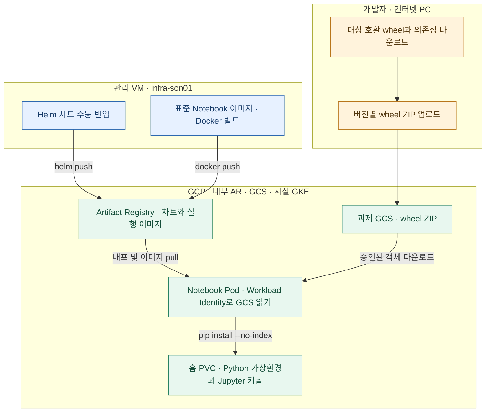

# 사용자 Notebook 표준 이미지

표준 이미지는 내부 sample 이미지에 gcloud/git/jq와 pandas/pyarrow/BigQuery/GCS 라이브러리를 추가합니다. 빌드 명령은 [관리 VM의 표준 이미지 빌드 명령](../01.docs/01-infra-setup.md#7-notebook-표준-이미지-빌드)를 참고하세요.

이미지 태그 `4.2.0-r2-home`은 사용자의 PVC를 `/home/{username}`에 마운트하고, 시작 스크립트가 같은 경로를 `HOME`과 작업 디렉터리로 사용합니다. 예를 들어 `user01`은 `/home/user01`에서 시작합니다. 컨테이너의 Linux 실행 계정은 이미지의 `jovyan`을 사용하므로 기존 PVC의 UID와 권한을 유지합니다.

## 기존 sbx03에 적용

관리 VM에서 [표준 이미지 빌드·검증·게시](../01.docs/01-infra-setup.md#7-notebook-표준-이미지-빌드)를 마칩니다. 아래 절차는 기존 과제별 Hub 릴리스 `jupyterhub-sbx03`용입니다. 그룹 공유 PoC는 과제 JSON의 `image`에 게시된 digest를 지정합니다.

빌드가 성공하면 Helm 레지스트리에 로그인합니다.

```bash
gcloud auth print-access-token --account=son@sonmap.net | helm registry login asia-northeast3-docker.pkg.dev --username oauth2accesstoken --password-stdin
```

기존 Helm 설정을 사용하면서 사용자 이미지와 홈 설정을 적용합니다.

```bash
CLOUDSDK_CORE_ACCOUNT=son@sonmap.net helm upgrade jupyterhub-sbx03 \
  oci://asia-northeast3-docker.pkg.dev/gcp-sbx-edp-gke01/ar-sbxtest01-platform/jupyterhub \
  --version=4.2.0 --namespace=sbx03 \
  --kubeconfig="$HOME/.kube/config-sbx-dns" \
  --reuse-values --atomic --timeout=15m \
  --set-string singleuser.image.tag=4.2.0-r2-home \
  --set-string 'singleuser.storage.homeMountPath=/home/{username}' \
  --set-string 'singleuser.extraEnv.SANDBOX_NOTEBOOK_HOME=/home/{username}' \
  --set-string 'singleuser.cmd[0]=/usr/local/bin/start-sandbox-notebook'
```

사용자는 작업을 저장한 뒤 JupyterHub에서 서버를 중지하고 다시 시작합니다. 새 Pod의 JupyterLab 터미널에서 `printf '%s\n' "$HOME"; pwd`를 실행합니다. user01의 예상 경로는 `/home/user01`입니다. 기존 홈 파일은 동일한 PVC에서 열립니다.

신규 과제 자동 배포에는 이 소스로 빌드한 배포 runner 릴리스가 필요합니다.

## 표준 이미지 wheel 반입

`infra-son01`에서 표준 이미지의 APT 설치와 Docker 빌드를 수행합니다. VM에서 접근 가능한 Python 인덱스로 전체 의존성이 해결되면 인덱스 설치를 사용합니다. 일부 패키지가 막혀 있으면 승인된 인터넷 PC에서 표준 이미지와 같은 OS·CPU 아키텍처·Python 버전의 환경을 사용해 의존성을 포함한 wheel 모음을 준비합니다.

```bash
STANDARD_WHEELS="$(mktemp -d)"
python -m pip download --only-binary=:all: --dest "$STANDARD_WHEELS" -r 04.Jupiter-setup-image/requirements.txt
```

승인된 경로로 wheel 파일을 관리 VM의 Test02 저장소 `04.Jupiter-setup-image/wheelhouse/`에 전달합니다. 해당 빌드 전용 디렉터리를 사용하고 이전 반입 파일이 섞이지 않도록 확인합니다. 관리 VM에서 `NOTEBOOK_PIP_MODE=wheelhouse`로 빌드하면 Dockerfile이 이 파일들로 Python 설치를 수행합니다. 대상에 맞는 wheel이 없는 패키지는 승인된 대상 호환 빌드 환경에서 wheel을 준비해야 합니다.

## 개발자 추가 패키지 GCS 경유

표준 이미지는 운영자가 관리합니다. 개발자는 필요한 추가 Python 패키지를 버전별 GCS 경로로 전달해 자신의 Notebook 가상환경에 설치합니다.



| 위치 | 준비 사항 |
|---|---|
| 개발자 인터넷 PC | 대상 Notebook과 호환되는 Linux 환경과 Python을 사용합니다. 업로드에는 과제 버킷의 승인 경로에 새 객체를 만들 수 있는 권한이 필요합니다. |
| 과제 GCS | 승인된 전용 버킷 또는 관리 폴더에 과제·개발자·버전별 경로를 사용합니다. |
| Notebook Pod | Workload Identity로 연결된 과제 GSA에 해당 객체 읽기 권한이 필요합니다. 예를 들어 승인 범위에 `roles/storage.objectViewer`를 적용합니다. 사설망에서 Cloud Storage API에 접근할 수 있어야 합니다. |
| 사용자 홈 PVC | 가상환경과 커널을 사용자 홈에 저장합니다. Pod 재기동 시 같은 PVC와 호환되는 베이스 이미지가 필요합니다. |

**1. 인터넷 PC에서 wheel을 받아 GCS에 업로드합니다.**

먼저 Notebook에서 `python -m pip debug --verbose`로 Python 버전과 호환 태그를 확인합니다. 인터넷 PC가 Windows·macOS이면 대상과 일치하는 Linux VM이나 컨테이너에서 wheel을 내려받습니다. 예시 버킷과 경로, 패키지 버전은 승인된 값으로 바꿉니다. 이미 게시된 경로에 다시 올리려면 새 버전 경로를 사용합니다. `ipykernel`과 설치에 필요한 의존성도 함께 반입합니다.

```bash
WHEEL_OBJECT=gs://YOUR-APPROVED-BUCKET/notebook-wheels/sbx01/user01/20261113-v1/wheels.zip
WHEEL_WORK="$(mktemp -d)"
python -m pip download --only-binary=:all: --dest "$WHEEL_WORK/wheels" 'ipykernel==6.29.5' 'scikit-learn==1.6.1'
(cd "$WHEEL_WORK/wheels" && python -m zipfile -c "$WHEEL_WORK/wheels.zip" ./*.whl)
gcloud storage cp --if-generation-match=0 "$WHEEL_WORK/wheels.zip" "$WHEEL_OBJECT"
```

**2. Notebook 터미널에서 읽고 홈 PVC의 가상환경에 설치합니다.**

인터넷 PC와 같은 `WHEEL_OBJECT` 값을 설정합니다. 아래 예시는 표준 이미지의 `gcloud`를 사용합니다. 다른 이미지에 CLI가 없으면 승인된 Cloud Storage 클라이언트 또는 표준 이미지를 사용합니다. 터미널에서 `HOME`이 과제 PVC 아래의 사용자 홈인지 확인한 뒤 실행합니다.

```bash
WHEEL_OBJECT=gs://YOUR-APPROVED-BUCKET/notebook-wheels/sbx01/user01/20261113-v1/wheels.zip
WHEEL_WORK="$(mktemp -d)"
VENV="$HOME/.venvs/sbx01-20261113-v1"
gcloud storage cp "$WHEEL_OBJECT" "$WHEEL_WORK/wheels.zip"
python -m zipfile -e "$WHEEL_WORK/wheels.zip" "$WHEEL_WORK/wheels"
python -m venv --system-site-packages "$VENV"
"$VENV/bin/python" -m pip --isolated install --no-index --find-links="$WHEEL_WORK/wheels" --only-binary=:all: 'ipykernel==6.29.5' 'scikit-learn==1.6.1'
"$VENV/bin/python" -m pip check
"$VENV/bin/python" -m ipykernel install --user --name sbx01-20261113-v1 --display-name "Python (sbx01 20261113-v1)"
```

각 명령이 성공한 뒤 다음 명령을 실행합니다. Notebook에서 새 커널을 선택하고 `import sklearn`을 실행해 확인합니다. 가상환경은 `--system-site-packages`로 공통 이미지의 기존 라이브러리도 볼 수 있습니다. 추가 패키지는 해당 사용자 환경에 설치되며 공용 이미지에 반영하려면 운영자가 새 이미지를 빌드합니다.

## Notebook 이미지 운영 릴리스

그룹 공유 PoC의 승인 이미지가 준비된 이후, 운영 이관이 있을 때만 사용합니다.

| 파일 | 실행 시점과 역할 |
|---|---|
| [release-image.sh](release-image.sh) | 운영자가 승인한 기존 이미지 digest에 운영 태그를 붙입니다. 태그가 다른 digest를 가리키면 종료합니다. |
| [Dockerfile.release](Dockerfile.release) | 승인된 라이브러리 변경이 있을 때 베이스 이미지와 해시가 포함된 `requirements.lock`으로 후보 이미지를 만듭니다. |
| [notebook-candidate-release.yaml](../03.cloudbuild/notebook-candidate-release.yaml) | 운영자가 후보 이미지 빌드를 Cloud Build에 제출할 때 읽는 설정입니다. |

이미지 내용이 같으면 Central-1 또는 승인된 운영 환경에서 태그만 게시합니다. 릴리스마다 새 버전 태그를 지정합니다. 동시 릴리스 충돌은 AR immutable tags 또는 포털의 단일 승인 실행으로 관리합니다.

```bash
bash 04.Jupiter-setup-image/release-image.sh "$APPROVED_IMAGE_DIGEST" "$RELEASE_TAG"
```

라이브러리가 바뀌면 승인된 빌드 컨텍스트에 해시가 포함된 `requirements.lock`을 준비합니다. 다음 예시에서 `APPROVED_BUILD_CONTEXT`는 그 디렉터리입니다. 후보 태그로 빌드하고 GKE에서 검증한 새 digest에 운영 태그를 붙입니다.

```bash
cp 04.Jupiter-setup-image/Dockerfile.release "$APPROVED_BUILD_CONTEXT/Dockerfile.release"
gcloud builds submit "$APPROVED_BUILD_CONTEXT" \
  --project="$BUILD_PROJECT" --region=asia-northeast3 \
  --config=03.cloudbuild/notebook-candidate-release.yaml \
  --substitutions="_BASE_IMAGE=$APPROVED_BASE_DIGEST,_CANDIDATE_IMAGE=$CANDIDATE_TAG,_NOTEBOOK_UID=1000"
```
