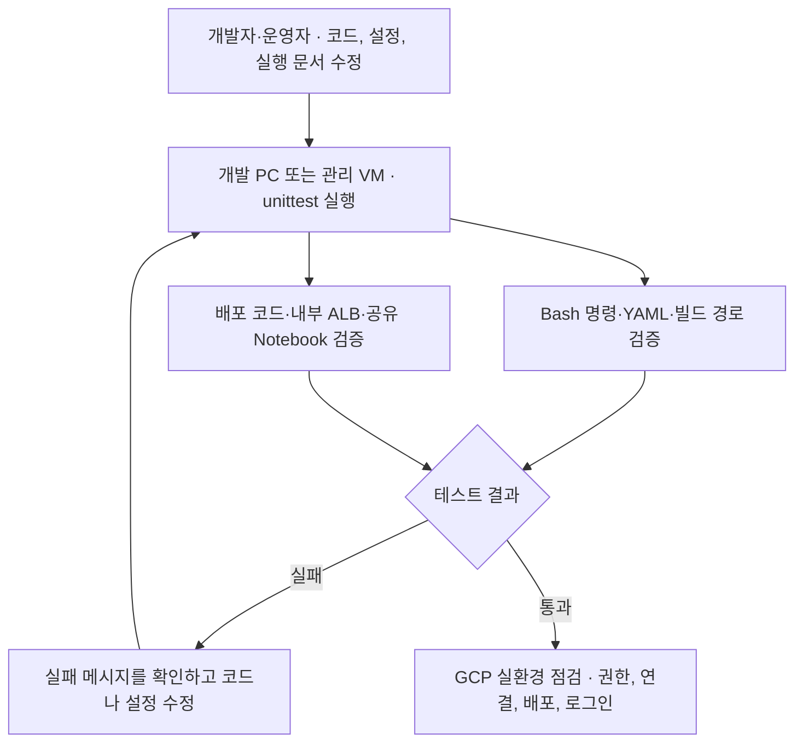

# Test02 로컬 검증

코드·YAML·실행 문서를 수정한 뒤, 배포에 필요한 명령과 설정이 서로 맞는지 로컬에서 확인합니다. 실제 운영 작업은 [1차 인프라 구축](../01.docs/01-infra-setup.md), [Workflows 과제 배포](../01.docs/02-sandbox-deploy.md) 또는 [그룹 공유 PoC](../12.sandbox_shared/README.md)에서 시작합니다.

## 검증 흐름



## 파일별 역할

| 파일 | 개수 | 확인하는 내용 |
|---|---:|---|
| [test_build_paths.py](test_build_paths.py) | 2 | Cloud Build의 Docker 빌드 디렉터리와 `COPY` 파일 경로, 삭제된 구성요소의 참조 |
| [test_commandbooks.py](test_commandbooks.py) | 7 | 인프라 문서의 Bash 구문, 변수 확장, Workflow URL 치환, YAML 경로와 공통 프로젝트 설정 |
| [test_internal_alb.py](test_internal_alb.py) | 6 | 리전 내부 ALB의 헬스 체크·백엔드·URL Map, KSA와 GSA 연결, 오류 분류 |
| [test_provisioning.py](test_provisioning.py) | 12 | 과제 요청 검증, Terraform 배포 ZIP, Build 실행 계정·그룹 구성 순서 |
| [test_release_bootstrap.py](test_release_bootstrap.py) | 2 | Cloud Identity Customer ID 검사와 플랫폼 릴리스의 소스 게시 설정 |
| [test_shared_sandbox.py](test_shared_sandbox.py) | 7 | 5인 공유 Notebook Pod, 기존·신규 PVC, 로컬 테스트 계정, 과제 중지 시 PVC 보존 명령 |

[fixtures/group.example.json](fixtures/group.example.json)은 공유 Notebook 테스트의 입력 예시입니다. 배포할 때 운영자는 실제 승인값으로 작성한 그룹 JSON의 경로를 `GROUP_CONFIG`에 지정합니다.

## 실행 명령

Test02 저장소 루트에서 Bash와 Python 3.12를 사용합니다. 의존성 설치는 접근 가능한 Python 패키지 인덱스를 사용합니다. 테스트는 GCP 명령을 모의 실행하므로 GCP 로그인이나 실행 중인 GKE는 필요 없습니다.

```bash
python3 -m venv .local/test-venv
.local/test-venv/bin/python -m pip install -r requirements-dev.txt
.local/test-venv/bin/python -m unittest discover -s 11.tests -v
```

특정 파일만 확인하려면 패턴을 지정합니다.

```bash
.local/test-venv/bin/python -m unittest discover -s 11.tests -p 'test_shared_sandbox.py' -v
```

전체 테스트는 **36개**입니다. `OK`가 나오면 로컬 검증을 통과한 것입니다. 실제 GCP IAM·네트워크 연결, GKE 배포·브라우저 로그인, Pod 재기동 후 파일 보존은 실환경에서 확인합니다.
