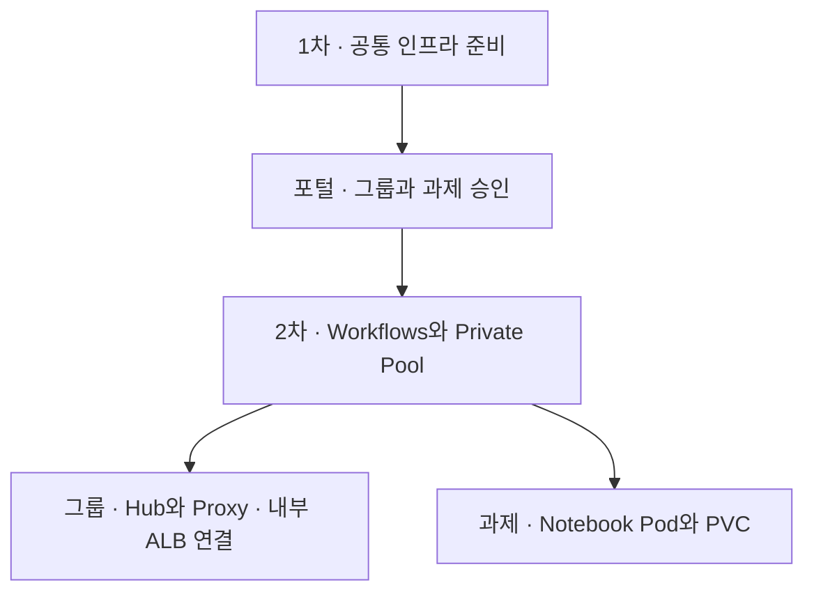

# GCP Sandbox Test02

| 단계 | 시작 문서 | 수행 내용 |
|---|---|---|
| 1차 · 공통 인프라 | [infra-setup-commend.md](02.infra-setup/infra-setup-commend.md) | 관리 VM에서 Shared VPC·GKE·내부 ALB·Artifact Registry와 Notebook 이미지를 준비합니다. |
| 2차 · Sandbox 구축 | [03.sandbox_deploy](03.sandbox_deploy/README.md) | 포털 승인 후 Workflows가 그룹 Hub·Proxy와 과제별 Notebook 배포를 시작합니다. |

[참고 문서](02.infra-setup/reference/) · [저장소 테스트](04.tests/README.md)
