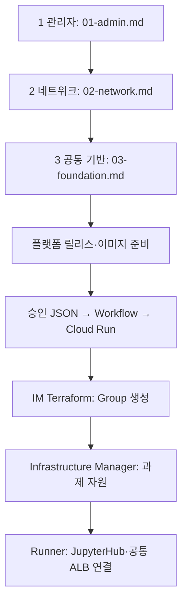

**[Git 최신 설정 동기화·현재 단계 재개](01.docs/reference/git-sync-current-environment.md)** — 로컬 Customer ID를 보존하고, 프로젝트 치환 없이 Private Pool 점검을 실행합니다.

> 신규 프로젝트·과제 전용 GSA 생성은 [sbx03 신규 과제 절차](01.docs/reference/sbx03-new-project-runbook.md)를 우선 적용합니다. 기존 프로젝트 재사용 절차와 구분하세요.

**[현재 실환경: 개별 명령 작업 가이드](01.docs/reference/operator-command-guide.md)** — `gcp-sbx-edp-gke01` 기반 실제 수행 순서·계정 구분·오류 해결·미완료 확인사항. 현재 환경에서는 이 가이드의 값을 우선 사용하세요. 관련 기본값도 현재 환경으로 동기화했습니다.

# GCP_SBX_Test01

> **[서브넷별 IAM](02.sandbox_setup_01_gcloud/02-subnet-iam.md)**: VPC Admin이 네트워크를 준비한 뒤 GKE·ALB VIP 서브넷에 필요한 계정만 사용 권한을 부여합니다. 이후 tf-manager로 내부 ALB를 구성합니다.

> **[내부 사설 ALB 설계](01.docs/reference/internal-alb-design.md)**: ALB·VIP는 gcp-sbx-edp-gke01, /27 VIP Subnet과 최소 /26 프록시 Subnet은 Shared VPC Host에 둡니다. 후보 CIDR은 VPC Admin 승인 후 적용합니다.

> **[IP 최소화 구성](01.docs/reference/minimal-ip-design.md)**: Cloud Run·과제별 서브넷은 기본 생성하지 않고, 기존 GKE·Private Pool PSA를 유지·재사용합니다.

**[프로젝트·서브넷·Private Pool·GCP 자원 설계표](01.docs/reference/network-resource-design.md)** — 기존 과제 SBX 프로젝트 재사용 기준입니다.

> **프로젝트 통합:** GKE·Build·Workflows·AR·GCS·Run·IM과 두 서비스 계정을 모두 **gcp-sbx-edp-gke01**에 구성합니다. [통합 자원·실행 순서·기존 배포 확인](01.docs/reference/tf-manager-project.md)

## tf-manager 소속 프로젝트

Terraform·Build 실행 계정은 **tf-manager@gcp-sbx-edp-gke01.iam.gserviceaccount.com**입니다. 두 서비스 계정과 Build·Infrastructure Manager·AR·GCS·Run·Workflow·GKE는 모두 SBX_GKE_PROJECT 하나에 구성합니다. [통합 프로젝트 구성과 사전 준비](01.docs/reference/tf-manager-project.md)을 확인하세요.

> **현재 작업 기준:** 공통 인프라는 작업자가 개별 gcloud 명령으로 구축합니다. 과제는 포털이 GCS에 저장한 승인 JSON을 대상으로 작업자가 [Deploy 명령](02.sandbox_setup_01_gcloud/05-deploy.md)을 실행합니다. GCS 이벤트 자동 시작·포털 결과 자동 전달은 추후 적용하며 현재 필수 구축 단계가 아닙니다. 기존 Deploy 내부의 API·Build·Terraform·GKE 처리 코드는 사용합니다.

**[작업 순서 Mermaid + 단계별 실행 문서·폴더 링크](01.docs/reference/work-order.md)** — 최초 준비와 운영 자동화 순서를 여기서 확인하세요.

## 프로젝트 기준과 변수명

이 작업의 주 대상은 **SBX_GKE_PROJECT=gcp-sbx-edp-gke01**입니다. 공통 GKE와 Sandbox의 JupyterHub·Notebook Pod가 이 프로젝트에서 실행됩니다. 자동화 실행·이미지 보관은 SBX_GKE_PROJECT, Shared VPC는 VPC_HOST_PROJECT, 과제의 데이터·Query Job 자원은 SBX_PROJECT에 둡니다.

```bash
export SBX_GKE_PROJECT="gcp-sbx-edp-gke01"          # 주 대상: Sandbox GKE
export SBX_NAME="sbx01"                      # 과제·Namespace 이름
export VPC_HOST_PROJECT="gcp-prod-edp-hub-vpchost"   # Shared VPC
export SBX_PROJECT="pjt-net-hub-base"         # 과제 자원·Query Job
```

변수명은 대소문자를 구분합니다. SBX_GKE_PROJECT를 모든 자동화·GKE 자원의 공통 프로젝트 변수로 사용합니다. Cloud Run API와 Build 배포 코드 사이의 실행 환경변수도 SBX_GKE_PROJECT로 통일했습니다. Cloud Build 사용자 치환 변수는 형식 제약에 맞춰 _SBX_GKE_PROJECT를 사용합니다. Cloud Run 설정과 API·배포 도구 이미지는 함께 갱신해야 합니다. JSON의 project.project_id·gke.project_id와 Terraform 입력 필드명은 포털 요청 규격이므로 유지합니다.

승인 JSON으로 GKE Jupyter Sandbox를 만드는 테스트 저장소입니다. **최초 구축 1~3단계는 Terraform 대신 gcloud**, 사용자 관리 서비스 계정은 **두 개**를 사용합니다.

**처음 실행할 때는 [01.docs 시작 안내](01.docs/README.md)와 [실제 수행 절차](01.docs/reference/runbook-two-stage.md)를 먼저 여세요.** 실행 계정·명령·성공 기준을 단계별로 정리했습니다.

## 폴더 번호와 작업 우선순위

| 순서 | 폴더 | 주 작업 |
|---|---|---|
| 01 | `01.docs/` | 실행 설명서·구성도 먼저 확인 |
| 02 | `02.sandbox_setup_01_gcloud/` | 최초 인프라·권한 준비 |
| 03 | `03.cloudbuild/` | 실행 이미지 빌드·릴리스·미러링 준비 |
| 04 | `04.Jupiter-setup-image/` | 사용자 Notebook 이미지 준비 |
| 05 | `05.sandbox_json/` | 과제 신청 JSON 작성 |
| 06 | `06.sandbox_json_rules/` | 신청 JSON 필수 항목·허용값 검사 |
| 07 | `07.sandbox_request_api/` | Cloud Run에서 신청 접수·배포 시작 |
| 08 | `08.sandbox_setup_02_terraform/` | 과제 프로젝트·IAM·Dataset·GCS 구성 |
| 09 | `09.sandbox_gke_deployer/` | GKE·JupyterHub 설치·ALB 연결 |
| 10 | `10.sandbox_deploy_tools/` | 위 작업에서 공통으로 쓰는 보조 도구 |
| 11 | `11.tests/` | 변경 사항 검증 |

번호는 **문서 확인 → 기반 준비 → 신청 처리 → 과제 배포**의 주 작업 흐름입니다. Cloud Build는 필요한 API/배포 도구 이미지를 준비 단계에서 함께 빌드하고, 이후 API·Terraform·GKE 모듈을 자동으로 호출합니다. 보조 도구는 각 단계에서 재사용하며 테스트는 변경 후·배포 전에 실행합니다.

각 단계의 실제 명령 순서는 [실행 설명서](01.docs/reference/runbook-two-stage.md)를 따릅니다. 아래 인프라 명령 문서는 코드 블록 맨 앞에 필요한 변수 선언을 포함합니다.

| 단계 | 작업 | 개별 명령어 |
|---|---|---|
| 준비 | 공통 변수 설정 | [00-variables.md](02.sandbox_setup_01_gcloud/00-variables.md) |
| 1 | 관리자 권한·서비스 계정 | [01-admin.md](02.sandbox_setup_01_gcloud/01-admin.md) |
| 2 | Shared VPC·서브넷·PSA·방화벽 | [02-network.md](02.sandbox_setup_01_gcloud/02-network.md) |
| 3 | Cloud Run·Cloud Build·GKE·Workflow·ALB | [03-foundation.md](02.sandbox_setup_01_gcloud/03-foundation.md) |
| 이후 과제별 | 프로젝트·IAM·BigQuery·GCS | Infrastructure Manager의 Terraform |

**1~3단계는 개별 gcloud 명령을 한 줄씩 복사하여 실행합니다.** Python 통합 실행기와 config.json은 제거했습니다. 전체 실행 스크립트·--apply 모드는 없습니다. 조회 결과를 확인하고 없는 자원만 생성합니다.

```bash
git clone https://github.com/sonmap/GCP_SBX_Test01.git
cd GCP_SBX_Test01
```

[공통 변수](02.sandbox_setup_01_gcloud/00-variables.md)를 같은 터미널에 설정한 후 1 → 2 → 3 순서로 진행합니다. 최신 Google Cloud CLI와 Bash가 필요합니다. 1~3단계 명령 실행에는 Python·Terraform 설치가 필요하지 않습니다. Cloud Build/Run/Workflows용 YAML은 [`02.sandbox_setup_01_gcloud/configs/`](02.sandbox_setup_01_gcloud/configs)에 있습니다. 이후 과제별 자동화의 Python 프로그램은 유지합니다.

| 표시 이름 | 실제 서비스 계정 ID | 용도 |
|---|---|---|
| sbx_manager | sbx-manager | 요청 처리·Workflow·Notebook |
| tf_manager | tf-manager | 기반 구축·Build·Infrastructure Manager·GKE·ALB |

밑줄은 GCP 서비스 계정 ID에 사용할 수 없어 실제 ID는 하이픈으로 지정했습니다. Google 서비스 에이전트/노드 기본 SA와 Kubernetes KSA는 별도입니다.

**계정 통합으로 Notebook도 요청 처리 계정의 권한을 공유합니다. 과제별 데이터 격리와 제어 계정 격리가 없는 신뢰 사용자 PoC용입니다.** [권한·전환 범위](01.docs/reference/architecture-and-operations.md)를 확인하세요.



- [전체 파일 관계](01.docs/reference/file-relationships.md)
- [파일별 설명](01.docs/reference/file-catalog.md)
- [실행 절차](01.docs/reference/runbook-two-stage.md)
- [권한·기존 환경 전환](01.docs/reference/architecture-and-operations.md)
- [Private Pool ↔ GKE VPN 설계](01.docs/reference/cloudbuild-private-gke-vpn-design.md)

원본: `sonmap/Gcp_Managed_GKE_GIT_ETC_09` @ `4f0cae91c6483380b4e2fb2b705a63129db395eb`.
원본 저장소는 수정하지 않았습니다. 이 저장소의 변경만으로 GCP 자원이 생성되지는 않습니다.

관리자 준비 작업은 [개별 gcloud 실행 문서](02.sandbox_setup_01_gcloud/04-manual-gcloud.md)를 사용합니다. shell 실행 없이 OAuth 등록·릴리스·미러링·Notebook 빌드를 수행합니다. 과제 요청은 포털→GCS가 운영 기준이며, 수동 요청 제출은 연동 시험용입니다. GCS 이벤트 시작과 배포 결과의 포털 전달은 추가 구현 대상입니다.
